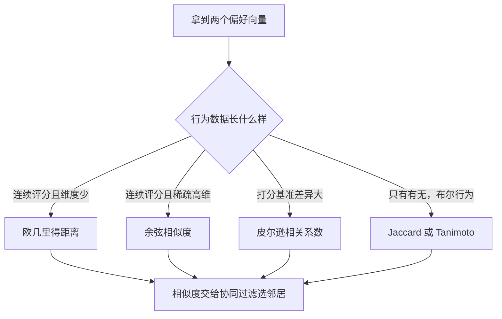

# 相似度算法：欧氏距离、余弦相似度、皮尔逊相关系数与 Jaccard

无论基于用户的推荐还是基于商品的推荐，第一步都是找到相似的用户或相似的商品：没有相似度就选不出邻居，后面的推荐无从谈起。所以「用什么算法算出两个商品比较相似、两个用户比较相似」就成了关键问题。课程把常见算法摆在桌面上：欧几里得距离、皮尔逊相关系数、基于夹角余弦的相似度、Tanimoto 系数。学习目标不是推导公式，而是弄清每种算法的语义，好在调整推荐效果时能换算法、调参数，让推荐结果更准确。

## 先给结论

- 相似度算法是协同过滤的尺子，度量的是两个偏好向量像不像。
- 欧氏距离衡量点的远近，距离越小相似度越大，适合维度不多、量纲一致的稠密评分。
- 余弦相似度衡量方向的吻合程度，不看长短只看夹角，适合稀疏高维的评分向量。
- 皮尔逊相关系数相当于先中心化再算余弦，能消除「有人习惯打高分」的打分基准差异。
- Tanimoto 系数与 Jaccard 同源，面向集合与布尔行为，交集除以并集就是相似度。
- 实现不必自己推导，常用库已内置；重点是根据场景选算法、调参数。

## 一、欧几里得距离：离得近就是相似

欧几里得距离算的是多维空间中两个点的直线距离，公式从二维推广到 n 维：

```text
二维：d = √( (x1 - y1)² + (x2 - y2)² )
三维：在二维基础上再加一项 (x3 - y3)²
n 维：d = √( Σ(xi - yi)² )，i 取 1 到 n
```

课程以二维空间为例画出一张「偏好空间」散点图：六位用户（Snakes、Toby、LaSalle、Rose、Matthews、Seymour）对两件商品打分，横轴是一件商品的评价，纵轴是另一件商品的评价，每位用户成为平面上的一个点。评价高的用户落在坐标值大的一侧，评价低的落在另一侧。评价接近的两位用户落在一起，点与点的距离短，说明他们对这两件商品的喜好程度接近；评价悬殊的两位用户隔得远，相似度就低。

多维情形需要一点想象力：把每个维度想成一件商品，维度上的取值是用户对该商品的评价，公式照旧逐维累加。结论一句话：**欧氏距离越小，两个用户的相似度越大；距离越大，相似度越小。**

## 二、余弦相似度：方向一致就是相似

把用户对每件商品的评价排成向量，两个向量的夹角反映偏好模式：夹角小，说明两人对各商品的相对喜好吻合；夹角大，方向就不太一样了。公式按画面记录：

```text
cos(x, y) = (x · y) / (|x| · |y|) = Σ(xi · yi) / ( √Σxi² · √Σyi² )
```

分子是两个向量的内积，分母把向量各自的长度归一掉，所以余弦只看方向、不看长短。举例：用户甲对两件商品打 5 分和 1 分，用户乙打 4 分和 1 分，两人方向几乎一致，余弦值接近 1；就算乙把分数整体缩成 2 和 0.5，比例没变，余弦照样接近 1，它度量的是「口味比例」一致。

与欧氏距离对照着分工：欧氏比的是绝对距离，分值接近才相似，适合量纲一致、数据密集的场合；余弦比的是相对方向，偏好比例接近就相似，评分稀疏、维度高时更稳。两把尺子量的东西不同，选错会得出相反的结论。

## 三、皮尔逊与 Jaccard：补上另外两把尺子

**皮尔逊相关系数解决打分基准差异。** 有人习惯打高分，有人手紧只肯打低分：甲打 `4, 5, 4`，乙打 `2, 3, 2`，两人的打分模式完全一致，欧氏距离却给出不小的值，余弦也会偏向量级大的一方。皮尔逊的做法是先把每个人的打分减去他自己的均值，再做相关计算，衡量「两个偏好是否同涨同跌」，取值范围负 1 到 1。用户打分苛刻度参差不齐的评分场景，这把尺子最常用。

**Jaccard（Tanimoto）系数面向集合与布尔行为。** 很多场景没有评分，只有「有没有」：买没买过、点没点赞、有没有打过某个标签。此时用户偏好是一个集合，相似度定义为交集大小除以并集大小。举例：用户 1 的偏好集合是 `{A, C, D}`，用户 2 是 `{A, B, C}`，交集 `{A, C}` 有 2 个元素，并集 `{A, B, C, D}` 有 4 个，相似度 0.5。课程清单里的 Tanimoto 系数在布尔取值下与 Jaccard 等价，实值向量上还能推广为逐位取小除以逐位取大，思路仍是交并比。

## 四、选型决策与实现



这张图把选型收敛成一个问题：行为数据长什么样。连续评分走距离与夹角一族，布尔行为走交并比一族，打分习惯参差不齐就交给皮尔逊。

实现层面不必自行推导，常用库都有现成函数。资料包无本课源码，下面的示例按本课写法补全，三种度量一次实现：

```java
package com.study.tanhua.spark.similarity;

import java.util.*;

/**
 * 相似度计算示例，示例为按本课写法补全
 */
public class SimilarityDemo {

    //欧几里得距离：越小越相似
    public static double euclidean(double[] x, double[] y) {
        double sum = 0;
        for (int i = 0; i < x.length; i++) {
            sum += Math.pow(x[i] - y[i], 2);
        }
        return Math.sqrt(sum);
    }

    //余弦相似度：越大越相似，理论取值负 1 到 1
    public static double cosine(double[] x, double[] y) {
        double dot = 0, normX = 0, normY = 0;
        for (int i = 0; i < x.length; i++) {
            dot += x[i] * y[i];
            normX += x[i] * x[i];
            normY += y[i] * y[i];
        }
        return dot / (Math.sqrt(normX) * Math.sqrt(normY));
    }

    //Jaccard 相似度：交集大小除以并集大小
    public static double jaccard(String[] a, String[] b) {
        Set<String> sa = new HashSet<>(Arrays.asList(a));
        Set<String> sb = new HashSet<>(Arrays.asList(b));
        Set<String> union = new HashSet<>(sa);
        union.addAll(sb);
        Set<String> inter = new HashSet<>(sa);
        inter.retainAll(sb);
        return (double) inter.size() / union.size();
    }

    public static void main(String[] args) {
        double[] u1 = {5, 1}; //用户甲对两件商品的评价
        double[] u2 = {4, 1}; //用户乙
        System.out.println(euclidean(u1, u2)); //1.0，两点很近
        System.out.println(cosine(u1, u2));    //约 0.999，方向几乎一致
        System.out.println(jaccard(new String[]{"A", "C", "D"},
                new String[]{"A", "B", "C"}));  //0.5
    }
}
```

调推荐效果时，相似度层面有两个旋钮可拧：换相似度算法，或者对度量本身调整，比如把距离做 `1 / (1 + d)` 转换映射到 0 到 1 区间、给余弦加热门物品惩罚。旋钮拧完要靠离线评估指标验证，而不是凭感觉。

## 常见误区

- **余弦高就断定口味相同。** 错例：`5, 1` 与 `50, 10` 的余弦为 1，但两人的绝对量级差十倍。正解：余弦只看比例方向，关心绝对分值时要配合欧氏距离或中心化处理。
- **拿距离值直接当相似度。** 错例：距离 3.2 与 2.7 直接比大小，且各维度量纲不统一。正解：常做 `1 / (1 + d)` 转换到 0 到 1 区间，量纲不一致先归一化再算。
- **稀疏数据上用欧氏距离。** 错例：千人千物矩阵里两个用户共同评分的物品很少，欧氏距离只由这几条重叠记录决定，噪声大。正解：稀疏高维场景用余弦或皮尔逊，必要时先补全缺失评分。
- **把 Tanimoto 与 Jaccard 当成毫无关系的两种方法。** 错例：以为名字不同就不能互相替换。正解：布尔取值下两者相等，都是交并比思路，差别只在 Tanimoto 能推广到实值向量。

## 面试可能被问到的问题

1. 面试官追问：「常见的相似度算法有哪些，分别怎么理解？」
   答：欧几里得距离算多维空间中两点的直线距离，越小越相似；余弦相似度算两个偏好向量的夹角，方向越一致越相似；皮尔逊相关系数中心化后算相关程度，能消除打分基准差异；Tanimoto 系数与 Jaccard 同源，交集除以并集，适合集合与布尔行为。
2. 面试官追问：「余弦相似度和欧氏距离怎么选？」
   答：看业务关心什么。关心绝对分值接近、数据稠密且量纲一致时用欧氏距离；关心偏好比例或方向一致、数据稀疏高维时用余弦。两者结论可能相反，选型前先明确业务含义。
3. 面试官追问：「皮尔逊相关系数解决了什么问题？」
   答：用户打分习惯不同，有人习惯打高分，有人只肯打低分，直接算距离或余弦会被量级带偏。皮尔逊先减去各自的均值做中心化，再算相关程度，衡量同涨同跌的模式，消除打分基准差异。
4. 面试官追问：「Jaccard 相似度怎么算，适合什么数据？」
   答：交集大小除以并集大小。适合只有有无、没有程度的数据，比如是否购买、是否点赞、是否打过标签；布尔场景下 Tanimoto 系数与它等价。
5. 面试官追问：「调推荐效果时，相似度层面能做什么？」
   答：一是换相似度算法，二是对度量本身调整，例如距离转相似度的函数、热度惩罚、时间衰减；调整后用离线评估指标对比效果，避免凭感觉换算法。

## 配套资料

- 学习目标：`materials/code/07/day07 探花交友-SparkMLlib推荐系统快速入门/day07/学习目标.md`，其中「了解相似度算法」对应本课内容。
- 说明：day07 资料包无本课源码，相似度计算示例为按本课画面与主流写法补全；欧氏距离公式、余弦公式与「偏好空间」散点图来自课程画面。
