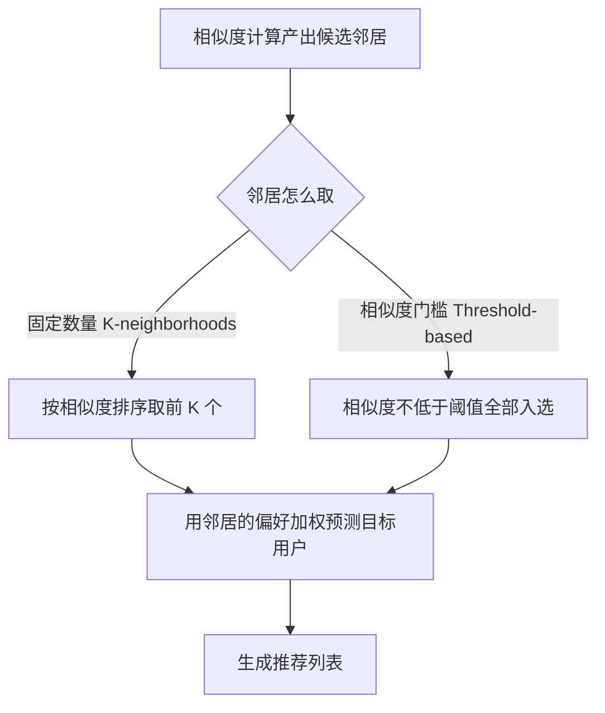

# 最近邻域：相似度算出一大堆邻居，到底取几个当参考

相似度计算跑完，一个目标用户往往能关联出几百个相似用户、几千件相似商品，候选邻居一大把。全都拿来当参考，弱相关项会把推荐结果稀释成一锅平均粥；只挑一个最相似的，又把宝押在单个样本上。最近邻域要回答的正是这个问题：邻居取多少、按什么规则取。这一课只有 1 分 43 秒，是个纯概念课，但它是协同过滤落地的最后一环，理解到位才好往下走。

## 先给结论

- 相似度计算产出大量候选邻居，推荐只取其中一部分作参考，这就是最近邻域。
- 两种常用取法：固定数量的邻居 K-neighborhoods，取最相似的前 K 个；基于相似度门槛的邻居 Threshold-based neighborhoods，相似度达到阈值就全部入选。
- K 与阈值是效果旋钮：K 太小易被个别噪声支配，太大把弱相关邻居混进来稀释结果；阈值太严冷门用户可能没有邻居，太松失去过滤意义。
- KNN 是协同过滤的底层取数机制：基于用户的推荐取最相似的 K 个用户加权预测，基于商品的推荐取与目标物品最相似的 K 件物品。
- 邻居由相似度算出，与好友、关注这类社交关系是两回事。

## 一、两种取法

课程把问题拆成两张图。图 A 是 K-neighborhoods：以节点 1 为中心，与它相连的邻居有节点 2 到 7，除自身外最近的有 7 个；固定选 5 个，就取相似度最高的 5 个作为推荐参考，不管它们的相似度绝对值是多少。图 B 是 Threshold-based neighborhoods：画一个相似度门槛的圆，圆内的节点 2 到 7 全部入选，圆外的节点 1、8、9、10 全部排除，入选数量由数据自己决定。



这张图讲的是邻居选取在推荐链路中的位置：相似度先给出候选池，取法决定谁进参考集合，最后用邻居的偏好加权出预测结果。

两种取法各有脾气，列成表看：

| 选法 | 规则 | 优点 | 风险 |
| --- | --- | --- | --- |
| 固定数量 K-neighborhoods | 不管相似度绝对值，取前 K 个 | 邻居数量稳定，计算量可控 | 相似度普遍偏低时也要凑满 K 个，混进弱相关邻居 |
| 相似度门槛 Threshold-based | 相似度达到阈值就入选 | 邻居质量有下限 | 阈值定得不合适时邻居可能过多，也可能一个都选不出来 |

## 二、K 值怎么影响结果

K 是这个环节最重要的参数。**K 太小，结果容易被噪声支配。** 极端情况 K 取 1，整个推荐押在唯一一个邻居身上：这个邻居刚好是异常用户或兴趣很偏的用户，推荐结果就整体跑偏。**K 太大，个性被稀释。** 邻居扩到几百个，大量弱相关用户的偏好加入加权平均，结果趋同于大众热门，推荐的个性化价值就没了。打个比方：问路只问一个人，他说错你就绕远；问一百个人，答案被平均成「往人多的方向走」，谁的方向都听不清。

阈值同样讲究。阈值设得高，冷门用户可能凑不出邻居，推荐链路断粮；设得低，门槛形同虚设，等于没过滤。K 没有万能值，常见做法是以离线评估指标为准来调，量级上从几十起步试验，再按业务表现微调。

## 三、与协同过滤的关系：KNN 在推荐里的样子

KNN 在机器学习课本里常以分类算法出现，推荐场景里它的角色更朴素：给预测找一个靠谱的参考集合。基于用户的推荐预测公式是典型用法：

```text
p(u, i) = Σ( sim(u, v) × r(v, i) ) / Σ sim(u, v)
```

目标用户 u 对物品 i 的预测偏好，等于他的邻居们对 i 的偏好按相似度加权平均，邻居 v 取自最近邻域。基于商品的推荐同理，只是参考集合换成与 i 最相似的 K 件物品。邻居选取的质量直接决定这个公式的下限：邻居选错了，加权算得再精细也救不回来。

选邻居的两种实现（资料包无本课源码，示例为按本课写法补全）：

```java
package com.study.tanhua.spark.knn;

import java.util.*;
import java.util.stream.Collectors;

/**
 * 最近邻域两种取法示例，示例为按本课写法补全
 * sims：候选邻居 -> 相似度
 */
public class KnnDemo {

    //方式一：固定数量，取相似度最高的前 K 个
    public static List<Long> topK(Map<Long, Double> sims, int k) {
        return sims.entrySet().stream()
                .sorted(Map.Entry.<Long, Double>comparingByValue().reversed())
                .limit(k)
                .map(Map.Entry::getKey)
                .collect(Collectors.toList());
    }

    //方式二：相似度门槛，不低于阈值的全部入选
    public static List<Long> byThreshold(Map<Long, Double> sims, double threshold) {
        return sims.entrySet().stream()
                .filter(e -> e.getValue() >= threshold)
                .sorted(Map.Entry.<Long, Double>comparingByValue().reversed())
                .map(Map.Entry::getKey)
                .collect(Collectors.toList());
    }

    //加权预测：sum sim * r / sum sim，邻居偏好按相似度加权
    public static double predict(Map<Long, Double> neighborSim,
                                 Map<Long, Double> neighborRating) {
        double num = 0, den = 0;
        for (Map.Entry<Long, Double> e : neighborSim.entrySet()) {
            num += e.getValue() * neighborRating.get(e.getKey());
            den += e.getValue();
        }
        return den == 0 ? 0 : num / den;
    }
}
```

拿一组数据感受旋钮的拧法：

```text
候选邻居相似度：用户2 = 0.9  用户3 = 0.8  用户4 = 0.4  用户5 = 0.2
固定 K = 2：用户2、用户3 入选
门槛 0.5：用户2、用户3 入选
门槛 0.1：四个邻居全部入选，弱相关的用户5 也混了进来
```

同一个候选池，参数拧在哪、拧多紧，参考集合就不一样。生产里两种取法还常组合使用：先按阈值过滤保证质量下限，再取前 K 控制数量上限。

## 四、day07 前半的拼图到这里收齐

到这里，day07 前半的理论线拼完整了：数据的容器是本地向量与各类分布式矩阵，骨架是推荐系统的业务流程，基于用户与基于商品的协同过滤提供两套找邻居的路由，用户偏好数据收集负责燃料，相似度算法是那把尺子，最近邻域决定参考谁。概念环环相扣，缺一环后面都跑不通。理论铺垫到此收官，接下来进入交替最小二乘法 ALS 的原理与实战，把推荐从概念推向可运行的代码。

## 常见误区

- **把推荐里的 KNN 与 KNN 分类划等号。** 错例：以为要给用户投票输出一个类别标签。正解：推荐里的 KNN 是选取参考邻居并加权预测偏好，输出的是物品与得分，不是类别。
- **K 越大越准。** 错例：把 K 拉到几百上千，以为参考越多越稳。正解：弱相关邻居会把结果拉向热门与平均，K 要靠离线评估来定，不是越大越好。
- **把邻居当好友。** 错例：直接拿关注关系当邻居集合。正解：邻居由相似度计算得出，与社交关系链无关；两者可以结合使用，但不能划等号。
- **设了阈值就不限数量。** 错例：热门用户相似度普遍达标，邻居上千个，预测变成大锅炖。正解：先按阈值过滤保质量，再取前 K 控数量，组合着用。

## 面试可能被问到的问题

1. 面试官追问：「什么是最近邻域，常用哪两种取法？」
   答：相似度计算会产出大量候选邻居，推荐只取其中一部分作参考，这就是最近邻域。常用取法两种：固定数量 K-neighborhoods 取相似度最高的前 K 个；相似度门槛 Threshold-based neighborhoods 取达到阈值的全部邻居。
2. 面试官追问：「K 值大小对推荐结果有什么影响？」
   答：K 太小，推荐被极少数邻居支配，容易被噪声带偏；K 太大，弱相关邻居加入加权平均，结果趋同热门、个性被稀释。K 没有万能值，通常以离线评估指标为准来调。
3. 面试官追问：「KNN 与协同过滤是什么关系？」
   答：KNN 是协同过滤选取参考集合的底层机制。基于用户的协同过滤用目标用户的 K 近邻偏好加权预测，基于商品的协同过滤用目标物品的 K 近邻相似物品加权打分，邻居质量决定预测下限。
4. 面试官追问：「固定数量和相似度门槛各有什么问题？」
   答：固定数量保证邻居数稳定，但相似度普遍偏低时也会凑满 K 个，混入弱相关邻居；相似度门槛保证质量下限，但阈值不当时邻居可能过多或为零。实践常先按阈值过滤再取前 K，组合使用。

## 配套资料

- 学习目标：`materials/code/07/day07 探花交友-SparkMLlib推荐系统快速入门/day07/学习目标.md`，其中「掌握基于用户的协同过滤算法」「了解相似度算法」等条目涵盖最近邻域这一概念。
- 说明：day07 资料包无本课源码，邻居选取与加权预测示例为按本课画面与主流写法补全。
