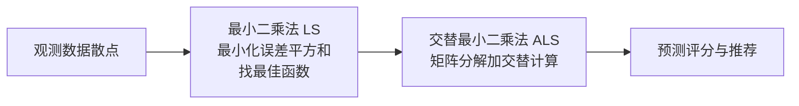

# 最小二乘法：ALS 推荐算法背后的拟合思想

在 Spark MLlib 的推荐算法名单里，ALS（交替最小二乘法）是个绕不开的名字。不少人第一次接触它时卡在名字上：交替什么？最小二乘又是什么？这一课先把名字里的「最小二乘法」讲透，它是 ALS 的数学地基，地基清楚了，后面的矩阵分解与交替迭代才有着力点。

## 先给结论

- ALS 即交替最小二乘法，是 Spark MLlib 提供的推荐算法，属于统计分析中常用的逼近计算：通过反复计算让结果尽可能逼近真实结果。
- ALS 的基础是最小二乘法 LS：通过最小化误差的平方和，寻找与数据匹配的最佳函数。
- 最小二乘法的直观理解：让所有样本点到拟合曲线的距离总和最小，这条曲线就是最佳函数匹配。
- 一维情形下拟合直线是 `f(x) = ax + b`，误差度量是 `δ = Σ(f(xi) - yi)^2`，让 δ 取到最小值，参数 a 与 b 就定下来了。
- 求出最佳函数后即可推算未知数据，再在数据之间寻找误差平方和最小的关联，就能算出比较相似的商品，推荐由此落地。

## 一、从 ALS 说起：名字里的渊源

ALS 是 Spark MLlib 中提供的一种推荐算法，全称 Alternating Least Squares，中文叫交替最小二乘法。它在统计分析中属于常用的逼近计算类算法，思路是把计算拆成一轮一轮的交替过程，每一轮的结果都比上一轮更接近真实值，直到足够接近为止。

从名字就能看出它的身世：交替最小二乘法是在最小二乘法的基础上演变出来的，最小二乘法简称 LS。LS 本身就是一种常用的机器学习算法，它做的事一句话能说清：通过最小化误差的平方和，寻找数据的最佳函数匹配。

两者的关系可以画成一条链：



这张图讲的是算法的演进关系：最小二乘法负责「给定函数形式，怎么拟合得最像」，ALS 在它之上引入矩阵分解与交替求解，负责「从评分矩阵里学出用户与商品的隐因子，再预测评分」。

## 二、最小二乘法要解决什么问题

现实中常遇到这样的场景：手里有一批观测点，希望找到一条曲线概括它们的规律，并据此推算没观测到的位置。以最简单的一维情形为例，把点画进二维空间，问题就变成：找一条直线，和这些点达到最佳匹配。

什么才叫「最佳匹配」？最小二乘法给出的答案朴素而有效：让这些点到直线的距离最小。距离越小，直线贴合数据越紧；所有候选直线里距离总和最小的那一条，就是我们要找的直线。

为什么不直接用误差的和，而要用误差的平方和？可以从三个角度理解。第一，偏差有正有负，直接相加会互相抵消，一条偏离得很厉害的直线可能算出很小的总偏差，平方之后正负不再抵消，偏离越多罚得越重。第二，平方函数处处可导，方便用求极值的方式解出直线的参数。第三，平方会放大较大的偏差，逼着拟合优先照顾偏离严重的点。这套度量方式决定了后面 ALS 优化的整个走向。

## 三、一维线性回归的推演

课程用一幅图演示这个过程：若干个点依次分布在向量空间中，目标是找出一条与它们最佳匹配的直线，最简单的办法就是让这些点到直线的距离最小，由此得出最小二乘法的公式。

```text
拟合直线（目标函数）：f(x) = a·x + b
误差平方和：          δ = Σ( f(xi) - yi )^2     i = 1, 2, …, n
```

两个式子分工明确。f(x) 是直线的拟合公式，也是所说的目标函数，它定义了「候选直线长什么样」，a 与 b 是待定参数。第二个公式负责打分：对每个观测点计算函数值 f(xi) 与真实值 yi 的差并平方，再对所有点求和，得到总偏差 δ。δ 越小，直线贴合得越好；让 δ 取到最小值的 a 与 b，对应的直线就是最佳函数。

拿三个点手推一遍，感受 δ 的作用（示例数据为按本课写法补全）：

```text
观测点：(1, 2)、(2, 4)、(3, 6)

候选直线 A：f(x) = 2x
  f(1)=2  偏差 0     f(2)=4  偏差 0     f(3)=6  偏差 0
  δ = 0² + 0² + 0² = 0

候选直线 B：f(x) = x + 1
  f(1)=2  偏差 0     f(2)=3  偏差 1     f(3)=4  偏差 2
  δ = 0² + 1² + 2² = 5

δ 越小越优：直线 A 的误差平方和为 0，最小二乘法选择 A。
```

换成代码，用标准的最小二乘公式直接解出 a 与 b（本课无配套源码，示例为按本课写法补全）：

```java
package com.study.tanhua.spark.ls;

/**
 * 一维最小二乘法：对点集 (xi, yi) 求拟合直线 f(x) = a*x + b
 */
public class LeastSquares {

    public static double[] fit(double[] x, double[] y) {
        int n = x.length;
        double mx = 0, my = 0;
        for (int i = 0; i < n; i++) { mx += x[i]; my += y[i]; }
        mx /= n; my /= n;

        double num = 0, den = 0;
        for (int i = 0; i < n; i++) {
            num += (x[i] - mx) * (y[i] - my);   //分子：Σ(xi-x平均)(yi-y平均)
            den += (x[i] - mx) * (x[i] - mx);   //分母：Σ(xi-x平均)的平方
        }
        double a = num / den;                   //斜率
        double b = my - a * mx;                 //截距
        return new double[]{a, b};
    }

    //误差平方和 δ = Σ(f(xi) - yi)的平方
    public static double sse(double[] x, double[] y, double a, double b) {
        double s = 0;
        for (int i = 0; i < x.length; i++) {
            double d = a * x[i] + b - y[i];
            s += d * d;
        }
        return s;
    }
}
```

对上面三个点调用 `fit`，得到的正是直线 A 的 `a = 2.0`、`b = 0.0`，`sse` 返回 0，与手算一致。

## 四、从拟合到推荐

最小二乘法之所以出现在推荐系统这一课，是因为它提供了「简便求得未知数据」的能力：在已知数据上拟合出最佳函数后，未知位置的取值可以直接用函数算出来。把这套思想搬进推荐：在已有评分数据上寻找让误差平方和最小的模型，模型给出的未知评分就是预测值，预测值高的商品就是候选推荐，从而计算出比较相似的商品并完成推荐。

ALS 把这个思想推到了矩阵层面：评分矩阵拆成两个小矩阵交替求解，每一次求解内部用的都是最小二乘法。矩阵怎么拆、「交替」两个字怎么落地，下一课展开。

## 常见误区

- **把最小二乘法当成推荐算法本身。** 错例：简历里写「用最小二乘法做推荐」。正解：最小二乘法是拟合工具，在 ALS 里负责固定一方时求出另一方；推荐算法是 ALS，最小二乘法是它的数学基础。
- **认为误差用绝对值之和等价于平方和。** 错例：觉得 Σ|f(xi) - yi| 与 Σ(f(xi) - yi)² 结果差不多。正解：平方和正负不抵消、处处可导、对大偏差惩罚更重，这些性质是求解极值与 ALS 迭代收敛的前提；绝对值在零点不可导，优化要麻烦得多。
- **认为拟合直线必须穿过每一个点。** 错例：看到直线没有贴到某些点，就断定拟合失败。正解：拟合是逼近不是复刻，允许偏差存在，目标只有一个，总偏差平方和最小。
- **盲目追求 δ 等于 0。** 错例：为了在训练数据上把 δ 压到 0 而不断加高模型复杂度。正解：教学例子里 δ 为 0 是巧合，真实数据带噪声，把训练误差压到 0 往往意味着过拟合；ALS 里用正则化参数 lambda 来约束模型，实战篇会再遇到它。

## 面试可能被问到的问题

1. 面试官追问：「什么是最小二乘法？」
   答：一种通过最小化误差平方和来寻找数据最佳函数匹配的机器学习算法。以一维线性拟合为例，目标函数是 f(x) = ax + b，误差度量是 δ = Σ(f(xi) - yi)²，让 δ 最小的那组参数对应的直线就是最佳拟合结果。
2. 面试官追问：「为什么用误差的平方和，而不是误差的绝对值之和？」
   答：平方和有三点优势，正负偏差不会抵消，能真实反映总偏离；处处可导，便于用求导取极值的方式解出参数；对大偏差惩罚更重，拟合优先照顾偏离严重的样本。绝对值在零点不可导，优化困难。
3. 面试官追问：「最小二乘法和 ALS 是什么关系？」
   答：ALS 是交替最小二乘法，建立在最小二乘法之上。它把评分矩阵分解为用户矩阵与物品矩阵，交替固定一方、用最小二乘法求解另一方，反复迭代让误差逼近最小，最终得到能预测评分的模型。
4. 面试官追问：「拟合直线 f(x) = ax + b 中的 a 和 b 是怎么定下来的？」
   答：把每个点到直线的偏差平方后求和得到 δ，δ 是关于 a、b 的函数，对 a、b 分别求偏导并令其为 0，解方程组即可得到使 δ 最小的参数值，这组参数对应的就是最佳拟合直线。

## 配套资料

- 学习目标：`materials/code/07/day07 探花交友-SparkMLlib推荐系统快速入门/day07/学习目标.md`，其中「了解交替最小二乘法的原理」「掌握 ALS 的实战」条目与本课对应。
- 说明：本课为 PPT 原理讲解，资料包无配套源码；最小二乘计算示例为按本课写法补全。
