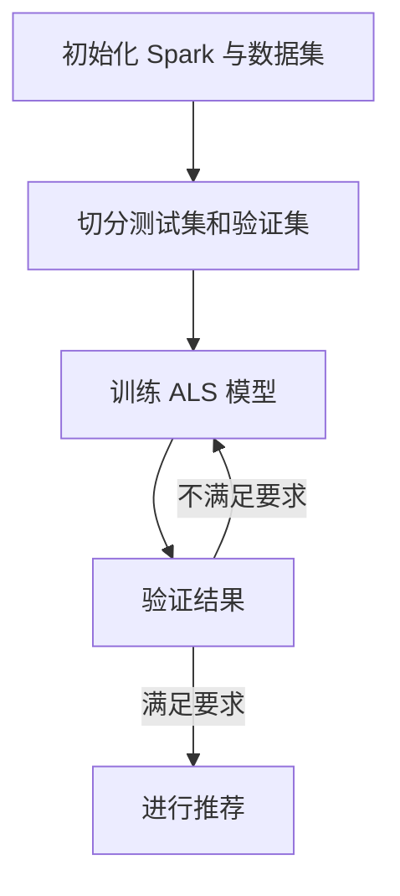

# ALS 算法流程：从初始化到推荐的调参闭环

原理清楚了，轮到工程落地。Spark MLlib 给出了现成的 ALS 实现，但模型不是调一次 API 就完事：数据怎么备、效果怎么验、参数怎么调，都需要一套固定打法。这一课把 Spark MLlib 中使用交替最小二乘法实现推荐的流程走一遍，流程不长，闭环思想是重点。

## 先给结论

- Spark MLlib 中用 ALS 做推荐的标准流程四步：初始化 Spark 与数据集、切分测试集与验证集、训练 ALS 模型、用验证集验证推荐结果。
- 验证满足要求就进入推荐环节；不满足要求就回到训练环节调整参数重新训练。这是一个带回环的闭环流程，不是一条走到黑的单行道。
- 调参主要围绕 rank（隐因子数）、iterations（最大迭代次数）、lambda（正则化参数）三个旋钮，课程讲义给出的经验值分别是 10 到 20 之间、10 次左右、0.01。
- 经验值只是起点：每个环境的最佳参数不同，必须用自己的数据实测调优，才能得到最匹配的组合。
- 切分数据是流程里最容易被轻视的一步：模型好不好，要用没参与训练的数据来验证。

## 一、四步主流程

课程用一张流程图给出全貌：



这张图讲的是 ALS 落地的完整闭环：从环境与数据出发，经过切分、训练、验证，达标进入推荐，不达标回到训练继续调。注意最后那条回环箭头，它是整个流程的灵魂，模型质量是「调」出来的，不是「跑」出来的。

四步各自的要点如下。

**初始化 Spark 与数据集。** Spark 运行环境与待用的评分数据是前提，环境决定算力，数据决定模型上限。没有环境跑不动训练，没有评分数据，一切无从谈起。

**切分测试集和验证集。** 从全量数据中留出一部分专门做测试与验证。训练集用来喂模型，测试与验证数据用来考模型，两份数据必须分开，考题绝不能混进平时的作业里。

**训练 ALS 模型。** 调用 MLlib 的 ALS 训练方法，对训练数据做矩阵分解，得到模型对象。训练这一步内部就是上一课讲的交替求解：固定一方求另一方，迭代到收敛或次数用尽。

**验证结果。** 用验证集检查模型的推荐效果：把验证集里的用户与商品喂给模型预测评分，与真实评分比对，看误差是否可接受。满足要求就投入推荐，不满足就带着调参结论回到训练环节。

## 二、验证不达标怎么办：调参闭环

验证不达标不是失败，而是常态，回到训练环节的依据是参数。课程在这里点了一句关键的话：训练 ALS 模型时有很多参数需要不断调优，调整为最匹配的参数用于最终推荐。三个最核心的旋钮在这里先认识一下，具体用法留到实战篇展开：

| 参数 | 含义 | 课程讲义经验值 |
| --- | --- | --- |
| rank | 模型中隐因子数 | 一般设定在 10 到 20 之间 |
| iterations | 最大迭代次数 | 一般 10 次左右 |
| lambda | 正则化参数 | 一般设置为 0.01 |

rank 决定矩阵分解的精细程度，iterations 决定交替求解的轮数上限，lambda 约束模型复杂度防止过拟合。经验值给的是量级参考，课程特别强调：每个人的运行环境与数据不同，最优值也不同，有人 10 次合适，有人 8 次、15 次更合适，必须通过测试得出自己环境里最准确的数值。

切分与验证的代码形态很朴素（本课无配套源码，示例为按本课写法补全，实战篇会给出完整上下文）：

```scala
package com.study.tanhua.spark.als

import org.apache.spark.mllib.recommendation.Rating
import org.apache.spark.rdd.RDD

object SplitDemo {

  //按 8 : 2 切分训练集与验证集，seed 固定保证可复现
  def split(ratings: RDD[Rating]): (RDD[Rating], RDD[Rating]) =
    ratings.randomSplit(Array(0.8, 0.2), seed = 11L)
}
```

```text
验证的最小闭环：
1. 用训练集调 ALS 训练，得到模型
2. 对验证集中每个 user 与 item 组合调 model.predict 算预测分
3. 预测分与真实评分比对，误差可接受则上线，否则调整 rank、iterations、lambda 重训
```

流程跑通之后，下一课就带着真实的 MovieLens ml-100k 数据，进入数据说明与数据建模的实战环节。

## 常见误区

- **跳过切分直接全量训练。** 错例：把全部评分喂给模型，训练完自己看几条预测就上线。正解：必须切分出独立的验证数据，模型在没见过的数据上的表现才代表真实水平。
- **把流程当成单行道。** 错例：训练一次，验证不达标就宣布 ALS 效果不行。正解：不达标的标准动作是回到训练环节调参重训，闭环转起来才叫完整跑过 ALS 流程。
- **把经验值当圣旨。** 错例：rank 固定写 10，iterations 固定写 10，从不做对比实验。正解：经验值只是起点，每个环境与数据集的最优组合不同，要用离线评估实测。
- **只盯误差不看业务。** 错例：误差指标降了就认为模型更好。正解：误差要结合推荐业务的表现一起看，误差小不等于用户点开推荐的概率高，最终以业务效果为准。

## 面试可能被问到的问题

1. 面试官追问：「描述一下用 Spark MLlib 做 ALS 推荐的流程。」
   答：四步闭环。初始化 Spark 环境与评分数据；切分测试集与验证集；用训练数据训练 ALS 模型；用验证集验证推荐结果，满足要求进入推荐，不满足回到训练环节调参重训。
2. 面试官追问：「为什么必须切分验证集？」
   答：模型在训练数据上的表现不代表泛化能力，只有用没参与训练的数据验证，误差才可信。切分还服务于调参：不同参数组合的优劣靠同一份验证数据横向比较。
3. 面试官追问：「验证不达标时你会做什么？」
   答：回到训练环节做调参，重点调 rank、iterations、lambda 三个参数，按经验值起步，逐组对比验证误差，选出当前数据与环境下的最优组合再重新训练。
4. 面试官追问：「ALS 有哪些关键超参数？」
   答：rank 是隐因子数，一般 10 到 20；iterations 是最大迭代次数，一般 10 次左右；lambda 是正则化参数，一般 0.01 左右。三者都需实测调优，另有 blocks、alpha、seed 等参数通常保持默认。

## 配套资料

- 学习目标：`materials/code/07/day07 探花交友-SparkMLlib推荐系统快速入门/day07/学习目标.md`，其中「了解交替最小二乘法的原理」「掌握 ALS 的实战」条目与本课对应。
- 说明：本课为流程讲解，资料包无配套源码；切分与验证示例为按本课写法补全。
