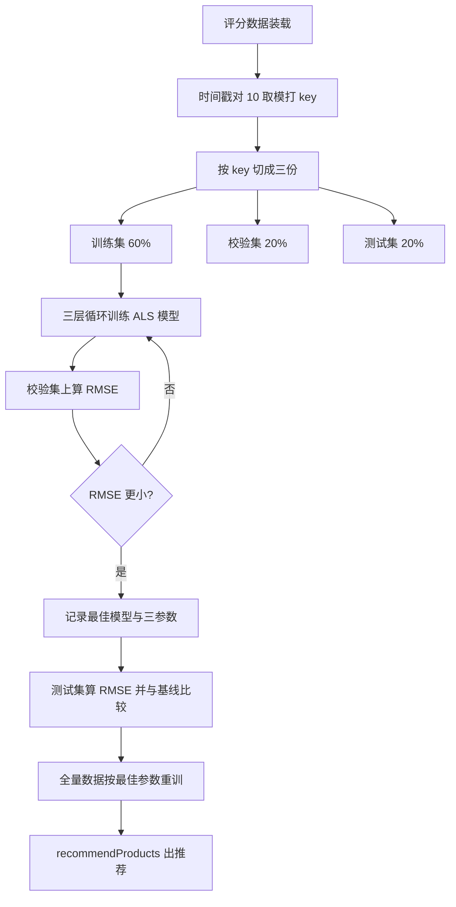

# ALS 实战优化：让 rank、lambda 与迭代次数从写死到算出来

基础版把推荐跑通了，但有个不舒服的地方：rank = 8、迭代 10 次，这些数字全是写死的；换一份评分数据、换一个业务场景，这组数字还灵不灵，没人敢打包票。三讲连起来是一次完整的「参数考古」：把评分数据按时间戳打上 key，切成训练、校验、测试三份，三层循环训练几十个模型，用 RMSE 一决高下，跟均值基线比出提升幅度，最后拿全量数据按冠军参数重建模型，用它给用户 789 出推荐。这一套流程在后面的探花交友推荐系统里会原样复用，值得逐行吃透。

## 先给结论

- 参数不能写死：数据规模、稀疏程度一变，最优 rank、lambda、迭代次数都会变，要靠数据算出来。
- 评分数据按时间戳对 10 取模打 key，再按 key 范围切成 60% 训练、20% 校验、20% 测试三份。
- 校验集负责挑参数，测试集负责报成绩，两份数据各司其职，成绩才不作弊。
- RMSE 是预测分与真实分的均方根误差，三层循环（rank × lambda × 迭代数）遍历参数组合，留误差最小的一组。
- 选完参数必须用全量数据重训最终模型；数据规模是 943 用户、1682 部电影、100000 条评分。

## 一、参数为什么不能写死

写死参数等于把一次实验的经验当成定律。数据量从 10 万涨到 1000 万，最优 rank 往往上移；评分极度稀疏时，正则强度 lambda 又要加大来压制过拟合。三个参数还会互相牵连：rank 给大了，lambda 不跟上就过拟合；迭代数给少了，再好的 rank 也到不了收敛点。所以不能一次调一个参数下结论，要让组合成批地上场。课程的做法是把候选参数摆开，让模型一组组试，用统一的评估指标裁决。整条优化流水线如下：



这张图讲的是从原始评分到线上可用模型的完整通道。关键路径在校验环：训练只在 60% 数据上做，挑选靠校验集，成绩由测试集说了算，最后一步全量重训保证每条评分都为最终模型出力。

## 二、装载改造：给评分数据打上 key

基础版读文件后封装成 Rating 就完事；优化版在封装之外多包一层 Tuple2。原因是马上要按比例切数据，切分的依据是 key，而 key 取自时间戳对 10 取模：

```java
//评分数据：时间戳对 10 取模作为 key，方便按比例切分
JavaRDD<String> sourceRDD = jsc.textFile("F:\\ml-100k\\u.data");
JavaRDD<String[]> lineRdd = sourceRDD.map(v -> v.split("\t"));
JavaPairRDD<Integer, Rating> ratings = lineRdd.mapToPair(v -> {
    Rating rating = new Rating(Integer.valueOf(v[0]),
            Integer.valueOf(v[1]), Double.valueOf(v[2]));
    Integer key = Integer.valueOf(v[3]) % 10;
    return new Tuple2<>(key, rating);
});
```

时间戳对 10 取模得到 0 到 9 十个值，分布接近均匀。一条评分落到哪个 key，等于做了一次随机抽样；同一用户、同一部电影的评分会被打散到不同的 key 区间，后面按 key 过滤切分时，三份数据的分布才不会失衡。u.data 的第 4 列时间戳在基础版里全程没用，到这里它的价值才兑现。

这个打 key 的粒度是评分而不是用户，值得咀嚼。同一个用户的 10 万分之几百条评分被切到训练、校验、测试三个集合里，校验与测试考察的是「用户已知一部分偏好时，能不能猜对他的其余偏好」，这正是推荐系统线上面对的真实任务：老用户回来，系统见过他，要猜的是他没表现过的那部分兴趣。如果按用户整体切走，模型在评估时反而遇到大量陌生用户，测的就变成冷启动能力，与调参要回答的问题错位。

电影表也要装载。u.item 每行第一列是电影 id、第二列是电影名，分隔符是竖线，放进正则要转义成 `\\|`。装载后 collect 到驱动端内存，留着做 id 与名称的映射，打印推荐结果时能把干巴巴的数字换成看得懂的电影名：

```java
//电影数据：id -> 名称
List<Tuple2<String, String>> movies = jsc.textFile("F:\\ml-100k\\u.item")
        .map(v -> {
            String[] ss = v.split("\\|");
            return new Tuple2<>(ss[0], ss[1]);
        }).collect();

//统计规模
long numRatings = ratings.count();
long numUsers = ratings.map(v -> v._2().user()).distinct().count();
long numMovies = ratings.map(v -> v._2().product()).distinct().count();
System.out.println("用户：" + numUsers + " 电影：" + numMovies + " 评论：" + numRatings);
```

统计的写法注意 distinct 的对象：数用户就对 Rating 的 user 去重，数电影就对 product 去重，直接对整个 Rating 对象去重得到的是评分条数。运行结果与数据说明里的口径完全对上：943 个用户、1682 部电影、100000 条评论。装载环节先打印这一笔，是给后面的切分留对照基准。

## 三、三份切分：训练、校验、测试各管一段

key 的十个值划成三段：小于 6 的进训练集，6 到 7 的进校验集，8 到 9 的进测试集，比例正好 60/20/20：

```java
Integer numPartitions = 4; //分区数
//训练集
JavaRDD<Rating> training = ratings.filter(v -> v._1() < 6)
        .values().repartition(numPartitions).cache();
//校验集
JavaRDD<Rating> validation = ratings.filter(v -> v._1() >= 6 && v._1() < 8)
        .values().repartition(numPartitions).cache();
//测试集
JavaRDD<Rating> test = ratings.filter(v -> v._1() >= 8)
        .values().repartition(numPartitions).cache();

long numTraining = training.count();
long numValidation = validation.count();
long numTest = test.count();
System.out.println("训练集：" + numTraining + " 校验集：" + numValidation + " 测试集：" + numTest);
```

三个集合的分工必须分清。**训练集负责喂模型。** ALS 只看这一份去分解矩阵，学出用户与电影的特征向量。**校验集负责挑参数。** 每训出一个模型，就在它上面算一次误差，谁误差小谁当选。**测试集负责最终验收。** 参数选定之后，模型在测试集上的成绩作为上线前的最后体检。

校验集和测试集看起来都是「模型没见过的数据」，为什么要拆成两份？因为参数是照着校验集挑的，模型天然对校验集讨好，再用校验集报成绩就有虚高嫌疑；测试集从头到尾不参与挑选，它的分数才接近真实上线表现。三份数量加起来正好 10 万条，与装载阶段的统计互为印证。

链路上的三个算子也各有讲究。filter 按 key 范围筛出 Tuple2，values() 把 Rating 从键值对里解出来；repartition 固定分区数，让三个集合的并行度一致，课程取 4；cache 把集合留在内存，后面三层循环里每个集合都要被反复扫描，不缓存的话每次都要重算一遍血缘。

比例本身也有讲究。训练占大头 60%，因为模型学特征靠它；校验与测试各占 20%，评估的样本量足够让 RMSE 站得住脚。若把评估份压得太薄，少量样本算出的误差会随抽样大幅波动，参数之间的高下就比不出来了。课程打印三份的数量，正是让这个比例可以被肉眼核对。

## 四、三层循环加 RMSE：把最优参数找出来

候选参数摆三组。rank 取 8、10、12（常用区间 8 到 20）；lambda 取 0.01、0.03、0.1、0.3、1、3，ALS 的默认值就是 0.01，课程候选里不少是 3 的倍数，属于经验取法；迭代次数取 8、9、10。演示取值偏少是为了快速出结果，学习时可以把候选集扩充再跑，参数越多耗时越长，这是用时间换精度。

先看评估指标。RMSE（均方根误差）衡量预测分与真实分的差距：把每条预测与真实评分的差平方，求平均再开根号。它的单位与评分一致，五星制下 RMSE 0.9 的含义是预测分平均偏离真实分约 0.9 分，数值越小预测越贴。差值先平方再取均值，让大错付出不成比例的代价：预测 5 星而真实 1 星的样本，对指标的打击远比四条偏 1 星的样本重，这正好符合推荐场景「别把离谱的推出去」的诉求。计算方法按讲义给出，方法体为按讲义写法还原：

```java
//计算预测值与真实值之间的均方根误差 RMSE
public static double computeRmse(MatrixFactorizationModel model,
                                 JavaRDD<Rating> data, long n) {
    JavaRDD<Tuple2<Object, Object>> userProducts = data.map(
            v -> new Tuple2<Object, Object>(v.user(), v.product()));
    JavaRDD<Rating> predictions = model.predict(userProducts);
    //按用户与物品拼接 key，与真实评分 join 后求平方差
    JavaRDD<Tuple2<Double, Double>> predAndTrue = predictions
            .mapToPair(p -> new Tuple2<>(p.user() + "_" + p.product(), p.rating()))
            .join(data.mapToPair(r ->
                    new Tuple2<>(r.user() + "_" + r.product(), r.rating())))
            .values();
    double sum = predAndTrue.mapToDouble(t ->
            (t._1() - t._2()) * (t._1() - t._2())).reduce((x, y) -> x + y);
    return Math.sqrt(sum / n);
}
```

模型对传入的每个「用户、物品」组合给出预测分，与真实评分按 key 对齐后逐条求平方差。join 用「用户_物品」拼成的字符串当 key，保证预测与真实评分按同一条评分记录对齐；join 不上的组合自动丢弃，参数 n 传入数据条数用于归一。方法签名里的 long n 由调用方传 count() 进来，避免在方法内部重复触发一次行动算子。

再回到三层循环的成本账。54 组参数意味着 54 次训练加 54 次校验集评估，本地模式下课程跑了数分钟量级；候选集翻倍，耗时跟着翻倍。这就是演示取值克制的原因：调参预算有限时，先把 lambda 的量级扫对（0.01 与 3 的差距是数量级的差距），再在同一量级内细扫，比一上来铺满参数网格划算得多。

然后是主战场，三层嵌套循环把 3 × 6 × 3 共 54 组参数全部试一遍：

```java
//参数候选：rank、lambda、迭代次数
int[] ranks = {8, 10, 12};
double[] lambdas = {0.01, 0.03, 0.1, 0.3, 1, 3};
int[] numIters = {8, 9, 10};

MatrixFactorizationModel bestModel = null;
double bestValidationRmse = Double.MAX_VALUE;
int bestRank = 0, bestNumIter = -1;
double bestLambda = -1.0;

//三层嵌套循环：训练集训练，校验集评估，误差更小则记录
for (int rank : ranks) {
    for (double lambda : lambdas) {
        for (int numIter : numIters) {
            MatrixFactorizationModel model =
                    ALS.train(training.rdd(), rank, numIter, lambda);
            double rmse = computeRmse(model, validation, numValidation);
            System.out.println("RMSE(校验集) = " + rmse
                    + ", rank = " + rank + ", lambda = " + lambda
                    + ", numIter = " + numIter);
            if (rmse < bestValidationRmse) {
                bestModel = model;
                bestValidationRmse = rmse;
                bestRank = rank;
                bestLambda = lambda;
                bestNumIter = numIter;
            }
        }
    }
}
```

bestValidationRmse 初始化为 double 的最大值，保证第一组比较必然成立；此后每组参数训练出的模型都与当前记录比较，误差更小就把模型与三个参数一并覆盖。循环走完，留在 bestModel 里的就是校验集上的冠军，bestRank、bestLambda、bestNumIter 就是冠军参数。这里的四参重载 train(ratings, rank, iterations, lambda) 与基础版的区别，就是把正则强度显式交了出来。

打印每一组的 RMSE 与参数是刻意的安排，不只是调试习惯。参数对误差的影响往往不是单调的：lambda 从 0.01 加到 0.1 可能降，从 1 加到 3 又可能升。把全部组合的分数铺在日志里，能看出误差随参数变化的趋势面，判断冠军是「真优」还是「偶然小胜」，为下一轮收窄候选区间提供依据。

## 五、测试集验收与全量重训

冠军模型先上测试集称重，再跟一个朴素的基线比。基线模型什么都不学，对所有测试样本统一给平均分，也就是训练加校验两份数据的评分均值，它能算出一个 RMSE。课程代码把两个 RMSE 的差距换算成提升幅度：

```java
//冠军模型在测试集上的 RMSE
double testRmse = computeRmse(bestModel, test, numTest);
System.out.println("测试集在最佳模型 rank = " + bestRank + ", lambda = "
        + bestLambda + ", numIter = " + bestNumIter + " 上的 RMSE = " + testRmse);

//均值基线：所有样本都预测平均分时的误差
double meanRating = training.union(validation).mapToDouble(v -> v.rating()).mean();
double baselineRmse = Math.sqrt(test.map(v ->
        (meanRating - v.rating()) * (meanRating - v.rating()))
        .reduce((v1, v2) -> v1 + v2) / numTest);

//提升幅度
double improvement = (baselineRmse - testRmse) / baselineRmse * 100;
System.out.println("最佳训练模型的准确率提升了："
        + String.format("%.2f", improvement) + "%");
```

为什么要比基线？模型必须明显好过「闭着眼睛给平均分」才谈得上上线价值，提升幅度就是这句判断的量化表达。均值取自训练加校验的并集：测试集属于「模型没见过的数据」，拿它自己的均值去算基线等于提前偷看考卷，所以均值的数据来源把测试排除在外。注意求和与除法的次序：reduce 只负责把平方差累加，除以条数要放在求和完成之后，写错位置结果直接失真。课程当次运行的结果：最优参数是 rank = 12、lambda = 0.01、迭代 9 次，测试集 RMSE 在 2.0 上下，打印的提升幅度约 97.49%。教师当场提醒：随机初始化决定每次运行结果都有浮动，准确率数字不必背，要背的是这套比较流程。

最后一个关键动作容易被忽略。**调参阶段只用过 60% 的训练集。** 直接把 bestModel 拿去上线，等于让最终模型少看四成数据。参数既然定了，就重新训练一次，这次喂全量评分：

```java
//全量数据按最佳参数重建模型
MatrixFactorizationModel model =
        ALS.train(ratings.values().rdd(), bestRank, bestNumIter, bestLambda);

//为用户 789 推荐 10 部电影
Rating[] recommendProducts = model.recommendProducts(789, 10);
for (Rating rating : recommendProducts) {
    System.out.println(rating.user() + "->" + rating.product()
            + ":" + rating.rating());
}
jsc.stop();
```

ratings.values() 取出全部 Rating 再转 rdd，训练参数换成 bestRank、bestNumIter、bestLambda，这次得到的才是真正用于推荐的模型。课程用它为 789 号用户打出十部电影的推荐列表，打印格式是「用户->电影：预测分」。回头看整段代码：API 的核心始终是 train 加 recommendProducts 两行，前后的装载、切分、循环、验收，都是为了把 model 的参数算对。

## 六、延伸：隐式反馈与冷启动

train 的完整签名里还躺着两个参数，正片点到，这里展开。alpha 是隐式反馈的变化率，控制每次迭代对观察值的修正幅度，配合 implicitPrefs 使用时 ALS 切到隐式反馈模式。显式反馈是用户直接打分，隐式反馈是从行为推断偏好：浏览了、点赞了、看完了，都是偏好的证据，只是强度不同。两种模式对数据的理解完全不同：显式模式下没有评分的条目视为「未知」，隐式模式下没有行为的条目被视为「不喜欢的证据，只是置信度低」，所以隐式模式必须靠 alpha 给观察到的行为赋予高置信权重。探花交友里用户对动态几乎没有「打分」动作，发布、浏览、点赞全是隐式行为，所以把平台数据接进推荐系统时，隐式反馈口径比显式评分更贴身（课程正片只讲到 train 签名与各参数含义，此处为按本课写法的延伸补充）。

冷启动在切分环节已经埋下伏笔。测试集里如果出现训练集从未见过的用户或电影，模型拿不出对应的特征向量，预测无从谈起；线上同理，新注册用户零行为、新动态零互动，ALS 给不出有效推荐。冷启动的严重程度随场景递增：老用户对新内容是轻度的「物品冷启动」，一条动态发出去几分钟就有大量曝光可学；新用户对全站则是重度的「用户冷启动」，系统对他一无所知。工程上的通行做法是分层兜底：新用户走注册兴趣选择或热门榜，新内容靠内容属性与运营位分发，攒够行为数据后再交还给模型。day08 接平台数据时，这层兜底就藏在默认推荐逻辑里。

## 常见误区

- **校验集当测试集用。** 错例：挑参数和报成绩都看校验集 RMSE，数字漂亮，上线露馅。正解：挑参数用校验集，报成绩用从未参与挑选的测试集。
- **切分前不打 key。** 错例：按文件行号直接取前六成当训练集。正解：数据按时间排列，直接切会让三份分布失衡；先按时间戳取模打 key 再过滤，等效随机抽样。
- **循环里只训练不记录。** 错例：三层循环跑了 54 个模型，循环外用的却是最后一组。正解：比较逻辑写在循环体内，误差更小就更新 bestModel 与三个 best 参数。
- **均值基线求和写错位置。** 错例：reduce 里写成 (v1 + v2) / numTest，每步折半再累加，结果失真。正解：reduce 只做求和，除以条数放在求和完成之后。
- **拿 60% 数据的调参模型直接上线。** 错例：bestModel 验收通过就发布。正解：参数选定后必须用全量数据重训最终模型，再交给线上使用。

## 面试可能被问到的问题

1. 面试官追问：「为什么要把数据切成训练、校验、测试三份？」
   答：训练集供模型学习，校验集供参数挑选，测试集供最终评估。参数是照着校验集挑的，再用它报成绩会乐观偏差；测试集全程不参与挑选，成绩才接近线上真实表现。
2. 面试官追问：「RMSE 怎么理解，怎么用它选模型？」
   答：RMSE 是预测值与真实值之差的平方均值开根号，单位与评分一致，数值越小预测越准。把每个候选参数组合训练出的模型放到校验集上算 RMSE，取最小者对应的参数组合。
3. 面试官追问：「lambda 在 ALS 里起什么作用？」
   答：lambda 是正则化系数，约束特征向量的取值幅度，防止为拟合训练数据学出过大的分量。lambda 过大模型欠拟合、误差整体抬高，过小则过拟合、训练误差低而校验误差高，常用默认值 0.01 起步按倍数试验。
4. 面试官追问：「选完参数为什么还要全量重训？」
   答：调参时训练只用 60% 数据，bestModel 是「选出参数的模型」而不是「最终模型」。参数确定后用全量评分重训，每条数据都能贡献特征，线上推荐质量更高。
5. 面试官追问：「显式反馈和隐式反馈有什么区别，ALS 怎么支持？」
   答：显式反馈是用户主动打分，隐式反馈是从浏览、点赞、观看等行为推断偏好。ALS 通过 implicitPrefs 开启隐式模式，用 alpha 控制对观察值的置信修正幅度，行为强度不同、权重不同。
6. 面试官追问：「新用户没有任何评分，推荐系统怎么办？」
   答：这是冷启动问题。ALS 需要用户在训练数据里出现过才能学出特征，新用户给不出有效预测。工程上用兜底策略：注册兴趣、热门榜、运营位先顶上，行为积累后再切换到模型推荐。

## 配套资料

- 学习目标：`materials/code/07/day07 探花交友-SparkMLlib推荐系统快速入门/day07/学习目标.md`，「掌握 ALS 的实战优化改进」即本课对应条目。
- 数据目录：`materials/code/07/day07 探花交友-SparkMLlib推荐系统快速入门/day07/资料/ml-100k/`，内含官方数据整理脚本 `mku.sh`；课程演示用的 `u.data`、`u.item` 为 MovieLens ml-100k 标准文件，放入该目录即可复现。
- 说明：day07 资料包无本课源码，MyRecommend2 与 computeRmse 方法体为按本课画面与讲义写法补全。
