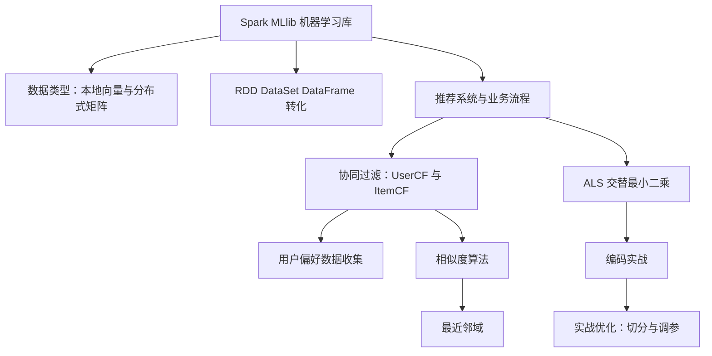

# day07 复盘：从 Spark MLlib 概念到跑出 ALS 推荐结果

一天的课程收官，值得停下来把线捋直。day07 全程围绕一个问题展开：怎么让机器替人挑出「你可能喜欢」。答案分两半，前半场是概念与原理的地基，后半场是两段递进的代码实战。复盘的价值在于看清每块砖放在哪、为什么放在那，以及接下来往哪盖。

## 先给结论

- day07 的知识主线是一条链：MLlib 是什么 → 数据怎么装 → 推荐系统怎么运转 → 协同过滤怎么找邻居 → 相似度怎么算 → 最近邻域怎么取 → ALS 怎么分解矩阵。
- 实战主线两段递进：基础版验证 API 走通，优化版回答参数从哪来；学习目标里「掌握 ALS 的实战」「掌握 ALS 的实战优化改进」是分量最重的两条。
- ml-100k 的 943 用户、1682 部电影、100000 条评分是全天的实验田，60/20/20 切分加 RMSE 调参是 ALS 落地的标准动作。
- 模型产出的推荐结果不是终点：要落存储、接接口才能被用户看到，day08 把这件事接进探花交友。

## 一、知识地图：一条链串起全部概念



这张图讲的是 day07 的知识依赖：容器的形态决定算法怎么吃数据，业务流程给出协同过滤的位置，相似度与最近邻域是找邻居的尺子和筛子，ALS 则把「找邻居」升级成「学特征」。理论半场的关键词速记分三组。

**数据容器。** 本地向量、标签点、本地矩阵是单机侧的样本表示，分布式矩阵承接大规模数据，MLlib 的算法都以它们为输入。RDD、DataSet、DataFrame 是 Spark 三套抽象，关系要能徒手讲：RDD 最底层无结构，DataFrame 带列结构，DataSet 结合两者，DataFrame 是 DataSet[Row] 的特化，三者可以互相转换。

**推荐运转方式。** 推荐系统解决的是信息过载，业务流程从收集行为一路走到产出列表。协同过滤两条路线：UserCF 找相似的人，把邻居喜欢的推过来；ItemCF 找相似的物，顺着用户喜欢过的东西延伸。偏好数据要经过归一化才能用，相似度算法四件套（欧氏距离、皮尔逊相关系数、余弦相似度、Tanimoto 系数）负责量化「像不像」，最近邻域决定参考几个邻居、按什么规则参考。

**ALS。** 交替最小二乘把稀疏的评分矩阵拆成用户特征矩阵与电影特征矩阵，固定一方、优化另一方，交替迭代直到预测评分逼近真实评分。原理层面课程的要求是了解，重心放在实战，这也是学习目标里唯一的区别对待。

## 二、两段代码的递进关系

| 维度 | 基础版 | 优化版 |
| --- | --- | --- |
| 数据 | 全量直接进模型 | 打 key 后切 60/20/20 三份 |
| 参数 | 写死 rank、迭代次数 | 三层循环搜索参数组合 |
| 评估 | 无，肉眼看结果 | 校验集 RMSE 挑选，测试集验收 |
| 产出 | 一次演示推荐 | 全量重训的最终模型与提升幅度 |

基础版回答「API 怎么用」，优化版回答「参数怎么定」。抽掉外围逻辑，核心 API 只有两行：

```java
//用最佳参数在全量评分上训练，再对指定用户取推荐
MatrixFactorizationModel model = ALS.train(
        ratings.values().rdd(), bestRank, bestNumIter, bestLambda);
Rating[] recommendProducts = model.recommendProducts(userId, 10);
```

train 的完整签名里 rank、迭代数、lambda、并行块数、隐式反馈变化率 alpha、随机种子 seed 一应俱全。优化版把前三个交给循环搜索，后几个保持默认，这正是生产上的常规取法：

```text
train(ratings, rank, iterations, lambda, blocks, alpha, seed)
```

掌握程度也要分层：API 四步与调参五段（装载打 key、三份切分、循环训练、RMSE 评估、全量重训）要求能独立写出来；矩阵分解的数学推导、相似度公式的证明，达到能讲清思路即可。

## 三、推荐结果怎么服务线上

控制台打印只解决「算得出」，离「用得上」还差两步。**第一步，结果落存储。** 离线任务逐个用户跑 recommendProducts，把 topN 写进数据库；探花交友的方案是写 MongoDB 的推荐数据，线上查询完全不碰 Spark。**第二步，接口换数据源。** 页面请求推荐列表时，接口直接读存储里的现成结果渲染给用户。成熟推荐系统几乎都是离线批量计算加在线查询，Spark 负责算，接口负责查，两边互不拖累。

day08 就是在做这两步，外加数据侧的改造：圈子动态的发布、浏览、点赞先按计分规则量化成偏好分数，经消息队列送进推荐系统；Spark 复用 day07 的推荐逻辑算出每个用户的动态推荐；小视频列表也从按时间排序改成按推荐排序。ml-100k 的电影评分只是教学载体，探花交友里真正要推荐的，是圈子动态与小视频。

## 常见误区

- **把 MLlib 当成一个算法。** 错例：「MLlib 就是 ALS」。正解：MLlib 是 Spark 的机器学习库，分类、回归、聚类、推荐都在里面，ALS 只是推荐模块的一员。
- **原理没吃透就不敢动手。** 错例：陷在最小二乘的推导里迟迟不写代码。正解：课程对原理的要求是了解，对实战的要求是掌握，先跑通再回头补数学。
- **把电影推荐当成项目需求。** 错例：以为探花交友要推荐电影。正解：ml-100k 是教学用的标准数据集，项目的推荐对象是圈子动态与小视频。
- **只记住基础版。** 错例：面试只说得出 ALS.train 加 recommendProducts。正解：写死参数的版本不完整，切分、RMSE 调参、全量重训才是有落地价值的那部分。

## 面试可能被问到的问题

1. 面试官追问：「Spark MLlib 是什么？」
   答：Spark 的机器学习库，提供特征提取、分类、回归、聚类、协同过滤等算法，以及本地向量、分布式矩阵等数据类型。它构建在 Spark Core 之上，算法天然享受分布式与内存计算能力。
2. 面试官追问：「RDD、DataSet、DataFrame 三者什么关系？」
   答：RDD 是最底层的分布式数据集，无结构信息；DataFrame 带列结构，走 Catalyst 优化器；DataSet 结合两者，编译期类型安全，DataFrame 可视作 DataSet[Row] 的特化。三者之间可以互相转换。
3. 面试官追问：「协同过滤的两种路线怎么选？」
   答：UserCF 找相似用户、推邻居喜欢的物品，适合社交属性强的场景；ItemCF 计算物品相似度、顺着用户历史延伸，物品量相对稳定时计算可控，电商常用。选型看数据规模与业务侧重，两者都以相似度计算和最近邻域为基础。
4. 面试官追问：「一句话说清 ALS 的建模思路，参数怎么定？」
   答：把稀疏评分矩阵分解成用户特征矩阵与物品特征矩阵的乘积，固定一个矩阵解另一个，交替迭代让预测评分逼近真实评分。rank 是隐因子维度，通常 8 到 20 起步；lambda 是正则强度，默认 0.01；精确值靠校验集 RMSE 比较得出，选完参数用全量数据重训。

## 配套资料

- 学习目标：`materials/code/07/day07 探花交友-SparkMLlib推荐系统快速入门/day07/学习目标.md`，十三条目标即全天知识地图，与本复盘逐条对应。
- 数据目录：`materials/code/07/day07 探花交友-SparkMLlib推荐系统快速入门/day07/资料/ml-100k/`，内含官方数据整理脚本 `mku.sh`；配套的 `u.data`、`u.item` 为 MovieLens ml-100k 标准文件。
- 说明：day07 资料包无源码包，代码要点为按本课画面与主流写法补全。
