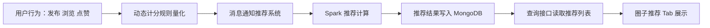

# day08 开篇：把 ALS 推荐从控制台接进探花交友的页面

day07 的 ALS 在 10 万条电影评分上跑出了推荐列表，但结果停留在控制台，数据也是教学的 ml-100k。探花交友要推荐的从来不是电影，而是圈子动态与小视频。day08 的任务可以用一个词概括：接入。把平台里的用户行为变成推荐系统的输入，把 Spark 算出的推荐结果变成 App 里用户刷到的列表。这一课 2 分钟，是全天任务清单的宣读。

## 先给结论

- day08 两大功能目标：圈子推荐与小视频推荐，列表从默认排序改为按推荐计算结果展示。
- 推荐依据是用户行为：发布、浏览、点赞等操作，经动态计分规则量化后交给推荐系统。
- 数据链路：行为计分、消息通知、Spark 推荐计算、结果写 MongoDB、查询接口按推荐结果返回。
- 学习目标六条，关键词是「独立实现」：发送消息、接收消息、推荐逻辑、小视频推荐都要亲手完成。

## 一、先看效果：推荐位置要变什么

圈子页顶部有「推荐」与「好友」两个标签。好友标签看的是关注之人的动态，推荐标签此前的列表走的是默认推荐数据；改造后，这个位置展示的是推荐系统针对当前用户算出的动态列表。课程效果图里，推荐标签下的动态按用户偏好排列，不同用户看到的顺序各不相同。

小视频同理。小视频页的列表此前按发布时间排列，改造后按推荐结果排列，每个用户刷到的顺序带着个人的偏好烙印。两条线的形态不同，本质是同一件事：把「大家都一样」的列表换成「为你计算」的列表。

## 二、圈子推荐的流程骨架



这张图讲的是行为数据变成页面列表的完整通道。关键在首尾两端：首端的计分规则决定推荐系统的输入质量，尾端 MongoDB 的推荐结果决定接口查询是否轻快；中间的 Spark 计算复用 day07 的 ALS 逻辑，只是评分数据从电影评分换成了动态行为分。

流程拆开是四件事。**第一，把行为变成分数。** 系统根据用户的发布、浏览、点赞等操作对动态做计算，操作类型不同、权重不同，量化结果就是推荐系统眼里的「评分」。**第二，把该算的送过来。** 圈子模块通过消息把动态数据送进推荐系统，大数据侧收到后增量处理，自增长 id 在其中充当取数游标，避免重复扫描。**第三，用 Spark 算推荐。** 搭建独立的推荐系统工程，把 MLlib 的推荐逻辑封装进去，为每个用户跑出推荐结果。**第四，把结果接回接口。** 修改之前的查询逻辑，推荐列表不再取默认数据，改从推荐结果读取，页面展示随之生效。

第四步的查询改造，示意如下（day08 资料包无源码，示例为按本课写法补全）：

```java
//推荐列表查询示意：优先读推荐结果，无结果时回落默认列表
public List<RecommendMoment> queryRecommendList(Long userId) {
    //读推荐系统算好的结果，key 为用户 id
    List<RecommendMoment> list = recommendResultDao.findByUserId(userId);
    if (list == null || list.isEmpty()) {
        //新用户或尚无推荐结果时，走默认推荐兜底
        return recommendResultDao.findDefault();
    }
    return list;
}
```

接口层只认「读结果」这一个动作，Spark 怎么算、消息怎么传，对页面完全透明。这个边界划清楚，后端与大数据两侧就能并行开发，day08 后面的每一节都在把这条链路逐段落地。

## 三、目标与技术点对照

| day08 环节 | 要做的事 | 背后的技术点 |
| --- | --- | --- |
| 圈子推荐说明与流程 | 看懂效果图、梳理链路 | 业务分析 |
| 自增长 id 与动态计分规则 | 增量取数、行为量化 | 游标、计分规则 |
| 发送消息、接收消息 | 圈子与推荐系统解耦通信 | 消息队列 |
| 搭建推荐系统、Spark 实现推荐逻辑 | 离线计算每个用户的推荐 | Spark MLlib、ALS |
| 修改查询逻辑 | 接口改读推荐结果 | MongoDB |
| 小视频推荐 | 同一套链路复用 | 同上 |

学习目标里反复出现「独立实现」，意味着 day08 的代码量远超 day07：推荐逻辑、消息收发、查询改造三条线都要自己写出来。day07 打磨的调参流程在这里不重复展开，推荐工程直接沿用「装载、训练、出推荐」的最简主线，把精力留给链路打通。

## 常见误区

- **以为推荐是实时算的。** 错例：用户刷新页面时才调 Spark 算推荐。正解：推荐结果离线批量算好写进 MongoDB，接口只做查询，Spark 不在线上链路里。
- **把计分规则当成推荐算法。** 错例：认为加一张权重表就算有了推荐系统。正解：计分规则解决「行为怎么变成输入」，推荐算法解决「输入怎么变成列表」，两者缺一不可。
- **以为要重写 ALS。** 错例：day08 推倒 day07 的代码重来。正解：推荐逻辑是对 day07 成果的工程化抽取与封装，数据源换了，算法内核不变。
- **忽略消息环节。** 错例：让圈子模块直接调用推荐系统同步等结果。正解：业务与大数据侧通过消息解耦，圈子只管发消息，推荐系统异步消费，各自独立扩容。

## 面试可能被问到的问题

1. 面试官追问：「探花交友的推荐依据是什么数据？」
   答：用户在圈子与小视频里的行为数据，包括发布、浏览、点赞等操作。这些行为按动态计分规则量化成偏好分数，作为推荐系统的输入，最终为每个用户算出专属的动态与小视频推荐列表。
2. 面试官追问：「推荐结果为什么放 MongoDB？」
   答：推荐结果以用户为维度、以列表形式存储，读多写少、结构灵活，MongoDB 的文档模型合适；圈子与小视频的业务数据本来也在 MongoDB，接口查询链路统一，运维成本低。
3. 面试官追问：「消息队列在推荐链路里起什么作用？」
   答：解耦与削峰。圈子模块把动态变化以消息发出即可，不用等推荐结果；推荐系统按自己的节奏消费消息、增量计算，两侧独立部署扩容，互不拖累。
4. 面试官追问：「day08 里 Spark 承担哪一段？」
   答：离线推荐计算。它接收量化后的行为数据，用 MLlib 的 ALS 推荐逻辑为每个用户算出推荐列表，结果写入 MongoDB；线上接口查询不经过 Spark，保证响应速度。

## 配套资料

- 学习目标：`materials/code/07/day08 探花交友-实现推荐功能/day08/学习目标.md`，六条目标即本日任务清单。
- 说明：day08 资料包仅含学习目标，无源码包；链路与计分口径为按本课画面与主流写法整理。
