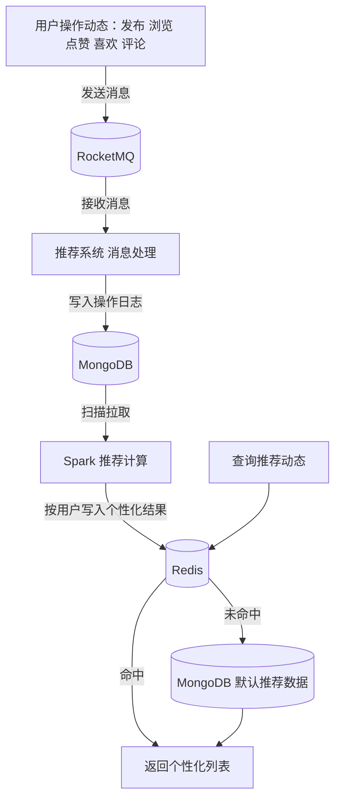

# 圈子推荐的完整流程：一次点赞如何走进别人的推荐列表

功能说明定下了「要做个性化推荐」，工程上更关心的是数据怎么流。用户点一次赞，到另一个用户刷新时列表顺序发生变化，中间要经过 RocketMQ、推荐系统、MongoDB、Spark、Redis 五站。流程说明这节课用一张全景图把链路一次讲完，day08 后面每个小节实现的都是图中的一小段，这张图就是全天任务的施工总纲。

## 先给结论

- 用户每次操作动态，发布、浏览、点赞、喜欢、评论，圈子模块就往 RocketMQ 发一条消息。
- 推荐系统接收消息并处理，把行为数据整理成操作日志写入 MongoDB。
- Spark 程序从 MongoDB 拉取日志数据，做推荐计算。
- 计算结果写入 Redis，按用户隔离，每个人一份个性化推荐。
- 查询推荐动态时先查 Redis，命中直接返回；未命中回落 MongoDB 的默认推荐数据。

## 一、全景流程图：写入与读取两条线

课程 PPT 把整个链路画成了一张图，把它誊清楚如下：



这张图分上下两段看。上半段是写入链路：行为以消息形式进 RocketMQ，推荐系统消费后把操作日志落进 MongoDB，Spark 再从 MongoDB 扫描数据计算，结果按用户写进 Redis。下半段是读取链路：查询先问 Redis，有结果就返回个性化列表，没有就退回 MongoDB 的默认推荐数据。课程在图上特意用红框圈出两组关系，一组是 Spark 与 MongoDB，强调取数来源；另一组是 Redis 与 MongoDB，强调兜底关系，这两处正是整条链路最容易理解错的地方。

## 二、中间为什么隔一道消息

行为侧与计算侧之间隔着 RocketMQ，不是多余的中间商。**第一，解耦。** 圈子模块的职责边界到「发消息」为止，点赞接口处理完业务逻辑，往消息队列投一条事件就算完事，不用等推荐结果，也不用知道推荐系统在哪。推荐系统按自己的节奏消费消息，两侧独立部署、独立扩容，一边升级不影响另一边。**第二，削峰。** 一条热门动态可能在几分钟内被集中点赞几百次，这些事件在队列里排队，计算侧按消费能力慢慢消化，瞬时洪峰不会冲垮计算与存储。**第三，粒度合适。** 每做一次操作就发一条消息，浏览算一条、点赞算一条，事件流完整保留了行为的时序与频次，推荐系统拿到的不是汇总结果，而是可以反复回放的原始记录。

## 三、MongoDB 的两个角色与 Redis 的一个角色

MongoDB 在图里出现了两次，扮演两个角色。角色一：操作日志的归宿。推荐系统消费消息后，把行为整理成结构化记录写入 MongoDB，课程原话里称之为日志数据，每条记录表达「谁在什么时间对哪条动态做了什么」：

```json
{
  "userId": 106,
  "pid": 12,
  "type": "LIKE",
  "date": 1570521600000
}
```

（文档字段为按本课流程整理的示例，day08 资料包无源码。）角色二：Spark 的取数源。Spark 程序从这里扫描日志数据，组装成评分记录喂给推荐算法。可能有人会问，Spark 为什么不直接消费 RocketMQ？因为计算需要的是可反复扫描的静态数据：日志落在 MongoDB 里可以重放、可以增量拉取，计算任务跑挂了重跑一遍不丢数据；消息队列里消费掉就没了，把计算绑在消息生命周期上风险太高。增量拉取还要靠一个数字游标来判断「上次算到哪了」，这正是下一课自增长 id 的用武之地。

Redis 的角色只有一个：结果缓存。Spark 算出的推荐列表按用户隔离写入，key 带着用户身份，value 是这个用户的个性化结果。推荐页签的读取频率远高于计算频率，把结果放在 Redis 里，查询就是一次内存操作。课程在 PPT 上给「写入到 MongoDB 中」和「写入到 Redis 中，为每个用户都进行个性化推荐」两句话加了下划线，强调的正是这两个落点：一个存源，一个存果。

## 四、查询侧改造：先 Redis 后默认

day03 的推荐页签直接读 `quanzi_time_line_recommend` 默认数据，day08 要在它前面加一层检查。改造后的查询逻辑示意如下（day08 资料包无源码，示例为按本课流程补全）：

```java
//推荐动态查询：先读 Redis 个性化结果，未命中回落 MongoDB 默认推荐
public PageResult queryRecommend(Long userId, Integer page, Integer pageSize) {
    //1.查推荐结果：key 按用户隔离，value 是有序的动态 pid 列表
    String key = "TANHUA_QUANZI_RECOMMEND_" + userId;
    List<String> pids = this.stringRedisTemplate.opsForList().range(key, 0, -1);
    if (pids != null && !pids.isEmpty()) {
        //按推荐顺序回查动态正文，pid 的先后即推荐排序
        return this.pageByPids(pids, page, pageSize);
    }
    //2.未命中：走 day03 的默认推荐数据
    return this.quanziApi.queryPublishList(null, page, pageSize);
}
```

未命中不是异常，是常态：新用户还没有行为记录，Spark 还没为这个用户算过结果，此时默认数据顶上，页面不空、体验不断。等用户行为积累起来，Redis 里的个性化结果就会接管这个入口。流程课到这里收尾，后面的实现环节按图索骥：先补自增长 id，再定计分规则，然后发送与接收消息，最后搭推荐工程跑 Spark，一步步把图上的箭头变成代码。

## 常见误区

- **以为 Spark 直接消费 RocketMQ 消息。** 错例：在 Spark Streaming 里订阅话题做在线推荐。正解：消息由推荐系统消费并写入 MongoDB，Spark 从 MongoDB 拉取静态数据做离线计算，图上两者之间没有连线。
- **以为结果写了 Redis 就不用落 MongoDB。** 错例：只存 Redis，机器重启列表全空。正解：MongoDB 是源数据与兜底，Redis 是加速层，两者职责不同，缺一不可。
- **以为推荐结果全平台一份。** 错例：所有用户共用同一个推荐列表 key。正解：结果按用户隔离，每人一份个性化列表，key 的设计必须带上用户标识。
- **以为查询未命中 Redis 就该抛异常。** 错例：Redis 没数据直接返回 500。正解：未命中回落 MongoDB 默认推荐数据，冷启动是正常业务场景，不是错误。

## 面试可能被问到的问题

1. 面试官追问：「描述一下圈子推荐的完整流程。」
   答：用户对动态的发布、浏览、点赞、喜欢、评论操作以消息形式发送到 RocketMQ；推荐系统消费消息，把行为整理成操作日志写入 MongoDB；Spark 从 MongoDB 拉取数据做推荐计算，结果按用户写入 Redis；用户查询推荐动态时先查 Redis，未命中则回落 MongoDB 的默认推荐数据。
2. 面试官追问：「为什么用消息队列解耦，而不是操作时同步调用推荐系统？」
   答：同步调用把行为侧和计算侧绑在一起，推荐系统抖动会拖累点赞这类核心接口。发消息后业务立即返回，推荐系统异步消费、独立扩容，高峰期的操作事件在队列里排队削峰，两侧互不拖累。
3. 面试官追问：「Spark 为什么从 MongoDB 拉数据，而不是直接消费 MQ？」
   答：离线计算需要可重放、可增量扫描的静态数据源。日志落在 MongoDB 里，任务失败可以重跑，还能靠数字 id 做增量游标；MQ 消费即消失，把计算绑在消息生命周期上会丢数据。
4. 面试官追问：「查询推荐动态时，数据来源的优先级是怎样的？」
   答：先查 Redis 里为当前用户算好的个性化结果，命中就按推荐顺序返回；未命中说明该用户还没有推荐结果，回落到 MongoDB 的默认推荐数据，保证任何情况下列表可用。
5. 面试官追问：「Redis 的推荐结果和 MongoDB 的默认推荐数据是什么关系？」
   答：一个是计算出来的个性化结果，一个是行为数据不足时的兜底数据，来源不同、形态同构。Redis 命中率高时默认数据基本不参与查询，但它是冷启动与异常场景的最后防线，不能省略。

## 配套资料

- 学习目标：`materials/code/07/day08 探花交友-实现推荐功能/day08/学习目标.md`，第二条即「了解圈子推荐功能的流程」，与本课全景图对应。
- 说明：day08 资料包仅含学习目标，无源码包；文中操作日志文档与查询代码为按本课流程图与既有工程结构补全的示例，RocketMQ 环境沿用 day01 已搭建的集群。
