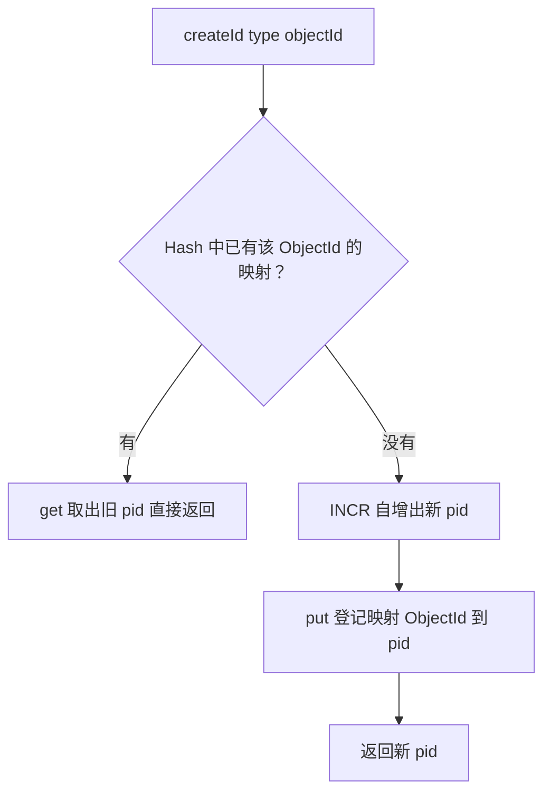

# 给动态发一张数字身份证：Publish 自增 pid 的来龙去脉

推荐链路的第一块拦路石不在算法里，而在数据类型上。day07 的 ALS 模型只认整数编号，而动态在 MongoDB 里的主键是 ObjectId，一串二十四位的十六进制字符；MongoDB 又不像 MySQL 那样自带自增主键，想给动态发一个数字身份证，只能应用侧自己动手。本课两个视频连讲：先讲清楚为什么非加不可，再从实体改造、Redis 自增服务一路写到测试现场的一次真实报错，把这套自增方案完整落地。

## 先给结论

- `pid` 是给推荐系统用的数字 id，`Long` 类型，与 ObjectId 主键并存：ObjectId 继续当文档主键，pid 专门喂给推荐模型。
- MongoDB 不提供 MySQL 那样的自增主键，自增逻辑必须应用侧自己维护。
- 方案靠 Redis 两条腿走路：`INCR` 原子自取出号，Hash 结构登记 ObjectId 与 pid 的一一对应。
- key 按 type 参数化并统一大写，`TANHUA_ID_PUBLISH` 与 `TANHUA_HASH_ID_PUBLISH`，后续小视频等场景直接复用这套服务。
- 测试现场踩了一记 ClassCastException：Hash 值的存取类型必须一致；失败请求消耗掉的号码不会回补，pid 从 2 号接着排，唯一性比连续性重要。

## 一、ObjectId 为什么进不了推荐模型

回看 day07 的推荐主线，训练前的固定动作是把评分数据封装成 Rating：

```java
//day07 的写法：user 与 product 都要求整数，rating 是小数
JavaRDD<Rating> ratingRDD = lineRdd.map(v ->
        new Rating(Integer.valueOf(v[0]),
                Integer.valueOf(v[1]),
                Double.valueOf(v[2])));
```

ml-100k 里的用户与电影天生就是整数编号，`Integer.valueOf` 顺手就能装箱。圈子推荐套用同一个模型时，「商品」换成了动态，问题立刻暴露：动态主键是 `org.bson.types.ObjectId`，形如 `5d84c32b04d3040d02f0bfb6` 的二十四位十六进制字符串，既不是整数也无法可靠地转成整数，推荐模型直接拒收。课程给的解法不是更换主键，而是给动态增加一个自增长的数字 id，也就是 `pid`，专供推荐模型使用；ObjectId 保留原有职责，主键、关联、查询一切照旧。

有人会想到折中方案：把 ObjectId 哈希成 int 塞进模型。这条路走不通。哈希值会冲突，两个动态撞出同一个 int，推荐模型把它们当成同一件商品，特征学习直接串味；哈希也不可逆，推荐结果里只剩一个数字，反查回动态还要再建一层映射，等于绕一圈回到原点。与其做有损转换，不如老老实实发一个全序的数字编号。

pid 还有一层附加价值。流程说明课里，Spark 从 MongoDB 拉取日志数据做增量计算，增量就意味着要问「上次算到哪了」，一个单调递增的数字天然适合当取数游标，比逐条比对 ObjectId 高效得多。ObjectId 的组成里虽然有 4 字节时间戳，按字符串排序大体随时间递增，但那是字符串序不是数值序，二十四位转整数也远超 Long 范围，当不了干净的比较基准。所以这个字段的定位是：对内是关联 ObjectId 的映射，对外是推荐链路的通用凭证。


这张图讲的是两种 id 的分工：业务世界认 ObjectId，推荐世界认 pid，Redis Hash 充当两套编号体系之间的翻译。关键路径在中间那条映射线，它保证了同一条动态在两个世界里始终是同一个身份，不会出现一条动态拿到两个 pid 的乌龙。

## 二、第一步：给 Publish 补一个 pid 字段

实体改造放在 `my-tanhua-dubbo` 工程的 interface 模块，`com.study.tanhua.dubbo.server.pojo` 包下的 `Publish`。pid 的字段注释要写清用途，避免后人误删：

```java
@Data
@NoArgsConstructor
@AllArgsConstructor
@Document(collection = "quanzi_publish")
public class Publish implements java.io.Serializable {

    private static final long serialVersionUID = 873238321802804771L;

    private ObjectId id; //主键id
    private Long pid; //自增长id，用于推荐系统的模型
    private Long userId; //用户id
    private String text; //文字
    private List<String> medias; //媒体数据，图片或小视频 url
    private Integer seeType; //谁可以看：1-公开，2-私密，3-部分可见，4-不给谁看
    private List<Long> seeList; //部分可见的列表
    private List<Long> notSeeList; //不给谁看的列表
    private String longitude; //经度
    private String latitude; //纬度
    private String locationName; //位置名称
    private Long created; //发布时间
}
```

两个细节值得交代。**其一，pid 不加 `@Id` 注解。** Spring Data 认 `id` 字段自动映射 `_id`，pid 只是一个普通字段，落在文档里就是一个键值对，推荐侧按它筛选、业务侧靠它反查动态，谁都不碰主键的位子。**其二，实体放在 interface 模块是 day03 定下的规矩。** `QuanziApi.savePublish` 的接口签名引用了 `Publish`，契约与传输对象必须待在一起，消费方与提供方共同依赖，这一课只是往既有实体里加一个字段，模块归属不动。

字段类型选 `Long` 而不是 `Integer`，是给数据量留余量：动态会持续增长，int 的二十亿上限在小体量课程里够用，工程习惯上编号字段直接上 Long 更稳妥，也与流程课里「数字 id 做增量游标」的长期角色匹配。

## 三、第二步：Redis 自增的思路与准备

MySQL 里建表时勾一个 `AUTO_INCREMENT` 就有的东西，MongoDB 没有。文档主键的设计哲学是分布式生成的 ObjectId，官方没提供自增选项，所以自增这件事必须由应用侧维护。课程选的方案是 Redis 的 `INCR` 命令：它对指定 key 的数值原子加一并返回结果，单线程模型天然排除了并发取号重复的可能，等于免费领了一台发号器。

发号器要住在 dubbo 服务工程里。为什么不用 MongoDB 自己维护一个计数集合，让每次发号都 `findAndModify` 加一？可用，但每发一个号就要一次数据库往返，发布动态本是低频操作，发号却要求低延迟高并发，把计数压力引向数据库得不偿失；而且工程在 day01 就搭好了 Redis 集群，缓存体系现成，`INCR` 是内存操作，一台现成的原子发号器就摆在手边，没有理由不用。

新建 `com.study.tanhua.dubbo.server.service` 包，写一个 `IdService`，先把最简版本立起来：

```java
package com.study.tanhua.dubbo.server.service;

import org.springframework.beans.factory.annotation.Autowired;
import org.springframework.data.redis.core.RedisTemplate;
import org.springframework.stereotype.Service;

/**
 * 生成自增长的 id
 * 原理：使用 Redis 的自增类型，实现自增长的 id
 */
@Service
public class IdService {

    @Autowired
    private RedisTemplate<String, String> redisTemplate;

    /**
     * 生成自增长的 id
     * @return 自增后的数字
     */
    public Long createId(String type) {
        String key = "TANHUA_ID_" + type;
        //increment 返回的就是自增后的新号码
        return this.redisTemplate.opsForValue().increment(key);
    }
}
```

让这段代码跑起来还需要两样东西，都是从 `my-tanhua-server` 工程拷过来的。**一样是依赖。** dubbo 服务工程此前没碰过 Redis，`pom.xml` 里补 spring boot 的 Redis starter，注意 artifactId 是 `spring-boot-starter-data-redis`，课程现场第一次手敲就漏了中间的 `data`，报出找不到依赖才回来看了一眼 server 工程的原版：

```xml
<dependency>
    <groupId>org.springframework.boot</groupId>
    <artifactId>spring-boot-starter-data-redis</artifactId>
</dependency>
```

**另一样是配置。** `application.properties` 里补上 Redis 连接，地址指向课程环境的 Redis 节点（day01 已搭好集群，沿用既有地址即可）：

```properties
spring.redis.host=192.168.31.81
spring.redis.port=6379
```

（配置为按本课写法补全，host 以实际部署环境的 Redis 地址为准。）依赖与配置就位后，注入 `RedisTemplate` 即可完成与 Redis 的交互，server 工程已有的序列化配置思路一并沿用。

key 的设计在这个阶段完成两件重要的事。**第一，type 参数化。** key 如果写死成圈子专用，将来给小视频做推荐时还得再写一个服务，把 type 做成方法参数，`TANHUA_ID_PUBLISH`、`TANHUA_ID_VIDEO` 各自独立计数，一套发号器服务所有业务，这也是 key 前缀统一带 TANHUA（项目探花交友的拼音）的原因。**第二，大小写统一。** 项目里 Redis key 的既有风格是全大写，调用方传进来的 type 却可能是小写的 `publish`，方法内用 `StringUtils.upperCase(type)` 统一转大写，避免同一个业务出现两把不同的号尺。

另外两个运维级的细节也一并记下。`INCR` 对不存在的 key 会先置零再加一，所以发号器不需要初始化，第一条动态领到的就是 1 号。这两把 key 都不设过期时间：号尺与映射是长期数据，一旦过期清零，新动态会从 1 重新发号，与历史 pid 撞号，那是比空洞严重得多的灾难。判别一套 key 该不该加 TTL，问一句「它过期之后数据还成立吗」即可，发号器的答案是永远不成立。

## 四、第三步：Hash 映射保证一一对应

初版有个隐患：号码只跟调用次数挂钩，跟动态本身无关。同一个 ObjectId 如果被调用两次 createId，就会领到两个不同的 pid，文档里却只能存一个，Redis 里还白白发掉一个号。「一条动态对应一个 pid」是推荐链路的硬约束，评分矩阵里同一商品的编号必须唯一，否则特征学到一半就会串味。

解法是把映射关系也记进 Redis，用 Hash 结构：大 key 按 type 分组（`TANHUA_HASH_ID_PUBLISH`），Hash 的 field 存 ObjectId 的十六进制字符串，value 存生成的 pid。取号前先查映射，命中直接返回旧号，未命中才自增并登记。逻辑分叉如下：



这张图讲的是发号器的防重逻辑，关键分叉在中间那个判断：映射存在说明这条动态早就领过号，任何情况下都不能再发第二个。落成完整代码：

```java
package com.study.tanhua.dubbo.server.service;

import org.springframework.beans.factory.annotation.Autowired;
import org.springframework.data.redis.core.RedisTemplate;
import org.springframework.stereotype.Service;
import org.springframework.util.StringUtils;

/**
 * 生成自增长的 id
 * 原理：使用 Redis 的自增类型，实现自增长的 id
 */
@Service
public class IdService {

    @Autowired
    private RedisTemplate<String, String> redisTemplate;

    /**
     * 生成自增长的 id
     * @param type 业务类型，如 publish
     * @param objectId 业务对象主键的字符串形式
     * @return 与该对象一一对应的自增数字 id
     */
    public Long createId(String type, String objectId) {
        //统一转成大写，与 Redis key 的整体风格保持一致
        type = StringUtils.upperCase(type);
        //先查映射：同一个 objectId 已生成过 pid，直接返回旧号
        String hashKey = "TANHUA_HASH_ID_" + type;
        if (this.redisTemplate.opsForHash().hasKey(hashKey, objectId)) {
            return Long.valueOf(this.redisTemplate.opsForHash().get(hashKey, objectId).toString());
        }
        //自增出号并登记映射，put 时把 Long 转成字符串存储
        String key = "TANHUA_ID_" + type;
        Long id = this.redisTemplate.opsForValue().increment(key);
        this.redisTemplate.opsForHash().put(hashKey, objectId, id.toString());
        return id;
    }
}
```

方法里有一处不起眼却致命的 `toString()`，它正是测试环节报错的根源，先按下不表，看完测试现场再回头看会更通透。Hash 的选择也有讲究：所有 ObjectId 的映射归到一个按 type 命名的大 key 下，`hasKey` 判存与 `get` 取值都是常数级操作，将来要清理某个业务的全部映射时，删掉一个 key 就完事，比给每个 ObjectId 单独开一个 String key 好管理得多。

并发窗口也值得看一眼。两个请求带着同一个 ObjectId 同时到达，都查到映射不存在，于是都去 `INCR`，分别领到相邻的两个号，随后各自 `put`，后写的覆盖先写的。结局依然是这个 ObjectId 只留一个 pid，多领的那个号成为空洞，一致性的底线没有破。也就是说这套方案的并发代价只是号码浪费，不是编号冲突；如果业务对号码利用率敏感，把判断与发号合并进 Lua 脚本即可收窄窗口，课程选择保留简单实现，把复杂度留给真正需要它的场景。

## 五、第四步：接进发布链路

发号器就绪，发布逻辑里只剩一行调用。`QuanziApiImpl.savePublish` 的填充段在原有基础上插入 pid 一行：

```java
@Override
public boolean savePublish(Publish publish) {
    //校验publish对象
    if (publish.getUserId() == null) {
        return false;
    }
    try {
        //填充数据
        publish.setId(ObjectId.get()); //生成 ObjectId 主键
        publish.setCreated(System.currentTimeMillis()); //发布时间
        publish.setSeeType(1); //查看权限，默认公开
        //生成自增长 id：type 为 publish，objectId 取主键的十六进制字符串
        publish.setPid(this.idService.createId("publish", publish.getId().toHexString()));
        //保存动态信息
        this.mongoTemplate.save(publish);
        //后续写入相册表与好友时间线的逻辑不变
    } catch (Exception e) {
        e.printStackTrace();
        return false;
    }
    return true;
}
```

调用顺序有讲究：`setId(ObjectId.get())` 必须在 `createId` 之前，因为映射的 field 就取自主键的十六进制字符串，主键先生成，映射才有键可登记。`IdService` 通过 `@Autowired` 注入进实现类，两个 Bean 同在 dubbo 服务工程里，装配是顺水推舟的事。

接口层对这个改动完全无感知。`my-tanhua-server` 的 `MovementsService` 依旧组装文本、位置与图片 URL 转发 dubbo，pid 的生成被封在 dubbo 服务的发布事务里，App 端、HTTP 接口、Dubbo 契约三处都不用动。这种「加字段不改契约」的平静，正是 day03 把实体放在 interface 模块、把填充逻辑收在服务端的红利。

这个字段是后面三节课的地基，它的去处值得预览一遍：计分规则课按动态的文字与图片折算出发布分，发送消息课把行为事件连同 pid 一起投进 RocketMQ，Spark 侧组装 Rating 时 pid 填进 product 位。一条动态从落库那天起就带着自己的数字身份证，推荐链路上每一站认的都是它，ObjectId 反倒退到幕后，只负责业务表内部的关联。

## 六、测试现场：一次 ClassCastException 与被消耗的 1 号

测试沿用 day03 写好的 `TestQuanzi` 测试用例，走 debug 模式逐步验证（测试类骨架为按既有工程补全）：

```java
@RunWith(SpringRunner.class)
@SpringBootTest
public class TestQuanzi {

    @Reference(version = "1.0.0")
    private QuanziApi quanziApi;

    @Test
    public void testSavePublish() {
        Publish publish = new Publish();
        publish.setUserId(1L);
        publish.setText("今天天气不错，适合出去走走");
        Boolean bool = this.quanziApi.savePublish(publish);
        System.out.println("发布结果：" + bool);
    }
}
```

用例启动时日志里依次出现 MongoDB 连接、Zookeeper 会话建立与 Spring Boot 启动完成的信息，说明 dubbo 环境、MongoDB、Redis 三方都连通了。Spring Boot 的测试上下文启动花费了半分多钟，`log4j` 对 dubbo 内部日志的初始化警告刷在控制台上，都不影响执行，属于这个工程启动时的固定背景音。在 `savePublish` 与 `createId` 里下好断点，第一轮 debug 的走势是：`StringUtils.upperCase` 把 publish 转成大写，`hasKey` 判断返回 false（第一次发号，映射必然为空），`increment` 自增返回 1，紧接着执行 `put` 时抛出异常：

```text
java.lang.ClassCastException: java.lang.Long cannot be cast to java.lang.String
```

原因在存入端：Hash 的 value 直接塞了 Long 类型的 id，而 `RedisTemplate<String, String>` 的序列化约定按字符串读写，取出时按 String 解析就撞了类型墙。修复方式课程里明确做了 toString 处理，也就是第四步完整代码里那两处：`put` 时存 `id.toString()`，`get` 时用 `Long.valueOf(obj.toString())` 还原，存取两端都落在字符串类型上，异常消失。

修复后重新跑测试，第二轮 debug 走到了有趣的地方：`hasKey` 依然返回 false，因为第一轮异常发生在 put 之前，映射根本没写进去；`increment` 这次返回的是 2，不是 1。1 号已经被失败的那次调用消耗掉了，Redis 的自增只进不退，不会因为业务失败而回补号码。这一轮 put 成功，pid 为 2 的动态顺利落库。打开 MongoDB Compass 刷新 `quanzi_publish` 集合，能看到文档里多了 `pid` 字段，值为 2；顺手用 redis-cli 查一眼 `TANHUA_ID_PUBLISH` 的当前值，号尺与已落库的最大 pid 对得上。再跑一遍测试，第二条动态的 pid 变成 3，自增长如约而至。

这轮现场给出两条可迁移的经验。**其一，发号与登记要看作一个整体。** increment 与 put 之间没有事务保护，中间断掉就会出现「号已发出、映射未登记」的悬空状态，本例靠重跑自愈，代价只是浪费一个号；更严格的场景要把两步放进 Lua 脚本原子执行。**其二，自增号的价值在唯一不在连续。** 出现空洞的 pid 完全合法，推荐模型只要求编号唯一且稳定，从不要求连续，1 号缺席不影响任何计算。

## 七、方案的边界：什么时候放心用，什么时候要留心

这套发号器的适用面很宽：任何「MongoDB 存文档、外部模型要数字编号」的集合都能套用，type 换一个词就是一套新号尺，小视频推荐、将来的其他推荐场景都不必另起炉灶。它的前提条件也要心里有数。发号依赖 Redis 可用性，发布动态又是核心写路径，Redis 抖一下，发帖跟着抖，这是方案天生的耦合；号尺与映射都只活在 Redis 里，一旦缓存数据丢失，号尺清零重发必然撞号，生产环境要配套 Redis 持久化策略。数据量再上一个量级后，业界的替代方案还有数据库号段模式与雪花算法，前者批量取号落库，后者本地生成趋势递增的长整数，各有取舍。课程规模下 Redis 方案以最小代码量解决问题，先把链路跑通，这些延伸留给真正需要它们的业务。

## 常见误区

- **以为 pid 要替代 ObjectId。** 错例：把主键改成 Long 自增，删掉 ObjectId。正解：两者并存，ObjectId 继续承担主键与分布式生成职责，pid 只服务推荐链路，删主键反而让所有关联逻辑返工。
- **以为 increment 返回的是自增前的旧值。** 错例：拿返回值减一当号码。正解：Redis 的 `INCR` 返回自增后的新值，直接使用即可，再减一在并发下会发出重复号。
- **以为同一对象重复调用 createId 会拿到新号也无妨。** 错例：不查映射直接自增，同一 ObjectId 领到多个 pid。正解：Hash 命中即返回旧号，保证一条动态全链路只有一个数字身份。
- **以为 pid 必须连续，1 号消失是 bug。** 错例：为了填坑手工把自增值回拨。正解：失败请求消耗号码属正常现象，回拨会导致重复发号，唯一性一破满盘皆输。
- **以为 Hash 的 value 类型可以随意放。** 错例：存 Long 取 String，运行期才炸 ClassCastException。正解：模板序列化按字符串约定，put 与 get 两端统一用字符串，数值用 `Long.valueOf` 还原。

## 面试可能被问到的问题

1. 面试官追问：「MongoDB 怎么实现自增 id？」
   答：MongoDB 本身没有 MySQL 那样的自增主键，需要应用侧维护。常见方案是用 Redis 的 INCR 原子自增发号，再用 Hash 或独立集合登记业务主键与自增号的映射；没有 Redis 时也可以用一个计数文档配合 findAndModify 原子更新实现，探花交友采用的是 Redis 方案。
2. 面试官追问：「为什么不直接用 ObjectId 做推荐模型的物品 id？」
   答：Spark MLlib 的 Rating 要求 user 与 product 是整数，ObjectId 是二十四位十六进制字符串，类型不匹配。给动态增加一个 Long 类型的 pid，通过 Redis Hash 与 ObjectId 一一对应，推荐链路用 pid，业务链路继续用 ObjectId，两边互不侵扰。
3. 面试官追问：「Redis INCR 为什么能保证并发下不重号？」
   答：INCR 是单线程 Redis 中的原子命令，对同一 key 的并发自增按到达顺序串行执行，每个调用拿到各自唯一的新值，天然适合做发号器；应用侧不需要加锁。
4. 面试官追问：「ObjectId 与 pid 的映射为什么用 Hash 而不是每个 id 一个 String key？」
   答：Hash 按 type 一个大 key 归组，field 是 ObjectId，判存与取值都是常数级；映射总量可控、便于整体清理与观察，避免海量零散 String key 撑大键空间。
5. 面试官追问：「发号成功了但映射没写进去怎么办？」
   答：increment 与 put 两步之间没有事务，中间失败会产生悬空号码。重试后对象会领到新号，旧号作废，唯一性依然成立；对一致性要求更高的场景，可以用 Lua 脚本把自增与登记合并成原子操作，或者接受号段空洞换取实现简单。

## 配套资料

- 学习目标：`materials/code/07/day08 探花交友-实现推荐功能/day08/学习目标.md`，本课对应链路的前置环节。
- ALS 输入参照：`materials/code/07/day07 探花交友-SparkMLlib推荐系统快速入门/day07/资料/ml-100k/`，Rating 对 user 与 product 的整数要求即来自 day07 的编码实战。
- 说明：day08 资料包仅含学习目标，无源码包；Publish 实体与 `savePublish` 主干为 day03 已有代码，IdService、pid 字段、依赖配置与测试片段为按本课画面与既有工程结构补全的示例。
