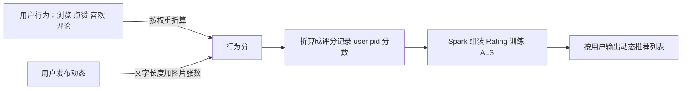

# 动态计分规则：把浏览点赞喜欢评论折算成 ALS 眼里的评分

ALS 模型吃的是评分矩阵，day07 里那十万个评分是观众实打实打出的星级。圈子动态没有人打星，用户与动态之间只有行为：看了一眼、点了个赞、留了句评论。要让推荐模型转起来，就得有人把行为翻译成分数，翻译规则就是这一课的内容。它只有两分半钟，给出的却是一张日后所有推荐计算的价目表。

## 先给结论

- 行为计分：浏览 +1、点赞 +5、喜欢 +8、评论 +10，按兴趣强度递进。
- 发布侧计分：文字 50 字以内记 1 分、50 到 100 字之间记 2 分、100 字以上记 3 分，每张图片记 1 分。
- 分值不是拍脑袋定的，要结合产品诉求与最终推荐效果持续校准。
- 计分在 dubbo 服务侧实现，分数随行为事件进入推荐链路，Spark 只消费结果不做换算。
- 行为分就是推荐模型里的 rating，顶替电影评分矩阵里的星级。

## 一、评分矩阵里的空位

推荐模型的输入是一张用户对物品的评分表，day07 的 u.data 每行三列：用户 id、电影 id、几分。电影场景里「几分」由观众给出，动态场景里没有这个动作，用户从不在圈子里给动态打星。但打分其实一直在发生：一个用户愿意停下来浏览，是 1 分的兴趣；点下赞，是明确的好感；点喜欢，是比点赞更重的偏好；专门打字评论，则是投入成本最高的深度互动。行为就是评分，只是没换算过。计分规则要做的，就是把这张行为价目表定出来，让每次操作都能折算成一个稳定的数字。

## 二、行为计分：四种操作四档分

课程定下的行为分值如下：

| 操作 | 分值 | 信号含义 |
| --- | --- | --- |
| 浏览 | +1 | 看过，最弱的兴趣表达 |
| 点赞 | +5 | 明确好感，成本低于评论 |
| 喜欢 | +8 | 强偏好，比点赞更接近个人口味 |
| 评论 | +10 | 深度互动，投入文字与时间 |

四个数字是一条递进的坡道。浏览是被动动作，几乎零成本，只记 1 分；点赞要主动出手，记 5 分；喜欢在产品语义上比点赞更贴近「我喜欢这个人或这条内容」，分值更高；评论要求组织语言、花费时间，是四种操作里最重的一种，记满分 10 分。分值的差距本身就是信息，模型据此知道一次评论抵得上两次浏览，而不是把所有操作一视同仁。

## 三、发布侧计分：内容本身也有价目

计分规则不只覆盖围观者，发布者的投入同样折算成分数。课程定的规则是两笔账：文字按长度计分，50 字以内记 1 分，50 到 100 字之间记 2 分，100 字以上记 3 分；图片按张数计分，每张记 1 分，发五张图的动态记 5 分。这两笔账衡量的是动态自身的制作成本，一段用心写的长文配上多张图，天然比一句话空发更值得被更多人看到，发布分给了这类内容一个初始权重。

把两套规则画进同一条流水线，就是下面这张图：



这张图讲的是分数从哪里来、到哪里去：左侧两种来源在中间汇成评分记录，右侧喂给推荐模型。关键路径在中间那个汇合点，行为分与发布分最终都以「用户、动态、分数」三元组的形态存在，对 ALS 来说与电影评分别无二致，模型代码一行不用改。

## 四、分值是谁定的：业务决策不是算法决策

这张价目表带着明显的业务味，它是可以商量的。课程原话的意思很实在：规则可以先这样定，但需要与产品经理沟通，更要看最终推荐出来的结果是否合理，分数随时可以调整。换句话说，计分规则是业务决策不是算法决策，它定义的是「产品认为什么行为更有价值」，模型只是忠实地消费这个定义。上线之后如果发现推荐列表被高产的图片动态刷屏，调一调图片分；如果评论太稀疏压不住浏览分，把评论再加重，规则集中在一处，改起来才有抓手。

## 五、计分实现的位置：dubbo 服务侧

分数在哪里算，课程链路里是明确的：dubbo 服务侧。发布分在 `savePublish` 落库时随动态算出，行为分在点赞、喜欢、评论这些操作的处理逻辑里累加，它们都是 dubbo 工程里的服务方法，行为发生的第一现场就在这里，就地计分最近也最准。算出的分数随行为事件进入推荐链路：消息里带着动态 pid 与行为分，Spark 消费侧组装 Rating 时直接取用。按这套规则写出的计分逻辑示意如下（day08 资料包无源码，示例为按本课计分规则补全）：

```java
/**
 * 发布动态计分：文字长度与图片数量，规则来自本课计分表
 */
private Long scoreOfPublish(Publish publish) {
    long score = 0;
    String text = publish.getText();
    int len = text == null ? 0 : text.length();
    if (len <= 50) {
        score += 1;   //50 字以内记 1 分
    } else if (len <= 100) {
        score += 2;   //50 到 100 字之间记 2 分
    } else {
        score += 3;   //100 字以上记 3 分
    }
    List<String> medias = publish.getMedias();
    score += medias == null ? 0 : medias.size(); //每张图片记 1 分
    return score;
}
```

```java
/**
 * 行为操作计分：浏览 1、点赞 5、喜欢 8、评论 10
 */
public long scoreOfAction(String action) {
    switch (action) {
        case "BROWSE":  return 1;  //浏览
        case "LIKE":    return 5;  //点赞
        case "LOVE":    return 8;  //喜欢
        case "COMMENT": return 10; //评论
        default:        return 0;  //未知操作不计分
    }
}
```

两段代码刻意保持一样的气质：规则表直译成代码，不做任何抽象包装。分值是会被产品反复调整的业务常量，写成集中、直白的形式，改一个数字就是一次回归验证；过早抽成策略模式反而把最常变的东西藏深了一层。分数算好之后的事，发送消息课会接过去，行为事件带着 pid 与分数流向 RocketMQ，Spark 那头把分数填进 Rating 的第三个位置，ALS 训练照旧。

## 常见误区

- **以为分值是算法算出来的。** 错例：用模型自动学习每个操作的权重。正解：分值是产品定义的业务规则，模型只消费结果；要调的是规则表，不是模型。
- **以为计分只看互动行为。** 错例：只给浏览点赞喜欢评论定价，发布端全算零分。正解：文字长度与图片张数决定发布分，内容制作成本同样是推荐输入的一部分。
- **以为所有操作等价，数个数就行。** 错例：行为次数求和当总分。正解：评论 10 分、浏览 1 分，一次评论的分量抵十次浏览，权重的梯度就是用户的兴趣强度。
- **以为计分规则一旦定下就不能动。** 错例：上线后从不回看推荐效果。正解：分值要跟着推荐结果持续校准，规则集中在一处，调整的成本才足够低。

## 面试可能被问到的问题

1. 面试官追问：「动态推荐里的评分矩阵，rating 从哪里来？」
   答：从用户行为折算而来。浏览、点赞、喜欢、评论按规则表分别计 1、5、8、10 分，动态的发布内容按文字长度与图片张数计分，这些分数以用户、动态 pid、分数三元组的形态组装成 Rating，替代电影场景里的星级评分。
2. 面试官追问：「为什么评论 10 分比点赞 5 分高一倍？」
   答：分值梯度对应行为成本。评论需要组织文字、投入时间，是表达偏好最重的动作；点赞只是一次点击，喜欢介于两者之间。分值差距让模型能区分「随手点过」与「深度互动」，推荐结果才偏向用户真正在意的内容。
3. 面试官追问：「计分为什么放在 dubbo 服务侧，而不是 Spark 算的时候再折算？」
   答：行为发生的第一现场在业务服务，落库或处理操作时就地计分最准也最省事；规则集中在业务侧一处维护，产品调整分值不用改大数据代码。Spark 只负责消费算好的分数组装 Rating，职责边界清晰。
4. 面试官追问：「上线后发现推荐列表偏重图片动态，怎么调整？」
   答：调计分规则而不是改模型。降低每张图片的发布分或提高文字分，规则集中在一处，改动后新行为按新分值流入推荐链路，离线计算重跑后列表逐步修正，同时配合产品回看效果持续校准。

## 配套资料

- 学习目标：`materials/code/07/day08 探花交友-实现推荐功能/day08/学习目标.md`，推荐逻辑的实现目标以本课计分规则为前置。
- ALS 输入参照：`materials/code/07/day07 探花交友-SparkMLlib推荐系统快速入门/day07/资料/ml-100k/`，u.data 的星级评分是行为分要对位的原形。
- 说明：day08 资料包仅含学习目标，无源码包；分值表以本课画面为准，两段计分代码为按本课规则与既有工程结构补全的示例。
