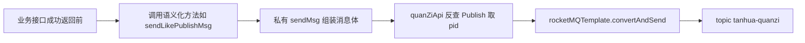

# 圈子推荐的第一段链路：把七类用户行为发进 RocketMQ

推荐系统的原料是用户行为，而行为全部发生在圈子的业务代码里。最直觉的做法是让圈子模块直接调用推荐工程，但这样一来，发布动态、点赞这些核心操作就绑死在另一个系统上：推荐工程发版、重启甚至宕机，用户可能连一条动态都发不出来。解耦的标准答案是发消息：业务侧只负责把「谁、对哪条动态、做了什么」广播出去，谁来消费、怎么算分，业务代码一概不管。

真正动手时会碰到三个具体问题：消息发到哪个 topic、消息体里该放哪些字段、发送失败算不算业务失败。这三个问题决定了埋点代码长什么样，这一节把发送侧一次搭完。

## 先给结论

- server 工程引入 rocketmq-spring-boot-starter，配置只有两项：nameServer 地址与 producer group。
- 发送逻辑统一收口在 QuanziMQService：私有方法 sendMsg 负责组装消息体，7 个语义化公开方法对应 7 类行为，type 编号与动态计分规则一一对应。
- 消息体固定 5 个字段：type、publishId、date、userId、pid；pid 是动态的自增长 id，发送前要用 publishId 反查一次动态才能拿到。
- 发送动作包在 try-catch 里，失败只记 error 日志，绝不让消息问题拖垮发布与互动的主流程。
- 埋点位置在「业务成功之后」，这要求 QuanZiApi 的 savePublish 从返回布尔值改成返回动态主键。

## 一、埋点收口成一个 MQ Service

七类行为散落在 MovementsController、CommentsController 等多处接口里。如果每个 Controller 各自拼 Map、各自调 RocketMQTemplate，topic 名、字段名很快就会漂移出好几个版本，消费端根本没法统一解析。收口的办法是单独做一个 QuanziMQService，让 topic 和消息结构只有一处定义，Controller 只需要在业务成功后调用一个语义清晰的方法。

依赖加在 server 工程里，因为用户的所有互动操作都从这个工程出去：

```xml
<!-- RocketMQ 发送端依赖 -->
<dependency>
    <groupId>org.apache.rocketmq</groupId>
    <artifactId>rocketmq-spring-boot-starter</artifactId>
    <version>2.0.3</version>
</dependency>
```

配置只有两项，nameServer 告诉客户端去哪找路由，producer group 标识发送方集群：

```properties
#rocketmq相关配置
spring.rocketmq.nameServer=192.168.31.81:9876
spring.rocketmq.producer.group=tanhua
```

## 二、通用 sendMsg：消息体设计与 pid 反查

发送端的核心是一个私有方法 sendMsg，两个入参：行为类型 type 和动态主键 publishId。type 是 int，取值就是前面定下的计分规则编号：1 发动态、2 浏览动态、3 点赞、4 喜欢、5 评论、6 取消点赞、7 取消喜欢。计分规则改权重时只动消费端，编号不动，发送端就完全不用改。

```java
@Service
public class QuanziMQService {

    private static final Logger LOGGER = LoggerFactory.getLogger(QuanziMQService.class);

    @Autowired
    private RocketMQTemplate rocketMQTemplate;

    @Reference(version = "1.0.0")
    private QuanZiApi quanZiApi;

    /**
     * 通用发送：组装消息体并发往圈子 topic
     * @param type 行为类型，与计分规则编号一致
     * @param publishId 动态主键（MongoDB ObjectId 的字符串形式）
     */
    private void sendMsg(Integer type, String publishId) {
        try {
            User user = UserThreadLocal.get();
            //消息里只有 publishId，而推荐侧需要自增长 pid，先反查一次动态
            Publish publish = this.quanZiApi.queryPublishById(publishId);
            Map<String, Object> msg = new HashMap<>();
            msg.put("type", type);
            msg.put("publishId", publishId);
            msg.put("date", System.currentTimeMillis());
            msg.put("userId", user.getId());
            msg.put("pid", publish.getPid());
            this.rocketMQTemplate.convertAndSend("tanhua-quanzi", msg);
        } catch (Exception e) {
            //发送消息不能影响业务主流程，失败只记日志
            LOGGER.error("圈子消息发送失败，type = " + type + ", publishId = " + publishId, e);
        }
    }
}
```

消息体 5 个字段各有分工，缺一个消费端就得补逻辑：

- `type`：行为编号，消费端 switch 计分的依据。
- `publishId`：动态在 MongoDB 里的主键字符串，消费端需要正文时靠它回查。
- `pid`：动态的自增长 id，推荐模型里的 item 标识，从反查到的 Publish 对象上取。
- `userId`：操作人，从 UserThreadLocal 取当前登录用户，推荐系统按用户维度建模。
- `date`：发送时刻的时间戳，推荐侧用它做训练集与测试集的时间切分。

整条发送链路如下图，Controller 只进不出，消息组装与发送全在 Service 内部：



关键路径在中间两步：反查 Publish 是为了让消费端不必每条消息都回查正文，topic `tanhua-quanzi` 是两侧唯一的约定点，名字一旦定下就不能随意改。

## 三、七个语义化方法与 type 编号

在 sendMsg 之上包一层公开方法，方法名直接说人话，调用方不用记编号：

```java
/** 发送新增动态消息，type = 1 */
public void sendSavePublishMsg(String publishId) {
    this.sendMsg(1, publishId);
}

/** 发送浏览动态消息，type = 2 */
public void sendQueryPublishMsg(String publishId) {
    this.sendMsg(2, publishId);
}

/** 发送点赞消息，type = 3 */
public void sendLikePublishMsg(String publishId) {
    this.sendMsg(3, publishId);
}

/** 发送喜欢消息，type = 4 */
public void sendLovePublishMsg(String publishId) {
    this.sendMsg(4, publishId);
}

/** 发送评论消息，type = 5 */
public void sendCommentPublishMsg(String publishId) {
    this.sendMsg(5, publishId);
}

/** 发送取消点赞消息，type = 6 */
public void sendDislikePublishMsg(String publishId) {
    this.sendMsg(6, publishId);
}

/** 发送取消喜欢消息，type = 7 */
public void sendDislovePublishMsg(String publishId) {
    this.sendMsg(7, publishId);
}
```

| type | 行为 | 消费端分值 |
| --- | --- | --- |
| 1 | 发动态 | 按文字长度与图片数计算 |
| 2 | 浏览动态 | 1 |
| 3 | 点赞 | 5 |
| 4 | 喜欢 | 8 |
| 5 | 评论 | 10 |
| 6 | 取消点赞 | -5 |
| 7 | 取消喜欢 | -8 |

取消类操作给负分，是计分规则的对称设计：取消点赞正好抵消之前那次点赞的 5 分，行为流水才能准确反映净偏好。

## 四、Controller 埋点：业务成功之后才发消息

埋点的位置有一个铁律：先落库成功，再发消息。失败的操作不该产生评分，否则推荐系统的输入全是噪声。落库成功的前提是能拿到动态主键，而此前的接口只返回布尔值，所以要把返回值改掉。

改动链条从 dubbo 接口开始：QuanZiApi.savePublish 的返回类型从 Boolean 改为 String，实现里返回动态主键，失败返回 null：

```java
public interface QuanZiApi {

    /**
     * 发布动态
     * @param publish 动态对象
     * @return 动态主键 publishId，保存失败返回 null
     */
    String savePublish(Publish publish);
}
```

实现类的 return 改成 `return publish.getId().toString()`，执行失败走 `return null`。MovementsService 的 saveMovements 同步透传这个字符串。之后 Controller 的埋点就顺理成章：

```java
@Autowired
private QuanziMQService quanziMQService;

@PostMapping
public ResponseEntity<Void> saveMovements(@RequestParam("textContent") String textContent,
                                          @RequestParam("location") String location,
                                          @RequestParam("longitude") String longitude,
                                          @RequestParam("latitude") String latitude,
                                          @RequestParam("multipartFile") MultipartFile[] multipartFile) {
    try {
        //saveMovements 已改造为返回动态主键
        String publishId = this.movementsService.saveMovements(textContent, location,
                longitude, latitude, multipartFile);
        if (StringUtils.isNotEmpty(publishId)) {
            //保存成功才发送新增动态消息
            this.quanziMQService.sendSavePublishMsg(publishId);
            return ResponseEntity.ok(null);
        }
    } catch (Exception e) {
        e.printStackTrace();
    }
    return ResponseEntity.status(HttpStatus.INTERNAL_SERVER_ERROR).build();
}
```

其余动作同理：动态详情查询成功后调 sendQueryPublishMsg，点赞、取消点赞、喜欢、取消喜欢各自对应编号 3 到 7 的方法。还有一处最容易漏：评论的埋点不在 MovementsController，而在 CommentsController 的发表评论接口里，评论保存成功后调 sendCommentPublishMsg。七处埋点补齐，发送侧才算闭环。

## 常见误区

- **让消息发送失败拖垮业务请求。** 错例：sendMsg 不加 try-catch，RocketMQ 连不上时用户发动态直接报 500。正解：发送包在 try-catch 里只记 error 日志，主流程照常返回；消息丢失对推荐这种统计型业务可以容忍，后续靠监控补偿。
- **消息体只带 publishId 不带 pid。** 错例：消费端每条消息都回查一次动态正文去取 pid。正解：发送端反查一次把 pid 放进消息体，浏览、点赞这类行为根本用不到正文，回查是白白放大 MongoDB 压力。
- **type 用魔法数字散落在 Controller 里。** 错例：调用处写 `sendMsg(3, id)`，编号含义全靠猜。正解：编号只出现在 QuanziMQService 内部，调用方一律用语义化方法。
- **以为 UserThreadLocal 任何线程都能拿到用户。** 错例：把发送逻辑挪进异步线程池后 userId 取出 null。正解：ThreadLocal 只在当前 Web 请求线程有效，跨线程要把 user 显式传过去。

## 面试可能被问到的问题

1. 面试官追问：「为什么用 RocketMQ 通知推荐系统，而不是直接 RPC 调用？」
   答：RPC 是强依赖，推荐工程不可用会把失败传染给发布、点赞这些核心操作；消息队列做到解耦与削峰，业务侧发完即走，推荐系统按自己的节奏消费，两侧可以独立部署与扩容。
2. 面试官追问：「消息体为什么要同时带 publishId 和 pid？」
   答：两者是同一动态的两套标识。publishId 是 MongoDB 的 ObjectId 字符串，用于回查正文；pid 是自增长 id，是推荐模型里的 item 标识，Spark 侧建模只用 pid。发送端反查一次带上 pid，消费端就省掉海量回查。
3. 面试官追问：「发送消息失败了怎么办，用户会感知到吗？」
   答：发送包在 try-catch 里，失败只记 error 日志，用户无感知，主业务正常成功。对推荐计分这类允许少量丢失的场景足够；要求严格的场景可以引入本地消息表或事务消息做补偿。
4. 面试官追问：「埋点为什么放在业务成功之后？」
   答：推荐系统的输入必须是真实发生的行为，保存失败的动态、没点成的赞都不该产生评分。先落库再发消息还保证消费端回查时数据一定存在。
5. 面试官追问：「convertAndSend 发的是 Map，消费端怎么解析？」
   答：RocketMQTemplate 会把消息体序列化成 JSON 字符串发送，消费端实现 RocketMQListener<String>，拿到字符串后用 Jackson 的 readTree 解析出各字段即可。

## 配套资料

- 学习目标：`materials/code/07/day08 探花交友-实现推荐功能/day08/学习目标.md`，「独立实现圈子中发送消息」即本节对应条目。
- 说明：day08 资料包仅含学习目标，无源码包；代码为按本课画面与主流写法补全，QuanZiApi、Publish 等命名与圈子功能一节的口径一致。
