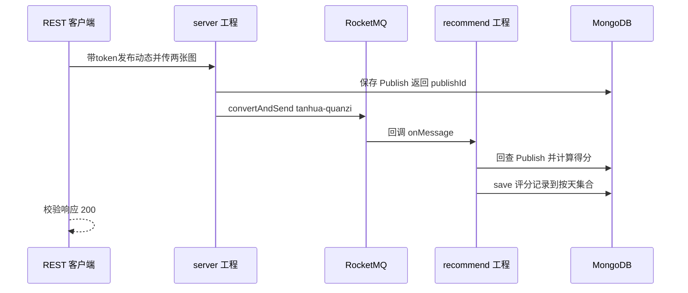

# 把消息链路跑通：从触发行为到 MongoDB 里看见得分

发送侧七处埋点、接收侧一个消费者，代码各自看起来都对，但这条链路跨了四个进程：dubbo 服务、SSO、server、recommend。任何一环断了，表面症状都一样，MongoDB 里查不到评分记录。测试的目标就是用真实请求把全链路串起来，先验证「发了能收到、收到能落库」，再逐个换行为验证得分是否与规则一致。

## 先给结论

- 四个服务全部启动：dubbo 服务提供者、SSO、server、recommend，缺一个链路就断。
- 用 REST 客户端带 token 走真实接口：发布一条带两张图的动态，消费端算出文字分 1 加图片分 2，落库 score 为 3。
- MongoDB 按天集合里每次操作新增一行：userId、pid、score、date 四要素齐全，行为可追溯。
- 同一条动态上点赞落 +5、取消点赞落 -5、喜欢落 +8，负分与正分成对出现，互相抵消。
- 消费失败默认会重投后进死信；课程实现 catch 掉异常等于放弃重试，幂等要靠行为接口与消费逻辑自身兜底。

## 一、测试环境与触发路径

四个服务的启动顺序没有强制要求，但依赖关系要清楚：server 依赖 dubbo 服务与 SSO 的登录态，recommend 依赖 RocketMQ 与 MongoDB。测试用 REST 客户端模拟 App：先发验证码、登录拿 token，之后所有请求都带这个 token。

一次发布动态在四个进程里的完整旅程如下图，图上的验证点就是本次测试的两处断点和一处落库检查：



关键路径验证手段是断点：在 MovementsController 的发布方法上打一个，在 QuanZiMsgConsumer 的 onMessage 上打一个。前者确认消息真的发出去了，后者确认消息真的到了消费端。单步跟进时能看到完整的数据流转：saveMovements 返回 publishId，sendMsg 反查 Publish 拿到 pid，消息组装完毕进入 convertAndSend；随后断点直接跳到 recommend 工程的 onMessage，此时请求侧已经收到 200 响应，消费在异步进行。

单步走完消费逻辑，能亲眼看到得分的计算过程：正文 7 个字落在「大于 0 且不超过 50」区间记 1 分，两张图片累加 2 分，最终 score 为 3，与规则一致。

## 二、查 MongoDB：得分怎么对账

落库验证直接看按天命名的评分集合，用 Mongo 客户端执行查询（集合名以当天日期为准，下例用 20200101 代指）：

```javascript
//查看当天全部评分记录，确认新行为已落库
db.getCollection('recommend_quanzi_20200101').find()
```

发布动态那一步应查到一条新文档，四个字段构成完整语义：userId 是当前登录用户，publishId 是这条动态的自增长 pid，score 是 3，date 是消息里的时间戳。换算成人话就是「用户 1 对动态 4 的发布行为记了 3 分」。

接着换行为做对账，对同一条动态连续触发几种互动，每次操作都应多出一行。以点赞为例，接口成功后消息发出，消费端按规则落 5 分：

```java
@GetMapping("/{id}/like")
public ResponseEntity<Long> likeComment(@PathVariable("id") String publishId) {
    try {
        Long count = this.movementsService.likeComment(publishId);
        if (null != count) {
            //点赞成功后发送 type = 3 的消息
            this.quanziMQService.sendLikePublishMsg(publishId);
            return ResponseEntity.ok(count);
        }
    } catch (Exception e) {
        e.printStackTrace();
    }
    return ResponseEntity.status(HttpStatus.INTERNAL_SERVER_ERROR).build();
}
```

| 触发操作 | 消息 type | 预期落库 score |
| --- | --- | --- |
| 发布动态（7 字正文加 2 图） | 1 | 3 |
| 点赞该动态 | 3 | 5 |
| 取消点赞 | 6 | -5 |
| 喜欢该动态 | 4 | 8 |

取消点赞落库 -5 这一条最值得看：它与之前那次 +5 正好抵消，说明负分对称设计在生效。三类操作测完，MongoDB 里同一 pid 挂着三行记录，分数一列写满 3、5、-5、8，这条流水就是日后 Spark 计算的全部原料。

## 三、失败重试：默认行为与课程取舍

测试里最容易忽略的问题是「消费失败会怎样」。RocketMQ 的默认策略是：onMessage 抛出异常即视为消费失败，broker 会按不断拉长的时间间隔重投，默认 16 次之后仍失败，消息进入该消费组对应的死信队列，等待人工介入。这套机制保证了「至少消费一次」的语义。

课程实现做了不同的取舍：onMessage 里 catch 住所有异常，只记 error 日志，不向外抛。这意味着坏消息一次都不重投，直接放弃。两种选择各有适用场景：

```java
//当前实现：坏消息直接放弃，适合计分允许少量丢失的场景
catch (Exception e) {
    LOGGER.error("消息处理失败！msg = " + msg, e);
}
//若要求不丢：去掉 try-catch 或重新抛出，交给 broker 重投 16 次后进死信
```

发送端同样存在丢失窗口：QuanziMQService 的 sendMsg 包在 try-catch 里，RocketMQ 不可用时消息静默丢失，用户无感知。对推荐计分这种最终统计型业务，个别丢失只影响模型精度，可以接受；如果是订单、支付类消息，两端都要换成事务消息或本地消息表方案。

## 四、幂等：重复消费了怎么办

消息队列的「至少一次」语义天然伴随重复：网络抖动时发送端可能重发，消费端消费成功但提交位点失败也会再次消费。这条链路里重复消费的后果很具体，同一次点赞被记两次 5 分，用户偏好被虚高。

课程链路的现实约束是：发布、点赞这些行为接口本身不幂等（重复请求就是两次行为），评分记录的主键又是随机 ObjectId，消费端无法识别「这是同一条消息的第二次投递」。生产上补齐幂等有两条常用路径：

- **发送端幂等**：以业务键（userId 加 publishId 加行为 type 加时间窗口）做去重表，重复的消息在发送前拦截。
- **消费端幂等**：利用 RocketMQ 消息的 msgId 或业务唯一键建去重集合，消费前检查是否处理过，处理过直接 ack。

对课程场景而言，计分偶尔重复对 ALS 训练的影响有限，幂等设计可以推迟到数据规模上来之后再补，但面试时要能说清楚这两条路径。

## 常见误区

- **把「MongoDB 没数据」一律归因于发送失败。** 错例：看到没有评分记录就去查发送端。正解：按链路分段排查，先看发送端日志有没有「消息发送失败」，再看 recommend 是否启动且 topic、consumerGroup 配置正确，最后看消费端 error 日志。
- **以为消费失败会无限重试。** 错例：坏消息重投堵住队列才发现上限是 16 次。正解：了解默认重投次数与死信队列机制，业务上决定是抛异常交给重试，还是 catch 掉主动放弃。
- **改了消息结构只重启一端。** 错例：发送端加了字段，recommend 没重启，消费端解析不到新字段。正解：两侧共享消息结构约定，联调时两端一起重启，用断点确认新字段在消费端可见。
- **重复消费后才想起幂等。** 错例：上线后统计发现分数虚高。正解：测试阶段就故意重发一条消息，观察落库是两行还是一行，把幂等策略纳入设计而不是补丁。

## 面试可能被问到的问题

1. 面试官追问：「怎么验证一条消息真的被消费了？」
   答：三处证据互相印证：发送端与消费端的日志各一条，MongoDB 里对应业务键的落库记录一条。有条件的话 MQ 控制台还能看到消费位点与堆积量，位点推进说明消费在正常进行。
2. 面试官追问：「消息重复消费怎么办？」
   答：消费逻辑做成幂等。通用做法是消费前用 msgId 或业务唯一键查去重表，处理过就直接返回；本课的计分场景每次行为插一行新流水，重复消费的代价是分数虚高，可以用发送端业务键去重来兜底。
3. 面试官追问：「这条链路里消息可能从哪些环节丢失？」
   答：三处。发送端 try-catch 静默吞掉发送失败；broker 同步刷盘配置不严时宕机可能丢；消费端 catch 掉异常不重投，处理失败即丢。推荐计分容忍丢失，换成资金类业务这三处都要补齐。
4. 面试官追问：「消费失败重投 16 次之后消息去哪了？」
   答：进入该消费组对应的死信队列，主题名通常是消费组名加 DLQ 前缀。死信消息不再被正常消费，需要监控告警并人工排查后重新投递或丢弃。
5. 面试官追问：「为什么每次操作落一行新记录，而不是更新动态的总分字段？」
   答：行为流水保留了取消类负分操作与时间戳，支持训练测试切分、按时间加权和效果回溯；总分随时可由流水聚合得出，反过来一旦只存总分，历史行为就再也找不回来。

## 配套资料

- 学习目标：`materials/code/07/day08 探花交友-实现推荐功能/day08/学习目标.md`，发送与接收两条「独立实现」条目的联调验证即本节内容。
- 说明：day08 资料包仅含学习目标，无源码包；接口与断点位置为按本课画面与主流写法补全，分值口径沿用前面小节定下的计分规则。
