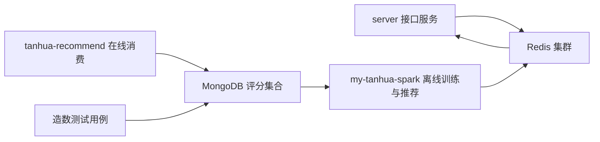

# 给离线推荐安个家：Spark 推荐工程的依赖与配置搭建

消息链路已经把「谁对哪条动态做了什么、记几分」的评分流水稳定写进 MongoDB，造数用例又把训练数据补到了可用规模，训练代码看起来随时可以开写。真要动手就会发现没有落脚点：Spark 的依赖树又重又挑食，ALS 相关类、MongoDB 连接器、Redis 客户端各有版本脾气，直接塞进任何业务工程都会把对方的依赖搅乱。本节的工程量不大，但依赖清单里的每一项都有明确的理由，配置文件只有两行，却决定了数据从哪读、结果往哪写。

## 先给结论

- 在父工程 `my-tanhua` 下新建子模块 `my-tanhua-spark`，packaging 为 jar，与业务工程物理隔离，依赖互不污染。
- 依赖五件套：`spark-mllib_2.12` 2.4.3、`mongo-spark-connector_2.12` 2.4.1、`javax.servlet-api` 3.1.0、`lombok`、`jedis` 3.1.0。
- Spark 自带的旧版 servlet（2.5）必须排除，再统一引入 3.1.0，否则可能出现类冲突。
- 配置文件 `app.properties` 只有两条：`spark.mongodb.input.uri` 指向 tanhua 库的按天评分集合，`redis.cluster.nodes` 声明 Redis 集群三节点。
- 工程分工要记牢：`tanhua-recommend` 在线收消息算分落库，`my-tanhua-spark` 离线读评分训练出推荐，结果写回 Redis 供查询侧命中。

## 一、Spark 工程为什么要单独拆出来

把训练代码写进业务工程，短期内看似省了一个模块，实际上埋了三类雷。**第一，依赖体量失控。** `spark-mllib` 一个坐标会拉进 Spark Core、SQL、Streaming、网络通信、各类序列化库等上百个 jar，业务工程的依赖树瞬间膨胀一个数量级，冲突排查成本随之暴涨。**第二，生命周期相反。** Web 工程启动后常驻进程对外提供服务，Spark 任务是批处理：启动、跑完训练、写出结果、退出，一个任务一次生命周期，混在一起连「这个进程为什么占着内存」都解释不清。**第三，版本各有主张。** Spark 2.4.3 绑定 Scala 2.12 与特定版本的 Hadoop、jackson 体系，任何一项与业务工程的版本顶在一起，都是难以定位的运行期错误。

拆出去之后，推荐体系的分工就清晰了，两个推荐相关工程各管一段：



这张图讲的是推荐数据的完整闭环。关键路径沿 D、F、B、A 一路走：评分集合由 tanhua-recommend 的消费者与造数用例写入，`my-tanhua-spark` 把它读出来训练 ALS 并生成推荐，结果落到 Redis，圈子查询再从 Redis 命中推荐列表。本节要建的就是图中 F 这个节点。

## 二、Maven 依赖：五件套与一次排除

新建模块时选择挂在父工程 `my-tanhua` 之下，groupId 沿用 `com.study.tanhua`，pom 的头部与依赖如下：

```xml
<parent>
    <artifactId>my-tanhua</artifactId>
    <groupId>com.study.tanhua</groupId>
    <version>1.0-SNAPSHOT</version>
</parent>
<modelVersion>4.0.0</modelVersion>
<packaging>jar</packaging>
<artifactId>my-tanhua-spark</artifactId>

<dependencies>
    <!--Spark MLlib：ALS 矩阵分解与推荐都在这里-->
    <dependency>
        <groupId>org.apache.spark</groupId>
        <artifactId>spark-mllib_2.12</artifactId>
        <version>2.4.3</version>
        <exclusions>
            <exclusion>
                <groupId>javax.servlet</groupId>
                <artifactId>javax.servlet-api</artifactId>
            </exclusion>
        </exclusions>
    </dependency>
    <!--Spark 读 MongoDB 的连接器-->
    <dependency>
        <groupId>org.mongodb.spark</groupId>
        <artifactId>mongo-spark-connector_2.12</artifactId>
        <version>2.4.1</version>
    </dependency>
    <!--统一使用 3.1.0 的 servlet API-->
    <dependency>
        <groupId>javax.servlet</groupId>
        <artifactId>javax.servlet-api</artifactId>
        <version>3.1.0</version>
    </dependency>
    <dependency>
        <groupId>org.projectlombok</groupId>
        <artifactId>lombok</artifactId>
    </dependency>
    <!--推荐结果要写进 Redis 集群-->
    <dependency>
        <groupId>redis.clients</groupId>
        <artifactId>jedis</artifactId>
        <version>3.1.0</version>
    </dependency>
</dependencies>
```

五个依赖各司其职，逐个说清引入理由。`spark-mllib_2.12` 是训练 ALS 的核心库，坐标尾部的 `2.12` 是 Scala 版本号，不是依赖自身的版本，Spark 生态里所有带 Scala 后缀的坐标必须对齐同一个 Scala 大版本，后面 connector 的 `2.12` 就是在跟它配对。`mongo-spark-connector_2.12` 提供 `MongoSpark` 这个入口类，Spark 读 MongoDB 的能力全靠它，没有驱动包，评分集合只能干看着。`javax.servlet-api` 单独列出来是因为排除动作：Spark 的传递依赖里带着 2.5 的旧版 servlet，2.5 与 3.1 的接口签名有差异，混在同一个 classpath 里可能在运行期抛出找不到方法的错误，所以先把旧的排除、再把统一版本引进来，classpath 上只留一份干净的 3.1.0。`lombok` 让后面可能用到的 pojo 少写模板代码。`jedis` 看起来最突兀，一个不跑 Web 的批处理工程为什么要 Redis 客户端，答案是推荐结果最终的落点就是 Redis 集群，没有它，训练出来的列表无处可写。

PPT 里 `javax.servlet-api` 的 `provided` scope 被注释掉了，这个细节值得留意：本地以 `local[*]` 模式运行时，servlet 相关类由工程自己携带，默认的 compile scope 即可；将来把任务提交到集群，执行环境已经自带 servlet 实现，再考虑改成 `provided` 避免重复打包。

## 三、两行配置：app.properties

配置文件放在 `src/main/resources` 下，命名为 `app.properties`，全部内容只有两条：

```properties
#Spark 读 MongoDB 的输入源：库 tanhua，按天命名的评分集合
spark.mongodb.input.uri=mongodb://192.168.31.81:27017/tanhua.recommend_quanzi_20191001
#Redis 集群节点，逗号分隔
redis.cluster.nodes=192.168.31.81:6379,192.168.31.81:6380,192.168.31.81:6381
```

第一条是 Mongo Spark 连接器的约定配置键，连接器在初始化时会读取它来定位数据源。URI 路径部分的语义是「库.集合」：`tanhua` 是业务共用的库，`recommend_quanzi_20191001` 是按天命名的评分集合，命名规则与 tanhua-recommend 消费端落库、与造数用例写入的集合完全一致，三处对不上名字，Spark 加载到的就是 0 条数据。做训练时想换数据，改这一行集合名即可，代码不需要动。

第二条是 Redis 集群的节点列表，三个节点用逗号分隔，每个节点是 `host:port` 形式。Spark 工程不用 Spring 的 RedisTemplate，而是直接用 JedisCluster 裸连，所以这里没有 Spring 风格的配置项，就是一个普通的自定义键，后续代码里用 `properties.getProperty` 读出来手工解析。把节点写进配置而不是写死在代码里，换一套测试或生产集群时只改文件不动代码，这也是下节 main 方法里要通过类加载器加载这个文件的原因。

## 四、工程骨架与下一步

代码只规划两个类，都放在 `com.study.tanhua.spark.mongo` 包下：`MLlibRecommend` 承接 day07 的 ALS 调参流程，输入评分数据、输出最优模型；`SparkQuanZi` 是主入口，负责加载配置、读评分、调模型、写 Redis。类的具体实现是接下来两节的内容，本节把地基打牢：模块独立、依赖齐全、配置就位，后面写代码时每一行都只关心业务逻辑，不再被环境问题打断。

验证地基是否牢固有个简单办法：模块建好、依赖刷新完毕后，在工程里随便建一个类 import `org.apache.spark.mllib.recommendation.ALS` 与 `org.mongodb.spark.MongoSpark`，都能点得进去、不报红，说明五件套各就各位；再看 External Libraries 里 `javax.servlet-api` 只剩 3.1.0 一个版本，说明排除动作生效了。

## 常见误区

- **漏掉 servlet 的排除与重引入。** 错例：只引 `spark-mllib` 就开始写代码，运行期抛出 servlet 相关的类冲突。正解：exclusions 排掉传递来的 2.5 旧版，再显式引入统一的 3.1.0，保证 classpath 只有一份。
- **Scala 版本后缀不一致。** 错例：`spark-mllib_2.12` 配上 `mongo-spark-connector_2.11`，编译期看不出来，运行期抛 NoSuchMethodError。正解：所有 Spark 生态坐标的 Scala 后缀统一为 2.12。
- **URI 里的集合名与落库集合对不上。** 错例：配置写了 `recommend_quanzi`，消费端落的是 `recommend_quanzi_20200101`，Spark 加载 0 条数据还以为代码有错。正解：URI 的库.集合与按天命名规则严格对齐，换日期换集合只改配置。
- **给批处理工程引入 Spring Boot 全家桶。** 错例：照着业务工程拷一份 spring-boot-starter 全家，依赖树膨胀且多数用不上。正解：Spark 工程只要五件套，配置用 Properties 读取，不需要 Spring 容器。

## 面试可能被问到的问题

1. 面试官追问：「Spark 计算工程为什么要和业务工程分开部署？」
   答：三个理由：依赖体量差异大，Spark 会拉进上百个 jar，混部署容易版本冲突；生命周期不同，Spark 任务跑完即退，Web 工程常驻；发布节奏不同，算法调参与业务迭代互不拖累。拆开后两边依赖各自干净，出问题先按工程切分排查。
2. 面试官追问：「spark-mllib_2.12 里的 2.12 是什么含义，不注意会怎样？」
   答：2.12 是该构件编译所用的 Scala 版本。Spark 生态的组件都带这个后缀，混用 2.11 与 2.12 的构件时编译能过，运行期会出现 NoSuchMethodError 这类字节码不兼容错误，所以整个工程的 Spark 系依赖必须统一后缀。
3. 面试官追问：「为什么要排除 Spark 带进来的 javax.servlet-api 再自己引入？」
   答：Spark 的传递依赖里是 2.5 的旧版 servlet，接口签名与 3.1 有差异，同 classpath 两份实现会出现运行期方法找不到的问题。Maven 的 exclusions 排旧，再显式引入统一的 3.1.0，是处理传递依赖冲突的标准做法。
4. 面试官追问：「spark.mongodb.input.uri 这个配置是谁消费的，路径怎么理解？」
   答：它是 mongo-spark-connector 的约定键，调用 MongoSpark.load 时连接器读取它定位数据源。路径部分是「库.集合」，前面的 tanhua 是 MongoDB 库名，后面是按天命名的评分集合，与消息消费端落库的命名规则保持一致。
5. 面试官追问：「推荐结果为什么写 Redis 而不是直接写 MongoDB？」
   答：推荐结果的读方是圈子列表这类在线接口，每次请求都要取一次，对延迟敏感；Redis 的读取性能远高于 MongoDB，而且 key 按用户划分，查询侧一次 get 就能命中整个列表。MongoDB 里的评分流水是训练原料，两边职责不同。

## 配套资料

- 学习目标：`materials/code/07/day08 探花交友-实现推荐功能/day08/学习目标.md`，「独立实现圈子的推荐逻辑」的工程承载即本节搭建的模块。
- ALS 算法背景：`materials/code/07/day07 探花交友-SparkMLlib推荐系统快速入门/`，本节引入的 `spark-mllib` 正是为承接该阶段的 ALS 训练代码。
- 说明：day08 资料包仅含学习目标，无源码包；依赖清单、pom 结构与配置文件为按本课画面与主流写法补全，集合命名与 IP 沿用课程口径，Redis 密码类敏感信息课程环境为无密码直连。
