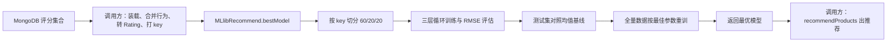

# 把 ALS 从演示代码抽成工具类：MLlibRecommend 的复用改造

day07 的 ALS 实战代码是一条完整的调参流水线：按时间戳打 key、三份切分、三层循环挑参数、全量重训出模型。但它的形态是教学型的 main 方法，数据路径写死成本地文件，跑一次推荐一遍过。推荐系统要复用这套流程时，数据来源换成了 MongoDB 里的评分集合，入口换成了另一个类的 main，如果照抄一遍，等于把几百行代码复制一份再改开头。正确的做法是做一次抽取：把不随数据源变化的部分收进一个工具类，调用方只负责喂数据。

## 先给结论

- 抽取的刀法：数据装载、行为合并、Rating 转换留在调用方；切分、调参、评估、全量重训收进 `MLlibRecommend`。
- 工具类只暴露一个方法：`bestModel(JavaPairRDD<Long, Rating>)`，传入打好 key 的评分数据，返回 `MatrixFactorizationModel`。
- 入参从文件路径变成 Rating RDD 是这次抽取的灵魂：算法与数据源彻底解耦，u.data 可以喂，MongoDB 评分集合也可以喂。
- 类内流程与 day07 完全一致：60/20/20 切分、三层循环按校验集 RMSE 选参、测试集对均值基线报提升幅度、全量数据重训返回。
- 类放在 `com.study.tanhua.spark.mongo` 包下，主流程 `SparkQuanZi` 下一节直接调用。

## 一、先看清被抽取的原型

day07 实战篇的原型代码从读取本地评分文件开始，四列数据「用户、电影、评分、时间戳」逐行转成 Rating，再用时间戳对 10 取模打上 key：

```java
//读评分文件，按制表符切分后转 Rating，时间戳取模作为 key
JavaRDD<String> rawData = jsc.textFile("F:\\ml-100k\\u.data");
JavaRDD<String[]> rawRatings = rawData.map(v -> v.split("\t"));
JavaPairRDD<Long, Rating> ratings = rawRatings.mapToPair(v -> {
    Rating rating = new Rating(Integer.valueOf(v[0]),
            Integer.valueOf(v[1]), Double.valueOf(v[2]));
    return new Tuple2<>(Long.valueOf(v[3]) % 10, rating);
});
```

原型后半段依次是：装载电影目录把 id 映射成片名、统计用户与电影规模、按 key 范围切出 60/20/20 三份、三层循环训练并在校验集上比 RMSE、测试集与均值基线对比报提升幅度，最后用全量数据按冠军参数重训，拿模型调 `recommendProducts` 出推荐。整条链路里，真正与「数据从哪来」绑定的只有开头十几行装载代码，后面的算法流程对数据长什么样毫无感觉，这正是可以抽取的原因。

抽取前后的边界用一张图划清，虚线两边各自的职责从此固定：



关键路径看 B 与 C 的交界：调用方把数据加工成「key 加 Rating」的形态之后，剩下的全部交给工具类；H 与 I 的交界同样干净，工具类不管推荐给谁、推荐几条，只交回一个能做预测的模型。

## 二、哪些留下，哪些带走

**带走的是算法侧的固定流程。** 切分比例 60/20/20 是 ALS 调参的通用配置；三层循环的候选参数与比较逻辑只跟算法有关；RMSE 的计算方式在哪个业务里都一样；全量重训这个动作更是纯粹的训练策略。这些代码放进工具类，一次写好处处复用。

**留下的是数据侧的灵活部分。** 演示环境从文件读，推荐系统从 MongoDB 读；u.data 天然一行一条评分，而评分集合里同一用户对同一动态会有多条行为流水，需要先按键合并。数据形态的差异全部消化在调用方，工具类收到的永远是「处理干净、打好 key」的 Rating 数据。如果哪天要给小视频做推荐，只需要再写一个调用方，工具类一行不改。

这个边界也是面试里常考的「职责划分」意识：工具类对上只暴露一个契约，契约之内的实现可以继续进化，比如把候选参数做成方法参数、把 RMSE 换成其他指标，调用方都无感。

## 三、MLlibRecommend 的完整形态

```java
package com.study.tanhua.spark.mongo;

import org.apache.spark.api.java.JavaPairRDD;
import org.apache.spark.api.java.JavaRDD;
import org.apache.spark.mllib.recommendation.ALS;
import org.apache.spark.mllib.recommendation.MatrixFactorizationModel;
import org.apache.spark.mllib.recommendation.Rating;
import scala.Tuple2;

/**
 * ALS 训练工具类：输入打好 key 的评分数据，返回全量重训后的最优模型
 */
public class MLlibRecommend {

    public MatrixFactorizationModel bestModel(JavaPairRDD<Long, Rating> ratings) {
        //规模统计：数用户对 Rating 的 user 去重，数动态对 product 去重
        long numRatings = ratings.count();
        long numUsers = ratings.values().map(v -> v.user()).distinct().count();
        long numPublishs = ratings.values().map(v -> v.product()).distinct().count();
        System.out.println("用户：" + numUsers + " 动态：" + numPublishs
                + " 评分：" + numRatings);

        Integer numPartitions = 4; //分区数
        //训练集：key 小于 6，约 60%
        JavaRDD<Rating> training = ratings.filter(v -> v._1() < 6)
                .values().repartition(numPartitions).cache();
        //校验集：key 落在 6 到 8 之间，约 20%
        JavaRDD<Rating> validation = ratings.filter(v -> v._1() >= 6 && v._1() < 8)
                .values().repartition(numPartitions).cache();
        //测试集：key 不小于 8，约 20%
        JavaRDD<Rating> test = ratings.filter(v -> v._1() >= 8)
                .values().repartition(numPartitions).cache();

        long numTraining = training.count();
        long numValidation = validation.count();
        long numTest = test.count();
        System.out.println("训练集：" + numTraining + " 校验集：" + numValidation
                + " 测试集：" + numTest);

        //参数候选：rank、lambda、迭代次数，可按数据规模自行扩充
        int[] ranks = {8, 10, 12};
        double[] lambdas = {0.01, 0.03, 0.1, 0.3, 1, 3};
        int[] numIters = {8, 9, 10};

        MatrixFactorizationModel best = null;
        double bestRmse = Double.MAX_VALUE;
        int bestRank = 0, bestNumIter = -1;
        double bestLambda = -1.0;

        //三层循环：训练集训练，校验集比 RMSE，误差更小则记录
        for (int rank : ranks) {
            for (double lambda : lambdas) {
                for (int numIter : numIters) {
                    MatrixFactorizationModel model =
                            ALS.train(training.rdd(), rank, numIter, lambda);
                    double rmse = computeRmse(model, validation, numValidation);
                    System.out.println("rank=" + rank + ", lambda=" + lambda
                            + ", numIter=" + numIter + ", RMSE=" + rmse);
                    if (rmse < bestRmse) {
                        best = model;
                        bestRmse = rmse;
                        bestRank = rank;
                        bestLambda = lambda;
                        bestNumIter = numIter;
                    }
                }
            }
        }

        //测试集验收，并与均值基线比较提升幅度
        double testRmse = computeRmse(best, test, numTest);
        Double meanRating = training.union(validation)
                .mapToDouble(v -> v.rating()).mean();
        double baselineRmse = Math.sqrt(test.map(v ->
                (meanRating - v.rating()) * (meanRating - v.rating()))
                .reduce((v1, v2) -> v1 + v2) / numTest);
        double improvement = (baselineRmse - testRmse) / baselineRmse * 100;
        System.out.println("最佳训练模型的准确率提升了："
                + String.format("%.2f", improvement) + "%");

        //按最佳参数用全量数据重训，作为返回给调用方的最终模型
        return ALS.train(ratings.values().rdd(), bestRank, bestNumIter, bestLambda);
    }

    //计算预测值与真实值之间的均方根误差 RMSE
    private double computeRmse(MatrixFactorizationModel model,
                               JavaRDD<Rating> data, long n) {
        JavaRDD<Tuple2<Object, Object>> userProducts = data.map(
                v -> new Tuple2<Object, Object>(v.user(), v.product()));
        JavaRDD<Rating> predictions = model.predict(userProducts);
        //按用户加物品拼 key，与真实评分 join 后逐条求平方差
        JavaRDD<Tuple2<Double, Double>> predAndTrue = predictions
                .mapToPair(p -> new Tuple2<>(p.user() + "_" + p.product(), p.rating()))
                .join(data.mapToPair(r ->
                        new Tuple2<>(r.user() + "_" + r.product(), r.rating())))
                .values();
        double sum = predAndTrue.mapToDouble(t ->
                (t._1() - t._2()) * (t._1() - t._2())).reduce((x, y) -> x + y);
        return Math.sqrt(sum / n);
    }
}
```

方法签名有两处设计值得咀嚼。**入参是 `JavaPairRDD<Long, Rating>` 而不是裸的 `JavaRDD<Rating>`。** key 是切分的唯一依据，如果只传 Rating，切分就只能靠行号抽样，三份数据的分布会随排序漂移；把打 key 的责任交给调用方，工具类拿到的数据自带切分依据，key 的含义（这里是时间戳取模）由数据的生产方解释。**返回的是模型而不是推荐列表。** 推荐给谁、推荐几条、要不要过滤已浏览的动态，都是业务问题，属于调用方；工具类只回答「当前数据能训出的最好模型是什么」，两边的变更频率不同，契约越窄越稳。

规模统计那段有个容易写错的点：数用户要对 Rating 的 `user()` 去重，数动态要对 `product()` 去重。key 字段是时间戳取模的切分值，拿它去重得到的是 key 的种类数，跟用户数毫无关系，两个统计混为一谈时，规模对不上账还找不到原因。

## 四、放进工程，等一个调用方

类落在 `my-tanhua-spark` 工程的 `com.study.tanhua.spark.mongo` 包下，与即将编写的主流程同包。调用方那侧的形态已经可以预览，主流程里最终就这两行：

```java
MLlibRecommend mllibRecommend = new MLlibRecommend();
MatrixFactorizationModel bestModel = mllibRecommend.bestModel(ratings);
```

`ratings` 是主流程从 MongoDB 评分集合加工出来的、按 date 对 10 取模打好 key 的键值 RDD，下一节的主角 `SparkQuanZi` 会把它生产出来。对比一下演示版与抽取版的差异，复用的价值一目了然：

| 维度 | day07 演示版 | 抽取后的 MLlibRecommend |
| --- | --- | --- |
| 数据来源 | 写死本地 u.data 文件 | 调用方传入 Rating RDD |
| 入口形态 | 独立 main 一次性运行 | 一个可反复调用的方法 |
| 输出 | 控制台打印推荐 | 返回 MatrixFactorizationModel |
| 复用方式 | 复制代码再改 | 换调用方即可换业务 |

## 常见误区

- **把数据装载也塞进工具类。** 错例：bestModel 内部自己去读 MongoDB，换个数据源就得改算法类。正解：装载、合并、打 key 留在调用方，工具类只接收处理干净的键值 RDD。
- **入参丢掉 key 只传 Rating。** 错例：签名写成 `JavaRDD<Rating>`，类内改用行号切分，三份分布随数据排序漂移，评估结果不稳定。正解：key 是切分依据，必须随数据一起传入。
- **统计规模时对 key 去重。** 错例：`map(v -> v._1()).distinct().count()` 当成用户数。正解：key 是时间戳取模值，数用户要对 `user()` 去重，数动态要对 `product()` 去重。
- **返回调参时选出的 best 直接用。** 错例：把校验集上胜出的模型当返回值，它只见过 60% 的数据。正解：选完参数必须用全量数据按最佳参数重训，返回重训后的模型。

## 面试可能被问到的问题

1. 面试官追问：「把 ALS 训练代码抽成工具类，你的划分依据是什么？」
   答：按变更频率与数据依赖划界。数据装载、行为合并、打 key 随数据源变化，留在调用方；切分比例、参数候选、RMSE 评估、全量重训是算法侧固定流程，收进工具类。工具类只暴露一个方法契约，输入键值评分 RDD，输出最优模型。
2. 面试官追问：「为什么入参是键值对 RDD，key 有什么用？」
   答：key 由时间戳对 10 取模得到，分布接近均匀，按 key 范围过滤等效随机抽样，能切出分布稳定的训练、校验、测试三份数据。key 由调用方打上并随数据传入，工具类直接按 key 范围切分，不同业务还能定义自己的 key 规则。
3. 面试官追问：「工具类为什么不顺便把推荐列表也生成了？」
   答：推荐列表牵涉用户范围、数量、过滤规则这些业务决策，变更频繁；模型只依赖数据与算法，变更频率低。返回模型把业务决策留给调用方，契约更窄，工具类的演进不会波及业务代码。
4. 面试官追问：「computeRmse 里为什么要 join 一下？」
   答：模型预测的是给定「用户、物品」组合的分数，要与真实评分逐条对齐才能算误差。两边都用用户加物品拼成的字符串作 key 做 join，对不上的组合自动丢弃，join 的结果就是预测与真值成对的集合，再算平方差均值开根号。
5. 面试官追问：「抽取时哪个动作最容易漏掉？」
   答：全量重训。调参阶段的模型只在训练集上训练过，参数选定后要用全量评分按最佳参数再训一次，每条数据都为最终模型出力。漏掉这步，线上模型等于少学了四成数据，效果打折还难以察觉。

## 配套资料

- 学习目标：`materials/code/07/day08 探花交友-实现推荐功能/day08/学习目标.md`，「独立实现圈子的推荐逻辑」的模型训练环节即本节的 `MLlibRecommend`。
- 原型与数据目录：`materials/code/07/day07 探花交友-SparkMLlib推荐系统快速入门/day07/资料/ml-100k/`，day07 演示代码的评分数据文件所在目录，抽取前的原型流程承接该阶段实战篇。
- 说明：day08 资料包仅含学习目标，无源码包；`MLlibRecommend` 类为按本课画面与 day07 实战写法补全，参数候选沿用 day07 实战篇口径，可按数据规模自行扩充。
