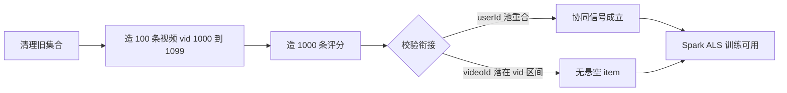

# 给小视频推荐造数：100 条视频与 1000 条评分的衔接设计

消息链路能攒评分，但攒的速度取决于真实用户的活跃度，开发阶段系统里只有几条零星记录。ALS 的协同信号靠共现关系撑起来，几十条评分算不出任何有意义的偏好，训练要么出噪声要么直接失败。圈子推荐的造数已经验证过一套成熟做法，小视频侧照搬套路，但有两处要对齐好：视频的数字身份从 pid 换成了 vid，评分集合从 quanzi 系换成了 video 系，任何一处没对上，Spark 那头拿到的就是一张满是悬空 item 的废表。

造数覆盖两类数据：视频数据构成推荐模型的 item 池，评分数据构成用户与分值两个维度。两类数据通过 vid 关联，关联的严密程度直接决定训练成败。

## 先给结论

- 造数放在 dubbo 服务工程的测试用例 `TestVideoApi` 里，两个 @Test 方法分别造视频与评分；用例要用到 `RecommendVideo` 实体，把它从推荐工程拷一份进 dubbo 工程。
- 动手前先删掉旧的 `video` 集合与评分集合，从零开始造，数据干净、结果可预期。
- 视频 100 条：vid 手动指定为 1000 起连续递增，不再走发号器；userId 随机 1 到 10，模拟 10 个活跃用户。
- 评分 1000 条：score 随机 0 到 15，userId 随机 1 到 10，videoId 随机 1000 到 1099，写入按天命名的 `recommend_video_20191007`。
- 造数期间注释掉 `saveVideo` 里的 vid 生成行，跑完恢复；执行前停掉 dubbo 服务提供者，测试用例与提供者同工程同端口，不停就冲突。

## 一、清理与规划：先定 vid 的合法区间

造数开始前把 MongoDB 里既有的 `video` 集合与 `recommend_video_20191007` 集合删掉。这一步不是洁癖，是给后面所有校验建立基准：删干净之后，库里每一条视频、每一条评分都是这次造数产出的，区间核对才有意义。

规划的核心是 vid 区间。圈子的做法是让发号器从 1 开始发，测试却需要 pid 完全可控：从 1000 到 1099 连续无空洞，这样评分数据的随机 item 才有明确的合法区间可落。视频沿用同一策略，循环变量直接算出 vid：



图里两个菱形就是造数的两道验收线：用户池重合决定矩阵的行之间有没有关联，item 区间对齐决定矩阵的列是不是都真实存在。造数代码写完先别急着跑，把这两条在心里过一遍。

## 二、造视频：手动指定 vid

测试用例写在 dubbo 服务工程的 test 目录里，类骨架与圈子的造数用例一致，`@Reference` 注入 `VideoApi`，再注入 `MongoTemplate` 给评分数据用。因为要操作 `RecommendVideo`，把这个实体从推荐工程拷一份到 dubbo 工程的测试源码目录下，保证用例能编译：

```java
@RunWith(SpringJUnit4ClassRunner.class)
@SpringBootTest
public class TestVideoApi {

    @Reference(version = "1.0.0")
    private VideoApi videoApi;

    @Autowired
    private MongoTemplate mongoTemplate;

    @Test
    public void testSaveVideo() {
        for (int i = 0; i < 100; i++) {
            Video video = new Video();
            video.setId(ObjectId.get());
            //随机 1~10 号用户，与评分数据的用户池保持一致
            video.setUserId(RandomUtils.nextLong(1, 10));
            //手动指定自增长 vid：从 1000 起连续递增
            video.setVid(Long.valueOf(1000 + i));
            video.setLocationName("上海市");
            video.setSeeType(1);
            video.setPicUrl("http://example.com/images/v" + i + ".png");
            video.setVideoUrl("http://example.com/videos/v" + i + ".mp4");
            video.setCreated(System.currentTimeMillis());
            String videoId = this.videoApi.saveVideo(video);
            System.out.println(videoId);
        }
    }
}
```

这段代码能按预期工作，依赖一个临时的工程改动：**造数期间要把 `VideoApiImpl.saveVideo` 里生成 vid 的那一行注释掉。** 正常流程下实现类会调 `IdService.createId` 发号，测试里手动 set 的 vid 会被发号器给的号覆盖，1000 到 1099 的区间规划当场作废。注释掉之后，setVid 写进去什么库里就是什么，区间完全可控。跑完造数必须把这行还原，否则正常发布的视频会拿不到 vid，后续所有推荐关联断裂。

`RandomUtils` 来自 commons-lang3，区间写法左闭右开，`nextLong(1, 10)` 实际产出 1 到 9，10 个用户位里 10 号永远缺席。课程接受这个小空洞，矩阵的协同信号依然成立；追求完美的可以把上界写成 11。图片与视频地址用占位 URL，推荐模型不看内容，URL 只要字段存在即可。

执行细节有一坑：测试用例与 dubbo 服务提供者在同一个工程、监听同一个端口，跑用例前必须把已启动的 dubbo 服务停掉，否则端口冲突直接起不来。跑完刷新 `video` 集合，100 条文档的 vid 列正好是 1000 到 1099。

## 三、造评分：随机但要落在合法区间

评分用例循环 1000 次，直接用 `MongoTemplate` 写入按天命名的集合，与消费端的落库规则保持一致：

```java
@Test
public void testSaveRecommend() {
    for (int i = 0; i < 1000; i++) {
        RecommendVideo recommendVideo = new RecommendVideo();
        recommendVideo.setId(ObjectId.get());
        recommendVideo.setDate(System.currentTimeMillis());
        //得分随机 0~15 分，覆盖发视频 2 分到评论 10 分的量级
        recommendVideo.setScore(Double.valueOf(RandomUtils.nextInt(0, 15)));
        //用户随机 1~10，与视频数据的用户池一致
        recommendVideo.setUserId(RandomUtils.nextLong(1, 10));
        //视频 vid 在 1000~1099 之间随机，保证能对上已造的视频
        recommendVideo.setVideoId(RandomUtils.nextLong(1000, 1099));
        //与消费端一致的按天命名
        this.mongoTemplate.save(recommendVideo, "recommend_video_20191007");
    }
}
```

三个随机区间都不是随手写的。userId 取 1 到 10，与视频数据的用户池重合，每个用户既有自己发布的视频又有对他人视频的行为，矩阵行之间的协同信号才有着落。videoId 取 1000 到 1099，正好覆盖造出来的视频池，不产生悬空 item。score 取 0 到 15，向下覆盖计分规则里发视频 2 分的量级，向上留出评论 10 分以上的高分带，取值分布接近真实行为流水的形态。

10 个用户配 100 条视频，理论评分格子有 1000 个，1000 条随机评分意味着平均每个格子被命中一次，多处格子里会叠上多条评分。这恰好给 Spark 侧的评分合并逻辑制造了真实压力，比精心避开重复的数据更能暴露合并代码的问题。

集合名 `recommend_video_20191007` 要与两个地方对齐：消息链路消费端写入的当天集合，以及 Spark 作业配置里 `spark.video.mongodb.input.uri` 指向的集合。三处名字差一个日期字符，训练读到的就是空表，这种错位排查起来极费时间，造数时就要钉死。

## 四、造数数据与生产数据的边界

到这一步，MongoDB 里躺着结构完整的两类数据：视频池提供 item 维度，评分表提供 user 与 rating 维度。往后 Spark 侧装载数据、合并评分、训练模型、写回推荐结果，代码对数据是造出来的还是真实发出来的完全无感，这正是评分落库结构统一的红利。

要分清造数的定位。随机分布模拟不出真实偏好，随机分数训练出的模型不能直接开放给用户，造数解决的是「链路通不通、代码对不对」。生产环境的评分只有消息链路一个来源，随着真实行为积累，用造数验证过的离线计算会平滑切换到真实数据上，两批数据的交接点就是那张按天命名的评分集合。

## 常见误区

- **造数时忘了注释 vid 生成行。** 错例：手动 set 的 vid 被 `IdService.createId` 的返回值覆盖，vid 变成发号器给的 1 到 100，评分数据的 1000 区间全部悬空。正解：造数期间注释生成行，vid 完全按 `1000 + i` 落库，跑完还原。
- **评分数据的 videoId 区间超出视频池。** 错例：视频只造到 vid 1099，评分随机出 1200，ALS 训练遇到不存在的 item。正解：item 区间由造视频的循环范围决定，两个用例的区间参数一起核对。
- **跑完造数忘记还原 vid 生成逻辑。** 错例：造数代码提交进仓库，正常发布视频全部没有 vid。正解：注释行为只属于造数现场，用完立即还原，代码走查时把这一行列为必查项。
- **集合名与 Spark 读的 uri 不一致。** 错例：造数写入 `recommend_video_20191007`，配置里指向 `recommend_video_20191008`，训练读到空集合。正解：造数、消费端、Spark 配置三处集合名统一维护，以造数当天的日期为准。

## 面试可能被问到的问题

1. 面试官追问：「造数时为什么要手动指定 vid，让发号器发不行吗？」
   答：发号器保证唯一不保证连续，测试需要 item 的合法区间完全已知，评分数据的随机 item 才能精确落在视频池内。造数期间关闭发号逻辑、按循环序号赋值，区间从 1000 到 1099 无空洞，验收与排查都直观。
2. 面试官追问：「随机造的评分能用来验证推荐效果吗？」
   答：不能。随机分布没有偏好结构，训练出的模型只是链路验证工具。造数的目的是确认装载数据、合并评分、训练、写回这套代码没有 bug；效果评估要等真实行为数据积累后，用按时间切分的测试集来做。
3. 面试官追问：「同一用户对同一视频会有多条评分，造数时怎么处理？」
   答：不需要处理，流水表本来就允许重复，这反而是机会。10 个用户配 1000 条评分，大量格子叠了多条记录，Spark 侧的评分合并逻辑在这种数据上会被真实触发，比刻意避开重复的测试数据更能暴露问题。
4. 面试官追问：「造数会不会污染真实数据？」
   答：会，所以环境必须隔离。造数前确认 MongoDB 连接指向测试环境，集合名带造数当天的日期便于辨认；生产库的评分只能来自消息链路的真实行为，造数用例不允许在生产配置下执行。

## 配套资料

- 学习目标：`materials/code/07/day08 探花交友-实现推荐功能/day08/学习目标.md`，「独立实现小视频的推荐功能」的数据准备环节即本节内容。
- 圈子造数对照：`materials/code/07/day08 探花交友-实现推荐功能/` 同一资料包覆盖圈子与小视频两条链路的造数环节，区间设计与集合命名口径一致。
- 说明：day08 资料包仅含学习目标，无源码包；造数用例为按本课画面与主流写法补全，随机区间与集合命名沿用课程口径，媒体地址以 example.com 占位。
