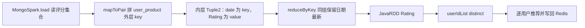

# 复用 ALS 链路训练小视频推荐：评分合并、模型训练与结果写回 Redis

评分数据与视频池都已就位，剩下的就是把圈子的推荐计算原样搬到小视频上。这一步的工作量小得出奇：推荐工程里已有的计算类从装载数据、合并评分、训练模型到写回 Redis 是一条通用流水线，圈子和视频的差别只在于读哪个集合、取哪几个字段、写哪把 key。动手方式是整类拷贝改名，再对着差异点逐个替换。

改动虽小，每一处都踩在链路的要害上。输入源配置指向错了集合，训练出来的模型就是错的；评分合并的方向写反了，用户的近期行为反而被旧数据覆盖；写回 Redis 的 key 与查询侧对不上，推荐结果等于没写。这一节把这三处要害连同验证一起过完。

## 先给结论

- 圈子版的 Spark 计算类拷进推荐工程，改名为 `SparkVideo`，主干逻辑零改动，只换字段名与集合名。
- `app.properties` 新增 `spark.video.mongodb.input.uri`，指向按天命名的视频评分集合，主机与端口部分原样保留。
- 评分合并策略：内层以 date 为 key、Rating 为 value，`reduceByKey` 后同一用户对同一视频只保留日期最新的一条。
- 训练复用圈子链路抽取好的 `MLlibRecommend.bestModel`，为每个用户推荐 20 条，vid 序列写入 Redis key `QUANZI_VIDEO_RECOMMEND` + userId。
- 拷贝来的代码漏了 `jedisCluster.close()`，连接用完必须显式关闭。

## 一、从圈子版到视频版：改名与字段替换

推荐工程 `tanhua-recommend` 同时承载消息消费与 Spark 离线计算，圈子的计算类就在这个工程里。拷贝一份，改名 `SparkVideoMongoDB`，顺手把 MongoDB 后缀也去掉，定为 `SparkVideo`，避免一个类名里出现两个语义。

类的主干五步走：读配置、建上下文、装载数据、合并评分、训练推荐。前三步的框架代码与圈子版几乎逐字相同：

```java
public class SparkVideo {

    public static void main(String[] args) throws Exception {
        //读取外部配置文件
        InputStream inputStream = SparkVideo.class.getClassLoader()
                .getResourceAsStream("app.properties");
        Properties properties = new Properties();
        properties.load(inputStream);

        SparkConf sparkConf = new SparkConf()
                .setAppName("SparkVideo")
                .setMaster("local[*]")
                .set("spark.mongodb.input.uri",
                        properties.getProperty("spark.video.mongodb.input.uri"));
        JavaSparkContext jsc = new JavaSparkContext(sparkConf);

        //加载MongoDB中的数据
        JavaRDD<Document> rdd = MongoSpark.load(jsc);
        //后续：合并评分、训练、推荐、写回Redis
    }
}
```

配置读取走 `app.properties` 而不是写死在代码里，是为了同一份代码能在本地与集群之间切换环境。配置改的是输入源那一行，代码里 Spark 配置项的名字始终是标准的 `spark.mongodb.input.uri`，具体指向哪个集合由 properties 的 key 决定，圈子的 key 与视频的 key 互不覆盖：

```properties
#圈子评分数据输入源（保留对照）
spark.mongodb.input.uri = mongodb://192.168.31.81:27017/tanhua.recommend_quanzi_20191001?readPreference=primaryPreferred
#小视频评分数据输入源，新增
spark.video.mongodb.input.uri = mongodb://192.168.31.81:27017/tanhua.recommend_video_20191007?readPreference=primaryPreferred
#Redis集群节点
redis.cluster.nodes = 192.168.31.81:6379,192.168.31.81:6380,192.168.31.81:6381
```

uri 的改法要按 namespace 拆开看：`mongodb://主机:端口/` 一段是地址，不动；`库.集合` 一段换成 `tanhua.recommend_video_20191007`，即业务库 tanhua 下按天命名的视频评分集合。改完这一行，Spark 读到的就是视频评分。

## 二、装载数据与评分合并

装载数据之后是一段有讲究的合并逻辑。同一个用户对同一个视频可能有多条评分：发布后点赞、取消、再点赞，流水表里就是四条记录。ALS 的 Rating 要求 user 与 product 的组合唯一，训练前必须把多条记录合成一条。合并策略落在 date 上：内层以日期为 key、Rating 为 value，归组后保留日期最新的一条：

```java
//合并同一用户对同一视频的多条评分：内层以 date 为 key，Rating 为 value
JavaRDD<Rating> ratings = rdd.mapToPair(document -> {
    Integer user = document.getLong("userId").intValue();
    Integer product = document.getLong("videoId").intValue();
    Double score = document.getDouble("score");
    Long date = document.getLong("date");
    Rating rating = new Rating(user, product, score);
    return new Tuple2<>(user + "_" + product, new Tuple2<>(date, rating));
}).reduceByKey((v1, v2) -> v1._1() > v2._1() ? v1 : v2) //同一对行为保留日期最新的一条
  .map(tuple -> tuple._2()._2());

//得到用户id的集合
List<Long> userIdList = rdd.map(v1 -> v1.getLong("userId")).distinct().collect();
```

外层 key 是 `用户_视频` 的字符串拼串，作用是把同一对行为路由到同一个 reduce 组；内层的 date 不是用来排序输出，而是合并时的裁判，数值大者胜出。保留最新而非累加，是行为语义决定的：取消点赞之后又点赞，最新记录表达的是当前状态，把历史正负分累加反而说不清用户现在到底喜不喜欢。

userIdList 直接从原始 RDD 上做 distinct 取出，去重后的用户集合就是稍后逐个推荐的遍历对象。这段流程浓缩成一张图：



关键路径在 reduceByKey 那一步：外层 key 决定谁和谁比，内层 date 决定谁留下，两层 Tuple2 的分工分清，这段合并代码就不会写错方向。

## 三、训练、推荐与写回 Redis

训练直接交给圈子链路抽取好的推荐工具类，把 Rating 交给它，内部完成按时间切分、多组参数训练与择优，返回最优的矩阵分解模型：

```java
//通过MLlib模型进行推荐，获取到推荐的视频
MLlibRecommend mllibRecommend = new MLlibRecommend();
MatrixFactorizationModel bestModel = mllibRecommend.bestModel(ratings);

//构建Redis集群环境
Set<HostAndPort> nodes = Arrays.stream(properties.getProperty("redis.cluster.nodes").split(","))
        .map(node -> new HostAndPort(node.split(":")[0], Integer.parseInt(node.split(":")[1])))
        .collect(Collectors.toSet());
JedisCluster jedisCluster = new JedisCluster(nodes);

//为每一个用户推荐20条视频并写入Redis
for (Long userId : userIdList) {
    Recommendation[] recommendations = bestModel.recommendProducts(userId.intValue(), 20);
    List<Integer> products = Arrays.stream(recommendations)
            .map(Recommendation::product)
            .collect(Collectors.toList());
    String key = "QUANZI_VIDEO_RECOMMEND" + userId;
    jedisCluster.set(key, StringUtils.join(products, ','));
}
//用完关闭集群连接，拷贝圈子版代码时这里曾漏掉
jedisCluster.close();
```

`recommendProducts` 的原理是拿模型学到的用户隐向量与全部视频隐向量做点积，预测出这个用户对每个未交互视频的评分，排序取前 20。产出的 product 就是 vid 的整数值，因为合并评分时 product 位填的就是 vid。每个用户一条 key，value 是逗号拼串的 vid 序列，key 前缀 `QUANZI_VIDEO_RECOMMEND` 沿用了圈子结果的命名习惯，查询侧按同样的前缀读取，两端约定一致。

跑完作业到 Redis 里验证结果，进集群节点开 redis-cli 查两个用户的 key：

```bash
docker exec -it redis-node01 /bin/bash
redis-cli -c
127.0.0.1:6379> get QUANZI_VIDEO_RECOMMEND_1
"1019,1041,1088,1023,1028,1065,1031,1086,1046,1052,1053,1056,1063,1048,1061,1073,1027,1036,1077,1059"
127.0.0.1:6379> get QUANZI_VIDEO_RECOMMEND_2
"1046,1052,1053,1056,1063,1048,1061,1073,1019,1041,1088,1023,1028,1065,1031,1086,1027,1036,1077,1059"
```

值里的 vid 都落在造数的 1000 到 1099 区间内，10 个用户对应 10 把 key，每个 key 20 个 vid。到这里推荐结果已经备好，查询侧只欠东风。

## 常见误区

- **输入源 uri 没改，读了圈子的评分集合。** 错例：代码里 `getLong("videoId")` 取圈子文档里的字段，取出来是 null 直接空指针。正解：视频版配置用独立的 key `spark.video.mongodb.input.uri`，跑作业前先在 Mongo 客户端确认集合里有 videoId 字段的数据。
- **漏掉 jedisCluster.close()。** 错例：拷贝来的代码只写不关，作业反复调试后节点连接数持续上涨。正解：写回循环结束后显式 close，这类资源关闭逻辑要作为拷贝代码的固定检查项。
- **合并方向写反，留了最旧的一条。** 错例：reduceByKey 里比较符写反，用户取消点赞的最新状态被旧的点赞正分覆盖。正解：date 数值大者胜，合并后抽查几组同一用户同一视频的记录人工核对。
- **写回 key 与查询侧对不上。** 错例：Spark 侧写 `QUANZI_VIDEO_RECOMMEND` + userId，查询侧读 `QUANZI_VIDEO_RECOMMEND_` 拼串，下划线差一位永远查不到。正解：key 前缀两端抽成常量统一维护，别在两处手写字符串。

## 面试可能被问到的问题

1. 面试官追问：「推荐结果为什么写 Redis，而不是让查询接口直接查库？」
   答：列表接口是在线读，要求毫秒级响应；ALS 训练是离线批任务，一跑几分钟到几小时。Redis 挡在中间做读写分离：离线算好一次性写入，在线接口一次 get 就拿到整页数据，MongoDB 的压力和训练任务的时长都不会传导到用户侧。
2. 面试官追问：「recommendProducts 内部是怎么算出 20 条的？」
   答：ALS 训练产出用户隐向量矩阵与物品隐向量矩阵，推荐时用目标用户的向量与所有物品向量做内积，得到对每个物品的预测评分，降序取前 20。物品池里用户已交互过的也可以参与排序，由业务决定是否过滤。
3. 面试官追问：「评分合并为什么取最新一条，而不是把多条分值累加？」
   答：评分流水里带着取消类负分行为，最新记录表达用户当前的状态，取最新语义清晰；累加会把历史波动全算进去，取消又点赞的场景算出来是非净分。若业务希望反映行为强度，也可以累加，两种策略都常见，关键是发送端与合并端约定一致。
4. 面试官追问：「每个用户只推荐 20 条，多了行不行？」
   答：可以，但没必要。列表页首屏加翻页消费不完太多条，20 条约等于两页的量；推荐列表越长，尾部条目的预测置信度越低，写了也排不上用场，还放大 Redis 的存储与网络开销。
5. 面试官追问：「local[*] 本地跑的作业，怎么上生产集群？」
   答：代码不动，打包后用 spark-submit 提交，指定 master 为集群管理器地址，去掉 local 模式。配置读取已经走外部 properties，只需要换一份指向生产 MongoDB 与 Redis 的配置文件，这也是当初把连接信息抽到配置文件里的回报。

## 配套资料

- 学习目标：`materials/code/07/day08 探花交友-实现推荐功能/day08/学习目标.md`，「独立实现小视频的推荐功能」的离线计算环节即本节内容。
- ALS 与 Rating 口径：`materials/code/07/day07 探花交友-SparkMLlib推荐系统快速入门/day07/资料/ml-100k/`，Rating 的整数要求与训练主线承接该节的编码实战。
- 说明：day08 资料包仅含学习目标，无源码包；`SparkVideo` 为按本课画面与主流写法补全，Redis 集群构建与合并比较符等细节为按既有推荐工程写法补全，topic 与 key 前缀沿用课程口径。
