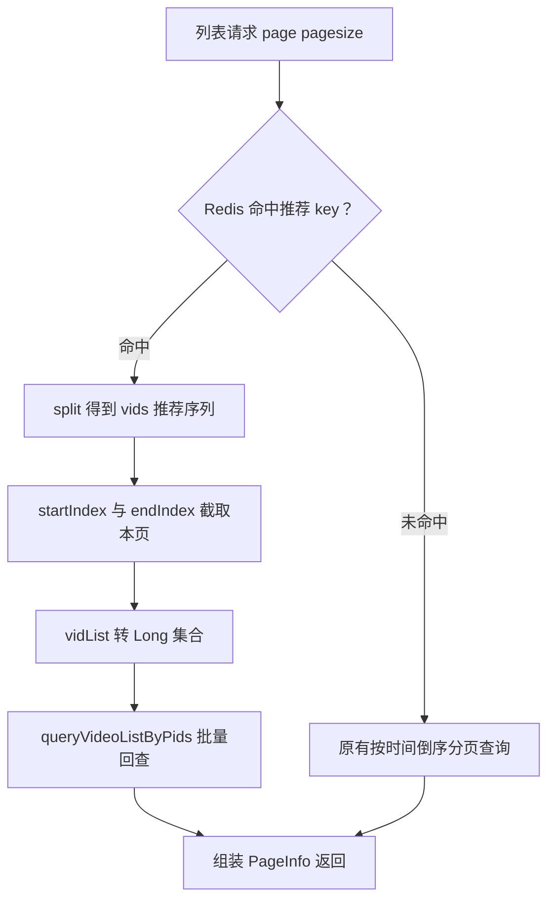
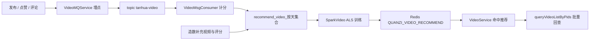

# 把推荐结果接进小视频列表：Redis 命中、按推荐顺序分页与 day08 收官

推荐结果已经躺在 Redis 里，每个用户一把 key、20 个 vid，但列表接口对此毫无感知：请求进来还是按时间倒序查 MongoDB，用户刷到的顺序与推荐无关，前面的计算等于白做。改动的切入点是 `VideoService` 的列表查询，思路是只在 Service 内部分叉，接口的入参、返回结构一概不动，App 端无感知切换。这也是离线推荐接入在线接口的标准姿势：查询侧永远优先消费推荐结果，拿不到再回落原有逻辑，两条路径并存。

分叉之后还有三个细节决定成败：按推荐顺序分页是数组截取而不是数据库 limit；批量回查要在 dubbo 侧扩展一个按 vid 查询的接口；截取的下标必须做边界收敛，翻到最后半页时不越界。

## 先给结论

- 命中判断放 Service 内部：先查 `QUANZI_VIDEO_RECOMMEND` + userId，命中走推荐顺序分页，未命中保留原有按时间倒序的查询逻辑。
- 推荐顺序的分页是截取：`startIndex = (page - 1) * pageSize`，`endIndex` 收敛到数组长度以内，再把下标段转成 vid 列表。
- dubbo 侧扩展 `queryVideoListByPids`，按 `vid in` 批量回查视频；变量名从圈子版的 pid 系改成 vid 系。
- 联调验证：重启 dubbo 与 server 工程，REST 客户端带 Authorization 请求列表接口，断点确认命中、每页 10 条，page 换成 2 结果换一段。
- day08 的推荐链路至此全部打通，剩下的是在 App 端做整体回归。

## 一、分叉点设计：命中判断放 Service 内部

列表查询的入口、参数、返回结构都不变，变的是 Service 内部的取数路径。`VideoService` 的查询方法开头先取当前登录用户，再向 Redis 探一次推荐结果：

```java
public PageInfo queryVideoList(QueryInfo queryInfo) {
    Long userId = UserThreadLocal.get().getId();
    Integer page = queryInfo.getPage();
    Integer pageSize = queryInfo.getPagesize();
    PageInfo pageInfo = new PageInfo();
    pageInfo.setPageNum(page);
    pageInfo.setPageSize(pageSize);

    //优先命中推荐数据
    String redisValue = this.redisTemplate.opsForValue()
            .get("QUANZI_VIDEO_RECOMMEND" + userId);
    if (StringUtils.isNotEmpty(redisValue)) {
        //命中：vids 按推荐顺序排列，按页截取一段 vid
        String[] vids = StringUtils.split(redisValue, ',');
        int startIndex = (page - 1) * pageSize;
        int endIndex = page * pageSize - 1;
        if (endIndex >= vids.length) {
            endIndex = vids.length - 1;
        }
        List<Long> vidList = new ArrayList<>();
        for (int i = startIndex; i <= endIndex; i++) {
            vidList.add(Long.valueOf(vids[i]));
        }
        List<Video> videoList = this.videoApi.queryVideoListByPids(vidList);
        pageInfo.setRecords(videoList);
    } else {
        //未命中：走原有的按时间倒序分页查询，逻辑不变
        List<Video> videoList = this.videoApi.queryVideoList(queryInfo);
        pageInfo.setRecords(videoList);
    }
    return pageInfo;
}
```

把变量名从圈子查询改造时的 pid 系统一改成 vid 系，`vids` 是截取出的本页视频编号数组，`vidList` 是转成 Long 后待查的集合。两个分支的分工非常清楚：命中时消费离线计算的成果，未命中时行为与改造前完全一致，新用户没有推荐数据、Spark 作业没跑、Redis 抖动，都不影响列表可用。这层兜底关系用一张图看清：



关键分叉在命中判断：Redis 值非空才走推荐路径，空值、key 不存在都会落进原有逻辑，接口任何时刻都有数据可返回。

## 二、vid 截取与批量回查

推荐序列存的是一串 vid，分页取第 n 页就是把数组下标 `(page - 1) * pageSize` 到 `page * pageSize - 1` 的一段切出来。与数据库 limit 语义不同，这里切的是内存数组，越界就是异常，所以 endIndex 做了收敛：超过数组长度时压到 `length - 1`。start 越过末尾时循环自然一次都不执行，返回空列表，符合「翻完就没了」的预期。

截取出来的 vid 列表要回 MongoDB 换成完整的视频对象，dubbo 接口在既有方法旁边扩展一个批量查询：

```java
/** 根据自增长 vid 批量查询视频 */
List<Video> queryVideoListByPids(List<Long> vids);
```

实现用 `Criteria.where("vid").in(vids)` 一次把本页视频全查出来：

```java
@Override
public List<Video> queryVideoListByPids(List<Long> vids) {
    Query query = Query.query(Criteria.where("vid").in(vids));
    return this.mongoTemplate.find(query, Video.class);
}
```

方法名从圈子版拷贝过来时保留了 `ByPids` 的后缀，参数与实现其实都已经是 vid，命名与实现不一致是个小技术债，功能不受影响，工程上值得顺手改名。查询本身没有排序子句，`in` 匹配的文档按 MongoDB 的自然顺序返回，并不保证与推荐序列一致，严格保序需要在服务端按 vidList 重排一遍，课程的实现选择了直接返回，这一点在列表顺序上属于可接受的近似。

## 三、联调验证：断点走一遍分页路径

dubbo 服务工程新增了接口实现，server 工程改了 Service，两边都要重启。REST 客户端复用历史请求：GET 请求列表接口，路径与参数是 `?page=1&pagesize=10`，Header 带 Authorization 的 JWT 与 User-Agent。

在 `queryVideoList` 里下断点，请求发出后逐段确认。第一站命中判断：`redisValue` 拿到了一长串逗号分隔的 vid，说明 Spark 写回的 key 与查询侧读的 key 完全对上了。第二站截取：split 后 vids 数组长度 20，page 1 时 startIndex 为 0、endIndex 为 9，循环产出 10 个 vid。第三站回查：`queryVideoListByPids` 返回 10 条视频对象，组装进 PageInfo，响应结构与 day04 的小视频列表完全一致，App 端拿到的还是原来的 JSON 形态，只是内容排序换成了推荐结果。

把参数换成 `?page=2&pagesize=10` 再发一次，断点里 startIndex 变成 10，截取的是序列的后半段，返回的视频集合与第一页不同。两页拼起来正好覆盖 20 条推荐，链路在真实请求下闭环。

## 四、day08 收官：链路全景与复用复盘

查询逻辑改完，day08 的编码主线到此收官。回头看整个 day08，小视频推荐走了一条与圈子完全对称的路，所有环节都能两两对应：



图里从埋点到回查的每一站，都是内容推荐链路的固定桩位：数字身份（vid）、计分规则、消息埋点、按天评分表、ALS 训练、Redis 结果、列表命中。这些桩位不是为小视频专门设计的，圈子链路先搭好，小视频只换了参数化的部分：type 换 video、字段换 vid、topic 与集合各起一套、key 前缀加 VIDEO。将来再接第三种内容形态，照这张图填参数即可，这正是 day08 用两条链路反复打磨模式的价值。

剩下的工作是在 App 端把整条链路真实跑一遍：发布、点赞、评论产生评分，离线作业更新推荐，列表刷新出新的排序。编码至此告一段落，联调属于收官验证。

## 常见误区

- **endIndex 不做收敛。** 错例：page 为 3、pageSize 为 10、推荐只有 20 条时，endIndex 算出 29，循环直接数组越界。正解：endIndex 超过 `vids.length - 1` 时压回去，或干脆用下标上界取 `Math.min`。
- **把 in 查询的结果当成推荐顺序返回。** 错例：Mongo 按自然顺序返回文档，页内顺序与推荐序列对不上。正解：需要严格保序时按 vidList 重排结果，再写入 PageInfo；接受近似时也要清楚顺序由谁决定。
- **未命中分支被删掉。** 错例：改造时把原有查询逻辑整个替换，推荐 key 不存在的新用户列表直接空白。正解：命中与未命中两条路径并存，Redis 异常与数据缺失都回落原有逻辑。
- **两端 value 序列化不一致。** 错例：Spark 用 Jedis 写入原始字符串，server 的 RedisTemplate 配了 JSON 序列化器，get 出来反序列化失败。正解：推荐 key 的读写两端统一 String 序列化，与 Spark 写入的字节形态对齐。

## 面试可能被问到的问题

1. 面试官追问：「列表接口怎么做到推荐与原有逻辑无缝共存？」
   答：Service 内部先探 Redis 推荐结果，命中走推荐分页，未命中走原有时间倒序查询。接口契约不变，App 无感知；推荐链路任何一环出问题都自动回落，可用性不受离线系统牵连。
2. 面试官追问：「按推荐顺序分页为什么用数组截取，而不是每页去算一次推荐？」
   答：离线计算已经把每个用户的 topN 固化在 Redis，在线只需一次 get 加数组切片，成本是常数级的；每次请求现算推荐要把模型调用与候选打分拖进在线路径，延迟和算力都不允许。固化加切片是离线推荐在线服务的通用形态。
3. 面试官追问：「Redis 里的推荐结果需要设置过期时间吗？」
   答：课程实现不设 TTL，靠下一次离线计算覆盖旧值，保证任何时刻都有推荐可命中。若设短 TTL，过期后大量用户回落到非个性化列表，个性化覆盖率波动；设长 TTL 与不设差别不大，真正要防的是长期不更新，用离线作业的调度频率兜底。
4. 面试官追问：「vid 用 in 批量查，页面数据量大时要拆分吗？」
   答：in 的代价与元素个数线性相关，推荐列表一页只有 10 条，几十个元素对 MongoDB 毫无压力；如果单次 in 的元素数上万才需要分批。另外 vid 是自增长数字，in 查询配合 vid 上的索引效果最好，实体落库时确认这个字段建了索引。
5. 面试官追问：「这套改动如何验证推荐真的生效了？」
   答：两层验证。代码层在 Service 断点确认命中 Redis、截取的 vid 与 Spark 写入一致；业务层对比改造前后同一用户的列表内容与顺序，或者直接在 Redis 里核对 key 的值与接口返回的 vid 序列。造数阶段的 10 个用户 20 条推荐，正好可以逐个对账。

## 配套资料

- 学习目标：`materials/code/07/day08 探花交友-实现推荐功能/day08/学习目标.md`，「独立实现小视频的推荐功能」的查询接入环节即本节内容。
- 小视频列表既有口径：`materials/code/07/day04 探花交友-实现评论、小视频/day04/学习目标.md`，小视频查询与列表的原始逻辑来自 day04。
- 说明：day08 资料包仅含学习目标，无源码包；`queryVideoList` 改造与 `queryVideoListByPids` 为按本课画面与主流写法补全，key 前缀与 PageInfo 结构沿用课程与既有工程口径。
