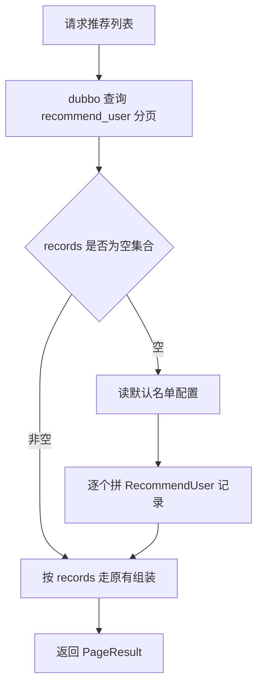

# 首页推荐列表的兜底设计：默认推荐用户的配置化注入

Spark 的推荐结果只覆盖出现在评分数据里的用户。新注册的用户没有任何行为，测试时清空过推荐集合，dubbo 的分页查询返回的就是一份空记录，首页的推荐列表随之空白，而页面设计里这块区域不可能留白。解法是在查询链路里加一层兜底：查不到推荐就返回一份默认名单，名单来自配置文件，随业务随时可换。这一课改动不大，但把「有推荐用推荐、没推荐有默认」的策略讲透了，这也是所有推荐系统上线前的必备补丁。

## 先给结论

- 兜底判断放在 Service 层：dubbo 查询回来的 records 是空集合时，用配置的默认名单手工拼 RecommendUser 记录。
- 默认名单走配置项 `tanhua.sso.default.recommend.users`，逗号分隔的用户 id，`@Value` 注入 server 工程，与此前今日佳人的默认用户配置并列。
- 默认记录三要素：userId 填名单里的 id，toUserId 填当前登录用户，score 用 `RandomUtils.nextDouble(70, 99)` 随机出缘分值。
- records 是空集合不是 null，直接往集合里 add，后续按 userIds 回查详情与组装 TodayBest 的逻辑零改动。
- 默认名单里的 id 必须能在用户信息表查到，否则组装阶段会被静默过滤，配置前先核对测试数据。

## 一、兜底策略：默认名单从哪来

推荐系统冷启动时人人平等地拿不到个性化结果，行业里常见的默认策略有几类：按注册时间给最新的活跃用户、按热度给全局热门、按资料匹配给粗排候选。课程的实现选择了最直观也最可控的一种：配置化白名单，把一组用户 id 写进配置文件，查询链路读配置拼数据。它的好处是行为完全可预期，测试环境清库也能复现；代价是名单需要人工维护，个性化程度为零。配置文件里同时存在两个相邻的 key，今日佳人的默认用户在前，推荐列表的默认名单在后，两处兜底同一思路：

```properties
#今日佳人的默认用户（此前课程已添加，保留对照）
tanhua.sso.default.user=1
#首页推荐列表的默认名单，逗号分隔（本节新增）
tanhua.sso.default.recommend.users=2,3,4,5,6,7,8,9,10,11,12,13
```

查询链路的分叉关系如下：



关键分叉在菱形处：判断的是空集合而非 null，dubbo 的 PageInfo 始终带回一个集合对象，empty 与 null 的区别决定判断怎么写。

## 二、配置注入与 Service 实现

server 工程的 Service 里把配置当普通字段注入，key 与配置文件一一对应：

```java
@Value("${tanhua.sso.default.recommend.users}")
private String defaultRecommendUsers;
```

完整的编排方法在原有查询之后插入一段兜底：

```java
public PageResult queryRecommendUserList(RecommendUserQueryParam queryParam) {
    //根据token获取当前登录用户（统一token处理已就位）
    User user = UserThreadLocal.get();
    PageInfo<RecommendUser> pageInfo = this.recommendUserService
            .queryRecommendUserList(user.getId());
    List<RecommendUser> records = pageInfo.getRecords();
    //未查询到推荐数据，使用默认推荐列表
    if (CollectionUtils.isEmpty(records)) {
        //按逗号拆分默认名单
        String[] ss = StringUtils.split(defaultRecommendUsers, ',');
        for (String s : ss) {
            RecommendUser recommendUser = new RecommendUser();
            //被推荐的用户id，取名单里的值并转成Long
            recommendUser.setUserId(Long.valueOf(s));
            //推荐给谁：当前登录用户
            recommendUser.setToUserId(user.getId());
            //缘分值暂无真实数据，随机生成一个70~99之间的分数
            recommendUser.setScore(RandomUtils.nextDouble(70, 99));
            records.add(recommendUser);
        }
    }
    List<Long> userIds = new ArrayList<>();
    for (RecommendUser record : records) {
        userIds.add(record.getUserId());
    }
    //后续：回查用户详情、组装 TodayBest，逻辑与原有版本一致
}
```

三处细节值得咀嚼。**其一，空集合语义。** dubbo 返回的 PageInfo 里的 records 是初始化过的空集合，`CollectionUtils.isEmpty` 把 null 与 empty 两个条件一起覆盖，比 `records == null` 严谨。**其二，字段方向不能反。** userId 是被推荐的人，toUserId 是推荐给谁，默认记录里前者来自名单、后者来自当前用户，写反了后续回查用户详情拿到的就是错误的人。**其三，随机分值的用意。** 兜底数据没有真实缘分值，随机给一个 70 到 99 区间的分数纯粹为了前端展示完整，id 与 date 两个后续用不到的字段干脆不设置。分值最终展示为整数，组装阶段的 `Math.floor` 取整逻辑不变，响应里看到的 95、94 这类缘分值就来自这段随机。

## 三、联调验证：清空数据看兜底

验证的思路是把「无推荐」与「有推荐」两种状态都跑一遍。先把推荐数据清空，模拟冷启动环境；按 dubbo 服务、sso、server 的顺序启动，server 用 debug 方式方便断点；App 端发送验证码登录，请求推荐列表接口。断点里逐段确认：dubbo 查询返回的 records 长度为 0，进入兜底分支，名单拆出 12 个 id，循环拼出 12 条默认记录，score 各不相同。接口响应的结构与有推荐时完全一致（示例数据已脱敏，昵称按编号改写，图片地址以 example.com 占位）：

```json
{
  "counts": 0,
  "pagesize": 10,
  "pages": 2,
  "page": 1,
  "items": [
    {
      "id": 2,
      "nickname": "user_2",
      "avatar": "https://example.com/images/logo/2.jpg",
      "gender": "man",
      "age": 22,
      "tags": ["单身", "本科", "年龄相仿"],
      "fateValue": 95
    }
  ]
}
```

`fateValue` 的整数形态就是随机分值取整后的结果，多请求几次能看到分值在 70 到 99 之间浮动。把推荐数据恢复，同一账号再请求，列表回到真实推荐内容，两条路径切换自然。

默认名单还有一处隐含约束：兜底记录拼出来后，后续逻辑会拿 userId 回查用户详情，名单里的 id 在用户信息表里必须真实存在，配置时从测试库的现有用户里挑，别写悬空 id。

## 常见误区

- **判断条件写成 records == null。** 错例：dubbo 返回的集合已初始化，永远不是 null，兜底分支进不去，首页空白依旧。正解：用 `CollectionUtils.isEmpty`，null 与 empty 一起覆盖。
- **userId 与 toUserId 方向写反。** 错例：userId 填了当前登录用户，回查详情查到自己，列表里出现本人卡片。正解：记住语义，userId 是被推荐的人，toUserId 是推荐给谁。
- **随机分值 API 用错。** 错例：想拿小数却调了 `nextInt`，或把区间边界写混，分值形态与真实数据对不上。正解：用 `RandomUtils.nextDouble(70, 99)` 这类明确区间的 API，展示端统一取整。
- **名单里配了不存在的用户。** 错例：配置里写了库里没有的 id，回查详情查不到，该条记录被静默丢弃，页面条数少于名单长度。正解：配置前核对测试数据，或让组装逻辑对查不到的记录打日志。

## 面试可能被问到的问题

1. 面试官追问：「推荐系统为什么要做默认推荐列表？」
   答：个性化结果只覆盖有行为的用户，新用户与数据缺失场景下列表会空白，产品上不可接受。默认列表是冷启动兜底，保证任何用户都能看到内容，同时把「无推荐」从异常变成可配置的正常状态。
2. 面试官追问：「默认名单为什么放配置文件，而不是写死在代码里？」
   答：名单属于运营与测试策略，会随环境与阶段变化，配置化让改动不碰代码、不发版；不同环境还能配不同名单，测试清库后行为依旧可复现。写死在代码里每次调整都要重新编译部署，代价不成比例。
3. 面试官追问：「兜底记录的缘分值随机生成，会不会误导用户？」
   答：兜底阶段的价值是让页面完整可用，分值的绝对精度此刻并不重要；随机区间贴近真实分布的取值范围，展示层不需要区分来源。若产品要求严谨，可以在数据里加来源标记，前端按来源弱化展示或隐藏分值。
4. 面试官追问：「空集合和 null 在这个场景为什么必须区分？」
   答：dubbo 服务返回的分页对象始终携带初始化过的集合，查不到数据时是 empty 而不是 null，判断写错兜底分支永远进不去；反过来若返回可能为 null，只判 empty 又会空指针。CollectionUtils.isEmpty 把两个条件一起覆盖，是这类边界判断的标准写法。
5. 面试官追问：「默认列表与真实推荐如何平滑切换？」
   答：切换发生在 Service 内部的同一出口之后，兜底只是往 records 里补数据，后续回查与组装逻辑共用，响应结构完全一致，前端无感知。数据恢复后判断自然走回真实推荐分支，不需要任何开关或发版。

## 配套资料

- 学习目标：`materials/code/07/day09 探花交友-好友推荐、今日佳人/day09/学习目标.md`，「独立完成好友推荐功能」的默认列表环节即本节内容。
- 今日佳人兜底前情：`materials/code/07/day02 探花交友-实现首页功能/day02/学习目标.md`，默认用户与缘分值兜底的思路承接 day02 的今日佳人实现。
- 说明：day09 资料包仅含学习目标，无源码包；配置项与 Service 代码按本课画面整理补全，包名统一 `com.study.tanhua` 系，响应 JSON 为脱敏示例，昵称 user_N 与 example.com 地址均为占位数据。
