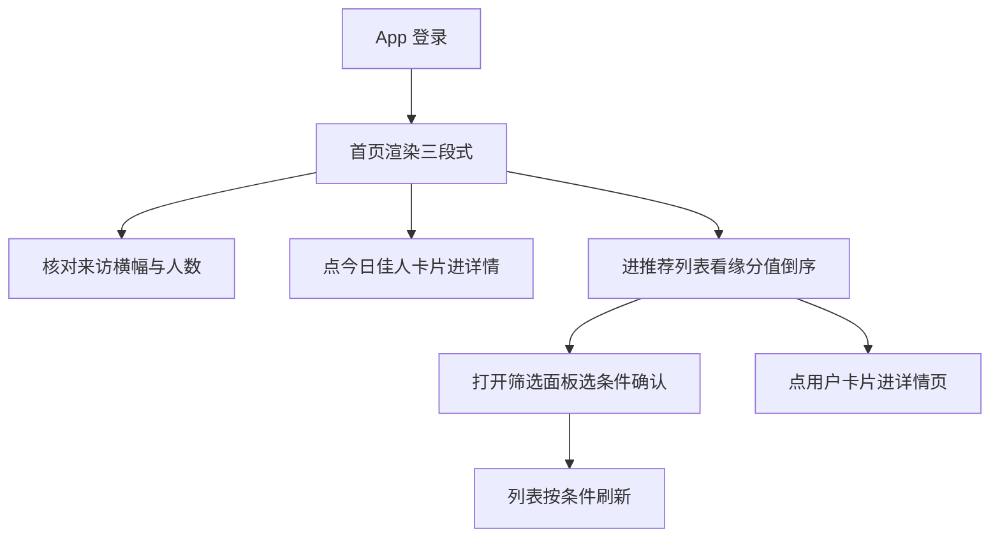

# App 端合体验收：最近六人来访、今日佳人与筛选列表一次跑通

服务端三件套全部就位：好友推荐的 Spark 程序往 `recommend_user` 里灌真实数据，谁看过我的 dubbo 服务管读写，App 接口把访客卡片组装出来。验收只剩一件事，把 App 接上真数据走一遍。课堂上的整合只花了一分多钟，不是因为它简单，而是前面每一步都有断点和接口测试兜过底，到了模拟器里要看的只有一件事：三个板块的数据能不能各就各位。

## 先给结论

- 首页自上而下三段式：来访横幅、今日佳人卡片、推荐列表，前两段的数据都出自 `recommend_user` 与 `visitors` 两套集合。
- 来访横幅的「最近六人来访」与接口里取 6 条的参数互为镜像，改数量要文案与接口一起改。
- 推荐列表的筛选面板已经可用，条件落到既有的 QueryWrapper 拼接模板：`in("user_id", userIds)` 必选，age、city 判空可选，注释打开即生效。
- 完整闭环还要补一轮跨账号核对：A 访问 B 的主页产生记录，B 登录看横幅与列表，两条链路都通才算收工。

## 一、首页三段式与数据来源

登录后的首页自上而下三段，每段背后是一条已经验收过的链路：

| 板块 | 数据来源 | 依赖链路 |
| --- | --- | --- |
| 来访横幅 | `visitors` 集合加 Redis 时间点 | dubbo 的 `topVisitor` 与 App 接口分流 |
| 今日佳人 | `recommend_user` 最高分一条 | dubbo 的 `queryWithMaxScore` |
| 推荐列表 | `recommend_user` 按缘分值倒序分页 | dubbo 的 `queryPageInfo` 加筛选拼接 |

三段共用两条数据主线：好友推荐线生产缘分值，谁看过我线生产来访记录。Spark 程序每次重训覆盖前者的数据，访客写入动作持续喂养后者，首页没有任何一处需要同步修改的代码，这正是前面把查询侧与生产侧解耦干净的红利。

## 二、走查路径



每一步都有明确断言。横幅显示「最近六人来访」，点进去访客列表有头像有昵称，缘分值各有其值；今日佳人展示的是推荐数据里得分最高的一位；推荐列表缘分值从高到低严格递减；筛选面板确认后列表内容随条件变化，条件放宽数据变多、收紧变少。走查时若某一段空白，回到对应链路的断点上查，接口测试已经证明过的环节可以第一个排除。

## 三、筛选条件的后端对应

筛选面板的性别、最近活跃时间、年龄、居住地、学历等条件，最终都落在推荐列表组装时的 QueryWrapper 上。day2 立好的拼接模板里，主条件是 `in`，其余条件先判空再拼、注释占位：

```java
List<Long> userIds = new ArrayList<>();
for (RecommendUser record : records) {
    userIds.add(record.getUserId());
}
QueryWrapper<UserInfo> queryWrapper = new QueryWrapper<>();
queryWrapper.in("user_id", userIds);   //用户 id，必选条件
if (queryParam.getAge() != null) {
    queryWrapper.lt("age", queryParam.getAge());   //年龄
}
if (StringUtils.isNotEmpty(queryParam.getCity())) {
    queryWrapper.eq("city", queryParam.getCity()); //城市
}
//需要查询用户的信息，并且按照条件查询
List<UserInfo> userInfos = this.userInfoService.queryUserInfoList(queryWrapper);
```

课堂演示的就是这个「打开开关」的动作：面板上多一个筛选维度，模板里就多一段判空拼接，参数没传就不进 SQL。条件作用的表是 `tb_user_info`，age 与 city 都是真实存在的列，注释解开后筛选立即生效。要留意的口径依然是那一条：dubbo 分页返回的推荐可能被筛选过滤掉一部分，最终响应的是「当页通过筛选的人」，前端列表因此变短是设计内行为。

## 四、跨账号核对与 day9 前半收官

单账号走查只能验证查询侧，写入侧要跨账号才能验完整：账号 A 登录后查看账号 B 的主页，B 的来访记录里就应落一条 `userId` 为 B、`visitUserId` 为 A 的文档；B 再登录，横幅与列表里能看到 A。本节的访客数据来自 dubbo 测试造的 100 条记录，查询侧已经被验证，写入侧的挂接在后续课程的他人详情接口里完成，届时按这个清单再对一轮账，两台模拟器或两个浏览器分别登录两个测试账号即可。

到这里，day9 的前半程收官：好友推荐从评分规则、Spark 两两对比、落库一路到接口消费全部打通，谁看过我从集合设计、dubbo 服务、App 接口到整合验收闭环。day9 后半还剩佳人信息、聊一下、地理位置三块功能，首页的推荐与访客两个产品位已经先行就位，正好给后面的页面当参照。

## 常见误区

- **文案与接口数量脱节。** 错例：横幅文案写「最近六人来访」，接口参数却改成 8 条，用户数出来的名单与文案对不上。正解：展示条数、文案人数、dubbo 查询参数三处由同一个约定或常量管理，改动时一起改。
- **只验单账号不看跨账号闭环。** 错例：单账号把首页三段看了一遍就宣布通过，写入侧的时机与方向问题全部漏网。正解：跨账号核对 A 写 B 读这条链路，写入与读取两端的数据逐字段对账。
- **筛选条件不判空直接拼。** 错例：把面板条件不加判断地全拼进 QueryWrapper，没传的条件变成空值比较，一筛选列表就空。正解：沿用判空拼接模板，参数缺省时条件不进 SQL。

## 面试可能被问到的问题

1. 面试官追问：「首页一次渲染要动用哪些数据源？」
   答：Redis 一次（上次查看时间点），MongoDB 两次（visitors 查访客、recommend_user 查缘分值与推荐），MySQL 一次（用户资料批量回查），dubbo 层封装了 MongoDB 的访问。数据源虽多，但每次访问都是条件命中索引的小查询，首页聚合的代价可控。
2. 面试官追问：「横幅的『新访客』判定怎么实现？」
   答：以 Redis 里记录的上次查看时间为界，dubbo 按时间条件查这之后的访客，查到几条就提示几人。判定完全在服务端，客户端只负责展示，时间点随查看动作刷新，天然实现「看过不再提醒」。
3. 面试官追问：「筛选面板的条件是怎么安全落到 SQL 的？」
   答：MyBatis-Plus 的 QueryWrapper 按需拼接，列名写在代码里、值走预编译占位符，没有注入面；每个可选条件先判空再调用 lt、eq，参数缺省时条件根本不进 SQL。这套判空拼接模板在推荐列表与筛选面板间复用，改一处即全局生效。

## 配套资料

- 学习目标：`materials/code/07/day09 探花交友-好友推荐、今日佳人/day09/学习目标.md`，好友推荐与谁看过我两项功能即本次整合的验收对象。
- 说明：day09 资料包仅含学习目标，无源码包；筛选拼接片段为按本课画面整理的既有模板复述，走查断言按本课演示流程归纳，App 界面文案以实机整合效果为准。
