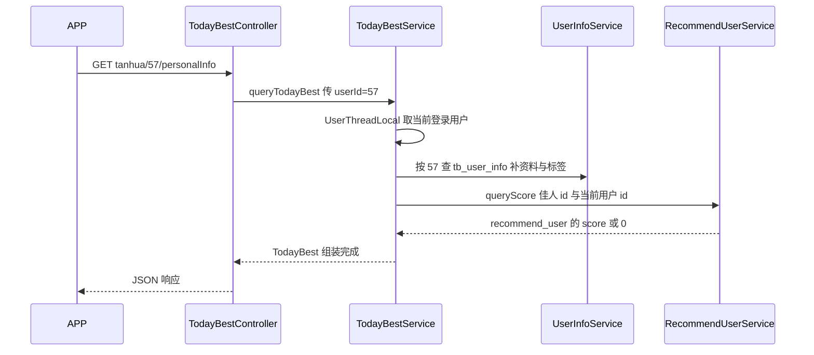

# 佳人信息详情接口：按用户 id 组装资料、标签与缘分值

> 🔒 安全提示：文中示例的口令/密钥均为课程教学环境演示口径，生产环境的安全要求见《安全与合规须知》。

首页的今日佳人卡片可以点进去，点开就是对方的详情页：头像、昵称、年龄、一排画像标签，右上角挂着一个缘分值。这套数据与首页卡片几乎同构，差别只有一个：首页的「那个人」由系统按最高缘分值挑出来，详情页的「那个人」由 URL 里的用户 id 指定。于是问题来了，首页那套无参的 `queryTodayBest` 没查过得分，详情页的缘分值从哪来？这一课就是把这个详情接口补完整。

## 先给结论

- 详情接口是 `GET tanhua/{id}/personalInfo`，路径参数 `id` 即佳人用户 id，响应结构复用首页的 `TodayBest` vo，前端无需另建模型。
- 组装分三段：用户资料查 `tb_user_info`，画像标签沿用 `tags` 列逗号拆分的口径，缘分值查 `recommend_user` 集合的 `score`，去尾转 long。
- dubbo 侧新增 `queryScore(userId, toUserId)` 双条件等值查询，查不到返回 0，业务侧降级成默认值 98，接口永不空手而归。
- 参数方向是本课最容易写反的地方：`userId` 是被推荐的人（详情页主角），`toUserId` 是当前登录用户，方向写反查询永远为空。

## 一、接口契约与详情页的数据构成

mock 文档把契约钉得很死：请求路径里带一个路径参数 `id`，示例值就是一个用户 id；响应部分与今日佳人完全同构，id、头像、昵称、性别、年龄、标签数组、缘分值一样不少。同构意味着前端可以复用同一个 vo 与同一套渲染逻辑，也意味着后端这次要做的只是「把无参版改造成带参版」，工作量集中在数据来源而不是模型设计。

详情页展示的信息分三类，各有各的出处。第一类是用户资料：头像对应 `tb_user_info` 的 `logo` 列，昵称、年龄、性别也都是资料表的列。第二类是画像标签：资料表的 `tags` 列按逗号分隔存着 `单身,本科,年龄相仿` 这样的标签串，接口要拆成数组再吐给前端。第三类是缘分值：它不属于任何用户资料，属于「这两个人之间的关系」，只能从推荐结果 `recommend_user` 集合里按双方 id 查。前两类照抄首页卡片那课的补全逻辑，真正的新活是第三类。

调用链路与首页版本同型，只是每个箭头都多了一个参数：



读图的重点在 R 那一段：缘分值查询是新增的 dubbo 调用，入参是两个 id，出参是一个 double。其余链路在 day2 与 day5 已经各就各位，登录态从线程上下文取，资料从 MySQL 查，这课不重复造轮子。

## 二、Controller 与 Service：把无参版改造成带参版

Controller 在既有的 `TodayBestController` 里追加一个方法，路径参数从注解里取：

```java
/**
 * 根据用户id查询佳人信息（他人详情页）
 */
@GetMapping("/{id}/personalInfo")
public ResponseEntity<TodayBest> queryTodayBest(@PathVariable("id") Long userId) {
    try {
        TodayBest todayBest = this.todayBestService.queryTodayBest(userId);
        return ResponseEntity.ok(todayBest);
    } catch (Exception e) {
        e.printStackTrace();
    }
    return ResponseEntity.status(HttpStatus.INTERNAL_SERVER_ERROR).build();
}
```

与首页那个 `@GetMapping("todayBest")` 的方法相比，有两处变化值得看。路径里的 `{id}` 是占位符，`@PathVariable("id")` 把它绑定到方法参数，前端传谁就查谁，不再依赖登录态推断目标。返回值从裸 vo 换成了 `ResponseEntity`，正常路径返回 200 加数据，异常统一收敛成 500，这个返回形态也和后续接口保持一致，出错的语义交给状态码而不是 null 体。

Service 层的带参版本，资料补全段与缘分值查询各占一半：

```java
public TodayBest queryTodayBest(Long userId) {
    //当前登录用户
    User user = UserThreadLocal.get();
    TodayBest todayBest = new TodayBest();
    //补全资料：按路径参数指定的用户查 tb_user_info
    UserInfo userInfo = this.userInfoService.queryUserInfoById(userId);
    todayBest.setId(userId);
    todayBest.setAge(userInfo.getAge());
    todayBest.setAvatar(userInfo.getLogo());
    todayBest.setGender(userInfo.getSex().name().toLowerCase());
    todayBest.setNickname(userInfo.getNickName());
    todayBest.setTags(StringUtils.split(userInfo.getTags(), ','));
    //查询两人之间的缘分值
    double score = this.recommendUserService.queryScore(userId, user.getId());
    if (score == 0) {
        score = 98; //默认分值，无推荐记录时兜底
    }
    todayBest.setFateValue(Double.valueOf(score).longValue());
    return todayBest;
}
```

逐段读下来，资料补全是首页那课的复述：`logo` 进 `avatar`，性别枚举名转小写，标签按逗号拆数组，`StringUtils.split` 对 null 输入返回 null 不抛异常的脾气依然在兜底。新东西在缘分值段：`queryScore` 的第一个参数是路径参数 userId，即详情页这位佳人；第二个参数是 `UserThreadLocal.get()` 取出的当前登录用户。这个先后顺序就是「谁看谁」的方向，写反了查的就成了「我看自己」的推荐记录。

`score == 0` 的分支是个降级设计。两个人之间可能根本没有推荐记录，比如对方从未进入过我的推荐列表，查出来就是 0。0 不是合法的缘分值展示，页面给一个默认 98 兜底，用户侧看到的永远是正常卡片。与首页默认推荐 id 从配置注入不同，这里的默认分值是写在代码里的常数，属于画面线上的课堂口径，正式项目里更稳妥的做法是同样外置到配置或给出「缘分未知」的展示形态。

## 三、dubbo 侧：双条件等值查询 queryScore

`RecommendUserApi` 接口新增一个方法，实现落在 `RecommendUserApiImpl`：

```java
@Override
public double queryScore(Long userId, Long toUserId) {
    //userId 为被推荐的人，toUserId 为推荐给谁，双条件共同定位一条推荐记录
    Query query = Query.query(Criteria
            .where("toUserId").is(toUserId)
            .and("userId").is(userId));
    RecommendUser recommendUser = this.mongoTemplate.findOne(query, RecommendUser.class);
    if (null == recommendUser) {
        return 0;
    }
    return recommendUser.getScore();
}
```

与 day2 的 `queryWithMaxScore` 对照着看，两段代码共用一套骨架：`Criteria` 条件加 `findOne` 取一条，集合由实体的 `@Document` 映射自动定位到 `recommend_user`。差异只有两点：条件从一个变两个，`toUserId` 与 `userId` 用 `and` 串成复合条件，语义是「推荐给 toUserId 的所有人里，被推荐者为 userId 的那一条」；排序消失了，因为双方 id 已经把结果唯一化，分数就存在那条文档的 `score` 字段里，不必比大小。查不到返回 0 而不是抛异常，把「有没有缘分」这个业务问题留给上层判断，dubbo 层只回答「数据库里是什么」。

这个查询落在数据模型上就是一条精确命中的文档。`recommend_user` 的文档形如 `{ userId: 57, toUserId: 1, score: 96.4 }`，含义是「57 被推荐给了 1，缘分值 96.4」。day8 重训 Spark 程序灌进去的真实数据里，给 1 号用户的最高分推荐恰好是 57 号用户，详情页的缘分值与首页卡片的 96 应当互相咬合，这个一致性就是稍后测试的断言。

## 四、测试：REST 工具与 APP 端各对一遍账

dubbo 服务重启后按两个层次验收。先用 REST 工具直捣接口：请求 `tanhua/57/personalInfo`，返回 200，body 里昵称、年龄、标签数组齐整，`fateValue` 为 96，与首页今日佳人卡片的分数一致。中途先拿 id 为 1 试过一次，接口正常返回 1 号用户的资料，只是它不是当前推荐出来的那位，数字对不上首页，这一步其实是顺手验证了「详情接口按传参查人」的契约本身。

APP 端随后接上：登录测试手机号（打码）加固定验证码 123456，进首页点今日佳人卡片，详情页弹出，头像、标签、昵称年龄、缘分值依次就位，与接口返回一一对应。页面下方还留着一个尾巴：详情页底部应该展示这位用户发布过的动态，此刻那块区域在报错，因为相册展现是另一个接口，紧随其后的下一课就去补它。查询侧的链路到这里全部打通，今日佳人从「首页挑人」到「点进看人」两段体验都落地了。

## 常见误区

- **queryScore 参数方向写反。** 错例：把当前登录用户当 `userId`、详情页用户当 `toUserId`，查询条件变成「推荐给我的人是我」，永远空集，缘分值全部落进默认 98。正解：`userId` 是被推荐的人（详情页主角），`toUserId` 是当前登录用户，与 `recommend_user` 的字段语义逐一对齐。
- **缘分值直接返回 double。** 错例：vo 的 `fateValue` 字段塞进 96.4，前端渲染出小数。正解：沿用去尾口径，`Math.floor` 后转 long，96.4 与 96.9 都输出 96，与首页卡片保持同一算式。
- **把 score 为 0 当异常处理。** 错例：查不到推荐记录就抛错或返回 null，详情页直接白屏。正解：0 是合法业务态，说明两人之间没有推荐关系，上层降级为默认分值，页面照常渲染。
- **路径参数绑定漏注解。** 错例：`@GetMapping("/{id}/personalInfo")` 写了占位符却不加 `@PathVariable`，参数永远是 null。正解：占位符、注解、参数名三处对齐，接口文档的路径段就是注解的拆分依据。

## 面试可能被问到的问题

1. 面试官追问：「详情页的缘分值为什么不存一份在用户资料里，而要去推荐集合查？」
   答：缘分值是「两个用户之间」的关系属性，不是任何单方的属性，随资料冗余存储既要面临计算结果过期，也要在关系变化时双写维护。放回推荐集合，谁看谁就查哪一条，数据单点维护，写入方还是 Spark 重训链路，天然一致。
2. 面试官追问：「双条件查询和先查一边再内存过滤，该怎么选？」
   答：能下推就下推。`and` 复合条件让 MongoDB 一次定位到目标文档，数据量大时内存过滤要先拉全量再筛，网络与内存都是浪费；双方 id 组合本身也适合建复合索引，等值命中代价极低。
3. 面试官追问：「接口里 score 为 0 兜底成 98，这种写法有什么隐患？」
   答：隐患在语义混淆，0 到底是「没算过」还是「真算出 0」，业务上区分不开，兜底值又让真实低分用户看起来缘分值虚高。改进方向是查询方法返回包装类型或 Optional，把「无记录」与「记录为 0」分开表达，展示层再决定降级形态；默认值外置到配置，避免代码里写死。
4. 面试官追问：「详情接口和首页今日佳人接口共用一个 vo，合理吗？」
   答：合理且应提倡。两处的响应结构完全一致，共用 vo 让前端复用渲染逻辑、后端复用组装代码，字段增减只改一处。代价是 vo 必须保持中性命名，不能沾上「今日推荐」这种场景词，否则复用语义会越来越拧巴。
5. 面试官追问：「路径参数与查询参数怎么取舍？」
   答：资源的标识走路径，如详情 id、父资源 id，语义是「这个资源的哪一条」；翻页、筛选这类可选项走查询参数。路径参数参与资源定位，缺失即 404 层面的问题；查询参数缺失通常有默认行为。两者混用会让接口语义模糊，也会影响客户端的拦截器与缓存策略。

## 配套资料

- 学习目标：`materials/code/07/day09 探花交友-好友推荐、今日佳人/day09/学习目标.md`，「独立完成佳人信息功能」即本课验收对象。
- 原型：`materials/code/07/day01 探花交友-项目搭建以及登录完善个人信息/day01/资料/探花交友移动端原型V1.2/`，交友模块详情页的资料、标签、缘分值与动态列表的页面形态出处。
- 数据库：`materials/code/07/day01 探花交友-项目搭建以及登录完善个人信息/day01/代码/mytanhua.sql`，`tb_user_info` 资料列与 `tags` 逗号分隔的存储约定。
- 说明：day09 资料包仅含学习目标，无工程源码，本课 Controller、Service 与 dubbo 实现均按课程画面逐行整理，包名统一为 `com.study.tanhua` 系；测试手机号属敏感信息已打码。
