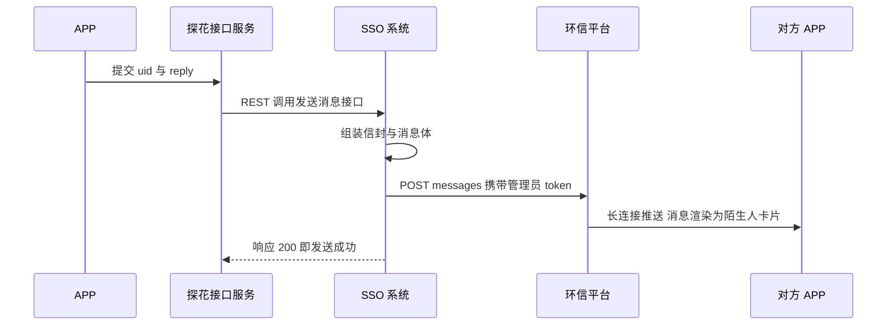

# 回复陌生人问题：把答案以系统身份发进环信的消息通道

聊一下的两个接口里，查询问题那半已经通了，弹窗能出题、能输答案，剩下的提交动作卡在一个绕不开的问题上：答案怎么变成对方 APP 上的一条消息？双方还不是好友，环信的用户之间没有好友关系就开不了会话，这个「发」必须由第三方完成。产品与平台给出的共同答案是系统代发，探花服务端以管理员身份替用户把答案送进环信，对方的 APP 弹出一张陌生人卡片。这一课把发送通道做出来并用工具验证通过。

## 先给结论

- 回复陌生人问题的 mock 契约是 POST 提交 `uid` 与 `reply`，响应只看状态码，真正的重活在服务端：把答案组装成消息发给环信。
- 与环信的全部交互继续收在 SSO 系统，本课在环信控制器里新增通用的发送消息接口，不设 `from` 字段，环信默认以管理员 `admin` 身份发送，正好满足系统代发。
- 环信发送消息的 REST 地址是 `{org_url}/{org_name}/{app_name}/messages`，请求体分两层：外层信封 `target_type` 与 `target`，内层消息体 `msg` 里再嵌 `type` 与文本。
- `target` 必须是数组，哪怕只发一个人也要 `Arrays.asList` 包一层。
- 课堂上最响的一课是 404：地址末段把 `messages` 少写一个 `s`，重启服务排查了半天，真相是路径拼写。

## 一、为什么由系统代发：from 字段与 admin 身份

环信的发送消息文档里有一个不起眼却决定业务形态的字段：`from`，消息的发送方。它不传时，环信默认走 `admin`，这条消息就以系统账号的名义发出；传了具体用户名，消息才算那个人发的。探花交友把两种语义都用上了：陌生场景由系统代发，不传 `from`；将来好友之间的服务端转发或机器人消息，才轮到具体身份。

陌生双方不能互发消息是场景的硬约束。发起人还没有对方的好友关系，直接以他的身份调环信的发送接口，消息要么发不出去，要么绕过产品规则造成骚扰，把发送动作收归系统，等于把「陌生人能不能开口」这道闸门留在了自己服务器上：什么时候发、发成什么样、要不要限流，全在探花服务端的掌控里。弹窗里那道题也因这层设计有了意义，答案必须先过服务端，才能变成消息。

完整的链路值得先看一遍全局，本课实现的是中段那一格：



APP 到探花接口服务、探花接口服务到 SSO 的两段封装属于「回复陌生人问题」接口的后续组装，本课先把 SSO 到环信这一段打通，它是一条通用通道，聊一下用它，将来任何系统通知也用它。

## 二、SSO 里的通用发送接口

SSO 系统是项目里唯一与环信对话的进程，管理员 token 的获取、环信用户的注册、凭证下发都在那里完成，本课的发送消息落点相同。控制器新增一个方法：

```java
/**
 * 发送消息给环信平台
 */
@PostMapping("messages")
public ResponseEntity<Void> sendMsg(@RequestParam("target") String target,
                                    @RequestParam("msg") String msg,
                                    @RequestParam(value = "type", defaultValue = "txt") String type) {
    try {
        Boolean bool = this.huanXinService.sendMsg(target, msg, type);
        if (bool) {
            return ResponseEntity.ok(null);
        }
    } catch (Exception e) {
        e.printStackTrace();
    }
    return ResponseEntity.status(HttpStatus.INTERNAL_SERVER_ERROR).build();
}
```

三个入参各管一件事：`target` 是接收方的环信用户名，本项目里就是平台用户 id 的字符串；`msg` 是消息文本，业务载荷会以 JSON 字符串的形式放进来；`type` 是消息类型，环信支持的取值还有图片、位置、透传等，接口用 `defaultValue = "txt"` 把最常见的文本设成缺省，调用方不传就走文本。返回值收成 `Void` 加状态码，发送成功 200，异常 500，调用方只看状态码就能分支，这与 mock 契约「响应只要状态码」的口径一致。

## 三、sendMsg 实现：信封与消息体两层结构

Service 层按环信文档逐段拼装请求：

```java
public Boolean sendMsg(String target, String msg, String type) {
    try {
        //拼接发送消息的 REST 地址
        String targetUrl = this.huanXinConfig.getOrgUrl() + "/"
                + this.huanXinConfig.getOrgName() + "/"
                + this.huanXinConfig.getAppName() + "/messages";
        //管理员 token，Redis 缓存取，过期再重取
        String token = this.huanXinTokenService.getToken();
        HttpHeaders headers = new HttpHeaders();
        headers.add("Content-Type", "application/json");
        headers.add("Authorization", "Bearer " + token);
        //外层信封
        Map<String, Object> requestParam = new HashMap<>();
        requestParam.put("target_type", "users"); //users 用户 chatgroups 群组 chatrooms 聊天室
        requestParam.put("target", Arrays.asList(target)); //目标必须数组，即便只有一个
        //内层消息体，msg 字段本身是个对象
        Map<String, String> msgParam = new HashMap<>();
        msgParam.put("type", type);
        msgParam.put("msg", msg);
        requestParam.put("msg", msgParam);
        //from 不设置，默认走 admin，以系统身份发送
        HttpEntity<Map<String, Object>> httpEntity = new HttpEntity<>(requestParam, headers);
        ResponseEntity<String> responseEntity =
                this.restTemplate.postForEntity(targetUrl, httpEntity, String.class);
        return responseEntity.getStatusCodeValue() == 200;
    } catch (Exception e) {
        e.printStackTrace();
    }
    return false;
}
```

**第一，请求体是嵌套的两层。** 外层信封描述「发给谁」：`target_type` 取 `users` 表示单聊用户，群组与聊天室各有对应取值；`target` 是接收方数组，环信一次调用支持发给最多二十个目标，单个接收方也要以数组形式传入，`Arrays.asList(target)` 这一层不能省。内层消息体描述「发什么」：`msg` 字段的值不是字符串而是对象，里面再放 `type` 与正文。文档对这层嵌套写得不算直白，课堂是对照文档末尾的请求示例才把结构确认下来的，参数拼写以示例为准，这类 REST 契约阅读时示例永远比字段表可靠。

**第二，鉴权与身份。** 请求头里 `Authorization` 挂管理员 token，来自 `huanXinTokenService.getToken()` 的 Redis 缓存，过期才有一次真实换取；`from` 字段整体不放进请求体，代码里以注释明示这层意图，半年后再读这段的人能立刻明白「没有 from」是设计而不是遗漏，系统身份发送的语义就锚在这行注释上。

**第三，成败的判定收敛到状态码。** `postForEntity` 拿回响应后只判断 `getStatusCodeValue() == 200`，环信对消息结构问题返回 400、鉴权问题返回 401，这些细节统一折叠成布尔值，Controller 再折成 200 或 500。对调用方而言，失败原因不重要，重要的是「这条消息出去了没有」；原因细节留在环信响应体与日志里，需要排障时再展开。

## 四、测试：404 的教训与 200 的闭环

dubbo 与 SSO 重启后，用 REST 工具直接打 SSO 的发送接口，地址拼出 `user/huanxin/messages`，三个参数现场填：`target` 给 57，`msg` 沿用环信用户系统集成那课的陌生人消息载荷，`type` 缺省即文本。载荷结构如下（昵称等取值按测试数据填写）：

```json
{
  "userId": "1",
  "nickname": "example-nickname",
  "question": "你喜欢什么颜色?",
  "answer": "red"
}
```

第一次请求得到的是 404。第一反应是服务没重启，重启后依旧 404，回头逐段核对地址才发现，末段写成了 `message`，少一个 `s`，与控制器映射对不上。改回 `messages` 再发，请求进入 Service，断点里依次确认：目标地址三段拼接完整，token 从缓存取出，请求头两项就位，信封里的 `target` 是长度为一的数组，`msg` 嵌套对象与示例结构一致；请求放行，响应 200，方法返回 true，消息成功送达环信平台。发送通道就此验证闭环，APP 侧把「选择的问题与答案」组装进这个 `msg` 载荷的动作，由后续的回复接口衔接，通道与业务解耦，各改各的。

## 常见误区

- **地址末段拼写凭感觉。** 错例：`message` 与 `messages` 一字之差，404 之后先怀疑服务没起，重启一通毫无收益。正解：REST 地址以接口文档与控制器映射为准，404 优先核对路径拼写，再看服务状态。
- **target 传字符串不传数组。** 错例：`requestParam.put("target", target)`，请求被环信以 400 拒绝或解析异常。正解：`Arrays.asList(target)` 包成数组，单发群发同一结构，调用侧代码不用分叉。
- **msg 当字符串直接放信封。** 错例：`requestParam.put("msg", msg)`，把正文平铺在外层，环信按 400 拒收。正解：`msg` 字段是对象，内嵌 `type` 与正文两层，结构照请求示例核对。
- **随手设置 from 为发起用户。** 错例：把发起人的环信用户名填进 `from`，以非好友身份直发，违反产品对陌生消息的管控设计。正解：陌生场景不传 `from`，默认 admin 系统身份发送，代码用注释固化这层意图。
- **每次发送都重新获取 token。** 错例：调一次接口请求一次 token，平白多一倍网络往返还容易触发频控。正解：复用 Redis 缓存的管理员 token，401 时删缓存重取，这条口径与注册环信用户时一致。

## 面试可能被问到的问题

1. 面试官追问：「系统代发消息的架构有什么好处，代价是什么？」
   答：好处是业务规则收拢在服务端，谁能开口、发什么内容、限不限流全由自己控制，还绕开了平台对非好友互发的限制；所有系统通知类消息共用同一条通道，鉴权与封装只有一份。代价是发送方身份统一为系统，接收方看到的来源不是具体用户，业务语义要靠消息载荷自己表达，同时服务端成了所有消息的必经节点，要做容量与失败重试的设计。
2. 面试官追问：「调第三方 REST 接口，工程上要把握哪几点？」
   答：地址与凭据外置配置，环境切换不动代码；请求结构以官方示例为准，不凭字段表猜嵌套；连接与读取超时必须设置，防止线程被慢响应拖死；响应按状态码收敛成败，错误详情进日志；token 类凭据做缓存并处理过期重取。这些点环信对接与短信、OSS 对接通用。
3. 面试官追问：「管理员 token 的获取与使用怎么设计比较稳？」
   答：token 有有效期，获取接口又有频控，标准做法是服务端换取后放 Redis，设置略短于有效期的 TTL，业务一律从缓存读；命中 401 说明缓存与有效期出现偏差，删除缓存重新获取即可自愈。多实例部署时缓存天然共享，避免各节点各自换取导致频控。
4. 面试官追问：「为什么消息类型要做成参数还带默认值？」
   答：发送通道是通用的，文本只是当下最常用的形态，图片、位置、透传都会在后续业务出现。类型参数化让通道不改代码就能承载新消息，默认值让高频调用方少传一个参数，接口简洁与扩展性两头都占。真正接入新类型时，主要工作在消息体结构的组装与端上渲染，通道本身不动。
5. 面试官追问：「发送失败怎么处理，用户看到什么？」
   答：通道层返回布尔或状态码，业务层按结果决定用户体验：提交答案的接口可以把失败转成明确提示让用户重试，也可以先落库标记待发、后台任务补偿重投，消息投递做成幂等，重试不会产生重复卡片。直接把第三方异常透传给用户是最差的选择，失败语义要在业务层翻译。

## 配套资料

- 学习目标：`materials/code/07/day09 探花交友-好友推荐、今日佳人/day09/学习目标.md`，「独立完成聊一下功能」的第二段即本课的消息发送环节。
- 学习目标：`materials/code/07/day05 探花交友-实现消息功能/day05/学习目标.md`，管理员 token、注册环信用户与发送消息验证的既有口径，本课的通道直接复用。
- 原型：`materials/code/07/day01 探花交友-项目搭建以及登录完善个人信息/day01/资料/探花交友移动端原型V1.2/`，聊一下弹窗与陌生人卡片的页面形态出处。
- 说明：day09 资料包仅含学习目标，无工程源码，本课控制器与 `sendMsg` 实现均按课程画面与环信文档整理，包名统一为 `com.study.tanhua` 系；环信组织名、AppKey 与测试手机号等敏感值已打码；消息载荷示例沿用既有课程口径，昵称等取值为占位。
