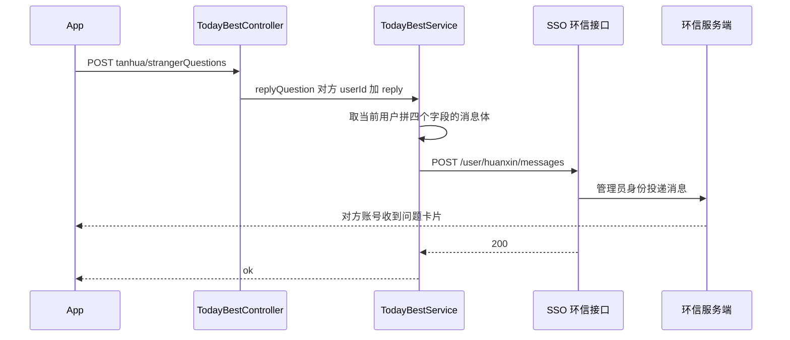

# 聊一下的最后一环：回复陌生人问题的接口实现与整合测试

> 🔒 安全提示：文中示例的口令/密钥均为课程教学环境演示口径，生产环境的安全要求见《安全与合规须知》。

陌生人详情页上那张问题卡是聊一下功能的入口：对方预先设置了一个问题，比如「喜欢什么颜色」，输入答案点击聊一下，这条答案就要以消息的形式落进对方的环信账号。查询问题的读接口在上一环节已经做完，剩下的是提交答案这条写链路：接口收下答案，拼好消息体，借道 SSO 系统把消息交给环信，最后在模拟器里把整条链路点一遍。写入侧接口看着短，但两个用户 id 的方向、消息体的字段口径、发送成功与否的判定，每一处都值得停下来对一遍。

## 先给结论

- 接口是 POST `tanhua/strangerQuestions`，挂在今日佳人的 Controller 里，请求体只有两个参数：对方的 `userId` 与自己的 `reply`。
- 消息体四个字段：`userId`（必须转字符串）、`nickname`、`question`、`reply`，由 `ObjectMapper` 序列化成 JSON 串后整体作为消息内容。
- 发送不直连环信，而是 RestTemplate POST 到 SSO 系统的 `/user/huanxin/messages`，表单参数 `target` 加 `msg`，以响应 200 作为成功判据，环信管理员凭据只留在 SSO 一处。
- App 端联调走真实流程：验证码登录进首页，今日佳人详情页填答案点聊一下，提示「消息已发送给对方」即全链路贯通。

## 一、接口契约与 Controller

接口文档平台上的 mock 契约写得很朴素：路径 `strangerQuestions`，请求体两个参数，一个是回答的问题主人 userId，一个是答案 reply。按契约在已有的 `TodayBestController` 里追加方法，类级映射沿用 day2 定下的 `tanhua`，完整路径就是 POST `tanhua/strangerQuestions`：

```java
/**
 * 陌生人问题：提交答案
 */
@PostMapping("strangerQuestions")
public ResponseEntity<Void> replyQuestion(@RequestBody Map<String, Object> param) {
    try {
        Long userId = Long.valueOf(param.get("userId").toString());
        String reply = param.get("reply").toString();
        Boolean result = this.todayBestService.replyQuestion(userId, reply);
        if (result) {
            return ResponseEntity.ok(null);
        }
    } catch (Exception e) {
        e.printStackTrace();
    }
    return ResponseEntity.status(HttpStatus.INTERNAL_SERVER_ERROR).build();
}
```

方法里有两个 id，方向不能搞反：请求体里的 `userId` 是「被回复的人」，也就是问题的主人；当前登录用户不需要客户端传，Service 里从 `UserThreadLocal` 取。方向一反，消息就发回了自己那里，对方永远收不到。Controller 的职责到解析为止，成功返回 ok，任何异常与业务失败统一转 500，让前端用状态码就能分支。

## 二、拼消息体：四个字段一个都不能少

Service 层先取当前用户与资料，再拼消息。消息体从测试用例阶段就已经对过口径，用 IDEA 的 JSON Viewer 插件看过一遍结构，四个字段各代表一件事：

```java
public Boolean replyQuestion(Long userId, String reply) {
    User user = UserThreadLocal.get();
    UserInfo userInfo = this.userInfoService.queryUserInfoById(user.getId());
    //构造消息内容：谁回答的、对方的问题、答案
    Map<String, Object> msg = new HashMap<>();
    msg.put("userId", user.getId().toString());      //注意转字符串
    msg.put("nickname", userInfo.getNickName());
    msg.put("question", this.queryQuestion(userId)); //对方设置的问题原文
    msg.put("reply", reply);
    try {
        String msgStr = MAPPER.writeValueAsString(msg);
        String targetUrl = this.ssoUrl + "/user/huanxin/messages";
        HttpHeaders headers = new HttpHeaders();
        headers.setContentType(MediaType.APPLICATION_FORM_URLENCODED);
        MultiValueMap<String, String> params = new LinkedMultiValueMap<>();
        params.add("target", userId.toString());
        params.add("msg", msgStr);
        HttpEntity<MultiValueMap<String, String>> httpEntity = new HttpEntity<>(params, headers);
        ResponseEntity<Void> responseEntity = this.restTemplate.postForEntity(targetUrl, httpEntity, Void.class);
        return responseEntity.getStatusCodeValue() == 200;
    } catch (Exception e) {
        e.printStackTrace();
    }
    return false;
}
```

序列化靠类顶部的静态 `ObjectMapper`：

```java
private static final ObjectMapper MAPPER = new ObjectMapper();
```

对应的消息体长这样：

```json
{
  "userId": "1",
  "nickname": "探花",
  "question": "喜欢什么颜色",
  "reply": "red"
}
```

三处细节值得咀嚼。`userId` 必须转字符串：这条消息最终以自定义消息的形式透传给对方 App，环信的用户账号体系就是字符串 id，数字类型跨端序列化时容易在前端出精度与类型的幺蛾子，统一字符串最稳。`question` 在服务端就拼进去，对方收到的消息卡片自带问题原文，App 端不必再发一次回查请求。`nickname` 取的是回答者自己的昵称，对方看到的第一眼要知道是谁在回答。

## 三、借道 SSO 发环信消息

**为什么不直连环信？** 管理员账号、密码、应用标识这些凭据，已经在 SSO 系统的环信集成里配好，管理员 token 的获取与缓存也封装在那里。业务服务再接一套环信 REST，等于凭据与 token 逻辑存了两份，将来换密钥、换环境要改两处。所以 server 只做一件事：把消息交给 SSO，地址从配置来：

```java
@Value("${tanhua.sso.url}")
private String ssoUrl;
```

SSO 侧接收消息的接口在环信相关的 Controller 里，路径 `POST /user/huanxin/messages`，参数三个，`type` 缺省 `txt`：

```java
@PostMapping("messages")
public ResponseEntity<Void> sendMsg(@RequestParam("target") String target,
                                    @RequestParam("msg") String msg,
                                    @RequestParam(value = "type", defaultValue = "txt") String type) {
    try {
        Boolean result = this.huanXinService.sendMsg(target, msg, type);
        if (result) {
            return ResponseEntity.ok(null);
        }
    } catch (Exception e) {
        e.printStackTrace();
    }
    return ResponseEntity.status(HttpStatus.INTERNAL_SERVER_ERROR).build();
}
```

`target` 是接收方在环信里的账号（与用户 id 对应），`msg` 是完整消息内容，这里装的就是序列化后的 JSON 串，内容以文本类型送达，App 端解析后渲染成问题卡片。整条链路的角色分工如下。



关键路径是最后两跳：SSO 拿管理员身份把消息投进环信，环信负责落一份聊天记录并推送给对方账号，server 全程不碰环信凭据。判定成功只看 200，非 200 会让 RestTemplate 抛异常进 catch 返回 false，Controller 再转 500，前端据此提示失败。

## 四、App 端联调：从登录到「消息已发送给对方」

服务重启完毕，dubbo 提供者与 server 都起来后，模拟器打开 App 走真实流程：测试手机号验证码登录，短信是课程 mock 的固定验证码 `123456`，进首页。如果首页的今日佳人卡片偶发空白，多半是刚启动时网络请求超时，重新进入一次即可恢复，这类环境噪音要先排除，别急着怀疑刚写的代码。

进首页点今日佳人，落到陌生人详情页，问题卡上写着对方设置的问题，输入答案 red，点击聊一下，页面提示「消息已发送给对方」。这句话背后发生了完整的一串：App 请求新写的 `strangerQuestions` 接口，Service 拼好消息交给 SSO，SSO 以管理员身份投递到环信，环信把消息写进双方的聊天记录并推给对方账号。对方登录后能在消息列表里看到带问题与答案的卡片；如果对方顺势回复并点击添加，双方成为好友，好友建立的逻辑在消息功能里早已实现，此处只负责把答案送达。

打开对方详情页这个动作本身也在为其他链路供数：来访记录由谁看过我的写入链路落库，聊天记录由环信沉淀，聊一下功能自己只管把这条答案消息安全送达。

## 常见误区

- **两个 userId 方向搞反。** 错例：把 `UserThreadLocal` 里的当前用户 id 当作 `target` 发消息，答案发回了自己。正解：请求体里的 `userId` 是问题主人，`target` 参数用它；当前登录用户只出现在消息体的 `userId` 字段里。
- **userId 不转字符串。** 错例：`msg.put("userId", user.getId())` 塞进 Long，跨端解析出数字类型，与环信的字符串账号对不上。正解：`user.getId().toString()`，消息体里的 id 一律字符串。
- **发送失败被吞掉。** 错例：catch 里打印堆栈后照样返回 true，前端提示成功，对方却收不到消息。正解：非 2xx 响应让 RestTemplate 抛异常，统一返回 false，Controller 转 500，让失败可感知。
- **凭据跟着业务走。** 错例：在 server 里也配一份环信管理员账号直发 REST。正解：凭据与 token 只留 SSO 一处，业务服务只传 `target` 与 `msg`，发送能力集中收口。

## 面试可能被问到的问题

1. 面试官追问：「回复陌生人问题为什么不直连环信，而要绕道 SSO？」
   答：环信的管理员凭据与 token 获取刷新逻辑已经封装在 SSO 的环信集成里，业务服务再接一套就是两份凭据两份缓存，换密钥要改两处。收口到 SSO 后，server 只发一个表单请求，传 target 与 msg，发送细节对业务透明，这也是服务分层里「能力上收」的典型做法。
2. 面试官追问：「消息体为什么自己拼 JSON，而不用一个 DTO 序列化？」
   答：字段就四个且要透传给移动端做卡片渲染，Map 加 ObjectMapper 一行一个字段，改动成本最低；DTO 的价值在字段多、复用广的场景。真要演进，把 Map 换成消息 VO 也是平移，两端契约不变即可。
3. 面试官追问：「怎么界定这条消息发送成功？」
   答：以 SSO 接口响应 200 为准。RestTemplate 对非 2xx 抛异常，catch 后返回 false，Controller 转 500。这判的是「SSO 受理成功」，环信侧的最终投递由其自身可靠性保证，严格场景可以再加环信回执或对账，课程规模下受理判定已够用。
4. 面试官追问：「从提交答案到成为好友，完整链路有哪几步？」
   答：App 提交答案到 strangerQuestions 接口，server 拼消息体借道 SSO，SSO 用管理员身份把消息投进环信，环信落聊天记录并推给对方；对方看到问题卡片后回复并点击添加，走消息功能里已有的好友建立逻辑，双方互加好友。聊一下只负责前半段送达，不重复实现好友逻辑。

## 配套资料

- 学习目标：`materials/code/07/day09 探花交友-好友推荐、今日佳人/day09/学习目标.md`，「独立完成聊一下功能」即本课交付的能力。
- 说明：day09 资料包仅含学习目标，无源码包；Controller、Service、SSO 接口与消息体为按本课画面与讲解整理补全的可编译示例，包名统一 `com.study.tanhua` 系；消息体字段按测试用例口径与画面综合整理，App 文案以实机整合效果为准。
