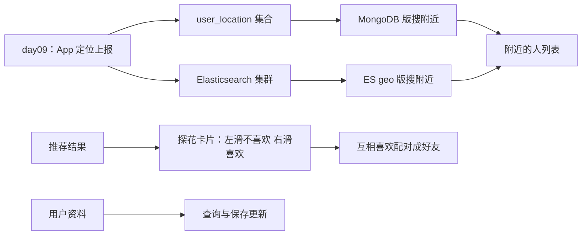

# day10 地形图：搜附近两套实现、探花左右滑与资料维护

day09 收尾时留了一个悬念：地理位置的上报链路已经打通，`user_location` 集合里每个用户都有一份随时刷新的坐标，2dsphere 索引也早早建好，却还没有一个接口去消费它。day10 开门就是还债，课程说明只用一分多钟，就把一天的骨架交了出来：搜附近功能双实现、探花配对、用户资料维护。开场短，信息密度却不低，把四个功能点的边界与依赖理清楚，后面的编码才不会在目录树里迷路。

## 先给结论

- 搜附近是全天主线：MongoDB 版本先行，用 day09 埋好的 2dsphere 数据跑通业务闭环；Elasticsearch geo 版本随后对照落地，同一个需求两套实现。
- 双实现不是重复劳动。地理查询在企业项目里没有唯一标准答案，项目里已有 MongoDB 就用 2dsphere，已有 Elasticsearch 就用 geo_point，多掌握一套方案，选型时才多一个选项。
- 探花功能把推荐好友做成卡片，左滑代表不喜欢、右滑代表喜欢，互相喜欢的两个人配对成好友。
- 用户信息维护收尾：性别、学历等资料支持查询与保存更新；Nginx 中不同路径的配置属于了解级内容。

## 一、搜附近：页面长什么样，数据从哪来

课程说明里贴出了搜附近的 UI 效果图：首页顶部有搜附近的入口，进入后按当前用户所在位置查询周边用户，页面上提示附近有多少好友。筛选条件有两个，一个是距离，可以选 500 米、1 公里、3 公里这样的档位；另一个是性别，男性或女性。

这两个条件对应的正是 day09 埋好的数据：App 端按位移超 500 米或每 5 分钟一次的节奏上报坐标，`user_location` 集合持续沉淀每个人的最新位置。消费端要做的，就是拿当前用户的坐标当圆心，拿筛选距离当半径，在集合里圈出落在圆内的其他用户。数据线在 day09 铺好，day10 只需要写查询。



这张图把一天的内容连成几条线：搜附近线消费 day09 的位置数据，MongoDB 与 Elasticsearch 两个实现殊途同归，产出同一个附近的人列表；探花线从推荐结果出发，经卡片滑动与喜欢落库，终点是好友配对；资料维护独立成块，支撑个人中心。

## 二、为什么同一个功能要实现两遍

讲解里专门回应了这个疑问：MongoDB 已经能做搜附近，为什么还要用 Elasticsearch 再做一遍。答案来自项目与企业的双重现实。

**第一，两种落法在企业里都常见。** 地理位置查询没有行业标准答案，MongoDB 与 Elasticsearch 是两条主流路线。有的团队业务数据都在 MongoDB 里，位置顺手就存了；有的团队检索体系建在 Elasticsearch 上，全文检索与地理位置分析一体完成。进项目之前两套都要会，进项目之后按既有技术栈选。

**第二，两者的能力侧重不同。** 把两条路线摊开对比，差异就清楚了：

| 维度 | MongoDB 2dsphere | Elasticsearch geo_point |
| --- | --- | --- |
| 定位 | 业务文档库，位置与业务数据同库 | 检索分析引擎，常需从主库同步数据 |
| 索引 | 2dsphere 球面地理索引 | geo_point 字段类型 |
| 查询语义 | `$near`、`$geoWithin`、聚合 `$geoNear` | `geo_distance` 查询与 geo 聚合 |
| 顺手做的事 | 增删改查一体化 | 全文检索、距离排序、聚合分析 |

业务简单、数据量可控时，MongoDB 一个组件就能闭环；检索需求重、要按距离排序打分时，Elasticsearch 的优势才显出来。day10 让两套各走一遍完整链路，对比的体感比背结论实在得多。

## 三、探花与资料维护：后半天的两件事

探花是产品的招牌交互：推荐好友以卡片形式一张张展现，右滑代表喜欢，左滑代表不喜欢。滑动背后是数据动作，喜欢与不喜欢都要落库；将来被喜欢的人打开 App，能看到谁喜欢了自己；两个人互相喜欢，系统自动配对成好友，消息功能的既有链路随之接管。卡片数据来自推荐体系，缘分值在 day08 已经算好，探花只是换了一种消费形态。

用户信息维护是标准的三段式：资料查询、保存更新、头像上传。性别、学历这类字段的变化最终落到用户表，逻辑不复杂，价值在于把 App 端表单提交、服务端校验保存、文件上传三类基本功再练一遍。学习目标里还列了一条 Nginx 中不同路径的配置，属于了解级，为部署阶段做铺垫。

## 四、验收清单与推进顺序

学习目标文档把一天的任务拆成了六条「独立完成」：

```markdown
- 独立完成MongoDB版本的搜附近功能

- 独立搭建Elasticsearch集群

- 独立完成Elasticsearch版本的搜附近功能

- 独立完成探花功能的编码

- 独立完成维护用户信息的功能

- 了解Nginx中不同路径的配置
```

六条任务有先后依赖：搜附近的 MongoDB 版本只依赖 day09 的位置数据，可以立刻动手；Elasticsearch 版本要先搭集群、再建工程，链路最长；探花除了消费位置数据，还要接上推荐结果；资料维护独立性最强，随时可做。按依赖排序推进，一天的时间才排得开。

## 常见误区

- **把双实现当重复劳动跳过其一。** 错例：MongoDB 版跑通后就认为 Elasticsearch 版可看可不看。正解：两版的差异在索引、查询语义与数据同步上，正是面试常考的对比题，跳过一半等于没学。
- **以为搜附近的数据是实时定位来的。** 错例：认为用户打开搜附近时服务端去请求定位。正解：定位在客户端，服务端消费的是 `user_location` 里沉淀的上报数据，上报节奏决定位置新鲜度。
- **把探花当单向收藏。** 错例：右滑只记一条喜欢就结束。正解：喜欢要双向检查，对方也喜欢自己时触发配对建好友，这是探花与普通点赞的本质区别。

## 面试可能被问到的问题

1. 面试官追问：「附近的人功能你会怎么设计？」
   答：数据层先由客户端按节奏上报位置，服务端用支持地理索引的存储沉淀；查询时以用户坐标为圆心、筛选距离为半径做范围查询，再叠加性别等业务条件，最后关联用户资料组装卡片。存储选 MongoDB 2dsphere 或 Elasticsearch geo_point 都可以，按团队既有技术栈定。
2. 面试官追问：「MongoDB 和 Elasticsearch 做地理位置查询各有什么优劣？」
   答：MongoDB 位置与业务数据同库，免同步，读写一体化，业务简单时链路最短；Elasticsearch 强在检索与聚合，距离排序、按距离分桶统计是现成能力，但要维护主库到 ES 的数据同步。数据量大、检索需求重选 ES，否则 MongoDB 更省心。
3. 面试官追问：「探花的左滑右滑在数据层要做什么？」
   答：滑动产生喜欢或不喜欢两条行为记录，喜欢需要双向查询：我喜欢的人列表与我被喜欢的人列表求交集，交集即配对成功，触发好友建立。不喜欢的记录同样要存，避免重复推荐同一人。
4. 面试官追问：「为什么把用户资料维护放在搜附近后面讲？」
   答：搜附近与探花的卡片都要回查用户资料，先有资料接口，列表组装时才有现成方法可调。课程顺序跟着依赖走，资料维护既是独立功能，也是前两个功能的公共底座。

## 配套资料

- 学习目标：`materials/code/07/day10 探花交友-Elasticsearch geo实现搜附近/day10/学习目标.md`，六条「独立完成」即本日验收清单。
- 说明：day10 资料包仅含学习目标，无源码包；功能拆解按课程说明的讲解归纳，具体编码在后续各课展开，包名统一 `com.study.tanhua` 系。
