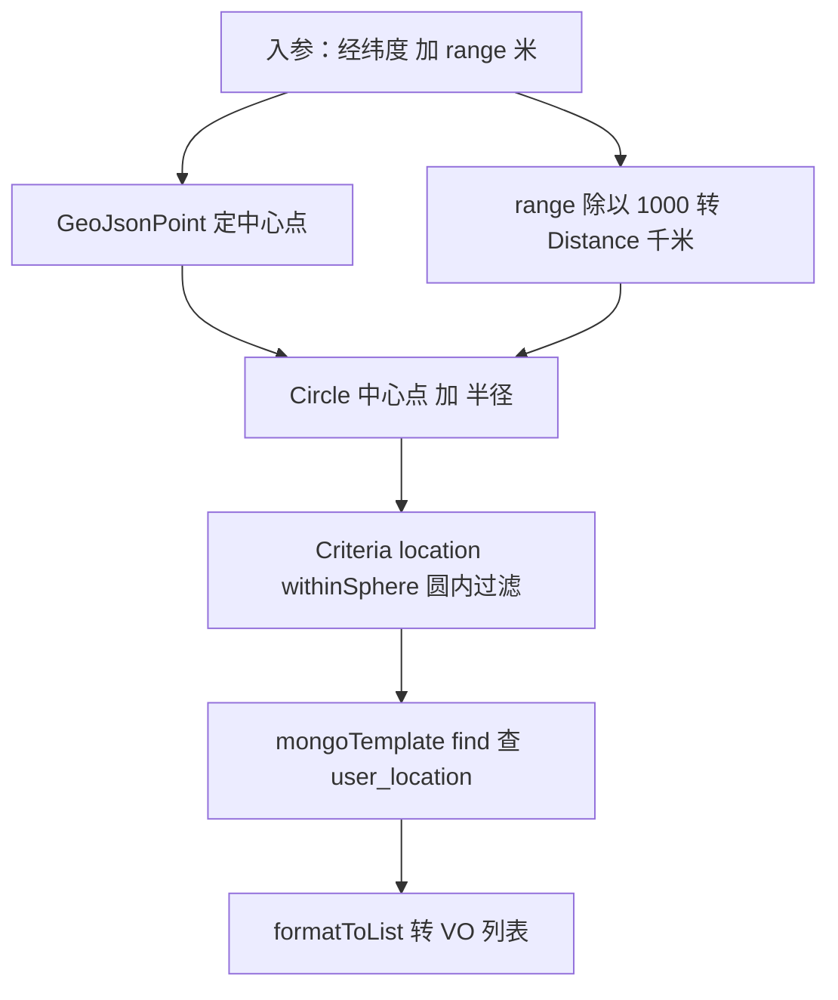

# 搜附近的 MongoDB 底座：定中心、量半径、圈内捞人

首页点开搜附近，选定距离与性别，页面随即列出附近的人。这一秒的产品体验，在后端是一条完整的查询链路：以当前用户坐标为圆心，以筛选距离为半径，到 `user_location` 集合里圈出落在圆内的其他用户。day09 已经把位置数据存好、把 2dsphere 索引建好，这一课补齐消费端：dubbo 接口怎么定义、画圆查询怎么实现、怎么用测试数据验证。Elasticsearch 版本留到本天后半段对照，先把 MongoDB 这条腿站稳。

## 先给结论

- UserLocation 不能直接当 dubbo 返回值：内嵌的 GeoJsonPoint 没有实现 Serializable，跨进程序列化直接报错，需要新造 UserLocationVo，用两个 double 承载经纬度。
- 接口新增两个方法：`queryByUserId` 按 userId 查单人位置；`queryUserFromLocation` 以经纬度为中心、range 为半径，返回圈内用户列表。
- 画圆三步：GeoJsonPoint 定中心点，Distance 换单位（米除以 1000 转千米），Circle 合并成查询范围，`Criteria.where("location").withinSphere(circle)` 完成圈内过滤。
- withinSphere 只负责圈住，不负责按距离排序；要由近到远得用 `$nearSphere` 或聚合 `$geoNear`，本课先把链路打通。
- 测试用上海地标坐标造数：1 公里范围命中数很少、多为近邻，扩到 5 公里远点全部浮出，范围与结果的正相关一目了然。

## 一、UserLocation 为什么不能直接返回

**第一，问题出在 location 字段。** UserLocation 实现了 Serializable，看起来能序列化，但它的 location 字段是 GeoJsonPoint 类型，这个类本身没有实现 Serializable。dubbo 默认用 hessian 做序列化，序列化推进到 location 字段时就抛异常，整个对象传不出去。这个坑一跑测试就现形：接口一调，序列化异常栈直接甩出来。

**第二，解法是换一个可序列化的对象。** 位置数据跨进程传输时，调用方真正需要的不过是 userId、地址、时间戳和一对经纬度。于是新造 UserLocationVo，把 GeoJsonPoint 拆成 longitude 与 latitude 两个 double 字段，再用两个静态方法承担转换：

```java
public class UserLocationVo implements java.io.Serializable {

    private Long userId;      //用户 id
    private Double longitude; //经度
    private Double latitude;  //纬度
    private String address;   //位置描述
    private Long created;     //创建时间
    private Long updated;     //更新时间

    public static final UserLocationVo format(UserLocation userLocation) {
        UserLocationVo userLocationVo = new UserLocationVo();
        userLocationVo.setAddress(userLocation.getAddress());
        userLocationVo.setCreated(userLocation.getCreated());
        userLocationVo.setUpdated(userLocation.getUpdated());
        userLocationVo.setUserId(userLocation.getUserId());
        userLocationVo.setLongitude(userLocation.getLocation().getX());
        userLocationVo.setLatitude(userLocation.getLocation().getY());
        return userLocationVo;
    }

    public static List<UserLocationVo> formatToList(List<UserLocation> userLocations) {
        List<UserLocationVo> list = new ArrayList<>();
        for (UserLocation userLocation : userLocations) {
            list.add(format(userLocation));
        }
        return list;
    }
}
```

（lombok 的 `@Data`、`@NoArgsConstructor`、`@AllArgsConstructor` 省略。）format 的本质是字段拷贝加 location 拆包：`getX()` 取出经度、`getY()` 取出纬度，与 day09 落库时「x 在前是经度」的口诀一脉相承。formatToList 只是把单条转换循环化，集合层面统一出口。VO 放进 dubbo 服务的 vo 包，api 接口与实现类都能引用它。

## 二、接口定义与单人查询

在既有的 UserLocationApi 上追加两个查询方法：

```java
public interface UserLocationApi {

    String updateUserLocation(Long userId, Double longitude, Double latitude, String address);

    /**
     * 根据用户 id 查询其地理位置
     */
    UserLocationVo queryByUserId(Long userId);

    /**
     * 查询某坐标一定范围内的用户位置
     *
     * @param longitude 经度
     * @param latitude  纬度
     * @param range     范围，单位米
     */
    List<UserLocationVo> queryUserFromLocation(Double longitude, Double latitude, Double range);
}
```

单人查询的实现没有任何花样，一个等值条件走 findOne：

```java
@Override
public UserLocationVo queryByUserId(Long userId) {
    Query query = Query.query(Criteria.where("userId").is(userId));
    UserLocation userLocation = this.mongoTemplate.findOne(query, UserLocation.class);
    if (null == userLocation) {
        return null;
    }
    return UserLocationVo.format(userLocation);
}
```

一个用户最多一条位置记录，这是 day09 有则更新无则新增保证的，所以 findOne 足够。查不到返回 null，兜底策略交给调用方。真正的主角是下面这个范围查询。

## 三、画圆查询：三个对象一次到位

讲解里画了一张示意图：把地球想成一个球面，每个用户是面上的一个点；要找张三附近的人，就以张三所在的点为中心，按给定半径画一个圆，落进圆内的点就是查询结果。编码与图形一一对应：

```java
@Override
public List<UserLocationVo> queryUserFromLocation(Double longitude, Double latitude, Double range) {
    //确定中心点
    GeoJsonPoint geoJsonPoint = new GeoJsonPoint(longitude, latitude);
    //设置半径，数据按球面存储，单位由米换算成千米
    Distance distance = new Distance(range / 1000, Metrics.KILOMETERS);
    //画圆
    Circle circle = new Circle(geoJsonPoint, distance);
    //查询 location 落在圆内的记录
    Query query = Query.query(Criteria.where("location").withinSphere(circle));
    List<UserLocation> userLocations = this.mongoTemplate.find(query, UserLocation.class);
    return UserLocationVo.formatToList(userLocations);
}
```



一张图三条主线：入参分别变成中心点与半径，二者合成 Circle，查询条件把圆交给 2dsphere 索引去匹配，查出的 UserLocation 列表统一转成可序列化的 VO。2dsphere 索引在这里兑现价值，球面距离判断与索引过滤都由 MongoDB 完成，应用层只拿结果。

## 四、想按距离排序：两个升级方向

withinSphere 的语义是「在圆内」，命中即返回，顺序不做承诺。产品上的附近的人通常要由近到远排，甚至分页。两条现成路径：一条是 `$nearSphere` 查询，天然按距离由近到远返回；另一条是聚合管道 `$geoNear`，距离作为字段参与后续统计与分页。spring-data-mongodb 对应的写法（示例，按主流用法补全）：

```java
//示例：按距离由近到远返回，geoNear 会为每个结果附带距离值
NearQuery nearQuery = NearQuery.query(geoJsonPoint, Metrics.KILOMETERS)
        .maxDistance(new Distance(range / 1000, Metrics.KILOMETERS))
        .query(UserLocation.class);
GeoResults<UserLocation> results = this.mongoTemplate.geoNear(nearQuery, UserLocation.class);
```

本课实现用 withinSphere 把范围查询的骨架立住，排序与分页的取舍留到对照 Elasticsearch 版本时再看：geo_distance 查询默认就能按距离排序，这也是两条技术路线的体验差异之一。

## 五、造数与测试：地标坐标说话

测试类沿用既有模板，注入 UserLocationApi 当本地 bean 调。先造一批测试数据，坐标从地图厂商的坐标拾取工具里查：输入地名，拷贝坐标。课堂以上海为舞台，数据里既有金茂大厦、东方明珠、上海中心大厦这样的近邻，也有上海火车站、鲁迅公园、上海博物馆这样的远点：

```java
@RunWith(SpringJUnit4ClassRunner.class)
@SpringBootTest
public class TestUserLocationApi {

    @Autowired
    private UserLocationApi userLocationApi;

    @Test
    public void testSaveTestData() {
        this.userLocationApi.updateUserLocation(11L, 121.512253, 31.24094, "金茂大厦");
        this.userLocationApi.updateUserLocation(101L, 121.506377, 31.243844, "东方明珠");
        this.userLocationApi.updateUserLocation(102L, 121.508815, 31.239185, "上海中心大厦");
        this.userLocationApi.updateUserLocation(25L, 121.493444, 31.240513, "上海公安");
        this.userLocationApi.updateUserLocation(30L, 121.462452, 31.253463, "上海火车站");
        this.userLocationApi.updateUserLocation(34L, 121.327908, 31.20333, "上海博物馆");
        this.userLocationApi.updateUserLocation(38L, 121.425155, 31.277476, "鲁迅公园");
    }

    @Test
    public void testQuery() {
        Double longitude = 121.512253;
        Double latitude = 31.24094;
        Integer range = 1000;
        List<UserLocationVo> userLocationVos =
                this.userLocationApi.queryUserFromLocation(longitude, latitude, range);
        for (UserLocationVo userLocationVo : userLocationVos) {
            System.out.println(userLocationVo);
        }
    }
}
```

testSaveTestData 先落一批地标，陆家嘴一带密度高、远处稀疏，与真实城市的人口分布一致。testQuery 以金茂大厦的坐标为查询点：1 公里范围课堂演示命中 4 条，第一条是自己要排除，剩 3 个附近的人；把 range 扩到 5000，上海火车站、鲁迅公园这些远点也进入结果，命中数量明显增多。范围从 1 到 5，结果从紧邻一圈变成大半张地图，画圆查询的语义得到直观验证。按 userId 的单人查询另起一个用例，查询造过数的用户并打印 VO，经纬度与地址与造数一致，两个方法双双通过。

## 常见误区

- **直接返回 UserLocation 踩序列化坑。** 错例：接口签名用 UserLocation，调用即抛序列化异常。正解：跨进程返回一律走 VO，GeoJsonPoint 拆成经纬度两个 double。
- **中心点经纬度写反。** 错例：`new GeoJsonPoint(31.24, 121.51)` 纬度在前，圆画到了别的大洲，结果集空得莫名其妙。正解：构造参数 x 是经度、y 是纬度，与落库时同一套口诀。
- **单位混乱。** 错例：`new Distance(range, Metrics.KILOMETERS)` 忘了米转千米，1 公里的筛选实际画出 1000 公里的圈。正解：入参统一米，除以 1000 与 Metrics.KILOMETERS 成对出现。
- **指望 withinSphere 按距离排序。** 错例：把 find 结果直接当有序列表展示。正解：排序交给 `$nearSphere`、聚合 `$geoNear` 或应用层计算。

## 面试可能被问到的问题

1. 面试官追问：「dubbo 接口返回值为什么不直接用 MongoDB 的文档对象？」
   答：文档对象里常有不可序列化的类型，这里 location 字段是 GeoJsonPoint，没实现 Serializable，hessian 序列化直接失败。跨进程传输用 VO 承载，把地理对象拆成普通 double 字段，既保住序列化，也避免把存储细节泄漏给调用方。
2. 面试官追问：「2dsphere 索引在这次查询里起什么作用？」
   答：withinSphere 生成的 `$geoWithin` 条件交给 2dsphere 索引匹配，球面距离判断在数据库层完成，应用层只拿结果。没有索引时 MongoDB 也能算，但要全集合扫描逐点算距离，数据量一大就不可接受。
3. 面试官追问：「$geoWithin 与 $nearSphere 的区别？」
   答：`$geoWithin` 只判断在不在指定形状内，结果无序，胜在性能；`$nearSphere` 按距离由近到远返回，天然满足附近的人的排序需求，还能配 maxDistance 限范围。要距离排序用后者，只要圈定范围用前者。
4. 面试官追问：「这段查询怎么支撑分页？」
   答：withinSphere 结果无序，分页前得先定序：用 `$geoNear` 聚合把距离写进结果，按距离排序后再 skip 与 limit；数据量更大时按地理分片，或交给 Elasticsearch 的 geo 能力承接，对照实现会再次回到这个取舍。
5. 面试官追问：「测试数据为什么要用真实地标坐标？」
   答：地标之间的真实距离可以人工核对，1 公里、5 公里两档结果是否符合预期一算便知；随机坐标虽然也能跑通，但结果对错没有参照，验证力差一个量级。

## 配套资料

- 学习目标：`materials/code/07/day10 探花交友-Elasticsearch geo实现搜附近/day10/学习目标.md`，「独立完成 MongoDB 版本的搜附近功能」即本课目标。
- 说明：day10 资料包仅含学习目标，无源码包；VO、接口、实现与测试类为按本课画面整理补全的可编译示例，包名统一 `com.study.tanhua` 系；排序与分页一节的 geoNear 片段为按主流用法补全的示例。
