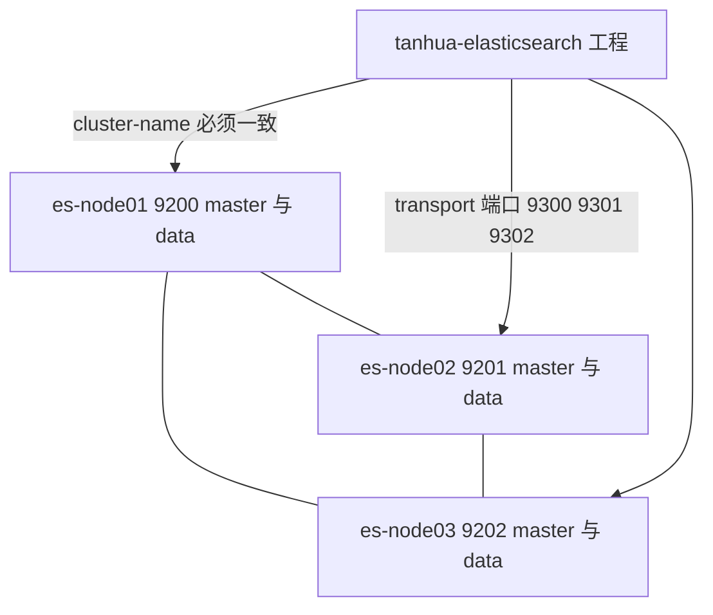
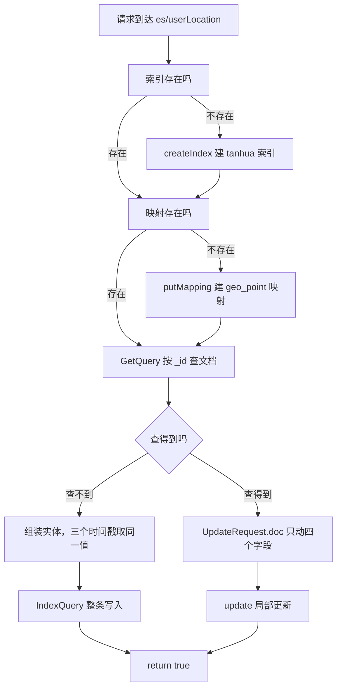
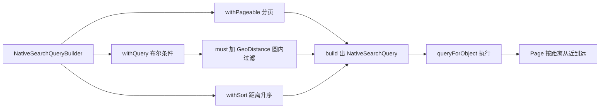
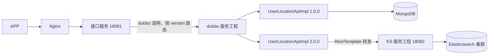

# Elasticsearch 实现位置查询：三节点集群、geo 搜附近与 dubbo 双版本切换

## 先给结论

- 集群前置：Docker 三节点部署 ES 6.5.4，先调大 `vm.max_map_count=262144`；每节点两份配置，jvm.options 定堆内存，elasticsearch.yml 定集群名、角色、端口、单播发现与 `minimum_master_nodes`（三节点设 2 防脑裂）。
- 端口两套体系分开记：9200 归 REST，9300 归传输客户端，Spring Data Elasticsearch 的 cluster-nodes 配的是 9300 起的传输端口。
- 位置地基是 `geo_point`：实体 `UserLocationES` 用 `@Document` 声明索引与分片副本，`location` 标 `@GeoPointField`；`GeoPoint` 构造纬度在前、经度在后，与 MongoDB 恰好相反。
- 更新走三层自检：索引不存在 `createIndex`、类型不存在 `putMapping`、文档存在走 `UpdateRequest.doc` 局部更新只动四个字段，不冲掉 created 与 userId 这类不该变的。
- 搜附近四件套：`NativeSearchQueryBuilder` 组分页、`GeoDistanceQueryBuilder` 圆内过滤、`GeoDistanceSortBuilder` 按距离升序、执行查询；入参米与 builder 千米要换算，geo 结果不设排序顺序随机。
- 切换实现靠 dubbo version：同一接口 1.0.0 是 MongoDB 版、2.0.0 是 ES 版，`@Reference` 的版本号对上哪边走哪边；ES 版实现注入 RestTemplate 转发，dubbo 工程要先补 web 依赖。
- 验证手法是断点看数据形态：ES 版主键是数字形式的 userId，MongoDB 版是 24 位十六进制的 ObjectId 字符串。

## 第1部分：Elasticsearch实现位置查询之搭建集群

MongoDB 版搜附近已经跑通，Elasticsearch 版要开工，第一步却不是写代码，而是把集群与工程立起来。课程没有从单节点起步，直接按生产形态搭三节点集群：ES 在生产环境从来以集群形态存在，master 选举、过半数、副本分片这些概念，也只有多节点才真正激活。这一课两件事：Docker 起三节点集群，再建承载 geo 查询代码的独立工程。

### 一、为什么跳过单节点直接上集群
单节点与集群的搭建动作差别不大，直接搭集群有两个理由：一是生产形态即集群，数据分片散在多个节点上，单节点只出现在个人实验里；二是集群参数的语义要有多节点才成立，minimum_master_nodes 的过半数、副本分片的落位，单节点上演练不了。课程用 Docker 在同一台 Linux 宿主机上起三个容器模拟三个节点，思路与生产一致，机器成本最低。

### 二、系统前置与目录规划
ES 对进程可用的内存映射区域有要求，宿主机默认值不够，先改内核参数再建目录：

```bash
#单个进程可分配线程数
vim /etc/sysctl.conf
vm.max_map_count=262144
#立即生效
/sbin/sysctl -p
```

```bash
mkdir /opt/tanhua/es-cluster/node01 -p
mkdir /opt/tanhua/es-cluster/node02 -p
mkdir /opt/tanhua/es-cluster/node03 -p
```

三个目录对应三个节点，各自的配置文件与数据彼此隔离，后面对照着改配置时互不干扰。

### 三、每节点两份配置
jvm.options 控制堆大小。演示机内存有限，初始堆与最大堆都压到 128m，生产环境按机器规格给（文件为资料中提供的模板，按讲解设置）：

```properties
#演示环境：初始堆与最大堆各 128m，按机器情况调整
-Xms128m
-Xmx128m
```

elasticsearch.yml 是集群语义所在，node01 的完整配置如下：

```yaml
cluster.name: es-tanhua-cluster
node.name: node01
node.master: true
node.data: true
network.host: 192.168.31.81
http.port: 9200
discovery.zen.ping.unicast.hosts: ["192.168.31.81"]
discovery.zen.minimum_master_nodes: 2
http.cors.enabled: true
http.cors.allow-origin: "*"
```

逐项过一遍。cluster.name 是集群的身份证，三个节点必须完全一致，不一致就是两个集群；node.name 各不相同，node02 配 9201、node03 配 9202，其余项不变。node.master 为 true 表示可被选举为 master，node.data 为 true 表示存数据，课程三个节点角色相同。discovery 两行是集群的骨架：zen 单播发现列出种子地址，节点启动后向它 ping 找同伴；minimum_master_nodes 设 2，三个节点里选 master 必须过半数，防止网络分区时少数派也选出 master 的脑裂局面。cors 两行放开跨域，供浏览器端的 head 插件访问。



图里三个节点经单播发现互连，工程侧连上任意一个节点，请求都能路由到整个集群；路由成立的前提是集群名一致、节点列表可达。

### 四、创建容器与启动验证
每个节点一个容器，配置文件与数据都挂到宿主机：

```bash
docker create --restart=always --name es-node01 -p 9200:9200 \
  -v /opt/tanhua/es-cluster/node01/elasticsearch.yml:/usr/share/elasticsearch/config/elasticsearch.yml \
  -v /opt/tanhua/es-cluster/node01/jvm.options:/usr/share/elasticsearch/config/jvm.options \
  -v es-cluster-node01-data:/usr/share/elasticsearch/data \
  elasticsearch:6.5.4
```

node02、node03 同型：容器名换成 es-node02、es-node03，`-p` 换成 9201、9202，两个配置挂载路径与数据卷名跟着节点走。`--restart=always` 让容器随宿主机自启并在异常退出后拉起；命名数据卷存节点数据，容器删了重建数据还在。启动与看日志一条命令连做：

```bash
docker start es-node01 && docker logs -f es-node01
docker start es-node02 && docker logs -f es-node02
docker start es-node03 && docker logs -f es-node03
```

日志里能看到各节点加载的模块清单，以及发现彼此节点的记录，三个都起来后集群即成形。验证用 Chrome 插件 elasticsearch-head：填宿主机 IP 与 9200，健康值显示绿色，三个节点列出，其中一个带着 master 标记。在插件里建一个 test 索引试验，分片 6、副本 2，刚建完颜色是黄色，副本分片还没同步完成，再次连接就转绿。

健康色是排查集群的第一语言：绿色代表全部分片就位；黄色代表主分片完好、副本分片未分配，多见于集群恢复中或副本无处可放；红色代表主分片缺失，数据已不能完整读取。顺带一个常识：单节点集群的副本永远分不出去，会长期黄着，这也是「副本数别超过节点数减一」这条经验的由来。

### 五、tanhua-elasticsearch 工程
搜附近的 ES 逻辑与既有 dubbo 服务相对独立，单独建一个模块承载，对外暴露接口后由 server 工程调用。模块挂在父工程下，依赖五件：

```xml
<parent>
    <artifactId>tanhua</artifactId>
    <groupId>com.study.tanhua</groupId>
    <version>1.0-SNAPSHOT</version>
</parent>
<artifactId>tanhua-elasticsearch</artifactId>

<dependencies>
    <dependency>
        <groupId>org.springframework.boot</groupId>
        <artifactId>spring-boot-starter-web</artifactId>
    </dependency>
    <dependency>
        <groupId>org.springframework.boot</groupId>
        <artifactId>spring-boot-starter-data-elasticsearch</artifactId>
    </dependency>
    <dependency>
        <groupId>org.springframework.boot</groupId>
        <artifactId>spring-boot-starter-test</artifactId>
        <scope>test</scope>
    </dependency>
    <dependency>
        <groupId>org.apache.commons</groupId>
        <artifactId>commons-lang3</artifactId>
    </dependency>
    <dependency>
        <groupId>org.projectlombok</groupId>
        <artifactId>lombok</artifactId>
    </dependency>
</dependencies>
```

web 用来对外提供接口，data-elasticsearch 带来 Spring Data 的 ES 支持与客户端自动装配，test 供单元测试，lang3 与 lombok 是项目惯用工具件。application.properties 把集群接进来：

```properties
spring.application.name = tanhua-elasticsearch
server.port = 18082
spring.data.elasticsearch.cluster-name=es-tanhua-cluster
spring.data.elasticsearch.cluster-nodes=192.168.31.81:9300,192.168.31.81:9301,192.168.31.81:9302
```

最容易翻车的是 cluster-nodes 的端口。9300 起的是传输端口，节点间通信与 Java 传输客户端走它；9200 起的是 HTTP 端口，REST 工具与浏览器用。同一台宿主机三个节点，传输端口默认从 9300 自增，正好 9300、9301、9302 一人一个。cluster-name 必须与集群配置逐字符一致，配错就是永远连不上。日志沿用项目统一的 log4j：

```properties
log4j.rootLogger=DEBUG,A1
log4j.appender.A1=org.apache.log4j.ConsoleAppender
log4j.appender.A1.layout=org.apache.log4j.PatternLayout
log4j.appender.A1.layout.ConversionPattern=[%t] [%c]-%p%n
```

启动类与其他模块同款，包名与项目保持一致：

```java
package com.study.tanhua.es;

import org.springframework.boot.SpringApplication;
import org.springframework.boot.autoconfigure.SpringBootApplication;

@SpringBootApplication
public class ESApplication {
    public static void main(String[] args) {
        SpringApplication.run(ESApplication.class, args);
    }
}
```

工程骨架到此完成。位置文档的映射类 UserLocationES、geo 查询的编码与单元测试在后续几课展开，这里先保证集群可达、客户端能起，讲义目录里紧随其后的 2.5 节就是映射类的定义。
## 第2部分：Elasticsearch实现位置查询之编码实现(更新用户地理位置)

MongoDB 版搜附近已经能按距离把人筛出来，为什么还要在 Elasticsearch 里再写一遍？因为位置数据量大、写入频繁、检索形态单一（按距离过滤加排序），这类负载正适合交给搜索引擎去扛。day10 开篇把三节点集群与 ES 服务工程搭好之后，本课把两条链路的代码补完：位置文档怎么进 ES（有则更新无则新增），以及真正的搜附近 geo 查询怎么写。中途还夹着一个单元测试，把索引从无到有的全过程盯了一遍。

贯穿全篇的坑只有一个：经纬度顺序。MongoDB 的 `GeoJsonPoint` 是经度在前，ES 的 `GeoPoint` 构造方法却是纬度在前，两边对着抄而不换序，上海就落到大洋里去了。

### 一、实体与映射：geo_point 是搜附近的地基
ES 里的 mapping 相当于 MySQL 建表时的列类型声明，字段是什么类型，决定了它能被什么方式检索。文本字段走分词与相关度，而经纬度字段只有标成 `geo_point`，才支持按距离过滤、按距离排序、聚合 geographic 范围这一族 geo 能力。搜附近的地基就是这一个类型标注。

```java
package com.study.tanhua.es.pojo;

import lombok.AllArgsConstructor;
import lombok.Data;
import lombok.NoArgsConstructor;
import org.elasticsearch.common.geo.GeoPoint;
import org.springframework.data.annotation.Id;
import org.springframework.data.elasticsearch.annotations.Document;
import org.springframework.data.elasticsearch.annotations.Field;
import org.springframework.data.elasticsearch.annotations.FieldType;

@Data
@NoArgsConstructor
@AllArgsConstructor
@Document(indexName = "tanhua", type = "user_location", shards = 6, replicas = 2)
public class UserLocationES {

    @Id
    private Long userId;        //用户 id，同时充当文档 _id，一个用户一条位置

    @GeoPointField
    private GeoPoint location;  //位置：x 经度，y 纬度

    @Field(type = FieldType.Keyword)
    private String address;     //位置描述，如 金茂大厦

    @Field(type = FieldType.Long)
    private Long created;       //创建时间

    @Field(type = FieldType.Long)
    private Long updated;       //更新时间

    @Field(type = FieldType.Long)
    private Long lastUpdated;   //上次更新时间
}
```

几个字段各有讲究。`@Document` 里的 `indexName = "tanhua"` 是索引库名，类比数据库；`type = "user_location"` 类比表；`shards = 6, replicas = 2` 声明 6 个主分片、每个主分片带 2 个副本，三节点的集群正好把分片摊开。类名特意带 ES 后缀，与 MongoDB 侧的 `UserLocation` 区分开，两套存储各留一套模型，互不掺和。

分片与副本的取值顺带说一句：这个量级的位置数据用不了 6 个主分片，课堂取值更多是在演示声明方式；生产上要按数据量与节点数权衡，分片过多则集群要维护的分片实例暴增，过少则单分片承载的数据倾斜，扩展时还得重建索引。

字段的类型家族值得展开一层。文本内容用 `text`，进倒排索引前先分词，服务模糊检索；`keyword` 整体存取不分词，服务精确匹配与排序；数值与时间用对应标量类型；地理坐标只有 `geo_point` 一族。`address` 选 `Keyword` 的理由是地名要整体匹配，把「东方明珠广播电视台」拆成一堆词再去匹配反而引入噪音。类型一旦写进 mapping 就不易更改，建索引前想清楚字段类型，是 ES 与 MySQL 使用习惯差异最大的一点。

`@Id` 落在 `userId` 上是个关键设计：文档 `_id` 就是用户 id 的字符串形式。位置数据天然是一个用户一条，业务主键当 `_id` 之后，重复写入是覆盖而不是堆积，幂等性白送。

`location` 用 `org.elasticsearch.common.geo.GeoPoint` 承载坐标，`@GeoPointField` 负责把它映射成 `geo_point` 类型。要死记的就是构造方法顺序：`new GeoPoint(latitude, longitude)`，纬度在前。注释里的 x 经度、y 纬度说的是坐标语义，不是构造参数顺序。`address` 标成 `Keyword`，整体存取不分词，地名检索走精确匹配。三个时间戳都是 `Long` 型毫秒值，与 MongoDB 版的 `user_location` 字段口径一致，两套存储里的数据可以互相印证。

索引库不需要手动创建。注解里已经写明索引名、类型、分片与副本，代码里补上自检创建的逻辑，应用跑起来索引就位，下一节展开。

字段口径还有一层设计意图：`UserLocationES` 与 MongoDB 版的 `UserLocation` 字段完全对齐，坐标、地名、三个时间戳一一对应。两套存储各存一份同构数据，实现切换时业务层拿到的结果形态不变，对照测试时也能互相印证，哪边算出的距离不对立刻能看出来。

### 二、Controller：三个 REST 接口的骨架
ES 服务工程对外走 REST，`UserLocationController` 挂在 `es/userLocation` 路径下，一共三个接口：按用户 id 查位置、更新用户位置、搜索附近的人。这些接口不直接服务 APP，真正的消费方是下一课的 dubbo 实现里发出的 RestTemplate 请求，也就是说它们是服务内部的 REST 契约，而不是面向前端的开放接口。

按用户查位置最短，`GET es/userLocation/{userId}`，路径参数转成 `GetQuery` 按 `_id` 取文档，查不到给 404，这与 MongoDB 版按用户查位置的接口形态一致：

```java
/**
 * 查询用户地理位置
 */
@GetMapping("{userId}")
public ResponseEntity<UserLocationES> queryUserLocation(@PathVariable("userId") Long userId) {
    try {
        UserLocationES userLocationES = this.userLocationService.queryUserById(userId);
        if (null == userLocationES) {
            return ResponseEntity.status(HttpStatus.NOT_FOUND).build();
        }
        return ResponseEntity.ok(userLocationES);
    } catch (Exception e) {
        e.printStackTrace();
    }
    return ResponseEntity.status(HttpStatus.INSUFFICIENT_STORAGE).build();
}
```

更新接口的参数从请求体里的 Map 解出四个值：

```java
/**
 * 更新用户地理位置
 */
@PostMapping
public ResponseEntity<UserLocationES> updateUserLocation(@RequestBody Map<String, Object> param) {
    try {
        Long userId = Long.valueOf(param.get("userId").toString());
        Double longitude = Double.valueOf(param.get("longitude").toString());
        Double latitude = Double.valueOf(param.get("latitude").toString());
        String address = param.get("address").toString();
        boolean result = this.userLocationService.updateUserLocation(userId, longitude, latitude, address);
        if (result) {
            return ResponseEntity.ok(null);
        }
    } catch (NumberFormatException e) {
        e.printStackTrace();
    }
    return ResponseEntity.status(HttpStatus.INSUFFICIENT_STORAGE).build();
}
```

参数解析全靠字符串转数值，`NumberFormatException` 一 catch 到底；service 返回 true 才给 200。错误出口用了一个有辨识度的状态码 `INSUFFICIENT_STORAGE`，语义本是 507 存储空间不足，课堂顺手拿来当统一失败码，属于课堂口径；工程上更常见 500，读者自行实现时换掉即可，关键是失败也要有明确的响应，不能静默。

### 三、更新位置：索引自检、有则更新无则新增
Service 层的 `updateUserLocation` 是本课的主菜，逻辑分三步走：保证索引与映射存在，按 `_id` 查旧文档，再决定新增还是更新。

```java
@Service
public class UserLocationService {

    @Autowired
    private ElasticsearchTemplate elasticsearchTemplate;

    public boolean updateUserLocation(Long userId, Double longitude, Double latitude, String address) {
        try {
            //判断索引是否存在，不存在则按注解创建
            if (!this.elasticsearchTemplate.indexExists(UserLocationES.class)) {
                this.elasticsearchTemplate.createIndex(UserLocationES.class);
            }
            //判断类型映射是否存在，不存在则按注解创建
            if (!this.elasticsearchTemplate.typeExists("tanhua", "user_location")) {
                this.elasticsearchTemplate.putMapping(UserLocationES.class);
            }
            //按 _id 查旧文档，有则更新，无则新增
            GetQuery getQuery = new GetQuery();
            getQuery.setId(userId.toString());
            UserLocationES ul = this.elasticsearchTemplate.queryForObject(getQuery, UserLocationES.class);
            if (null == ul) {
                //新增位置数据
                UserLocationES userLocationES = new UserLocationES();
                userLocationES.setAddress(address);
                userLocationES.setCreated(System.currentTimeMillis());
                userLocationES.setLastUpdated(userLocationES.getCreated());
                userLocationES.setUpdated(userLocationES.getCreated());
                userLocationES.setUserId(userId);
                userLocationES.setLocation(new GeoPoint(latitude, longitude));  //纬度在前，经度在后
                IndexQuery indexQuery = new IndexQueryBuilder().withObject(userLocationES).build();
                this.elasticsearchTemplate.index(indexQuery);  //写入 ES
            } else {
                //更新位置数据：doc 局部更新，只动四个字段
                Map<String, Object> map = new HashMap<>();
                map.put("lastUpdated", ul.getUpdated());   //上一轮的更新时间
                map.put("updated", System.currentTimeMillis());  //本轮时间
                map.put("address", address);
                map.put("location", new GeoPoint(latitude, longitude));
                UpdateRequest updateRequest = new UpdateRequest();
                updateRequest.doc(map);
                UpdateQuery updateQuery = new UpdateQueryBuilder().withId(userId.toString())
                        .withClass(UserLocationES.class)
                        .withUpdateRequest(updateRequest).build();
                this.elasticsearchTemplate.update(updateQuery);
            }
            return true;
        } catch (Exception e) {
            e.printStackTrace();
            return false;
        }
    }
}
```

**第一层是索引与映射的自检创建。** `indexExists(UserLocationES.class)` 直接从注解里读出索引名去问 ES；不存在就 `createIndex`，6 分片 2 副本在这一次调用里落定。索引建了还不够，`typeExists("tanhua", "user_location")` 再问一次映射在不在，不在就 `putMapping`，按 `UserLocationES` 的注解生成 mapping，`geo_point` 等字段类型在此时注册进索引。这两道检查让「手动去 ES 建库」这件事彻底消失，换一台机器部署也一样能跑。

**第二层是按 `_id` 的 get 查询。** `GetQuery` 设置 `userId.toString()` 作为 id，`queryForObject` 拿回整条文档。前面把 `@Id` 放在 `userId` 上，此处正是兑现红利的地方，查谁就按谁的 id 取，不用构造条件对象。

**第三层分两个支路。** 查不到说明该用户第一次上报，new 一个实体把地址、用户 id、位置填好，三个时间戳取同一个当前值，包成 `IndexQuery` 整条写入。查得到走更新支路，这里用的是 `UpdateRequest.doc(map)` 的局部更新：Map 里只放要改的四个字段，ES 在原文档上合并这些字段，`created` 与 `userId` 原样保留。时间戳的回填值得注意，`lastUpdated` 写入的是旧文档的 `updated` 值，两个时间戳真正错开一轮，比之前 MongoDB 版把 `lastUpdated` 原样写回的口径更贴合字段语义。整段包在 try 里，任何一步异常都返回 false，由 Controller 转成失败响应。



图上两条支路的分叉点在 `GetQuery` 的返回值：空则整条写入，非空则局部合并。局部更新的意义在于不用先取整文档再整条写回，字段少、传输小，也避免了整文档覆盖时误冲掉 `created` 的风险。

更新支路的书写顺序有个实用经验。`UpdateQuery` 依赖 `UpdateRequest`，`UpdateRequest` 又依赖装着待更新字段的 Map，层层嵌套决定了从最里层往外写最顺：先定 Map 填四个字段，再 new 出 `UpdateRequest` 调 `doc(map)`，最后用 `UpdateQueryBuilder` 的 `withId`、`withClass`、`withUpdateRequest` 三件套组装出 `UpdateQuery` 交给模板执行。从外往里凭空写很容易漏参数，从里往外推则每一步的依赖都是现成的。

返回值的设计也值得对照。service 只回答成功与否，布尔值加异常兜底；HTTP 语义由 Controller 翻译成状态码。这个分工让 service 可以被单元测试直接复用，不被 HTTP 细节绑架，测试类里注入的正是这个不带 Web 依赖的方法签名。

### 四、单元测试：看着索引从无到有
测试类把 service 当本地 bean 调，十个用户以陆家嘴一带为中心铺开，1 号用户落在金茂大厦，其余坐标从几百米到几公里不等：

```java
@RunWith(SpringJUnit4ClassRunner.class)
@SpringBootTest
public class TestUserLocationService {

    @Autowired
    private UserLocationService userLocationService;

    @Test
    public void testUpdateUserLocation() {
        this.userLocationService.updateUserLocation(1L, 121.512253, 31.24094, "金茂大厦");
        this.userLocationService.updateUserLocation(2L, 121.506377, 31.243105, "东方明珠广播电视台");
        this.userLocationService.updateUserLocation(3L, 121.508613, 31.243844, "东方明珠广播电视台");
        this.userLocationService.updateUserLocation(4L, 121.511999, 31.248844, "东方明珠广播电视台");
        this.userLocationService.updateUserLocation(5L, 121.493444, 31.247011, "东方明珠广播电视台");
        this.userLocationService.updateUserLocation(6L, 121.462452, 31.253463, "东方明珠广播电视台");
        this.userLocationService.updateUserLocation(7L, 121.61509, 31.25033, "东方明珠广播电视台");
        this.userLocationService.updateUserLocation(8L, 121.327906, 31.227831, "东方明珠广播电视台");
        this.userLocationService.updateUserLocation(9L, 121.425611, 31.207786, "东方明珠广播电视台");
        this.userLocationService.updateUserLocation(10L, 121.311999, 31.289165, "东方明珠广播电视台");
    }
}
```

断点打在 `updateUserLocation` 里以 debug 方式执行，能把索引从无到有的全过程看一遍。测试用的坐标不必背，地图厂商提供的坐标拾取工具里点一下地名就能读出经纬度，课堂的十个坐标都是这样取的，取的顺序刻意从金茂大厦向四周铺开，近的几百米、远的几公里，为后面搜一公里圆留出正反两种样本。第一站是 `indexExists`，返回 false，进入 `createIndex`；打开 ES 的 head 插件（一个浏览器端可视化管理界面），刷新后 `tanhua` 索引出现，分片信息显示 6 个主分片、每个主分片带 2 个副本，即每份主数据在集群里有 3 个拷贝，分片实例摊在 3 个节点上。第二站 `typeExists` 也是 false，`putMapping` 执行完，索引信息里的 mapping 出现 `user_location` 类型，字段类型一目了然：`location` 是 `geo_point`，`address` 是 `keyword`，三个时间戳是 `long`，与注解声明一一对应。

继续放行，`GetQuery` 查不到用户 1 的文档，走新增支路；`index` 执行完，head 的数据浏览 tab 里出现第一条文档，`userId`、`location`、`address`、三个时间戳齐整。后续九次调用不再创建索引与映射，各自按 id 新增自己的文档；对同一个用户再执行一遍，则会走更新支路，文档数量不增而 `updated` 变化。一个测试方法把两个支路和三层自检全数覆盖。

### 五、搜附近查询：NativeSearchQueryBuilder 的四件套
按用户 id 查位置是顺手的事，`GetQuery` 再用一次即可，Controller 里对应 `GET es/userLocation/{userId}`，查不到返回 404。真正复杂的是搜附近：入参中心点经纬度、半径（单位米）、页码与页大小，出参按距离从近到远的用户位置分页结果。

ES 原生查询 DSL 是一段 JSON，Spring Data Elasticsearch 用 builder 模式把它包成对象，`NativeSearchQuery` 实现了 `SearchQuery` 接口，交给 `ElasticsearchTemplate` 执行。搜附近的查询要往 builder 里装四样东西：

```java
public Page<UserLocationES> queryUserFromLocation(Double longitude, Double latitude,
                                                  Double distance, Integer page, Integer pageSize) {
    //分页：页码从 1 开始，转成 ES 的 from 要减 1
    PageRequest pageRequest = PageRequest.of(page - 1, pageSize);
    NativeSearchQueryBuilder builder = new NativeSearchQueryBuilder();
    builder.withPageable(pageRequest);

    //geo 范围过滤：定义中心点与半径，外层套布尔查询的 must
    BoolQueryBuilder boolQueryBuilder = new BoolQueryBuilder();
    GeoDistanceQueryBuilder geoDistanceQueryBuilder =
            new GeoDistanceQueryBuilder("location");   //作用字段：location
    geoDistanceQueryBuilder.point(latitude, longitude);          //中心点，纬度在前
    geoDistanceQueryBuilder.distance(distance / 1000, DistanceUnit.KILOMETERS);  //入参米，除以 1000
    boolQueryBuilder.must(geoDistanceQueryBuilder);
    builder.withQuery(boolQueryBuilder);

    //按距离升序：从近到远
    GeoDistanceSortBuilder geoDistanceSortBuilder =
            new GeoDistanceSortBuilder("location", latitude, longitude);
    geoDistanceSortBuilder.unit(DistanceUnit.KILOMETERS);
    geoDistanceSortBuilder.order(SortOrder.ASC);
    builder.withSort(geoDistanceSortBuilder);

    return this.elasticsearchTemplate.queryForObject(builder.build(), UserLocationES.class);
}
```

**分页这件最简单也最容易漏。** `PageRequest.of(page - 1, pageSize)` 把业务页码转成 ES 的 `from/size`，页码从 1 起而 `from` 从 0 起，减 1 忘了就永远查不到第一页。

**条件用布尔查询套 geo 过滤。** `GeoDistanceQueryBuilder` 构造参数是作用字段名，也就是标了 `@GeoPointField` 的 `location`；`point(latitude, longitude)` 设中心点，又是纬度在前；`distance(distance / 1000, DistanceUnit.KILOMETERS)` 设半径，接口入参是米，方法要千米，除以 1000 的换算必须显式做。`DistanceUnit` 的默认单位是米，源码里 `DEFAULT = METERS`，数值与单位不配套时查询结果会整体错位。布尔查询的 `must` 把这个 geo 条件挂进去，语义是必须落在圆内，后续要叠加别的条件也往这个布尔里加。顺带一提，布尔查询里 `must` 参与相关度打分，`filter` 不打分但结果可缓存，纯范围过滤放 `filter` 更省算力；本课按 `must` 书写，语义完全一致，属于两种都对的写法。

**排序必须显式按距离。** 普通检索默认按相关度得分排序，geo 过滤没有文本相关度可言，不指定排序的话结果顺序不可预期。`GeoDistanceSortBuilder` 的构造参数是字段名加中心点（纬度在前、经度在后），单位与条件处保持一致设成千米，`order(SortOrder.ASC)` 升序即从近到远，这正是搜附近的产品预期。

还有一个 IDE 层面的坑：`BoolQueryBuilder` 在 `org.elasticsearch.index.query` 包里，自动补全很容易点到 lucene 包下的同名 QueryBuilder，导错包轻则编译报错重则运行时异常，写第一个布尔查询时认准包名。



图上四条支线在 `build` 处汇合成一个 `NativeSearchQuery`，执行后返回的 `Page` 已经排好序。单测以此为中心点验证：以 1 号用户（金茂大厦）为圆心搜一公里，上限 100 条，遍历打印时用 `GeoDistance.ARC.calculate` 复算实际距离：

```java
@Test
public void testQuery() {
    //以用户 1 的坐标为中心，搜一公里内的人
    Page<UserLocationES> page = this.userLocationService
            .queryUserFromLocation(121.512253, 31.24094, 1000d, 1, 100);
    page.forEach(userLocationES -> {
        double d = GeoDistance.ARC.calculate(31.24094, 121.512253,
                userLocationES.getLocation().getLat(), userLocationES.getLocation().getLon());
        System.out.println(userLocationES.getAddress() + " 距离：" + d + " 米");
    });
}
```

结果共四条，第一条是自己，距离 0 米；随后依次是上海中心大厦 196 米、陆家嘴地铁站 459 米、东方明珠 725 米，升序排列。一次查询同时验证了三件事：圆内过滤生效（超出一公里的用户没进来）、距离排序生效（从近到远）、距离可复算（`ARC` 球面算法与 ES 的打分结果对得上）。`ARC` 按球面大圆计算，精度高；同枚举里还有一个 `PLANE`，把地球当平面算直线距离，短距离下误差可忽略而计算更省，两种算法的取舍同样是精度与性能的权衡。

### 六、Nginx 路由与 REST 联调
单测通过后把 ES 服务工程跑起来，走一遍完整链路。入口统一在 Nginx：这样做的好处是 APP 只认一个域名与端口，后端按路径前缀把流量分发给不同服务，端口不对外暴露，后续某个服务扩容或迁移时只改 Nginx 一处。原有配置里用户相关路径进 18080 的 SSO 服务，其余进 18081 的接口服务，ES 服务工程的路径以 `es` 开头，需要补一条路由指向 18082：

```nginx
location /es/ {
    proxy_pass http://127.0.0.1:18082;
}
```

用 REST 工具按接口契约传参联调，`GET es/userLocation/list` 带上 `longitude=121.512253`、`latitude=31.24094`、`distance=1000`，`page` 与 `pageSize` 缺省即为 1 与 100。返回的数组与单测结果一致，距离升序。一个观察细节：响应里 `location` 对象被序列化出的字段比业务需要的多，经纬度之外还带了一些辅助属性，消费方按需取 `lat` 与 `lon` 即可，不必照单全收。

到这一步，ES 侧「存」与「查」两条链路都就绪了：位置文档有则更新无则新增，搜附近按距离过滤加排序。剩下的问题是上层接口服务怎么用上它，也就是下一课的 dubbo 版本切换。
## 第3部分：Elasticsearch版的dubbo服务实现

搜附近在 MongoDB 版的 dubbo 实现里已经跑通，ES 版的 REST 服务也把「存」与「查」两条链路备齐了。悬着的问题是：上层接口服务的业务代码已经按 `UserLocationApi` 这个 dubbo 接口写好了，现在要把底层从 MongoDB 换成 ES，难道要改业务代码吗？答案是只需要换一个版本号。dubbo 的 `@Service(version)` 允许同一个接口的多个实现并存，1.0.0 挂着 MongoDB 版，2.0.0 挂着 ES 版，消费方把 `@Reference` 里的版本一改，整条链路就换了底座。

本课的全部工作都在两头：一头在 dubbo 服务工程里新增 2.0.0 的 ES 版实现（它不直连 ES，而是拿 RestTemplate 转发到 ES 服务工程的 REST 接口）；另一头在消费端把引用的版本从 1.0.0 改成 2.0.0。

### 一、version 就是 dubbo 的实现开关
面向接口编程在这一课兑现了价值。接口服务里的搜附近业务依赖的是 `UserLocationApi` 这一个抽象，它不关心底下是 MongoTemplate 还是 HTTP 转发。dubbo 的服务注册以「接口全限定名 + 版本号（可选分组）」为键，两个实现类只要版本不同就能同时注册到 ZooKeeper 上，注册中心按消费方声明的版本精准投递调用。



读图的关键在 D 节点分叉处：两个实现类同住 dubbo 服务工程，各挂一个版本号。消费端声明 1.0.0，请求落到 MongoDB；声明 2.0.0，请求改道 ES。业务代码一行不动，这就是开关的全部含义。这也解释了为什么 ES 版实现要放在 dubbo 服务工程里而不是接口服务里：接口定义与 1.0.0 实现都在这里，2.0.0 就近新增，天然复用同一份接口契约。

ES 版实现类与 MongoDB 版同名，都叫 `UserLocationApiImpl`，分属不同包以免编译冲突；对 dubbo 而言类名无关紧要，注册与路由只认接口加版本。

### 二、给 dubbo 服务工程补上 Web 能力
RestTemplate 属于 Spring Web 模块，而 dubbo 服务工程此前是纯 RPC 提供者，没有引入 Web 依赖。补上 `spring-boot-starter-web` 之后工程自动具备了内嵌容器能力，顺手要指定一个不与现有服务冲突的端口：

```properties
server.port=18083
#ES 服务工程地址
es.server.url=http://127.0.0.1:18082
```

18080 是 SSO 服务，18081 是接口服务，18082 是 ES 服务工程，dubbo 服务工程加 Web 模块后落到 18083，四个端口各安其位。`es.server.url` 把 ES 服务工程的地址外置，本地是 127.0.0.1，换到测试环境只改这一行，实现类里用 `@Value("${es.server.url}")` 取值。

RestTemplate 本身是个普通的 bean，需要显式声明：

```java
@Configuration
public class RestTemplateConfig {

    @Bean
    public RestTemplate restTemplate() {
        return new RestTemplate();
    }
}
```

配置类放在工程的 configure 包下，容器启动时注册好这个 bean，实现类里 `@Autowired` 即得。

### 三、2.0.0 实现：dubbo 收单，RestTemplate 转发
实现类标注 dubbo 的 `@Service(version = "2.0.0")`，实现同一个 `UserLocationApi` 的三个方法。更新位置的方法最完整，值得整段读：

```java
@Service(version = "2.0.0")  //2.0.0 为 ES 版实现，1.0.0 为 MongoDB 版实现
public class UserLocationApiImpl implements UserLocationApi {

    private static final ObjectMapper MAPPER = new ObjectMapper();

    @Autowired
    private RestTemplate restTemplate;

    @Value("${es.server.url}")
    private String esServerUrl;

    @Override
    public String updateUserLocation(Long userId, Double longitude, Double latitude, String address) {
        try {
            String url = this.esServerUrl + "/es/userLocation";
            //按 ES 服务接口的契约组装请求体
            Map<String, Object> param = new HashMap<>();
            param.put("userId", userId);
            param.put("longitude", longitude);
            param.put("latitude", latitude);
            param.put("address", address);
            String body = MAPPER.writeValueAsString(param);
            HttpHeaders headers = new HttpHeaders();
            headers.setContentType(MediaType.APPLICATION_JSON);
            HttpEntity<String> httpEntity = new HttpEntity<>(body, headers);
            ResponseEntity<Void> response =
                    this.restTemplate.postForEntity(url, httpEntity, Void.class);
            if (response.getStatusCode().value() == 200) {
                //ES 版没有 ObjectId，返回 userId 充当位置数据主键
                return userId.toString();
            }
        } catch (Exception e) {
            e.printStackTrace();
        }
        return null;
    }

    //queryById 与 queryNearUser 同型：发请求拿 JSON，反序列化后组装 UserLocationVo
}
```

这段代码的五处细节串起了 dubbo 与 REST 两个世界的衔接。URL 拼接从配置项出发，接上 ES 服务工程的路径；请求体按对方 Controller 的 Map 契约放四个参数，用 Jackson 序列化成 JSON；请求头把 Content-Type 设成 `application/json`，与对方 `@RequestBody` 的解析方式对齐；`postForEntity` 的响应类型给 `Void.class`，因为更新接口没有响应体，判成败只看状态码；返回值沿用接口签名要求的字符串，MongoDB 版返回 ObjectId 的十六进制串，ES 版没有 ObjectId，文档 `_id` 就是 userId，返回 `userId.toString()` 同样是一串能标识这条位置数据的字符串，对调用方而言语义成立。

查询侧的两个方法不整段贴了，套路完全一致：按用户 id 查位置发 GET，搜附近按契约传中心点经纬度、半径、页码与页大小，拿回的响应体用 ObjectMapper 反序列化，一个是对象节点一个是数组节点，逐字段取出经纬度、用户 id、地址与三个时间戳，装进 `UserLocationVo` 返回。vo 的组装也可以抽成私有方法复用，课堂为了对照讲义没有抽取，读者实现时值得收一下。

整段实现里没有一行 MongoTemplate，也没有一行 ES 的查询 API：dubbo 层只负责把 RPC 调用翻译成 HTTP 转发，geo 查询的全部复杂度都封在 ES 服务工程里。分层变薄了，两个工程的职责反而更清楚。

### 四、消费端一行注解切换与验证
接口服务里搜附近业务注入 dubbo 服务的位置，把版本号改掉并加注释说明口径：

```java
@Reference(version = "2.0.0")  //2.0.0 为 ES 版实现，1.0.0 为 MongoDB 版实现，可按需切换
private UserLocationApi userLocationApi;
```

版本号必须两边严格一致：提供者注册的是 2.0.0，消费者声明 1.0.0，注册中心里找不到匹配的提供者，调用直接失败。注释把两个版本的含义写清楚，后续想切回 MongoDB 版，把这行改回 1.0.0 重启即可。

验证不用看代码，看数据形态就够了。在接口服务的搜附近实现里打断点，发起一次搜附近请求，观察查回的 vo 列表：6 条记录，每条的 id 都是 1、2 这样的数字。如果链路走的是 MongoDB，这些 id 会是 24 位十六进制的 ObjectId 字符串。数字 id 只可能来自 ES 版实现里 `userId.toString()` 的返回值，链路改道成功的证据就在这。两套存储里的数据本就同构，比对两边返回的经纬度与距离，结果一致，切换才算稳。
## 常见误区

- **跳过 sysctl 直接起容器。** 错例：vm.max_map_count 不调，容器日志报 bootstrap check 失败起不来。正解：改 `/etc/sysctl.conf` 后执行 `/sbin/sysctl -p`，从输出确认参数生效再建容器。
- **9300 与 9200 混用、集群名配错。** 错例：cluster-nodes 里写 9200 导致连接拒绝，或 cluster-name 少个字母导致连到「另一个集群」。正解：HTTP 归 REST、传输归客户端，两个端口体系分开记；yml 与 properties 的集群名逐字符核对。
- **minimum_master_nodes 留默认。** 错例：三节点集群不设过半数，网络抖动时可能脑裂出双 master。正解：节点数为 n 时设 n/2 加 1，三节点即 2。
- **版本差异想当然。** 错例：换 7.x 的镜像还照抄 zen 发现配置。正解：7.x 用 discovery.seed_hosts 与 cluster.initial_master_nodes 取代 zen 的发现参数，参数变了，过半数防脑裂的原理不变。
- **经纬度顺序照抄 MongoDB。** 错例：`new GeoPoint(longitude, latitude)`，与 `GeoJsonPoint` 的参数顺序混用，位置整体偏移，搜附近的距离全部失真。正解：`GeoPoint` 构造方法纬度在前，用金茂大厦 `31.24094, 121.512253` 这组数自检。
- **只建索引不建映射。** 错例：`createIndex` 后忘了 `putMapping`，`location` 落成默认文本类型，geo 查询直接报错或静默查空。正解：索引与映射两道自检一起写，建完到 head 里核对 mapping 的字段类型。
- **距离单位不换算。** 错例：接口入参 1000 米直接传给 `distance()`，又指定单位千米，实际圈了一千公里，全国用户都在「附近」。正解：入参米、builder 千米，除以 1000；排序的单位与条件处保持一致。
- **geo 结果不设排序。** 错例：只加 `GeoDistanceQueryBuilder` 就返回，顺序随机，产品要求的「从近到远」无法保证。正解：`GeoDistanceSortBuilder` 显式按距离升序，搜附近的排序语义不能交给默认相关度。
- **版本号两边不一致。** 错例：提供者注册 2.0.0，消费者 `@Reference` 仍写 1.0.0，启动不报错，一调用就抛找不到提供者。正解：版本切换时 provider 与 consumer 同步改，注释里写明两版的口径。
- **以为要复制一套 dubbo 接口。** 错例：新建 `UserLocationESApi` 接口再实现一遍，消费端被迫依赖两个接口，切换失去意义。正解：接口不动，多实现靠 version 并存。
- **dubbo 工程忘加 Web 依赖。** 错例：直接在实现类里 `@Autowired RestTemplate`，容器里没有这个 bean，启动即报 bean 找不到。正解：先引 `spring-boot-starter-web`，再声明 RestTemplateConfig。
- **ES 服务地址写死在代码里。** 错例：URL 硬编码 `127.0.0.1:18082`，换环境要改代码重新打包。正解：地址外置 `es.server.url`，`@Value` 注入。

## 面试可能被问到的问题

1. 面试官追问：「为什么 ES 集群要设 minimum_master_nodes？」
   答：master 选举要过半数才能防脑裂。网络分区时若两个分区都能选出 master，写入就会分叉；把该值设为节点数过半，少数派分区选不出 master，只能拒绝写入，保证集群一致。三节点设 2。

2. 面试官追问：「集群健康 yellow 是什么意思，怎么处理？」
   答：主分片全部完好、部分副本分片未分配，常见于集群恢复中或单节点集群副本无处安放。等副本落位、扩节点，或临时把副本数清零再恢复即可。红色才是主分片缺失、数据不完整，要立刻处理。

3. 面试官追问：「Java 客户端连 9300 还是 9200，区别在哪？」
   答：9200 是 HTTP 层，curl、head 插件等 REST 请求走它；9300 是传输层，节点间通信与传输客户端走它。Spring Data Elasticsearch 的 cluster-nodes 配的是传输端口，新版 REST 客户端则改连 9200，按客户端类型定。

4. 面试官追问：「单节点和集群在功能上有什么差别？」
   答：单节点没有高可用，节点挂了服务就断，副本分片也无法分配；集群提供分片扩容、副本容灾与水平扩展。开发期单节点够用，上生产必须集群，配置差异集中在发现与选举参数。

5. 面试官追问：「为什么搜附近要单独建一个 ES 工程？」
   答：ES 逻辑与既有 dubbo 服务栈相对独立，依赖与配置自成一套，单独成模块便于按需部署与扩容；对外只暴露接口，server 工程调用时感知不到实现细节，将来替换或下线都不影响主链路。

6. 面试官追问：「geo_point 类型和普通 keyword 存经纬度有什么区别？」
   答：keyword 只能把坐标当字符串整体存取，只能精确匹配，算不了距离。geo_point 会把坐标转成可计算的地理结构，支持 geo_distance 圆内过滤、按到中心点的距离排序、按地理网格聚合等一整族查询。搜附近的核心就是过滤加距离排序，所以位置字段必须标 geo_point。

7. 面试官追问：「同一个搜附近需求，MongoDB 2dsphere 和 Elasticsearch geo 怎么选？」
   答：数据量小、位置还要与业务文档强关联时，MongoDB 一套存储顺手解决，2dsphere 索引加地理查询足够；数据量大、写入频繁、检索形态以过滤排序为主时，ES 的分片水平扩展与缓存更适合扛这类负载。本项目两版都实现了，按部署条件切换，课程目的就是对照两种实现的成本。

8. 面试官追问：「6 分片 2 副本在 3 节点集群里是什么分布？」
   答：6 个主分片各带 2 个副本，每份数据在集群里有 3 个拷贝，共 18 个分片实例尽量均匀摊到 3 个节点上。主分片负责写入路由，副本提供读冗余与故障接管，任一节点宕机，集群仍持有全部数据的完整拷贝。

9. 面试官追问：「UpdateRequest.doc 局部更新和整条 index 覆盖有什么区别？」
   答：doc 更新是把给定字段合并进原文档，未提及的字段保持不动，代价是 ES 内部仍要取旧文档、合并、重写一遍。整条 index 是以 `_id` 直接覆盖，没带的字段就丢了。本课新增走 index、更新走 doc，就是为了更新时不冲掉 created 与 userId 这类不该变的字段。

10. 面试官追问：「from 加 size 的分页在大数据量下有什么问题？」
   答：每个分片都要取出 from + size 条结果汇总到协调节点再截取，翻得越深代价越大，默认还限制 from + size 不得超过一万。位置检索这类按距离排序的场景，滚动翻页意义不大，产品上通常限制在首页几百条内；确需深翻可用 search_after 基于上一页的距离值续查。

11. 面试官追问：「dubbo 里同一个接口的两个实现怎么共存，调用时怎么路由？」
   答：服务注册的键是接口全限定名加上 version 与 group，两个实现类标不同 version 就能同时注册。消费方在 `@Reference` 上声明同样的 version，注册中心只把调用投给匹配版本的提供者。group 机制类似，常用于多套环境或多套逻辑的隔离。

12. 面试官追问：「为什么 ES 版实现用 RestTemplate 走 HTTP，而不是在 dubbo 服务里直接用 ES 的 Java 客户端？」
   答：课程口径是让 ES 服务工程统一封装 geo 查询的全部复杂度，dubbo 层保持薄转发，职责单一也便于两版对照。工程上直连客户端能省一跳 HTTP、复用连接池，代价是把 ES 的依赖与查询代码引进 dubbo 工程，两个方案的取舍要在团队边界与运维成本上权衡。

13. 面试官追问：「双版本并存在生产上有什么实际用处？」
   答：典型场景是迁移与灰度。新实现挂新版本上线，消费端先在部分实例上切版本验证，出问题改回旧版本即可回滚，新旧实现的响应还可以比对做数据校验。版本号是零成本的功能开关，前提是接口契约稳定。

14. 面试官追问：「RestTemplate 在高并发转发下要注意什么？」
   答：默认底层实现每次请求新建连接，缺乏连接池复用，高并发下要换带连接池的请求工厂并设置最大连接数与超时；更新的场景还要考虑失败重试与幂等，ES 版的更新本身按 userId 覆盖，天然幂等，重试是安全的。

## 配套资料

- 学习目标：`materials/code/07/day10 探花交友-Elasticsearch geo实现搜附近/day10/学习目标.md`，「独立搭建 Elasticsearch 集群」即本课目标。
- 说明：day10 资料包仅含学习目标，无源码包；集群配置、Docker 命令与工程配置为按本课画面整理补全，目录与集群名统一改写为 `tanhua` 系；演示 IP 以课堂环境为准。
- 学习目标：`materials/code/07/day10 探花交友-Elasticsearch geo实现搜附近/day10/学习目标.md`，「独立完成 Elasticsearch 版本的搜附近功能」即本课验收对象。
- 说明：day10 资料包仅含学习目标，无源码包；实体、Controller、Service、测试类与 Nginx 片段为按课程画面整理补全的可编译示例，包名统一 `com.study.tanhua` 系；错误状态码沿用课堂口径并在正文注明；课堂使用 head 插件查看索引与数据。
- 学习目标：`materials/code/07/day10 探花交友-Elasticsearch geo实现搜附近/day10/学习目标.md`，「独立完成 Elasticsearch 版本的搜附近功能」的服务接入即本课验收对象。
- 说明：day10 资料包仅含学习目标，无源码包；dubbo 实现类、RestTemplateConfig、配置项与消费端注解为按课程画面整理补全的可编译示例，包名统一 `com.study.tanhua` 系；ES 版实现类与 MongoDB 版同名分属不同包，dubbo 路由以版本号为准。
