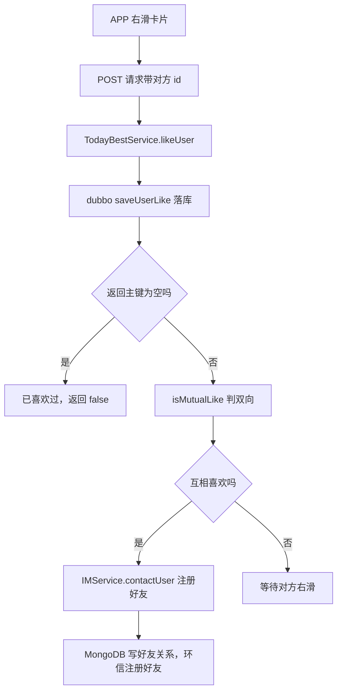

# 右滑喜欢的 APP 接口：落库、判双向、注册好友三步编排

dubbo 层的三个原子方法已经就位：`saveUserLike` 负责落库，`isMutualLike` 负责判定双向，`deleteUserLike` 留给左滑。但 dubbo 服务是给进程间调用准备的，手机上的 APP 触不到它；右滑动作要从 HTTP 接口进来，由 APP 接口服务把三个原子能力编排成一条完整链路。这一课铺完这段路：controller 怎么接请求，service 怎么串调用，互为好友之后好友注册在哪里触发，联调时那个来路不明的 404 又该怎么排查。

## 先给结论

- 接口挂在 `TodayBestController` 上，POST 请求路径里带对方的用户 id，请求体什么都不用带，当前登录人从线程上下文取。
- service 三步编排：先 `saveUserLike` 落库，返回的主键为空说明已喜欢过，直接返回 false；再 `isMutualLike` 判双向；判定为真就调 `IMService.contactUser` 注册好友。
- 好友注册是消息功能的既有能力，`contactUser` 做两件事：好友关系写入 MongoDB，再把关系注册到环信平台。
- 联调期最常见的 404 出在环信注册环节：对方用户还没在环信注册过，把对方账号补注册，或按正常流程从应用注册走一遍，报错即消失。
- controller 只在抛异常时返回 500，service 的 false 不改变响应码，重复右滑对外表现为 200，这是实现上的已知简化。

## 一、controller：路径变量带上对方 id

**接口契约由 mock 文档约定。** 路径里只有一个路径变量，就是被喜欢用户的 id：张三登录后右滑了李四，`likeUserId` 就是李四的 id。controller 的职责薄到只剩转发与异常兜底（路径以课程 mock 文档为准）：

```java
/**
 * 喜欢
 *
 * @param likeUserId 喜欢的用户 id，对方
 * @return
 */
@PostMapping("{id}/love")
public ResponseEntity<Void> likeUser(@PathVariable("id") Long likeUserId) {
    try {
        this.todayBestService.likeUser(likeUserId);
        return ResponseEntity.ok(null);
    } catch (Exception e) {
        e.printStackTrace();
    }
    return ResponseEntity.status(HttpStatus.INTERNAL_SERVER_ERROR).build();
}
```

注意 controller 没有接收当前登录人：登录校验的拦截器早已把用户对象放进 `UserThreadLocal`，service 里随取随用，请求体与请求头都不需要重复携带身份。

## 二、service：三步编排

`TodayBestService` 里注入 dubbo 的 `UserLikeApi`，版本号 1.0.0 对应 MongoDB 实现（2.0.0 是 Elasticsearch 版本的搜附近实现，两个版本在注册中心里共存，引用时必须对得上提供方的版本）：

```java
@Reference(version = "1.0.0")
private UserLikeApi userLikeApi;

@Autowired
private IMService imService;

public Boolean likeUser(Long likeUserId) {
    //当前登录用户
    User user = UserThreadLocal.get();
    //1、保存喜欢记录，返回主键
    String id = this.userLikeApi.saveUserLike(user.getId(), likeUserId);
    //主键为空：已喜欢过，幂等返回
    if (StringUtils.isEmpty(id)) {
        return false;
    }
    //2、判断是否相互喜欢
    if (this.userLikeApi.isMutualLike(user.getId(), likeUserId)) {
        //3、相互喜欢，注册好友
        this.imService.contactUser(likeUserId);
    }
    return true;
}
```



图上主线的三个分支对应三种产品状态：已喜欢过、单方面喜欢、两情相悦。dubbo 层只回答数据问题，动作的先后与触发时机全部由 service 决定，这正是上一课 dubbo 层职责划分的落地：编排留在业务层，原子能力沉在数据服务层。

## 三、好友注册：contactUser 的两件事

`IMService.contactUser` 在消息功能一课已经实现，这里直接复用。它对内做数据落库，对外做平台注册：

```java
public Boolean contactUser(Long userId) {
    //需要做 2 件事：1、好友关系到 MongoDB；2、好友关系注册到环信
    Users users = new Users();
    users.setUserId(UserThreadLocal.get().getId());
    users.setFriendId(userId);
    //1、保存好友关系到 MongoDB
    this.usersApi.saveUsers(users);
    //2、调系统管理服务把好友关系注册到环信，请求头携带管理员 token，构造略
    String url = ssoUrl + "/user/huanxin/contacts/" + users.getUserId() + "/" + users.getFriendId();
    ResponseEntity<Void> responseEntity = this.restTemplate.postForEntity(url, null, Void.class);
    return responseEntity.getStatusCodeValue() == 200;
}
```

两个动作缺一不可：MongoDB 里的好友关系支撑联系人列表、动态可见性这些站内查询；环信侧的注册让两个人在 IM 平台上互为好友，消息才发得进去。`ssoUrl` 指向系统管理服务，环信的 Appkey 与管理员 token 都由那一侧持有，接口服务只管发 REST 请求。

**404 是联调期的高发报错，出在环信注册这一步。** 根因是测试数据不完整：用单元测试或手工插数造出来的用户，只存在于 MySQL 与 MongoDB 里，环信平台上根本没有这个账号，两个人之间注册好友关系时环信返回 404。处理办法有两条：把要互加好友的对方账号先在环信平台上注册出来，再执行右滑；或者按产品正常流程走一遍注册登录，注册环节会顺带把环信用户建好。报错本身不代表代码有问题，看到 404 先查环信侧有没有人。

## 四、接口就位后的验证顺序

dubbo 层的行为已经用单元测试验证过，本课交付后完整的验证链是：重启 dubbo 提供者与接口服务，REST 工具带着登录 token 直接调一次喜欢接口，确认 200 与无异常日志；然后在安卓模拟器里登录，探花页右滑一个人，回 MongoDB 看 `user_like` 集合是否新增对应记录；再用两个互为喜欢的账号各滑一次，确认联系人列表出现对方。数据逐层确认，比只看界面可靠。完整的模拟器联调放在不喜欢功能之后一起做，两个接口共用一套登录与数据准备。

## 常见误区

- **把重复右滑当失败。** 错例：`saveUserLike` 幂等返回 null，service 返回 false，开发误以为落库失败去查日志。正解：null 的语义是「已喜欢过，无需再落库」，幂等不是故障；若要向上层交还已有记录，把 count 换成 findOne 返回旧主键更好。
- **dubbo 引用版本号写错。** 错例：`@Reference` 不写 version 或写成 2.0.0，注册中心里匹配不到提供者，运行期才报 No provider。正解：版本号是 dubbo 区分多实现共存的方式，引用与提供两侧必须一致。
- **404 当成本地代码 bug。** 错例：环信返回 404 后反复检查 controller 与 service。正解：404 来自环信侧，对方用户不存在，先补注册环信账号。
- **好友注册结果不跟进。** 错例：`contactUser` 返回 false 也继续返回 true，MongoDB 有关系而环信没有，两边不一致。正解：注册失败应记日志或进重试队列，至少把失败暴露出来。

## 面试可能被问到的问题

1. 面试官追问：「右滑一个动作为什么要拆成落库、判定、注册三步？」
   答：落库与判定是原子数据操作，注册是跨系统的编排动作，拆开后每一步的成败都有明确位置，dubbo 方法也因此可以被单独测试与复用。全塞进一个 dubbo 方法里，事务边界与失败语义都会变模糊。
2. 面试官追问：「saveUserLike 返回 null 的幂等设计有什么更好的形态？」
   答：返回 null 表达已存在，调用方需要区分 null 与失败两种含义。更好的形态是保存前 findOne，命中就返回已有记录的主键，调用方无需为空值做特殊分支；再配合 userId 加 likeUserId 的唯一索引，从存储层兜住并发双写。
3. 面试官追问：「MongoDB 好友关系写成功、环信注册失败，怎么办？」
   答：跨系统没有强一致，常见做法是记录失败明细进重试队列，由定时任务补偿注册；或者先注册环信成功再落 MongoDB，把本地失败留给事务回滚。课程实现选择先落库后注册并返回布尔值，属于把一致性交给运维与人工兜底的简化版。
4. 面试官追问：「站内 id 和环信 ID 对得上号，为什么还要单独调 REST 注册？」
   答：站内 id 相等只是本项目的映射约定，环信平台并不感知这个约定，它只认自己注册过的用户。REST 注册就是把站内关系同步到环信侧的动作，两边数据独立存储，必须显式同步。
5. 面试官追问：「dubbo 的 version 隔离在生产上有什么用？」
   答：同一接口的多套实现可以按版本号并存，典型场景是实现切换与灰度：MongoDB 版本与 Elasticsearch 版本各挂一个版本号，消费方按版本引用，切换时改配置而不是改代码，出问题也能按版本回退。

## 配套资料

- 学习目标：`materials/code/07/day10 探花交友-Elasticsearch geo实现搜附近/day10/学习目标.md`，「独立完成探花功能的编码」中喜欢链路的 APP 接口层即本课验收对象。
- 原型：`materials/code/07/day01 探花交友-项目搭建以及登录完善个人信息/day01/资料/探花交友移动端原型V1.2`，探花页右滑交互的出处。
- 说明：day10 资料包仅含学习目标，无源码包；controller 与 service 为按课程画面整理补全的可编译示例，包名统一 `com.study.tanhua` 系；接口路径以课程 mock 文档为准；`IMService.contactUser`、`Users` 集合与环信注册为消息功能的既有实现，此处按画面引用。
