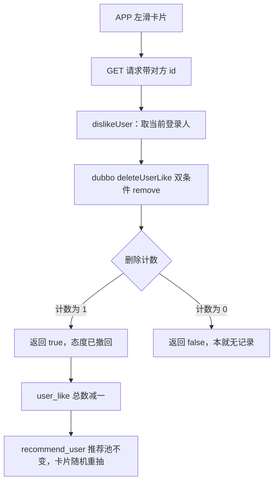

# 左滑不喜欢：一次 remove 背后的删除语义与推荐池边界

> 🔒 安全提示：文中示例的口令/密钥均为课程教学环境演示口径，生产环境的安全要求见《安全与合规须知》。

右滑链路通了，探花还差另一半：左滑不喜欢。产品的诉求很轻，这张卡别再出现；实现也轻，把「我喜欢他」这条单向记录删掉就完事。但轻功能里也有边界值得划清楚：删除删的是哪条记录、重复左滑算什么行为、左滑之后推荐池里那个人还在不在。这一课顺着代码把三件事说透，再用模拟器把左右滑一起联调收尾。

## 先给结论

- 接口 `GET {id}/unlove`，mock 文档把不喜欢约定为 GET 请求；service 只有一行转调，调 dubbo 的 `deleteUserLike` 完成删除。
- 删除只作用于 `user_like` 里「我喜欢对方」这一条单向记录，对方喜欢我的那条不受影响；方向传反删不到东西，返回 false。
- 删除天然幂等：重复左滑第二次命中计数 0，返回 false，库里不会有多余动作。
- 当前版本不从推荐池剔除：卡片每次刷新重新随机抽，左滑过的人可能再次出现；真正的剔除需要把不喜欢沉淀成数据再在池查询里排除，本课按画面只演示删除生效。
- 联调以数据变化为准：右滑三人 `user_like` 增加三条，左滑一人总数从 6 条变 5 条。

## 一、接口实现：controller 与 service 各司其职

controller 沿用喜欢接口的模板，换路径换方法名（路径以课程 mock 文档为准）：

```java
/**
 * 不喜欢
 *
 * @param likeUserId 不喜欢的用户 id，对方
 * @return
 */
@GetMapping("{id}/unlove")
public ResponseEntity<Void> dislikeUser(@PathVariable("id") Long likeUserId) {
    try {
        this.todayBestService.dislikeUser(likeUserId);
        return ResponseEntity.ok(null);
    } catch (Exception e) {
        e.printStackTrace();
    }
    return ResponseEntity.status(HttpStatus.INTERNAL_SERVER_ERROR).build();
}
```

service 短到极致，取登录人、转调 dubbo，两行：

```java
public Boolean dislikeUser(Long likeUserId) {
    User user = UserThreadLocal.get();
    return this.userLikeApi.deleteUserLike(user.getId(), likeUserId);
}
```

没有业务分支可写，是因为复杂性早已沉淀在 dubbo 层：`deleteUserLike` 用 userId 加 likeUserId 双条件定位，`remove` 之后看 `getDeletedCount()` 是否为 1 才算成功。接口层拿到的布尔值因此有准确含义：true 是确有一条记录被删掉，false 是方向本来就不存在或已删过。

## 二、删除语义：单向、幂等、计数说话

**单向记录决定了删除的精确范围。** `user_like` 里 A 喜欢 B 与 B 喜欢 A 是两条独立文档，左滑只构造「userId 等于自己、likeUserId 等于对方」这一个条件，删的是自己发出的那条态度。对方如果也右滑过我，那条记录仍然在，单向删除不会误伤对方的好感。产品语义也自洽：我不喜欢他了，不等于他不喜欢我了。



图上最后一支箭头是关键边界：删除动作的波及面只有 `user_like` 一个集合，推荐池纹丝不动。

**幂等性是白送的。** 删除类的幂等不需要额外代码，第二次左滑时条件查不到记录，计数 0，返回 false。与右滑的幂等对照着看：写操作靠先 count 后 save 保证只落一条，删操作靠条件定位保证只删存在的，两种幂等都不依赖调用方克制。

**GET 表达删除是 mock 文档的约定。** 按 REST 的严格语义，删除资源应该用 DELETE，至少也是 POST；mock 文档把不喜欢定义为 `GET {id}/unlove`，把右滑定义为 POST，两个写动作的动词并不统一。约定不一致时以文档为准，客户端照实现，服务端不必擅自改动词，否则端上联调全对不上；把两个接口统一成 POST 是日后更规范的演进方向。

## 三、左滑之后，推荐池里的人还在

联调画面里有一个值得盯住的细节：左滑生效后刷新探花页，卡片列表并没有系统性排除刚被左滑的人。原因在数据流向里：卡片池来自 `recommend_user` 推荐集合的随机抽样，`deleteUserLike` 只动 `user_like`，池子没有任何变化，查询卡片时也没有「排除已交互用户」的条件。刚左滑的人下次随机抽取时完全可能再次出现，这不是 bug，是当前版本的功能边界。

要把左滑变成真正的剔除，有两条演进路径。轻的一条：卡片查询时加排除条件，把已右滑与已左滑的人都从池子里滤掉，代价是左滑必须留痕，删除就要改成状态标记，`user_like` 的记录不能真删。重的一条：单独沉淀不喜欢集合，作为推荐打分的负反馈输入，推荐作业跑批时对这些人降权，让系统学会不再推。喜欢功能的 dubbo 设计里留过这个伏笔：减分项需要以数据为原料，它属于推荐侧的迭代，不是接口层顺手能带出来的东西。

当前版本的选择是换取实现最省：删除即表达，数据不留痕，接口一行转调。理解这个取舍比记住代码更重要。

## 四、联调实测：以条数变化为验收标准

服务重启后走模拟器：测试手机号（敏感信息已打码）加固定验证码 123456 登录，进入探花页。验证动作按数据链路设计：

1. 右滑三张卡片，到 Robo 3T 里查 `user_like` 集合，新增三条文档，字段是 userId、likeUserId、created，方向语义正确。
2. 对其中一人左滑，集合总数从 6 条变 5 条，删除精确命中一条。
3. 对已喜欢过的人再次右滑，集合条数不变，写侧幂等生效。
4. 多次刷新探花页，卡片组合持续变化，被左滑的人仍可能现身，边界与预期一致。

界面只能证明「没报错」，条数与文档内容才能证明「做对了」。联调养成回库看数的习惯，多数疑似 bug 在数据库里一眼见分晓。到这里，探花页的展现、右滑、左滑整条链路全部闭环。

## 常见误区

- **以为左滑会删掉对方的喜欢记录。** 错例：A 左滑 B 后以为两人在 `user_like` 里彻底无关，实际只删了 A 发出的那条，B 喜欢 A 的记录仍在，双向判定依然可能成立。正解：单向删除，范围只限自己发出的方向。
- **重复左滑当异常报。** 错例：第二次左滑返回 false 被当成删除失败排查半天。正解：计数 0 的 false 是幂等语义，表示本就无记录。
- **期待左滑后卡片永不再见。** 错例：验收时左滑一人后刷新，又看到同一个人，判定功能失效。正解：当前版本推荐池不剔除已交互用户，剔除是推荐侧的后续迭代。
- **service 里堆业务逻辑。** 错例：在 dislikeUser 里顺手更新推荐集合、清理缓存。正解：删除的波及面保持在 `user_like` 一个集合内，跨集合的联动交给明确的后续需求，否则接口层的职责越积越乱。

## 面试可能被问到的问题

1. 面试官追问：「不喜欢的负反馈数据要不要存？」
   答：看产品诉求。只为让卡片别再出现，删除即可；要喂给推荐系统做降权，就必须持久化不喜欢记录，单独成集合并带时间戳，因为负反馈有强弱与时衰，攒够数据量才有打分价值。
2. 面试官追问：「删除接口的幂等怎么保证？」
   答：条件删除天然幂等，重复请求命中同一条件时第二次计数为 0，返回值区分了删除成功与无记录两种状态。若要更明确，可以在响应里区分 404 与 200，但内部服务间用布尔值已够用。
3. 面试官追问：「同一时刻一个人右滑、另一人左滑，并发下结果是什么？」
   答：两个操作作用于不同方向的文档，互不冲突，最终状态是各自独立成立。冲突场景是同一方向的保存与删除并发，此时后到者胜，唯一索引与条件删除都能保证不出现脏数据，业务上接受最后一步的语义即可。
4. 面试官追问：「卡片池要排除已交互用户，查询怎么改？」
   答：在推荐查询里追加 not in 条件，排除 `user_like` 中与当前用户相关的全部对方 id；因为当前版本删除即留不下痕迹，排除需要先把左滑改成状态标记。数据量增大后这一步要转给 Elasticsearch 的过滤条件完成。

## 配套资料

- 学习目标：`materials/code/07/day10 探花交友-Elasticsearch geo实现搜附近/day10/学习目标.md`，「独立完成探花功能的编码」中左滑交互即本课验收对象。
- 原型：`materials/code/07/day01 探花交友-项目搭建以及登录完善个人信息/day01/资料/探花交友移动端原型V1.2`，左滑右滑的产品交互形态。
- 说明：day10 资料包仅含学习目标，无源码包；controller 与 service 为按课程画面整理补全的可编译示例，包名统一 `com.study.tanhua` 系；`deleteUserLike` 的实现口径见喜欢功能 dubbo 接口实现一课。
