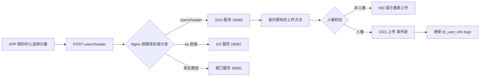

# 我的中心也要传头像：一条 Nginx 路由复用现成的上传链路

> 🔒 安全提示：文中示例的口令/密钥均为课程教学环境演示口径，生产环境的安全要求见《安全与合规须知》。

用户资料维护的第三件事是头像。查询与保存更新都是纯字段读写，头像却是一张实打实的图片文件，而且这条上传链路其实早就存在：注册登录后的完善信息环节，头像上传连同人像校验、对象存储落盘已经完整实现过一遍。现在「我的」模块的资料页也要一个换头像的入口，麻烦在于 APP 端这次请求走的路径与完善信息那条不一样。在接口服务工程里再写一套上传逻辑，还是让新路径去复用旧链路，这是本课要做的取舍。

一个前提先摆平：两次上传的请求参数完全一致，multipart 表单里一个图片文件加一个 token 请求头，差异只有 URL 路径。路径层面的分歧，用路由解决最合适。

## 先给结论

- 上传能力零复制：人像校验、OSS 上传、更新 `tb_user_info.logo` 三个环节全部复用单点登录工程里现成的实现。
- 路径不一致交给 Nginx：新增 `location /users/header`，把我的中心的头像请求路由到 SSO 服务的 18080 端口。
- SSO 侧只加一个薄薄的 `UsersController`，新路径映射到 `users/header`，方法体一行，委托给既有的上传方法。
- 配置文件改动后必须执行 `nginx.exe -s reload` 才生效，这条命令容易忘。
- 校验规则原样保留：非人像图片依旧被拒绝，客户端拿到的还是「图片非人像，请重新上传」。

## 一、两条路径，一套能力

完善信息环节的上传接口与我的中心的上传接口，能力上是同一件事：收图、验人像、传 OSS、把外链写回用户资料表。区别只在请求路径：前者在注册流程里，后者挂在「我的」模块的资料页下。

面对这种情形有两种选择。**第一种，在接口服务工程里再写一套上传。** 校验逻辑、OSS 配置、落库语句都要复制一遍，两处代码从此各自演化，人像校验规则一变就得改两个地方，这是典型的重复实现。**第二种，让新路径也走到旧链路上。** 旧链路在 SSO 工程里，那就在网关层把新路径转发过去，业务代码一行不动。

这套架构里 Nginx 本来就是统一入口：APP 只认一个域名与端口，后端按路径前缀分发流量。既有规则是用户相关路径进 18080 的 SSO 服务，es 前缀进 18082 的 ES 服务，其余进 18081 的接口服务。现在要做的，只是给头像这条路径补一条更具体的规则。



这张图把两种选择背后的分流画了出来：头像请求没有进入接口服务的业务编排，而是被网关直接引到 SSO，在校验通过后走既有的上传与落库链路。关键路径是 `users/header` 到 18080 这一条，其余两条是既有规则的背景。

## 二、Nginx 侧：一条 location 完成路由

课程资料里给出了最终的 Nginx 配置，头像相关的一段是这样的：

```nginx
location /users/header {
    client_max_body_size  300m;
    proxy_connect_timeout 300s;
    proxy_send_timeout 300s;
    proxy_read_timeout 300s;
    proxy_pass   http://127.0.0.1:18080;
}
```

几个配置项各管一件事。`proxy_pass` 决定去向，18080 正是 SSO 服务监听的端口；`client_max_body_size 300m` 给请求体开到 300 兆的上限，图片上传类路径都要显式放大这个值，否则默认的小上限会直接把大图挡在网关外；三个 timeout 统一拉长到 300 秒，给上传与处理留足时间。

Nginx 的 location 匹配走最长前缀优先，与书写顺序无关。`/users/header` 比 `/user/` 与 `/` 都更具体，命中后精确转发到 SSO；同级的 `/users/phone` 也是同样的思路，指向同一个端口。改完保存配置文件，让改动生效只有一步：

```bash
nginx.exe -s reload
```

reload 会让主进程重新读取配置并平滑拉起新的工作进程，已建立的连接不受影响。改了配置忘记 reload，是这类「明明配对了却不生效」问题的第一大来源。

## 三、SSO 侧：一个委托式的入口

网关把请求送到了 SSO，但 SSO 里还没有哪个方法映射在 `users/header` 这个路径上，请求依旧无处落地。做法是新增一个 `UsersController`，把既有的上传方法注入进来直接委托：

```java
package com.study.tanhua.sso.controller;

import org.springframework.beans.factory.annotation.Autowired;
import org.springframework.http.ResponseEntity;
import org.springframework.web.bind.annotation.PostMapping;
import org.springframework.web.bind.annotation.RequestHeader;
import org.springframework.web.bind.annotation.RequestMapping;
import org.springframework.web.bind.annotation.RequestParam;
import org.springframework.web.bind.annotation.RestController;
import org.springframework.web.multipart.MultipartFile;

@RestController
public class UsersController {

    @Autowired
    private UserInfoController userInfoController;

    /**
     * 我的中心上传头像：与完善信息共用同一条上传链路
     */
    @RequestMapping("users/header")
    @PostMapping
    public ResponseEntity<Object> saveLogo(@RequestParam("headPhoto") MultipartFile file,
                                           @RequestHeader("token") String token) {
        return this.userInfoController.saveLogo(file, token);
    }
}
```

方法体只有一行：把文件与 token 原样转交。路径映射写成 `users/header`，与 Nginx 的转发规则对齐；参数名 `headPhoto` 与 APP 端表单字段一致，token 从请求头取，这些契约都由 mock 接口文档约定，新旧两个入口保持同一套。

被委托的既有方法内部已经封好了完整流程：按 token 查用户、把上传文件转临时文件做 `checkIsPortrait` 人像校验、`putObject` 传 OSS、把外链用 `UpdateWrapper` 按 `user_id` 写回 `tb_user_info.logo`。校验不过或中途异常，统一汇成 500 响应加错误结构，错误信息就是那句「图片非人像，请重新上传」。新入口没有触碰其中任何一行逻辑，所以这些行为全部原样继承。

**Controller 里注入另一个 Controller 是不是坏味道，值得说一句。** 同进程内它只是普通的 bean 方法调用，没有序列化与远程语义，能跑；但两个入口共享一条代码路径时，更工程化的形态是把逻辑下沉到 Service，让两个 Controller 都依赖 Service，彼此不认识。课程取最小改动，好处是旧接口零风险，重构空间留在以后。

## 四、联调：从模拟器到落库确认

SSO 重启后走一遍真实流程。模拟器里用测试手机号获取验证码、输入固定验证码 123456 登录，进入「我的」模块打开资料页，点击头像，从相册选一张人像图片提交。上传完成后页面头像没有立刻变化，切换到其他页面再回来，新头像已经渲染出来，说明链路通了。

失败分支同样值得验一下：换一张风景图提交，客户端弹出「图片非人像，请重新上传」，与完善信息环节的行为一致。数据库侧确认，`tb_user_info.logo` 字段已经从旧值更新为这一次上传的 OSS 外链，浏览器打开该 URL 就是新头像。至此资料维护的查询、保存更新、头像上传三件事全部收口，用户资料功能在 day10 画上句号。

## 常见误区

- **改了配置不 reload。** 错例：在 `nginx.conf` 里加好 location，直接测 APP，请求依旧落在接口服务。正解：配置文件是磁盘上的死文本，`nginx.exe -s reload` 之后才会被主进程重新加载。
- **漏配 client_max_body_size。** 错例：路由指对了，上传稍大的图片直接返回 413。正解：上传类路径显式放大请求体上限，本课给到 300m。
- **复制一套上传逻辑图省事。** 错例：在接口服务工程重写校验与上传，两处代码口径慢慢漂移。正解：能力已有归属时，路由转发加薄委托，改动最小且不会分叉。
- **location 路径多写尾斜杠。** 错例：写成 `location /users/header/`，APP 请求 `/users/header` 无法命中。正解：location 前缀与实际请求路径逐字符对应，保持与 mock 文档一致。

## 面试可能被问到的问题

1. 面试官追问：「同一个能力出现在两个业务入口，怎么避免复制粘贴？」
   答：先判断差异层级。请求参数一致、只有路径不同时，在网关层做路由转发，业务代码不动；需要不同处理逻辑时，把公共能力下沉到 Service 或独立服务，两个入口各自薄封装后调用。原则是逻辑只写一份，入口可以多个。
2. 面试官追问：「Nginx 的 location 是按什么规则匹配的？」
   答：普通前缀 location 走最长前缀优先，与配置书写顺序无关；还有 `=` 精确匹配与正则匹配等修饰符，精确匹配命中即停。本课的 `/users/header` 比 `/` 更长，所以头像请求不会被兜底规则截走。
3. 面试官追问：「上传接口返回 413，你会怎么排查？」
   答：413 是请求体超过 Nginx 的 `client_max_body_size`，先看该请求命中的 location 有没有放大上限，再看 `proxy_pass` 后端应用自身有没有 multipart 大小限制，两层都可能拦截，逐层放宽并按实际业务给合理上限，而不是无脑开到最大。
4. 面试官追问：「Controller 注入 Controller 调用，有什么风险？」
   答：同进程内是普通方法调用，功能上没问题；风险在架构层面，入口层互相纠缠会让调用链路难追踪，事务与异常语义也容易混在一起。更规范的做法是把公共逻辑下沉到 Service 层，Controller 之间互不引用。
5. 面试官追问：「头像更新后，客户端和其他页面怎么感知新头像？」
   答：头像只有一个真相源，`tb_user_info.logo` 里的 OSS 外链。资料页与卡片列表都是查询时现读该字段，客户端重新拉取即拿到新值；外链地址每次上传都用 UUID 重新生成，天然绕开旧图缓存问题。若再叠加 CDN，刷新节点缓存即可。

## 配套资料

- Nginx 配置：`materials/code/07/day11 探花交友-我的中心/day11/代码/nginx.conf`，`/users/header` 一段即本课路由的最终形态，文件里还能看到 18080、18081、18082 三个服务的完整分工。
- 数据库：`materials/code/07/day01 探花交友-项目搭建以及登录完善个人信息/day01/代码/mytanhua.sql`，`tb_user_info.logo` 是头像外链的落库字段。
- 学习目标：`materials/code/07/day10 探花交友-Elasticsearch geo实现搜附近/day10/学习目标.md`，六条「独立完成」中「独立完成维护用户信息的功能」以本课收尾。
- 说明：SSO 与接口服务工程源码未随资料包提供，`UsersController` 为按课程画面整理补全的可编译示例；OSS 接入与人像校验引擎的完整搭建过程，在完善个人信息阶段的图片上传与人脸识别两课中已经展开，此处直接复用。
