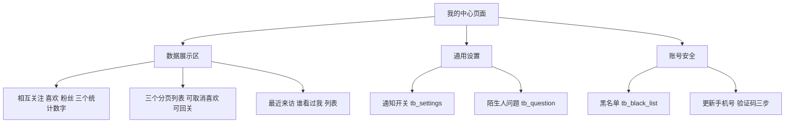

# day11 地形图：我的中心收官与 CDN 原理

项目进入第十一天，也是最后一天。day10 收口时「我的」模块只有资料维护的基础三件，而 APP 的我的中心页面上还挂着大片空白：顶部的相互关注、喜欢、粉丝三个数字，点进去的三个列表，通用设置里的一排开关，黑名单与更换手机号。收官一天的任务清单已经画好，外加一堂与代码无关但面试常问的 CDN 原理课。开场先把地形看清，编码才不会在功能堆里迷路。

## 先给结论

- day11 主线是我的中心，覆盖四类内容：我的喜欢的数据与交互、用户通用设置、黑名单、更新手机号。
- 我的喜欢是全天重头戏：先做三个统计数字，再做三个分页列表，最后接取消喜欢、关注喜欢这类交互。
- 三个数字有严格的方向语义：喜欢是我喜欢别人，粉丝是喜欢我的人，相互关注是两个方向同时成立，全部由 `user_like` 集合单向记录推导。
- 通用设置与黑名单落在两张新表：`tb_settings` 管三类通知开关，`tb_black_list` 管拉黑关系。
- CDN 只讲原理不动手：使用 CDN 的前提是已备案域名，课程环境不具备，原理本身是面试常客。

## 一、我的中心还欠什么

把产品原型里「我的」页面过一遍，与现状对照，缺口就列出来了。资料展示与头像上传在 day10 已经完成，剩下的缺口分四类：



数据展示区消费的是 day10 落库的喜欢数据，纯查询就能支撑；通用设置与黑名单需要新表；更新手机号是账号级操作，验证码链路在登录功能里已经搭过，复用思路即可。四类缺口对应学习目标的前七条，第八条 CDN 原理独立成块。

## 二、我的喜欢：一天里的重头戏

三个数字先要把概念掰清。以张三喜欢李四为例：张三的角度，这是他的「喜欢」；李四的角度，张三是他的「粉丝」；如果李四也喜欢张三，两人就是「相互关注」。喜欢不等于被喜欢，张三喜欢李四不代表李四也喜欢张三，这层方向感不清醒，后面的查询一定会写反。

数据底座是现成的：`user_like` 集合一条记录一个单向关系，`userId` 是动作发出者，`likeUserId` 是被喜欢的人。于是三个统计全部退化成计数问题：

- 喜欢数：`userId` 等于我的记录条数，即我喜欢了多少人。
- 粉丝数：`likeUserId` 等于我的记录条数，即多少人喜欢我。
- 相互关注数：在我喜欢的人里，数一数谁也喜欢我，两个条件同时命中的条数。

统计之下是三张列表，带分页，页面上还能做取消喜欢、关注回关这类操作；再往上叠加一个「谁看过我」的来访列表，与访客数据打通。列表与统计共享同一套查询条件，差别只在读一条还是读一页。

## 三、设置与黑名单：两张新表收官

资料包的数据库脚本里，本天要用的三张表都是现成的。通用设置表把通知类开关拆成三列：

```sql
CREATE TABLE `tb_settings` (
  `id` bigint(20) NOT NULL AUTO_INCREMENT,
  `user_id` bigint(20) DEFAULT NULL,
  `like_notification` tinyint(4) DEFAULT '1' COMMENT '推送喜欢通知',
  `pinglun_notification` tinyint(4) DEFAULT '1' COMMENT '推送评论通知',
  `gonggao_notification` tinyint(4) DEFAULT '1' COMMENT '推送公告通知',
  `created` datetime DEFAULT NULL,
  `updated` datetime DEFAULT NULL,
  PRIMARY KEY (`id`)
) ENGINE=InnoDB DEFAULT CHARSET=utf8 COMMENT='设置表';
```

有人喜欢我、有人评论我、有公告发布，是否推送各由一个开关决定，默认全开。设置表与用户一对一，查询与保存都是单行操作。

黑名单表记录拉黑关系，与喜欢表同构，只是方向语义变成「谁拉黑了谁」：

```sql
CREATE TABLE `tb_black_list` (
  `id` bigint(20) NOT NULL AUTO_INCREMENT,
  `user_id` bigint(20) DEFAULT NULL,
  `black_user_id` bigint(20) DEFAULT NULL,
  `created` datetime DEFAULT NULL,
  `updated` datetime DEFAULT NULL,
  PRIMARY KEY (`id`),
  KEY `user_id` (`user_id`)
) ENGINE=InnoDB DEFAULT CHARSET=utf8 COMMENT='黑名单';
```

`user_id` 是拉黑动作的发出者，`black_user_id` 是被拉黑的人。另外还有一张 `tb_question` 存用户留给陌生人的问题，配合消息功能里的「聊一下」使用。三张表都是 MySQL 单表，没有跨表事务诉求，按 MyBatis-Plus 的常规读写推进即可。

## 四、更新手机号与 CDN 原理

更新手机号是账号级安全操作，流程拆成三步：发送短信验证码、校验验证码、保存新手机号。验证码的生成与下发链路在登录功能里已经建好，这一天的增量主要在编排：校验通过前不触碰 `tb_user` 的手机号字段，三步各自有独立接口，失败重试不会产生脏数据。

CDN 是收官的原理课。它的价值一句话说清：把静态资源缓存到离用户最近的边缘节点，用户就近取资源，源站减压、加载提速。课程之所以只讲原理，是因为真实使用 CDN 有前置门槛：域名必须完成备案与审核，这类流程只有企业才具备条件。云厂商的 CDN 服务本身开箱即用，把原理与收益搞明白，进了企业接入时剩下的只是控制台操作。

## 五、验收清单

学习目标文档把一天拆成八条，全部围绕「独立完成」与「理解」两个动词：

```markdown
- 独立完成我的喜欢中查询统计数据

- 独立完成我的喜欢中列表展现

- 独立完成我的喜欢中的交互功能

- 独立完成保存陌生人问题

- 独立完成黑名单的功能

- 独立完成更新通知的功能

- 独立完成更新手机号的功能

- 理解cdn的工作原理
```

八条任务里，前七条都是编码，依赖关系清晰：统计先行，列表随后，交互收尾；设置、黑名单、手机号三块彼此独立，穿插推进。收官日的工作量不小，按依赖顺序排产能，一天刚好排满。

## 常见误区

- **把喜欢、粉丝、相互关注混为一谈。** 错例：统计粉丝数时用「我发出的喜欢」的条件。正解：方向语义钉死在 `userId` 与 `likeUserId` 两个字段上，写查询前先问一句「站在谁的角度」。
- **以为黑名单是在喜欢数据上加字段。** 错例：在 `user_like` 里加个标记位表示拉黑。正解：拉黑与喜欢是两类独立关系，生命周期不同，独立建表各自演化，查询也不互相牵连。
- **把 CDN 当成要动手接入的组件。** 错例：在课程环境里折腾域名备案。正解：备案是使用 CDN 的前置条件，课程只求原理通透，企业域名具备备案条件后接入是控制台操作。
- **收官日放松编码标准。** 错例：认为最后一天都是收尾杂活。正解：统计与列表的分页、方向语义、交互编排都是硬活，收官日的功能同样按 dubbo 加接口服务两层完整实现。

## 面试可能被问到的问题

1. 面试官追问：「我的中心这类聚合页面，功能规划你怎么做？」
   答：按页面分区拆成数据展示、交互操作、账号安全、系统设置四类。展示类只做查询并明确数据来源，交互类梳理状态流转，安全类补验证码等防护，设置类设计独立存储。每类对应独立的接口与数据层改动，规划完再排依赖顺序。
2. 面试官追问：「喜欢、粉丝、相互关注用一张表怎么支撑？」
   答：单向关系表，一行记录一个方向的喜欢，userId 是发出者、likeUserId 是接收者。喜欢数按 userId 计数，粉丝数按 likeUserId 计数，相互关注在「我喜欢的人」集合内查喜欢我的人。三个概念共享同一份数据，方向语义由查询条件表达。
3. 面试官追问：「通知类开关应该在什么时机判断？」
   答：在触发通知的动作链路里判断，比如评论产生时读设置表看评论通知开关是否打开，关着就不投递消息。判断时机要靠近通知的生产端而不是展示端，关掉的开关意味着事件根本不进推送链路。
4. 面试官追问：「黑名单和喜欢不共表，会不会造成数据不一致？」
   答：两者本来就是独立的关系，不存在一致性问题。需要约束的是业务规则，比如拉黑后自动解除喜欢关系，这属于跨关系的业务编排，在动作层显式处理，比在存储层共表清晰得多。
5. 面试官追问：「讲讲 CDN 的原理，什么场景值得接入？」
   答：CDN 把静态资源复制到分布各地的边缘节点，用户请求经调度系统命中最近节点就近返回，未命中的节点回源拉取并缓存。图片、视频、前端静态包这类读多写少、对延迟敏感的资源收益最大，接入前提是已备案域名与可预估的流量模型。

## 配套资料

- 学习目标：`materials/code/07/day11 探花交友-我的中心/day11/学习目标.md`，八条任务即收官日的验收清单。
- 数据库：`materials/code/07/day11 探花交友-我的中心/day11/代码/mytanhua.sql`，`tb_settings`、`tb_black_list`、`tb_question` 三张新表的建表语句与预置数据。
- Nginx 配置：`materials/code/07/day11 探花交友-我的中心/day11/代码/nginx.conf`，全部接口的统一入口，我的中心的各路径按前缀分发到对应服务。
- 说明：day11 资料包不含工程源码，功能拆解按课程说明的讲解归纳，具体编码在后续各课展开，包名统一 `com.study.tanhua` 系。
