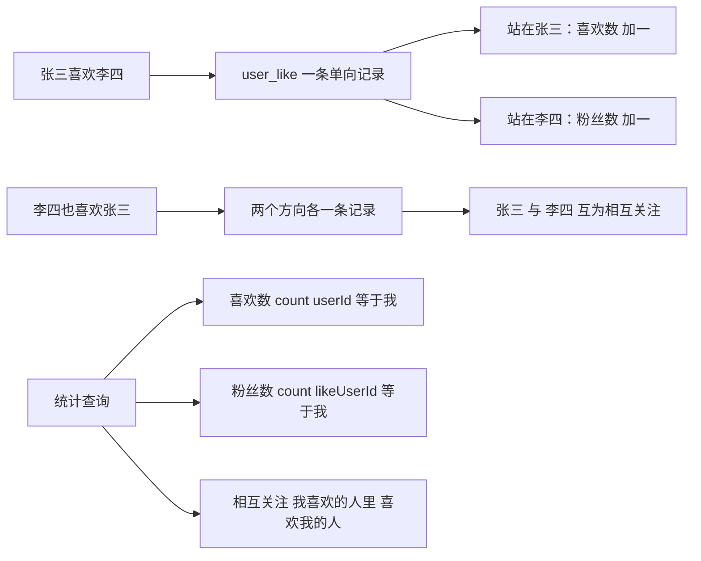
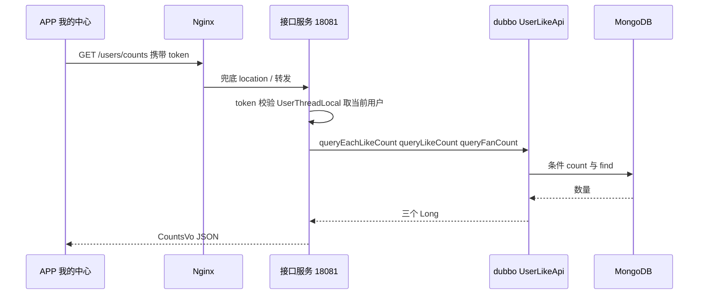

# 我的喜欢三问：统计三个数字，分页三张列表

我的中心页面顶部挂着三个数字：相互关注、喜欢、粉丝。数字看着简单，背后的方向语义却最容易写反；点进每个数字还有一张列表，分页、排序、去重一样不少。这一课把这三问一次做完：dubbo 层先补三个统计方法与三个列表方法，接口服务再开一个 `/users/counts` 统计接口把数字喂给 APP，顺手把「谁看过我」的来访列表也补齐分页。

数据底座是现成的：day10 的探花功能里已经立起 `user_like` 集合与 `UserLikeApi`，右滑喜欢的落库、双向喜欢的判定、左滑的删除都在那里完成。本课不新增任何存储，只在既有集合上换着角度查。

## 先给结论

- 三个数字有严格的方向语义：喜欢是我喜欢别人，按 `userId` 计数；粉丝是喜欢我的人，按 `likeUserId` 计数；相互关注是两个方向同时成立。
- 相互关注的统计是两步查询：先取我喜欢的人的 id 列表，再在该集合内查喜欢我的人，两个条件同时命中才算数。
- dubbo 的 `UserLikeApi` 再添六个方法：三个统计返回 `Long`，三个列表返回 `PageInfo`，分页封装收敛到一个私有方法。
- 分页统一 `PageRequest.of(page - 1, pageSize, Sort.by(Sort.Order.desc("created")))`，页码减一、按创建时间倒序，`total` 暂不提供。
- APP 接口 `GET /users/counts` 无请求参数，token 定位当前用户，返回 `CountsVo` 三个计数字段。

## 一、三个数字背后的方向语义

以张三喜欢李四为例把概念钉死：张三的角度，这条关系是他的「喜欢」；李四的角度，张三是他的「粉丝」；李四也喜欢张三时，两人互为「相互关注」。喜欢与被喜欢是两回事，张三喜欢李四不代表李四也喜欢张三，这层方向感是全部查询的地基。

`user_like` 的字段结构正好把方向编码了进去：`userId` 是动作发出者，`likeUserId` 是被喜欢的人。三个统计全部退化成条件计数：



页面上「相互关注」与判定好友时说的「相互喜欢」是同一件事的两种叫法：前者是展示词汇，后者是数据动作词汇，指向同一个查询。

## 二、dubbo 统计：一个两步查询与两个一行流

接口层在既有 `UserLikeApi` 上追加三个方法，原来的保存、判定、删除原样保留：

```java
public interface UserLikeApi {

    //既有方法：saveUserLike、isMutualLike、deleteUserLike

    /**
     * 查询相互喜欢的数量
     */
    Long queryEachLikeCount(Long userId);

    /**
     * 查询喜欢的数量
     */
    Long queryLikeCount(Long userId);

    /**
     * 查询粉丝的数量
     */
    Long queryFanCount(Long userId);
}
```

实现里，喜欢数与粉丝数各是一行条件 count，相互关注数要两步：

```java
@Override
public Long queryEachLikeCount(Long userId) {
    //查询我的喜欢列表
    Query query = Query.query(Criteria.where("userId").is(userId));
    List<UserLike> userLikes = this.mongoTemplate.find(query, UserLike.class);
    //收集我喜欢的用户 id（对方）
    List<Long> likeUserIds = new ArrayList<>();
    for (UserLike userLike : userLikes) {
        likeUserIds.add(userLike.getLikeUserId());
    }
    //在「我喜欢的用户」范围内，查询喜欢我的人：userId 在集合内且 likeUserId 是我
    Query query2 = Query.query(Criteria.where("userId").in(likeUserIds)
            .and("likeUserId").is(userId));
    return this.mongoTemplate.count(query2, UserLike.class);
}

@Override
public Long queryLikeCount(Long userId) {
    //我喜欢的人：userId 是我
    return this.mongoTemplate.count(Query.query(Criteria.where("userId").is(userId)), UserLike.class);
}

@Override
public Long queryFanCount(Long userId) {
    //喜欢我的人：likeUserId 是我
    return this.mongoTemplate.count(Query.query(Criteria.where("likeUserId").is(userId)), UserLike.class);
}
```

相互关注的两步念出来是一句人话：先问「我喜欢谁」，再在这些人的范围内问「谁喜欢我」。`in` 负责把范围圈进来，`and("likeUserId").is(userId)` 负责把这个范围里喜欢单向指向我的人挑出来，两个条件缺一不可，少了后一个就变成「我喜欢的人喜欢过任何人」，语义完全走样。

单元测试用一组手工数据把三个数字验满。执行前把 `user_like` 集合 drop 掉保证环境干净，同时停掉已启动的 dubbo 提供者，避免测试类以 Spring Boot 方式启动时重复注册服务：

```java
@Test
public void testSave() {
    //1 喜欢 2、3、4；2 喜欢 1；4 喜欢 1；5 喜欢 1；6 喜欢 1
    this.userLikeApi.saveUserLike(1L, 2L);
    this.userLikeApi.saveUserLike(1L, 3L);
    this.userLikeApi.saveUserLike(1L, 4L);
    this.userLikeApi.saveUserLike(2L, 1L);
    this.userLikeApi.saveUserLike(4L, 1L);
    this.userLikeApi.saveUserLike(5L, 1L);
    this.userLikeApi.saveUserLike(6L, 1L);
}

@Test
public void testQueryCounts() {
    System.out.println(this.userLikeApi.queryEachLikeCount(1L));  //2
    System.out.println(this.userLikeApi.queryFanCount(1L));       //4
    System.out.println(this.userLikeApi.queryLikeCount(1L));      //3
}
```

对着数据手算一遍：1 号用户喜欢的人是 2、3、4 三个，喜欢数 3；喜欢 1 号的人有 2、4、5、6 四个，粉丝数 4；两个方向都成立的是 2 与 4 一对，相互关注数 2。控制台输出与手算一致，方向语义没有写反。

## 三、APP 接口：GET /users/counts

mock 文档约定的统计接口很干净：地址 `GET /users/counts`，无请求参数，token 从请求头携带，响应 JSON 里三个数量字段。先按响应结构定义 VO：

```java
package com.study.tanhua.server.vo;

import lombok.AllArgsConstructor;
import lombok.Data;
import lombok.NoArgsConstructor;

@Data
@NoArgsConstructor
@AllArgsConstructor
public class CountsVo implements java.io.Serializable {

    private static final long serialVersionUID = 1L;

    private Long eachLoveCount; //相互关注数量
    private Long loveCount;     //喜欢数量
    private Long fanCount;      //粉丝数量
}
```

接口方法挂进接口服务工程既有的 `UsersController`，路径对齐 mock 文档：

```java
@GetMapping("counts")
public ResponseEntity<CountsVo> queryCounts() {
    try {
        CountsVo countsVo = this.usersService.queryCounts();
        return ResponseEntity.ok(countsVo);
    } catch (Exception e) {
        e.printStackTrace();
    }
    return ResponseEntity.status(HttpStatus.INTERNAL_SERVER_ERROR).build();
}
```

Service 层从 `UserThreadLocal` 拿当前登录用户，三次 dubbo 调用填满 VO：

```java
@Reference(version = "1.0.0")
private UserLikeApi userLikeApi;

public CountsVo queryCounts() {
    User user = UserThreadLocal.get();
    CountsVo countsVo = new CountsVo();
    countsVo.setEachLoveCount(this.userLikeApi.queryEachLikeCount(user.getId()));
    countsVo.setLoveCount(this.userLikeApi.queryLikeCount(user.getId()));
    countsVo.setFanCount(this.userLikeApi.queryFanCount(user.getId()));
    return countsVo;
}
```

REST 工具带上 token 请求一次，返回的三个数字与单元测试完全一致。接口路径还有一层路由细节值得留意：`/users/counts` 在 Nginx 里没有专属 location，落到兜底的 `location /` 进 18081 接口服务；`/users/header`、`/users/phone` 这类直达 SSO 的路径才有专属转发。一张路由表里，专属规则管特例，兜底规则管大多数，两侧各安其位。

真机验证比模拟器更接近日常开发场景：把手机画面用投屏软件投到电脑上，手机里直接访问电脑端服务，登录、进我的中心，三个数字正常渲染。再去探花页朝右滑十张卡片，回到我的中心刷新，喜欢数从 3 跳到 13，滑动与统计在同一条数据链路上闭合。



时序图里统计接口一次请求触发三次 dubbo 调用，其中相互关注那次在 MongoDB 里又是一次 find 加一次 count 的组合。数据量不大时毫无压力，量的增速上来后这就是第一个要优化的点，误区一节细说。

## 四、三个列表与一个分页封装

数字下面是列表。`UserLikeApi` 再追加三个方法，返回值统一用 dubbo 侧的 `PageInfo` 分页对象，参数都是用户 id 加页码加页大小：

```java
/**
 * 查询相互喜欢的列表
 */
PageInfo<UserLike> queryEachLikeList(Long userId, Integer page, Integer pageSize);

/**
 * 查询我喜欢的列表
 */
PageInfo<UserLike> queryLikeList(Long userId, Integer page, Integer pageSize);

/**
 * 查询粉丝列表
 */
PageInfo<UserLike> queryFanList(Long userId, Integer page, Integer pageSize);
```

相互关注列表的查询逻辑与统计完全同构，只是把 count 换成 find 再包一层分页；三个方法的条件不同、分页与包装完全相同，这段公共逻辑值得抽成一个私有方法：

```java
@Override
public PageInfo<UserLike> queryEachLikeList(Long userId, Integer page, Integer pageSize) {
    //查询我的喜欢列表
    Query query = Query.query(Criteria.where("userId").is(userId));
    List<UserLike> userLikes = this.mongoTemplate.find(query, UserLike.class);
    //收集我喜欢的用户 id（对方）
    List<Long> likeUserIds = new ArrayList<>();
    for (UserLike userLike : userLikes) {
        likeUserIds.add(userLike.getLikeUserId());
    }
    //在我的喜欢范围内查询喜欢我的人
    Query query2 = Query.query(Criteria.where("userId").in(likeUserIds)
            .and("likeUserId").is(userId));
    return this.queryList(query2, page, pageSize);
}

@Override
public PageInfo<UserLike> queryLikeList(Long userId, Integer page, Integer pageSize) {
    Query query = Query.query(Criteria.where("userId").is(userId));
    return this.queryList(query, page, pageSize);
}

@Override
public PageInfo<UserLike> queryFanList(Long userId, Integer page, Integer pageSize) {
    Query query = Query.query(Criteria.where("likeUserId").is(userId));
    return this.queryList(query, page, pageSize);
}

/**
 * 公共分页：页码减一、按创建时间倒序、结果包 PageInfo
 */
private PageInfo<UserLike> queryList(Query query, Integer page, Integer pageSize) {
    PageRequest pageRequest = PageRequest.of(page - 1, pageSize,
            Sort.by(Sort.Order.desc("created")));
    query.with(pageRequest);
    List<UserLike> userLikeList = this.mongoTemplate.find(query, UserLike.class);
    PageInfo<UserLike> pageInfo = new PageInfo<>();
    pageInfo.setTotal(0);          //总数暂不提供，前端靠空列表判断到底
    pageInfo.setPageNum(page);
    pageInfo.setPageSize(pageSize);
    pageInfo.setRecords(userLikeList);
    return pageInfo;
}
```

`queryList` 把三件容易出错的事钉在一处：页码减一（Spring Data 的页码从 0 开始，推荐列表那次的 off-by-one 教训通用）、按 `created` 倒序让最新的喜欢排前面、`total` 置 0。total 的取舍来自交互形态：这套 APP 的列表是下拉刷新式，翻到返回空列表即到底，全程不需要知道总条数；真要渲染页码条时，补一个同条件的 count 即可。单元测试跑通相互关注列表，遍历打印 `getRecords()` 的记录与手算的两条互关数据吻合，另外两个列表逻辑同源，留给自查。

## 五、谁看过我：来访列表补分页

mock 文档里还有一组列表接口，最后一个是「谁看过我」：我的中心顶部「最近有 N 人来访」点进去的列表。访客数据的读写此前已有 `VisitorsApi`，`saveVisitor` 落来访记录，两个 `topVisitor` 分别按数量与时间取新访客；本课给它补上分页版本，按来访时间倒序：

```java
/**
 * 分页查询访客列表，按来访时间倒序
 */
PageInfo<Visitors> queryVisitorList(Long userId, Integer page, Integer pageSize);
```

实现沿用同一套封装思路，排序字段换成访客记录自己的时间字段：

```java
@Override
public PageInfo<Visitors> queryVisitorList(Long userId, Integer page, Integer pageSize) {
    Query query = Query.query(Criteria.where("userId").is(userId));
    PageRequest pageRequest = PageRequest.of(page - 1, pageSize,
            Sort.by(Sort.Order.desc("date")));
    query.with(pageRequest);
    List<Visitors> visitorsList = this.mongoTemplate.find(query, Visitors.class);
    PageInfo<Visitors> pageInfo = new PageInfo<>();
    pageInfo.setTotal(0);  //总数暂不提供
    pageInfo.setPageNum(page);
    pageInfo.setPageSize(pageSize);
    pageInfo.setRecords(visitorsList);
    return pageInfo;
}
```

这里有个实现层面的讨论：方法要不要返回 `PageInfo`，返回 `List` 行不行。pageNum 与 pageSize 本来就是调用方传进去的，装回包里信息增量有限；真正的分水岭在 total，需要总数时 PageInfo 才有不可替代的价值。当前交互形态用不到 total，但保持与喜欢列表同一种返回形态，接口层不需要为访客单独处理分页对象，一致性本身就是收益。

至此四个列表的 dubbo 服务全部就位，APP 接口层按 mock 文档逐个开出口即可，那是下一课的事。

## 常见误区

- **统计条件方向写反。** 错例：查粉丝数用了 `userId` 等于我的条件，把「我喜欢谁」当成「谁喜欢我」。正解：动笔前先明确站在谁的角度，喜欢按 `userId` 计数，粉丝按 `likeUserId` 计数。
- **相互关注漏掉第二个条件。** 错例：只用 `in(likeUserIds)` 就 count，把「我喜欢的人喜欢过任何人」计成互关。正解：`in` 只圈范围，`and("likeUserId").is(userId)` 才把范围收敛到「喜欢我」。
- **页码原样传入。** 错例：`PageRequest.of(page, ...)`，第一页永远少一条最新记录。正解：页码减一统一收在 `queryList` 里，所有列表共用，换算点只存在一处。
- **三个列表各写一份分页包装。** 错例：复制三段几乎相同的包装代码，total、排序口径各自演化。正解：条件段各异、读取段收敛到私有方法，改一处全局生效。

## 面试可能被问到的问题

1. 面试官追问：「相互关注的统计为什么要两步查询，一条语句能不能做？」
   答：两步是先取我喜欢的人的 id 集合，再在该集合内查喜欢我的人。一条语句也能做，MongoDB 聚合管道可以用自关联把两步折叠，或者在写入时为互关关系维护一份冗余记录。课程选两步查询胜在直白、条件与业务语义一一对应，量级上来后再谈聚合或冗余计数。
2. 面试官追问：「in 加 and 的组合查询，索引怎么建？」
   答：查询形态是 userId 在集合内且 likeUserId 等值，理想索引是 likeUserId 打头、userId 跟随的复合索引，等值条件在前可以快速定位，in 集合在索引上做范围展开。没有索引时两条都只是集合扫描，数据量一大先看执行计划。
3. 面试官追问：「下拉刷新式分页和页码条式分页，total 的处理有什么不同？」
   答：页码条式必须 count 出 total 才能渲染「共 N 页」，且 count 与取数的条件要严格一致；下拉刷新式靠「返回列表是否为空」判断到底，total 可以不查，省一次计数。本课 total 置 0 并注释暂不提供，是把交互形态的约定写进了代码。
4. 面试官追问：「统计数字越算越慢，你会怎么优化？」
   答：先看是不是实时性必需，多数产品能接受秒级延迟，把三个数字缓存进 Redis、喜欢动作发生时增量维护即可；再进一步在用户维度冗余计数字段，写入时同步加减。两步查询本身也可以用聚合管道合并，减少一次往返。
5. 面试官追问：「一个 dubbo 接口的方法越加越多，怎么管理？」
   答：方法围绕同一个聚合根且语义高内聚时，加在一个接口上是合理的，调用方按需引用；膨胀的信号是出现明显不同的职责块，比如把统计、列表、推荐混在一起，那时按领域拆接口并带版本共存，消费方渐进迁移。
6. 面试官追问：「返回 PageInfo 还是 List，你怎么权衡？」
   答：看调用方要不要分页元信息。需要 total 做页码条，PageInfo 不可替代；只需要下一批数据时 List 更薄，页码本来就在请求参数里。同一系统的多个列表保持统一形态更重要，避免接口层为每个列表做一套适配。

## 配套资料

- 学习目标：`materials/code/07/day11 探花交友-我的中心/day11/学习目标.md`，「独立完成我的喜欢中查询统计数据」「独立完成我的喜欢中列表展现」即本课验收对象。
- 说明：day11 资料包不含工程源码，接口定义、实现类、VO 与测试类为按课程画面整理补全的可编译示例，包名统一 `com.study.tanhua` 系；`user_like` 集合结构与既有 `UserLikeApi` 方法承接自 day10 探花功能的编码，`Visitors` 访客实体承接自 day09 谁看过我的编码。
