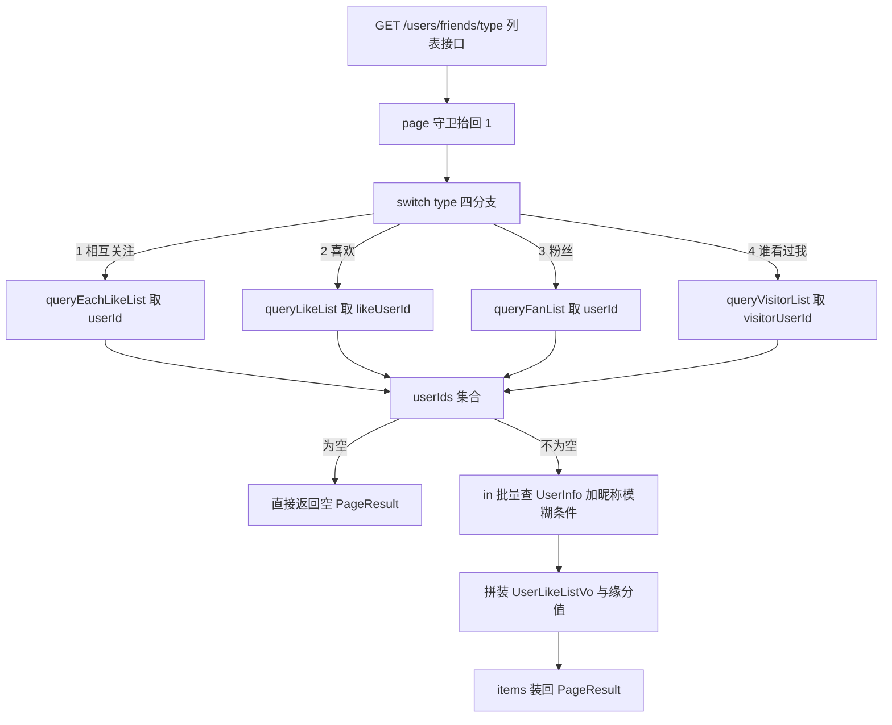

# 一个 type 参数撑起四张列表：喜欢列表的 app 服务实现

我的中心页面的三个数字，点进去各是一张列表：相互喜欢、喜欢、粉丝，再加上「谁看过我」，一共四张。mock 文档里它们长得几乎一样：同样的分页参数，同样的卡片字段，连搜索条件都是同一个昵称。给四个接口复制四遍组装逻辑是一种写法，但字段装错的概率会乘以四。这一课的做法是把四个列表收进一个接口，用一个 `type` 参数区分方向，Service 层的四个分支只负责「挑出对方用户 id」，后半段的批量查询与卡片组装全系统共用。

数据的落点分在两处：前三张列表来自 MongoDB 的 `user_like` 集合，走 dubbo 的 `UserLikeApi`；谁看过我来自访客记录，走 `VisitorsApi` 的分页方法。卡片上的昵称、头像、学历这些字段却存在 MySQL 的 `tb_user_info` 表里，所以每张卡片都要跨两个存储拼装，这层拼装正是本课的骨架。

## 先给结论

- 一个接口 `GET /users/friends/{type}` 覆盖四个列表：type 1 相互关注、2 喜欢、3 粉丝、4 谁看过我；入口处 `page = Math.max(1, page)` 把 0 与负数页码抬回 1。
- 四个 switch 分支只做一件事：把本页「对方的用户 id」收进集合。相互关注与粉丝取记录的 `userId`，喜欢取 `likeUserId`，谁看过我取 `visitorUserId`，getter 取错方向列表就会面目全非。
- id 集合为空直接返回空 `PageResult`；不为空则一次 `in` 批量查 `UserInfo`，昵称参数非空时追加 `like` 模糊条件。
- 卡片字段全部从 `UserInfo` 单表装出，婚姻状态的中文值转成 1 与 0，缘分值优先取推荐服务得分，得分为 0 时随机生成 30～90 兜底。
- 返回沿用下拉刷新口径：`pages` 与 `counts` 置 0，前端靠「列表为空即到底」翻页，与三个统计数字那节课的 `total` 处理同一条约定。

## 一、四个列表为什么能合成一个接口

mock 文档给四张列表约定了同一个地址模板 `/users/friends/{type}`，差别只在路径参数上。这不是文档偷懒，而是四个列表的响应结构本来就完全一致：一页卡片，每个卡片是一个用户的头像、昵称、性别、年龄、城市、学历、婚姻状态与缘分值。变化的只有「这一页装的是谁」：相互喜欢的人、我喜欢的人、喜欢我的人、看过我的人。

把「装的是谁」抽象成一个 `type` 整数，接口就从四个塌缩成一个：

```java
/**
 * 查询喜欢列表，type：1 相互关注 2 喜欢 3 粉丝 4 谁看过我
 */
@GetMapping("friends/{type}")
public ResponseEntity<PageResult> queryLikeList(@PathVariable("type") String type,
        @RequestParam(value = "page", defaultValue = "1") Integer page,
        @RequestParam(value = "pagesize", defaultValue = "10") Integer pageSize,
        @RequestParam(value = "nickname", required = false) String nickname) {
    try {
        //页码守卫：前端可能传 0 或负数，统一抬回最小值 1
        page = Math.max(1, page);
        PageResult pageResult = this.usersService.queryLikeList(Integer.valueOf(type), page, pageSize, nickname);
        return ResponseEntity.ok(pageResult);
    } catch (Exception e) {
        e.printStackTrace();
        return ResponseEntity.status(HttpStatus.INTERNAL_SERVER_ERROR).build();
    }
}
```

`page = Math.max(1, page)` 这行守卫是接口层新出现的处理。前端在测试阶段可能传 `page=0` 甚至负数，而下一层的分页封装要拿页码减一换算，0 减一就是 -1，Spring Data 的 `PageRequest` 会直接抛异常。守卫放在 controller 的第一行，四个列表共用这一个入口，非法值活不到 Service 层。

返回类型是 `PageResult`，五个字段各司其职：`page` 当前页码、`pagesize` 页大小、`items` 卡片数据、`pages` 总页数与 `counts` 总条数置 0。总页数不提供不是偷懒，交互形态决定了它没有存在感：列表是下拉刷新式的，前端拿到空列表就停止请求，全程不需要知道一共有多少条，这与统计接口里 `total` 置 0 的取舍一脉相承。

## 二、四个分支，四个 getter，一条方向纪律

Service 层先搭好骨架：从 `UserThreadLocal` 拿当前用户，建好返回的 `PageResult` 与 id 收集集合，然后进入 switch。每个分支调用上一篇就位的一个 dubbo 列表方法，把返回记录里的「对方 id」塞进集合：

```java
public PageResult queryLikeList(Integer type, Integer page, Integer pageSize, String nickname) {
    User user = UserThreadLocal.get();
    PageResult pageResult = new PageResult();
    pageResult.setPage(page);
    pageResult.setPages(0);        //下拉刷新式分页，总页数不提供
    pageResult.setCounts(0);
    pageResult.setPagesize(pageSize);

    //四个分支共同产出：本页对方的用户 id
    List<Long> userIds = new ArrayList<>();
    switch (type) {
        case 1: {
            //相互关注：记录里 userId 是对方，likeUserId 是我
            PageInfo<UserLike> pageInfo = this.userLikeApi.queryEachLikeList(user.getId(), page, pageSize);
            for (UserLike record : pageInfo.getRecords()) {
                userIds.add(record.getUserId());
            }
            break;
        }
        case 2: {
            //喜欢：我喜欢的人，记录里 likeUserId 是对方
            PageInfo<UserLike> pageInfo = this.userLikeApi.queryLikeList(user.getId(), page, pageSize);
            for (UserLike record : pageInfo.getRecords()) {
                userIds.add(record.getLikeUserId());
            }
            break;
        }
        case 3: {
            //粉丝：喜欢我的人，记录里 userId 是对方
            PageInfo<UserLike> pageInfo = this.userLikeApi.queryFanList(user.getId(), page, pageSize);
            for (UserLike record : pageInfo.getRecords()) {
                userIds.add(record.getUserId());
            }
            break;
        }
        case 4: {
            //谁看过我：访客记录里 visitorUserId 是对方
            PageInfo<Visitors> pageInfo = this.visitorsApi.queryVisitorList(user.getId(), page, pageSize);
            for (Visitors record : pageInfo.getRecords()) {
                userIds.add(record.getVisitorUserId());
            }
            break;
        }
        default:
            break;
    }
    //后半段见下一节：批量查询与卡片组装
}
```

四个分支的写法几乎一样，唯一的变量是「从记录里拿哪个字段」。这不是随手写的，每一条都由 `user_like` 的记录方向推出来：相互关注列表查的是「我喜欢的人里面喜欢我的」，记录里 `likeUserId` 是我，对方就是 `userId`；粉丝列表查的是「喜欢我的人」，`likeUserId` 同样是我，对方还是 `userId`；喜欢列表查的是「我喜欢的人」，`userId` 是我，对方变成了 `likeUserId`。喜欢与被喜欢两个字段在不同方向的查询里轮流扮演「自己」与「对方」，getter 必须跟着查询条件走，跟着别的分支抄就会抄反。



图里的分水岭在 `userIds` 是否为空：四个分支全都查不到数据时，后续的批量查询与组装一步都不用走，空页直接返回。default 分支把集合留空，恰好也汇入这条路，非法 type 不会引发异常，只会得到一张空列表。

## 三、批量查询与卡片组装

id 集合不为空时，用 MyBatis-Plus 的 `QueryWrapper` 一次 `in` 把整页用户的资料捞出来，昵称参数非空再追加模糊条件；随后逐个装 `UserLikeListVo`：

```java
if (CollectionUtils.isEmpty(userIds)) {
    return pageResult;
}

QueryWrapper<UserInfo> queryWrapper = new QueryWrapper<>();
queryWrapper.in("user_id", userIds);
if (StringUtils.isNotBlank(nickname)) {
    queryWrapper.like("nick_name", nickname);
}
List<UserInfo> userInfoList = this.userInfoService.queryUserInfoList(queryWrapper);

List<UserLikeListVo> userLikeListVos = new ArrayList<>();
for (UserInfo userInfo : userInfoList) {
    UserLikeListVo vo = new UserLikeListVo();
    vo.setId(userInfo.getUserId());          //卡片 id 是对方用户 id，不是 userinfo 表主键
    vo.setNickname(userInfo.getNickName());
    vo.setGender(userInfo.getSex().name().toLowerCase());
    vo.setAge(userInfo.getAge());
    vo.setCity(userInfo.getCity());
    vo.setAvatar(userInfo.getLogo());
    vo.setEducation(userInfo.getEdu());
    vo.setMarriage(StringUtils.equals(userInfo.getMarriage(), "已婚") ? 1 : 0);

    //缘分值：正常取推荐服务得分，查不到再随机兜底
    Double score = this.recommendUserService.queryScore(user.getId(), userInfo.getUserId());
    if (score == 0) {
        score = RandomUtils.nextDouble(30, 90); //特殊情况下的评分生成，一般情况下都会有值
    }
    vo.setMatchRate(score.intValue());
    userLikeListVos.add(vo);
}
pageResult.setItems(userLikeListVos);
return pageResult;
```

卡片字段几乎都能从 `tb_user_info` 直接映射，两处需要加工。婚姻状态在库里是「已婚」「未婚」这样的中文值，前端只认 1 与 0，`StringUtils.equals` 比对后三元换算；性别字段是枚举，`name().toLowerCase()` 把 `MAN` 变成前端要的小写 `man`。卡片的 `id` 字段取的是 `user_id` 而不是 `tb_user_info` 的自增主键：前端拿这个 id 去打开对方的资料页，拿错主键，四张列表里的所有卡片都会点开错误的人。

VO 本身很薄：

```java
@Data
@NoArgsConstructor
@AllArgsConstructor
public class UserLikeListVo implements java.io.Serializable {

    private static final long serialVersionUID = 1L;

    private Long id;            //对方用户 id
    private String avatar;      //头像
    private String nickname;    //昵称
    private String gender;      //性别 man woman
    private Integer age;        //年龄
    private String city;        //城市
    private String education;   //学历
    private Integer marriage;   //婚姻状态：1 已婚，0 未婚
    private Integer matchRate;  //缘分值
}
```

缘分值是卡片上唯一不在 MySQL 里的字段。推荐服务 `queryScore` 按当前用户与对方两个 id 查缘分得分，正常情况下人人有值；但推荐数据是离线算出来的，极端情况下两条用户之间没有得分记录，方法返回 0。此时随机生成 30～90 的分数兜底，注释里写明这是特殊情况的生成，避免后来者误以为缘分值本来就是随机的。用 `intValue()` 把 Double 收成前端要的整数。

昵称搜索是个增量能力：讲义里的实现没有对 `nickname` 做任何处理，课堂代码在 `like("nick_name", nickname)` 这一步补上了。APP 客户端目前的搜索框尚未接入这个接口，用接口工具带上 `nickname` 参数请求，就能验证模糊匹配已经生效，客户端接上即可用。

## 四、跑起来联调

服务重启后先修一个登录侧的小毛刺：验证码校验通过后，Redis 里那条验证码还占着位置，重复登录会被它的有效期挡住。在登录成功、比对正确的分支上补一行删除，用完即焚：

```java
//验证码比对正确，删除已使用的验证码，避免等待过期
redisTemplate.delete(key);
```

重启 SSO 服务后，验证码「一次一发一用」，不必再等过期时间。真机投屏到电脑，手机端把服务地址指到本地，登录进入我的模块：相互喜欢列表渲染出三条数据，喜欢与粉丝列表各自成页，谁看过我也正常出卡片。四个 type 在同一套组装代码上跑通，列表之间只有数据不同、没有逻辑差异。

再用接口工具补一组搜索验证：请求时带上 `nickname` 参数，返回的卡片只剩昵称命中的用户。至此 mock 文档里四张列表的约定全部落地，剩下的取消喜欢与关注粉丝两个动作接口，承接的就是这几张列表上的按钮。

## 常见误区

- **四个分支抄同一个 getter。** 错例：粉丝分支照抄喜欢分支的 `record.getLikeUserId()`，而粉丝记录里 `likeUserId` 是自己，收进集合的全是自己 id，列表看着有数据，卡片点开却全是本人。正解：getter 由查询方向决定，相互关注与粉丝取 `userId`，喜欢取 `likeUserId`。
- **卡片 id 用了 userinfo 表的自增主键。** 错例：`vo.setId(userInfo.getId())`，前端拿着它请求资料接口，查到的是另一个人。正解：卡片 id 必须是 `user_id`，它与资料接口、缘分值查询用的是同一套用户 id 体系。
- **页码不设防直接进分页封装。** 错例：前端传 `page=0`，`PageRequest.of(page - 1, ...)` 抛出异常，接口 500。正解：入口处 `Math.max(1, page)` 统一收口，Service 层不再关心非法值。
- **缘分值查不到直接给 0。** 错例：`matchRate` 显示 0%，用户理解为「毫无缘分」，产品语义走样。正解：得分为 0 视为无推荐数据，随机 30～90 兜底并注释清楚，正常用户仍走真实得分。

## 面试可能被问到的问题

1. 面试官追问：「四个列表合成一个接口，type 参数扩张到几十个怎么办？」
   答：type 收敛的是响应结构相同的查询，扩张到几十个说明职责该拆了。判断标准是响应结构与数据来源：结构一致、只是条件不同的合在一个接口；结构或来源不同的拆开。真到几十个枚举时，按策略模式把分支注册成 Map 分发，controller 不再感知具体分支。
2. 面试官追问：「先查 MongoDB 拿 id 列表，再查 MySQL 批量取资料，为什么要分两步？」
   答：跨存储没法一次查完，两步是标准形态。可以优化的方向是把头像昵称这类高频展示字段冗余进 MongoDB 文档，一次查询出卡片；代价是资料更新时要同步两处。列表页数据量小、时效要求不高时，两步查询加批量 in 已经够用。
3. 面试官追问：「in 查询的 id 集合多大时要警惕？」
   答：in 本身走索引没问题，风险在集合膨胀。列表接口天然有分页兜底，集合大小不超过页大小，几十个 id 完全安全；要警惕的是后台任务把全表 id 塞进 in，那种场景应该改成游标分批或临时表 join。
4. 面试官追问：「缘分值随机兜底，测试与生产环境会有什么差异？」
   答：有推荐数据的生产环境几乎不会触发兜底，测试环境数据稀疏时频繁触发，同一个人两次刷新显示不同分数。这是兜底策略的可预期副作用，测试断言要只校验区间不校验具体值，生产上想消除差异就得保证推荐得分全覆盖。
5. 面试官追问：「验证码校验成功后立刻删除，会不会影响重试场景？」
   答：比对正确才删，密码错的场景验证码还在，用户仍可用原验证码重试。删除解决的是验证码在有效期内被重复使用的问题，语义是「一次验证一码」，比单纯依赖过期时间更收紧，也缩短了暴力尝试的窗口。

## 配套资料

- 学习目标：`materials/code/07/day11 探花交友-我的中心/day11/学习目标.md`，「独立完成我的喜欢中列表展现」即本课验收对象。
- 表结构：`materials/code/07/day11 探花交友-我的中心/day11/代码/mytanhua.sql`，`tb_user_info` 的 `nick_name`、`logo`、`edu`、`city`、`marriage` 即卡片字段的来源。
- 说明：day11 资料包不含工程源码，controller、service、VO 与登录删除验证码的代码为按课程画面整理补全的可编译示例，包名统一 `com.study.tanhua` 系；`user_like` 集合与 `UserLikeApi` 三个列表方法承接自上一篇的 dubbo 实现，`VisitorsApi` 分页查询承接自 day09 谁看过我的编码，`recommendUserService.queryScore` 承接自 day08 推荐功能。
