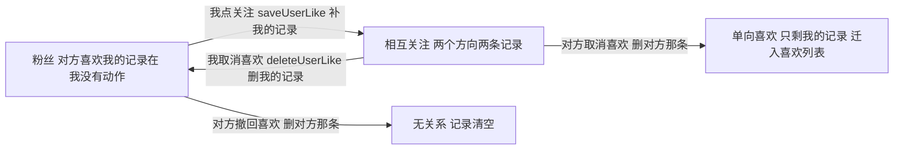

# 关注粉丝：补一条记录，把粉丝升级成相互关注

粉丝列表里的「+ 关注」按钮，与取消喜欢互为一对逆操作。粉丝已经喜欢我了，`user_like` 里躺着一条他指向我的记录；我点关注，等于把「我喜欢他」这半条补上，两个方向凑齐，互关判定成立，这个粉丝就升级成了相互关注。实现上它薄得惊人，因为落库、查重、互关判定全部由 day10 的 `saveUserLike` 承担，这一课只需要把按钮接到 dubbo 上。

dubbo 侧同样零新增。IDE 里展开 `UserLikeApi` 的方法列表就能看到：`saveUserLike`、`deleteUserLike`、`isMutualLike`、三个统计、三个列表，方法面已经覆盖了「我的喜欢」模块的全部读写需求。粉丝关注不需要新接口、不需要新集合，这是前面几课把方向语义做对之后换来的红利。

## 先给结论

- 接口是 `POST /users/fans/{uid}`，路径上的 `uid` 是粉丝的用户 id，Service 一行核心：`this.userLikeApi.saveUserLike(user.getId(), userId)`。
- 参数顺序就是方向：第一个参数是动作发出者，写入的是「我指向粉丝」的记录；写反就会把自己变成对方的粉丝。
- 保存承接 day10 的写法：写入前按两个 id 查重，已存在则跳过，重复点击与重复关注不会产生重复数据。
- 互关判定走上一篇的两步查询口径：我喜欢的集合里他也在且他喜欢我，两条记录齐备即互关，相互关注数加一。
- 与取消喜欢互为逆操作：同一对用户在粉丝列表与相互喜欢列表之间来回迁移，全程只靠增删各一条记录驱动。

## 一、两行代码的接口

Controller 挂在 `UsersController` 末尾，POST 动词表示这是一个创建动作：

```java
/**
 * 关注粉丝
 * @param userId 粉丝的用户 id
 * @return
 */
@PostMapping("fans/{uid}")
public ResponseEntity<Void> likeFan(@PathVariable("uid") long userId) {
    try {
        this.usersService.likeFan(userId);
        return ResponseEntity.ok(null);
    } catch (Exception e) {
        e.printStackTrace();
    }
    return ResponseEntity.status(HttpStatus.INTERNAL_SERVER_ERROR).build();
}
```

Service 层与取消喜欢呈镜像：一个删一条，一个存一条，参数方向完全一致：

```java
public void likeFan(Long userId) {
    User user = UserThreadLocal.get();
    this.userLikeApi.saveUserLike(user.getId(), userId);
}
```

`user.getId()` 打头、粉丝 id 收尾，与 `deleteUserLike` 的调用形态保持同构。两个接口连异常兜底的结构都一样，读代码的人不需要为它们各建立一套心智模型。

## 二、saveUserLike 接住了什么

关注粉丝的全部复杂度都在 `saveUserLike` 里，而这个方法 day10 已经写完。它要做三件事：查重、定方向、算互关。按 day10 的编码口径还原出来是这样：

```java
//承接 day10 编码：保存喜欢，已存在则跳过
@Override
public Long saveUserLike(Long userId, Long likeUserId) {
    Query query = Query.query(Criteria.where("userId").is(userId)
            .and("likeUserId").is(likeUserId));
    UserLike old = this.mongoTemplate.findOne(query, UserLike.class);
    if (old == null) {
        UserLike userLike = new UserLike();
        userLike.setUserId(userId);
        userLike.setLikeUserId(likeUserId);
        userLike.setCreated(new Date());
        this.mongoTemplate.save(userLike);
    }
    return 1L;
}
```

存入的是一条全新的单向记录，与对方那条「他喜欢我」互不覆盖。互关状态不需要在这里特殊处理：统计口径用两步查询实时判定（先取我喜欢的人，再在其中查喜欢我的人），两条记录都在，互关自然成立。记录上的 `isMutual` 字段作为冗余标记存在，两步查询才是互关数字的唯一口径，这个约定上一篇已经钉下。

把同一对用户在这套模型里的状态迁移摆出来，四个动作各自改动的就是一条记录：



图里值得停一下的是右侧分支：粉丝关注之后若对方先取消了喜欢，剩下「我喜欢他」一条记录，他在我的相互喜欢列表消失，却出现在我的喜欢列表里。四个列表的姿态差异，全部可以还原成「哪条记录在、哪条记录不在」，这就是两条单向记录模型的解释力。

## 三、测试闭环

服务重启，真机投屏登录。粉丝列表里给 6 号用户点「+ 关注」，弹窗确认后关注成功；切到相互喜欢列表，原有的 2、4、5 之外多出了 6，三条变四条，第二个方向补齐的推演落到了界面上。

反向再走一遍：在相互喜欢列表取消 2 号，他立刻退回粉丝列表，粉丝喜欢我的那条记录一直都在；回到粉丝列表再点「+ 关注」，2 号又回到相互喜欢。一对逆操作把同一张卡片在两个列表之间搬来搬去，数据始终自洽。

重复点击也顺手验证了：已互关的用户再点一次「+ 关注」，`saveUserLike` 查重后跳过写入，列表不出现重复卡片，统计数字纹丝不动。幂等逻辑在 dubbo 层兜底，接口层不需要防重。

讲义里这一节与取消喜欢排在相邻编号，同样只有 Controller、Service 加测试三段，课堂代码与之对应。

## 常见误区

- **参数顺序写反。** 错例：`saveUserLike(userId, user.getId())`，存出来的是「粉丝喜欢我」的重复记录而不是「我喜欢粉丝」，粉丝没有变成互关，反而多出一条脏数据。正解：第一个参数永远是动作发出者，两个写接口共用同一约定。
- **不做查重直接插入。** 错例：每次点击都 save 一条新记录，重复关注后列表出现重复卡片，计数翻倍。正解：写入前按两个 id 的完全匹配 findOne，已存在则跳过。
- **在这里维护互关数字。** 错例：关注成功后手动给某个「互关表」加一，取消时减一，计数与记录各自演化必然漂移。正解：互关是查询口径不是存储口径，实时两步查询保证数字与记录永远一致。
- **以为关注粉丝要新建接口与集合。** 错例：另起一个 `FansApi` 与 `fan` 集合，把同一份关系存两处。正解：粉丝、喜欢、互关是同一个 `user_like` 集合的三个观察角度，存储层一套数据，展示层各取所需。

## 面试可能被问到的问题

1. 面试官追问：「先查重再插入，两个并发请求同时通过检查怎么办？」
   答：查重与插入之间存在竞态窗口，极端并发下可能落两条相同记录。兜底手段是给 `userId` 与 `likeUserId` 组合建唯一索引，MongoDB 用复合唯一索引，第二条插入直接报错，业务层捕获后按已存在处理。查重负责省一次无效写入，唯一索引负责最终一致。
2. 面试官追问：「互关判定用两步查询，还是写入时维护 isMutual 字段？」
   答：两步查询是唯一可信口径，字段只是记录上的冗余标记。维护字段要保证双向记录同步更新，任何一处漏改就与事实漂移；查询口径永远和记录一致。数据量大到两步查询成为瓶颈时，先上缓存与冗余计数，字段口径仍只做展示参考。
3. 面试官追问：「关注粉丝成功后要不要发通知？」
   答：这类动作通知价值高、打扰成本低，通常要发，但要过用户的通知开关。设置表里的喜欢通知开关就是为这类推送预留的，发送前查开关，关闭则跳过。通知走异步链路，不阻塞关注动作本身。
4. 面试官追问：「user_like 数据量到千万级，这三类列表查询怎么优化？」
   答：查询形态固定，复合索引按等值条件打头即可覆盖：喜欢列表用 `userId` 打头，粉丝列表用 `likeUserId` 打头。再往上按用户分桶冗余一份轻量关系（只存 id 与时间），列表页查冗余集合，详情判定查原集合。分页与排序字段建进索引，避免内存排序。

## 配套资料

- 学习目标：`materials/code/07/day11 探花交友-我的中心/day11/学习目标.md`，「独立完成我的喜欢中的交互功能」涵盖关注粉丝。
- 说明：day11 资料包不含工程源码，controller 与 service 为按课程画面整理补全的可编译示例，包名统一 `com.study.tanhua` 系；`user_like` 集合结构、`saveUserLike` 的查重与落库行为承接自 day10 探花功能的编码，互关统计的两步查询口径承接自上一篇 dubbo 实现。
