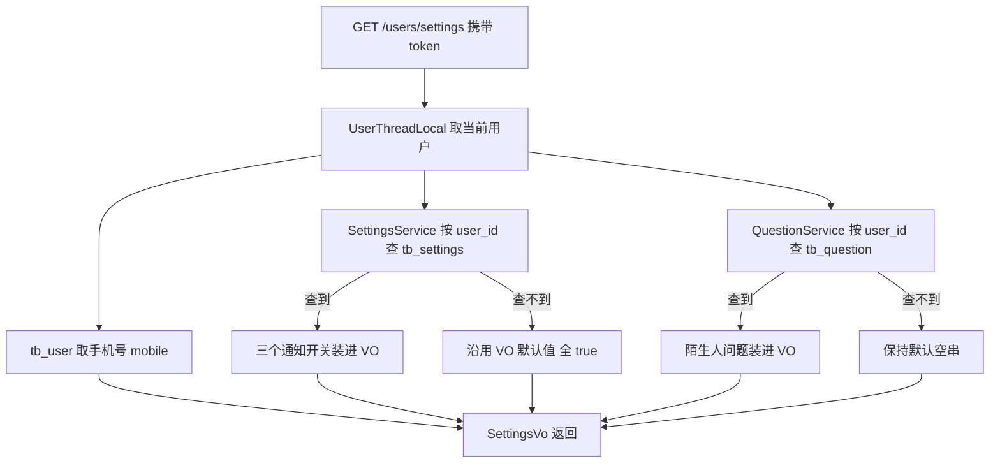

# 用户通用设置：一张设置表，三路数据拼出查询接口

我的中心往下翻，通用设置是用户配置自己的入口。页面上挂着四块功能：设置陌生人问题、通知设置、黑名单、修改手机号，后三块在后续课程里逐个落地，而无论哪一块，页面打开时的第一件事都是查询。把 mock 文档的响应结构摊开看，这个查询接口其实是一次三路拼装：手机号来自用户表，三个通知开关来自设置表，陌生人问题来自另一张早已存在的表。本课的任务是把这张页面「查」出来。

存储选型在这里有一个值得咀嚼的转折：项目的关系类数据此前大多落在 MongoDB，通知开关却回到了 MySQL。原因不难理解，开关是结构化、低频写、强事务的配置数据，一行三个 tinyint 足以表达；而喜欢、访客这类高频增长、结构多变的记录才适合文档库。配置数据与业务流水分库存放，各自用最顺手的引擎。

## 先给结论

- 新增 MySQL 表 `tb_settings`：`user_id` 加三个 tinyint 开关（喜欢、评论、公告通知），默认值都是 1，陌生人问题不进这张表。
- 陌生人问题沿用 day05 消息功能已有的 `tb_question`（`user_id` 加 `txt`），查询走既有的 `QuestionService`，设置表里不重复存储。
- 代码链路三层起步：`Settings` 实体继承 `BasePojo`，`SettingsMapper` 继承 `BaseMapper`，`SettingsService` 按 `user_id` `selectOne`。
- 接口 `GET /users/settings` 返回 `SettingsVo`，字段默认值全 true、问题为空串；设置记录查不到不报错，直接用默认值返回。
- 联调时现场修过一个坑：VO 忘了装用户 id，前端拿到 null，补一行 `setId` 才闭环。

## 一、表设计与数据归属

设置表的结构来自课程资料包里的真实建表语句：

```sql
CREATE TABLE `tb_settings` (
  `id` bigint(20) NOT NULL AUTO_INCREMENT,
  `user_id` bigint(20) DEFAULT NULL,
  `like_notification` tinyint(4) DEFAULT '1' COMMENT '推送喜欢通知',
  `pinglun_notification` tinyint(4) DEFAULT '1' COMMENT '推送评论通知',
  `gonggao_notification` tinyint(4) DEFAULT '1' COMMENT '推送公告通知',
  `created` datetime DEFAULT NULL,
  `updated` datetime DEFAULT NULL,
  PRIMARY KEY (`id`)
) ENGINE=InnoDB AUTO_INCREMENT=2 DEFAULT CHARSET=utf8 COMMENT='设置表';
```

三个开关各管一路推送：别人喜欢我时是否通知、动态被评论时是否通知、平台发公告时是否通知。默认值 1 写在表定义里，与 VO 的默认值互相呼应，双保险的语义是「不设置就都通知」。表里刻意没有放陌生人问题，它在 day05 聊一下功能时就有了自己的表 `tb_question`（`user_id` 与 `txt` 两列业务字段），陌生人打招呼的场景已经在那张表上建立了读写链路，设置页只是把它的值展示出来。同一份数据只存一处，展示端跨表拼装，是这里的归属原则。

三路数据的来路不同，用一张图把拼装关系摆清楚：



两条旁挂数据各自的空值路径都通向默认值，接口永远返回结构完整的 VO，前端不需要处理字段缺失。

## 二、三层代码起步

按 MySQL 项目的老套路立三层。实体继承公共字段的 `BasePojo`（id、created、updated），三个业务字段与表列一一对应：

```java
@Data
@TableName("tb_settings")
public class Settings extends BasePojo {

    private Long userId;

    private Boolean likeNotification;     //推送喜欢通知

    private Boolean pinglunNotification;  //推送评论通知

    private Boolean gonggaoNotification;  //推送公告通知
}
```

Mapper 与 Service 一步到位，查询逻辑就是按 `user_id` 等值查一条：

```java
@Mapper
public interface SettingsMapper extends BaseMapper<Settings> {
}
```

```java
@Service
public class SettingsService {

    @Autowired
    private SettingsMapper settingsMapper;

    //按用户 id 查询设置，查不到返回 null
    public Settings querySettingsByUserId(Long userId) {
        QueryWrapper<Settings> queryWrapper = new QueryWrapper<>();
        queryWrapper.eq("user_id", userId);
        return this.settingsMapper.selectOne(queryWrapper);
    }
}
```

tinyint 与 Boolean 的映射由 MyBatis-Plus 自动完成，库里存 1 与 0，实体里拿到的就是 true 与 false。`selectOne` 在没有匹配行时返回 null，这个返回值约定直接决定了 Service 层的判空写法，下一节的兜底逻辑全部建立在这个约定上。

## 三、接口与 VO 装配

mock 文档约定的接口是 `GET /users/settings`，响应里除了三个开关，还有当前用户 id、手机号与陌生人问题。VO 的默认值承载「未配置即默认开启」的语义：

```java
@Data
@NoArgsConstructor
@AllArgsConstructor
public class SettingsVo implements java.io.Serializable {

    private static final long serialVersionUID = 1L;

    private Long id;                        //当前用户 id
    private String mobile;                  //手机号
    private String strangerQuestion = "";   //陌生人问题，默认空串

    private Boolean likeNotification = true;     //喜欢通知，默认开启
    private Boolean pinglunNotification = true;  //评论通知，默认开启
    private Boolean gonggaoNotification = true;  //公告通知，默认开启
}
```

Controller 保持薄壳，查询与装配全部下沉到 `UsersService`：

```java
@GetMapping("settings")
public ResponseEntity<SettingsVo> querySettings() {
    try {
        SettingsVo settingsVo = this.usersService.querySettings();
        return ResponseEntity.ok(settingsVo);
    } catch (Exception e) {
        e.printStackTrace();
    }
    return ResponseEntity.status(HttpStatus.INTERNAL_SERVER_ERROR).build();
}
```

Service 里按三路拼装，判空包裹是这段代码的纪律：

```java
public SettingsVo querySettings() {
    User user = UserThreadLocal.get();

    Settings settings = this.settingsService.querySettingsByUserId(user.getId());
    SettingsVo settingsVo = new SettingsVo();
    settingsVo.setId(user.getId());
    settingsVo.setMobile(user.getMobile());
    if (settings != null) {
        settingsVo.setLikeNotification(settings.getLikeNotification());
        settingsVo.setPinglunNotification(settings.getPinglunNotification());
        settingsVo.setGonggaoNotification(settings.getGonggaoNotification());
    }

    //陌生人问题：查到才装配，查不到保持默认空串
    Question question = this.questionService.queryQuestion(user.getId());
    if (question != null) {
        settingsVo.setStrangerQuestion(question.getTxt());
    }
    return settingsVo;
}
```

`QuestionService.queryQuestion` 承接自 day05 陌生人问题的编码，同样是 `user_id` 等值查一条。两处判空的意图要分清：设置记录为 null 走默认开关，问题记录为 null 走默认空串，两者都不会把异常抛给接口层。

## 四、联调与一个现场修复

测试数据先就位：往 `tb_settings` 插一条 `user_id` 为 1、三个开关全 1 的记录。课程阶段这样手工造数据没问题，但真实项目里默认设置应该在用户注册成功时写入，或者消费注册消息后补写，让「每个用户都有设置记录」成为系统保证而不是运气。

REST 工具先请求一次，token 已过期返回 401，重新走一遍获取验证码加校验登录，再查 `settings`，响应里三个开关与手机号齐了，唯独 `id` 是 null。排查结果是装配时漏了用户 id，前端打开设置页要靠它定位用户，补上 `settingsVo.setId(user.getId())` 重启再测，四个字段全部就位。

真机投屏过一遍页面：通用设置里手机号正确显示，陌生人问题一栏展示出之前存的问题。把问题改成「你喜欢我吗」后返回首页再进设置页，新问题立刻出现，证明这一路读的是 `tb_question` 的实时值，设置页与聊天场景共用同一份数据。

## 常见误区

- **把陌生人问题塞进设置表。** 错例：给 `tb_settings` 加一列 txt 存问题，聊天场景与设置页各自读写同一列，两套更新逻辑迟早打架。正解：问题归 `tb_question`，设置页跨表拼装展示，数据只有一个写入口。
- **判空缺失直接取开关。** 错例：`settings.getLikeNotification()` 前不判空，新用户没有设置记录时直接空指针，接口 500。正解：`selectOne` 的返回值约定就是可空，null 分支返回默认值的 VO。
- **忽视 Boolean 拆箱。** 错例：开关列允许 NULL，实体拿到 null Boolean，塞进三元或 if 判断时拆箱抛 NPE。正解：列定义给默认值 1，业务写入永远显式给 0 或 1，VO 层默认值再兜一层。
- **VO 忘装用户 id。** 错例：响应里 id 为 null，前端后续按用户维度提交设置时无从关联。正解：`id` 放当前登录用户 id，与 token 解析出的身份保持一致，联调时逐字段核对响应。

## 面试可能被问到的问题

1. 面试官追问：「通知开关为什么用 MySQL，而喜欢、访客数据用 MongoDB？」
   答：开关是结构固定、低频写、随用户资料强一致读的配置数据，一行几列表达完整，关系库顺手；喜欢、访客是高频增长、字段可能演化的流水数据，文档模型免改表。按数据的读写模式与演化速度选引擎，而不是项目统一一种库。
2. 面试官追问：「新用户的默认设置，注册时写入、消费消息写入、查询时兜底，你怎么选？」
   答：注册时写入最直接，注册链路多一步写但语义清晰；消费消息写入把主链路削薄，适合注册高峰场景，但要处理消息丢失的补偿；查询时兜底实现最省，却把默认值逻辑散进每次查询且统计「已配置用户」会失真。本课选注册链路写入，兜底默认值仍保留作双保险。
3. 面试官追问：「设置类数据要不要加缓存？」
   答：读多写少、单行小数据，很适合缓存进 Redis，key 按用户维度设计，更新设置时删除或刷新对应 key。要注意缓存后的开关变更生效延迟，推送侧读取开关也应走同一个缓存源，避免页面显示已关而推送侧读到旧值。
4. 面试官追问：「设置项后续增长，加列还是用扩展字段？」
   答：低频增长、每项都有明确类型语义时加列最清晰，配合查询与索引都没负担；项数不可控或由产品配置驱动时，预留一个 JSON 扩展列放低频项。混用要避免把需要按列统计的项埋进 JSON，取用前先想它会不会进查询条件。
5. 面试官追问：「tinyint 存 0 和 1，用 Boolean 还是 Integer 接？」
   答：语义只有两态时 Boolean 更贴切，MyBatis-Plus 映射自动完成；三态语义（未知、开、关）或将来要加档位时用 Integer 留余地。选择要全项目统一，混用 Boolean 与 Integer 接同一类列，调用方反复装箱拆箱还容易误判。

## 配套资料

- 建表语句：`materials/code/07/day11 探花交友-我的中心/day11/代码/mytanhua.sql`，`tb_settings` 与 `tb_question` 的表结构即表设计一节的数据底座。
- 学习目标：`materials/code/07/day11 探花交友-我的中心/day11/学习目标.md`，「独立完成保存陌生人问题」的前置查询即本课验收对象。
- 说明：day11 资料包不含工程源码，实体、Mapper、Service、VO 与 controller 为按课程画面整理补全的可编译示例，包名统一 `com.study.tanhua` 系；`tb_settings`、`tb_question` 表结构为资料包真实语句，`QuestionService` 查询承接自 day05 聊一下功能之查询陌生人问题的编码，`BasePojo` 与 MyBatis-Plus 配置承接自 day01 工程搭建。
