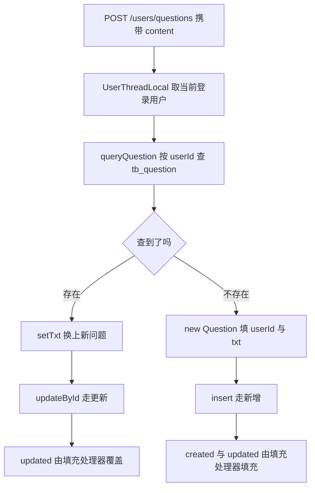
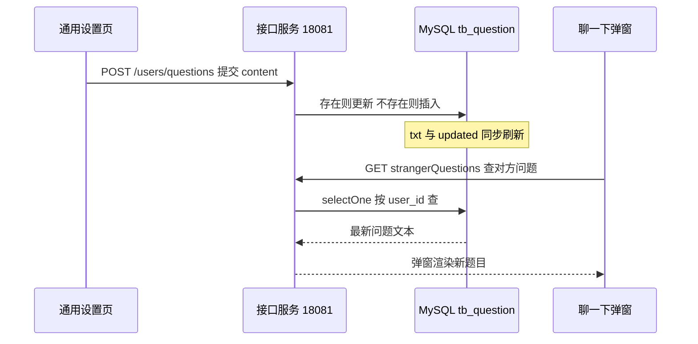

# 保存陌生人问题：一用户一题的更新与新增，时间字段交给自动填充

通用设置页在上一节已经能回显设置项，通知开关之外最显眼的一项是「陌生人问题」。问题不是只能看，用户随时会改，点下确认，新题目就要落库生效。这个看似只存一句话的动作，藏着两个工程问题：第一次设置走新增、改过的要走更新，这个分支怎么判；created 与 updated 两个时间字段谁来填。保存链路做完，主角色是 MyBatis-Plus 的自动填充。

## 先给结论

- 保存接口按 mock 契约做 JSON 提交，请求体只有一个文本字段 `content`，Controller 用 `@RequestBody` 接住，问题落 MySQL 的 `tb_question` 表。
- 一个用户只有一道题，保存天然是 upsert：先按 userId 查一次，查到就 `updateById`，查不到就 `insert`，一次判断两条路径。
- created 与 updated 不再手动 set：`BasePojo` 的时间字段补上 `@TableField(fill)`，再注册一个 `MetaObjectHandler` 处理器，由框架在插入与更新时统一填充。
- 更新填充不做判空、直接覆盖当前时间；判空会让查询带出的旧值永远挡住新值，updated 形同虚设。
- server 工程是独立应用，SSO 工程里写过的填充处理器不能共享，需要在 server 工程自带一份。

## 一、保存为什么是 upsert

upsert 是 update 与 insert 的合写，含义是「存在就更新，不存在就插入」。保存陌生人问题为什么长这样，根源在表的设计：`tb_question` 约定一个用户只有一道题，聊一下查询那课已经按这个约定用 `selectOne` 做了单数语义的查询。既然一比一，保存就不该每次都插新行，否则同一个人的历史问题堆成一堆，查询端又只认一条，数据必然打架。

判断的依据就是查询本身：按 userId 查一次，查到了说明用户设过题，走更新；查不到说明第一次设置，走插入。整条链路画出来是一条带分叉的短路径：



两个终点都汇到填充处理器上，这是有意为之：无论插入还是更新，时间字段都不该由业务代码操心，一旦散落在各个 save 方法里，漏填只是时间问题。

## 二、三层链路与 save 的实现

Controller 挂在既有的 `UsersController` 里。mock 契约按 JSON 提交问题内容，用 `@RequestBody Map` 收下后取出 `content` 字段，转交 `UsersService`：

```java
/**
 * 设置陌生人问题（JSON 提交，按 POST 语义整理）
 */
@PostMapping("questions")
public ResponseEntity<Void> saveQuestions(@RequestBody Map<String, String> param) {
    try {
        String content = param.get("content");
        this.userService.saveQuestions(content);
        return ResponseEntity.ok(null);
    } catch (Exception e) {
        e.printStackTrace();
    }
    return ResponseEntity.status(HttpStatus.INTERNAL_SERVER_ERROR).build();
}
```

Service 层做两件事：从 `UserThreadLocal` 拿当前登录人，把 userId 与问题文本一起交给 `QuestionService`。问题属于谁不用问参数，token 已经给出了答案，这也是全项目接口的一致姿势：

```java
public void saveQuestions(String content) {
    User user = UserThreadLocal.get();
    this.questionService.save(user.getId(), content);
}
```

`QuestionService` 的 save 就是 upsert 的两条路径，判断分支与流程图一一对应：

```java
public void save(Long userId, String content) {
    //判断问题是否存在，存在走修改，不存在走新增
    Question question = this.queryQuestion(userId);
    if (null != question) {
        question.setTxt(content);
        this.questionMapper.updateById(question);
    } else {
        question = new Question();
        question.setUserId(userId);
        question.setTxt(content);
        this.questionMapper.insert(question);
    }
}

private Question queryQuestion(Long userId) {
    QueryWrapper<Question> queryWrapper = new QueryWrapper<>();
    queryWrapper.eq("user_id", userId);
    return this.questionMapper.selectOne(queryWrapper);
}
```

按用户找问题的查询在聊一下那课写过一次，这里沿用同一套写法，`selectOne` 加等值条件一行完成。更新的写法值得停一下：查出来的 `question` 对象已经带着 id，`updateById` 直接按主键更新，业务代码只改 `txt` 一个字段，既不用拼条件也不用防错位。

## 三、时间字段交给自动填充

先看被淘汰的写法：在 save 里手动 `question.setUpdated(new Date())`，插入路径再补 created。它能跑通，但每个写库方法都要记得 set，项目里几十张表几十个方法，漏一次就是一条时间失真的数据。MyBatis-Plus 的自动填充把这层事上收到框架，分两半完成。

**第一半是声明。** `BasePojo` 的时间字段补上 `@TableField(fill)`，告诉框架这两个字段在什么时机需要填充：

```java
public abstract class BasePojo {
    @TableField(fill = FieldFill.INSERT)          // 插入时填充
    private Date created;
    @TableField(fill = FieldFill.INSERT_UPDATE)   // 插入和更新时都填充
    private Date updated;
}
```

created 选 `INSERT`，它表达「诞生时间」，诞生后不该再变；updated 选 `INSERT_UPDATE`，它表达「最后一次变动时间」，插入与更新都要介入。

**第二半是逻辑。** 注解只是声明，真正往字段里塞值的是实现了 `MetaObjectHandler` 接口的处理器，标上 `@Component` 交给容器即可。server 工程与 SSO 工程是两个独立应用，day01 写过的处理器不能跨工程共享，这里在 handler 包里自带一份：

```java
@Component
public class MyMetaObjectHandler implements MetaObjectHandler {

    @Override
    public void insertFill(MetaObject metaObject) {
        Object created = getFieldValueByName("created", metaObject);
        if (null == created) {
            //字段为空，可以进行赋值
            setFieldValueByName("created", new Date(), metaObject);
        }
        Object updated = getFieldValueByName("updated", metaObject);
        if (null == updated) {
            //字段为空，可以进行赋值
            setFieldValueByName("updated", new Date(), metaObject);
        }
    }

    @Override
    public void updateFill(MetaObject metaObject) {
        //更新时不判空，直接覆盖为当前时间
        setFieldValueByName("updated", new Date(), metaObject);
    }
}
```

插入填充判空、更新填充不判空，这个不对称是有原因的。插入时对象是业务代码 new 出来的，created 与 updated 天然为空，判空是为了尊重调用方显式指定的值。更新时对象是查出来的，旧数据里 updated 已经带着上次的时间值，如果这里也判空，判断永远是「有值、跳过」，new Date() 永远塞不进去，更新时间从此停在创建那一刻。判空的本意是「别覆盖别人的值」，在更新场景里恰恰相反，不覆盖就等于永远不更新。

## 四、真机验收与两端联动

服务重启后用真机投屏验收：登录测试账号进通用设置，把默认的「你喜欢我吗」改成自己的题提交，Navicat 刷新 `tb_question`，txt 变成新问题，updated 变成刚刚提交那一刻；再改一次再提交，updated 跟着跳到第二次提交的时间。两次提交两次刷新，插入与更新两条路径的填充都验到了。

保存的价值要放到另一端才看得见：详情页聊一下弹窗读的也是这张表。问题改完，下一个陌生人点开聊一下，看到的就是新题目，不需要任何缓存清理或重启。



时序图里同一个数据库在图上出现了两个身份：被设置页写、被弹窗读。写入端每改一次题，读取端下一次查询立刻可见，MySQL 默认隔离级别下的普通查询天然具备这个时效。一句陌生人问题，从此在设置页与聊一下之间保持同源。

## 常见误区

- **无脑 insert 造成一用户多题。** 错例：保存不分情况直接插入，同一 user_id 积累多条，`selectOne` 偶发抛异常。正解：先查后判的 upsert 是一比一约定的代码化，存量的重复数据还要清洗。
- **updateFill 也判空。** 错例：更新填充照抄插入的判空模板，updated 永远停留在创建时刻，数据看似正常实则时间失真。正解：更新场景直接覆盖，new Date() 不需要任何前置判断。
- **只配处理器忘了加注解，或只加注解忘了写处理器。** 错例：`@TableField(fill)` 与 `MetaObjectHandler` 只补了一半，填充静默失效，库里时间列全是 null。正解：两半缺一不可，验证时插入一条新数据看时间列是否落值。
- **GET 请求收 JSON body。** 错例：按「查询」的惯性把保存写成 GET 加 `@RequestBody`，语义拧巴且部分客户端根本不发 GET body。正解：写操作按 POST 语义整理，mock 契约的 JSON 提交与 `@PostMapping` 对齐。

## 面试可能被问到的问题

1. 面试官追问：「先查再改的 upsert 在并发下安全吗？」
   答：不严格安全。两个请求同时查同一用户都得到「不存在」，会各插一条，撞出重复数据。兜底靠数据库：给 user_id 建唯一索引，第二个插入直接报错，业务层捕获异常转更新。更硬的做法是用 MySQL 的 `INSERT ... ON DUPLICATE KEY UPDATE`，把判断下沉给存储引擎，一条语句原子完成。
2. 面试官追问：「MetaObjectHandler 的填充时机是怎么实现的？」
   答：MyBatis-Plus 在启动时解析实体元数据，登记带 fill 属性的字段清单；insert 与 update 语句执行前通过反射构造 MetaObject，把字段清单交给注册的处理器回调。它发生在参数组装阶段，SQL 还没到数据库，所以填充值会随语句一起入库。
3. 面试官追问：「created 与 updated 为什么抽到 BasePojo 而不是每张表自己写？」
   答：审计字段是全表共有且语义统一的两列，抽到抽象父类后实体只声明业务字段，填充规则一处生效、全部表受益。分散写的结果是字段名漂移、类型不一、填充遗漏三类问题，公共字段收口是成本最低的一致性手段。
4. 面试官追问：「更新接口要不要把 updated 的时间返回给前端？」
   答：看业务语义。设置类操作返回 Void 就够，前端自己的提交时间已经能渲染；「最后修改于 xx 时刻」这类展示需求才需要回传。回传时注意用 `@JsonFormat` 固定格式，避免默认时间戳带来的时区歧义。
5. 面试官追问：「如果问题要支持多道，这套设计怎么改？」
   答：三处一起动。表加题目类型或序号列并放开唯一约束，查询从 selectOne 换成 selectList 加排序，保存从 upsert 换成按 id 定向更新与插入。契约层也要从单字符串换成列表结构，任何一处不改都会造成数据与接口的语义错位。

## 配套资料

- 学习目标：`materials/code/07/day11 探花交友-我的中心/day11/学习目标.md`，「独立完成保存陌生人问题」即本课验收对象。
- 数据库：`materials/code/07/day11 探花交友-我的中心/day11/代码/mytanhua.sql`，`tb_question` 表结构与测试数据出处。
- 说明：day11 资料包不含工程源码，Controller、Service、查询方法与填充处理器按课程画面与讲解整理补全，包名统一 `com.study.tanhua` 系；保存动作的 mock 契约为 JSON 提交，Controller 按 POST 语义整理；`MyMetaObjectHandler` 与 day01 基础代码一课的 SSO 工程同名类同源，server 工程为独立应用需自带一份；mock 文档站点域名以 example.com 占位。
