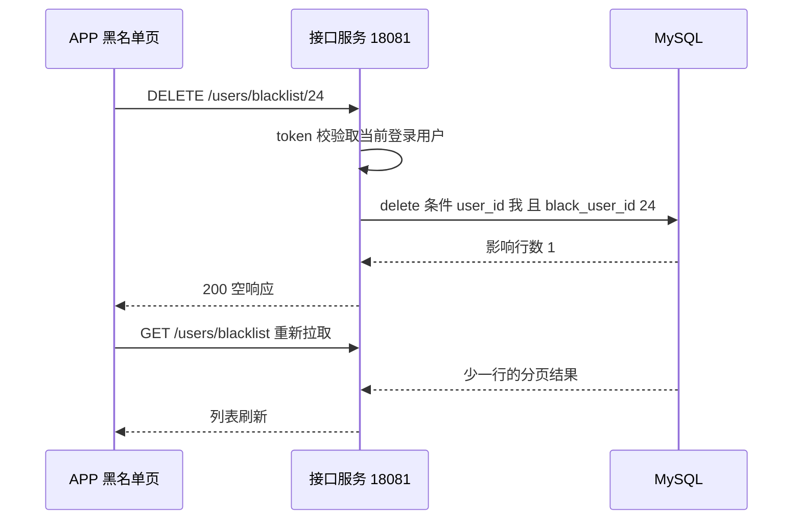

# 移除黑名单：一次双条件删除，为我的中心这条线收官

黑名单是给冲动准备的出口，也是给自己准备的后悔药：误点了拉黑、气消了想和解，都要能把人从名单里放出来。黑名单页每行右侧的「取消」按钮对应的就是这个移除动作。它是 day11 里代码量最少的一个功能，却是整条黑名单链路闭环的最后一环，而且删除这类写操作，每一个细节都比查询更值得抠。

## 先给结论

- 契约是 `DELETE /users/blacklist/{uid}`，路径参数 uid 是被拉黑用户的用户 id，响应无数据体。
- 删除条件必须双条件：`user_id` 等于当前登录人、`black_user_id` 等于目标用户，两者一起把删除严格限制在自己的关系内。
- Mapper 的 `delete` 返回影响行数，Service 把它翻译成 Boolean，调用方据此区分「删到了」与「本就没有」。
- 服务端身份一律取自 token 而不是请求参数，这是水平越权的天然防线，双条件删除正是这道防线的落地形态。
- 真机验收：取消后列表少一人，库里三行变两行；day11 的设置、问题、黑名单主线到此闭环。

## 一、DELETE 契约与路径参数

mock 文档给移除黑名单的约定有三个要素：方法 DELETE、路径带一个 uid 占位符、响应无数据。三要素各有各的道理。方法用 DELETE 是 REST 的语义约定，URI 定位资源、HTTP 方法表达动作，`/users/blacklist/24` 这条路径指向「24 号用户与我之间的拉黑关系」，DELETE 就是解除这段关系；写操作用 GET 既语义错乱，还会被预加载、爬虫误触发，这类事故的实际案例并不少。

uid 放路径参数而不是查询参数，理由同样是资源定位：它是目标资源的 id，不是筛选项。Controller 用 `@PathVariable` 接住占位符，注解里的名字要与路径里的占位符完全一致：

```java
/**
 * 移除黑名单
 */
@DeleteMapping("blacklist/{uid}")
public ResponseEntity<Void> deleteBlacklist(@PathVariable("uid") Long blackUserId) {
    try {
        this.usersService.deleteBlacklist(blackUserId);
        return ResponseEntity.ok(null);
    } catch (Exception e) {
        e.printStackTrace();
    }
    return ResponseEntity.status(HttpStatus.INTERNAL_SERVER_ERROR).build();
}
```

方法入参没有 page 也没有条件对象，只有一个目标用户 id：删除谁，路径已经说清楚；谁发起删除，token 已经说清楚。参数越少，接口越不容易被滥用。

## 二、双条件删除与行数返回

Service 层两行：线程上下文取当前登录人，连同目标用户一起下传：

```java
public void deleteBlacklist(Long blackUserId) {
    User user = UserThreadLocal.get();
    this.blackListService.delete(user.getId(), blackUserId);
}
```

删除动作收敛在 `BlackListService`，条件用 `QueryWrapper` 拼，两个 `eq` 一个都不能少：

```java
public Boolean delete(Long userId, Long blackUserId) {
    QueryWrapper<BlackList> queryWrapper = new QueryWrapper<>();
    queryWrapper.eq("user_id", userId);
    queryWrapper.eq("black_user_id", blackUserId);
    return this.blackListMapper.delete(queryWrapper) > 0;
}
```

**双条件是安全边界，不只是查询精度问题。** 黑名单表里躺着所有人的拉黑关系，如果只按 `black_user_id` 删，任何登录用户都能删掉别人的黑名单记录，张三可以替李四解除拉黑，被拉黑的人换个账号调一次接口就能把自己放出来，这是典型的水平越权：用户 A 的请求越过了 A 自己的数据范围，摸到了用户 B 的数据。双条件把操作限制在「我发起的拉黑关系」内，越权请求最多影响零行，什么也删不掉。

**返回 Boolean 是把影响行数翻译成业务结论。** Mapper 的 delete 返回受影响行数，大于零说明确实删到了一条，等于零说明这条关系不存在，可能是目标 id 传错，也可能是这条拉黑已被解除。把行数换算成布尔值上抛，接口层和端上不必各自理解行数语义，重试与提示逻辑都有据可依。这里没有用「删除成功就返回 ok」的粗粒度做法，重复点一次取消按钮，第二次请求依然稳定返回，DELETE 的幂等语义在响应上同样成立。

整条链路从按钮点击到列表刷新是一次写一次读：



## 三、真机验收与 day11 收官

投屏真机验证：登录进通用设置打开黑名单，列表里躺着手工造的三条数据 22、23、24；点 24 右侧的取消，请求发出，列表返回时 24 消失；切到数据库客户端刷新 `tb_black_list`，三行变两行，删除真实落库。再点一次 24 的取消已经没有按钮可点，接口侧重复发同一请求也只会得到零行删除的稳定响应，闭环完整。

到这里，day11 的主线收官。我的中心从三个数字的统计起步，走过喜欢与粉丝的列表分页，进入通用设置的回显与保存，再以黑名单的建表、列表、移除三连收尾，学习目标里「独立完成保存陌生人问题」「独立完成黑名单的功能」两条验收点全部落地。这条线反复出现的套路值得清点：token 定人、ThreadLocal 传递、Service 收敛业务、Wrapper 表达条件、分页统一封装，往后每一个新功能都是这套骨架的排列组合。day11 还剩更新通知、更新手机号与 CDN 原理三块，它们会在后面的课程里按同样的节奏展开。

## 常见误区

- **删除条件只带目标用户。** 错例：`eq("black_user_id", blackUserId)` 就删，等于把全表这条关系的删权限开放给了任何登录用户。正解：双条件缺一不可，服务端 userId 永远取自 token，客户端传来的只有目标 id。
- **占位符与注解名不一致。** 错例：路径写 `{uid}` 而注解写 `@PathVariable("id")`，启动或请求时报找不到路径变量。正解：两处名字逐字一致，或者干脆省略注解值依赖参数名一致。
- **用 GET 做删除。** 错例：图省事写 `@GetMapping("blacklist/delete")`，链接预取、安全扫描都能触发误删。正解：写操作各归各位，删除用 DELETE，更新用 PUT 或 POST。
- **无视影响行数。** 错例：delete 完直接返回成功，目标 id 不存在时端上拿到假成功，重试与提示逻辑全乱。正解：行数换算 Boolean 上抛，零行删除按业务态处理而不是报异常。

## 面试可能被问到的问题

1. 面试官追问：「DELETE 请求为什么是幂等的，重复调用会怎样？」
   答：同一删除请求重复执行，资源终态都是「该关系不存在」，第二、第三次调用删除零行，结果集不再变化，这就是幂等。注意幂等描述的是终态一致而不是响应完全相同，实现上可以在零行时返回与首次相同的成功语义，让端上的重试无感。
2. 面试官追问：「水平越权是什么，这个接口防住了吗？」
   答：水平越权指同一权限等级的用户 A 通过构造请求访问到用户 B 的数据。这个接口的 userId 来自 token 解析后的线程上下文，客户端伪造不了自己的身份，删除条件又强制带上 user_id，越权请求最多命中零行。凡是「传个 id 就操作」的接口都要做这道自检。
3. 面试官追问：「黑名单解除用物理删除，什么时候应该用逻辑删除？」
   答：看数据是否有审计与恢复价值。关系类数据解除即失效，物理删除干净利落，还能省掉每条查询的过滤条件；订单、资金、内容类操作涉及合规审计与纠纷回溯，逻辑删除加 deleted 标记更稳妥，MyBatis-Plus 用 `@TableLogic` 一行注解就能把框架的所有查询自动追加过滤条件。两者也可以混用，黑名单这类先物理删，关键业务再上逻辑删。
4. 面试官追问：「移除黑名单之后，之前屏蔽的互动要立刻恢复吗？」
   答：产品语义决定，通常要立刻生效。实现上把黑名单读侧做成 Redis Set 缓存的，移除时同步删除集合成员，下次 SISMEMBER 判断自然放行；直接查表的链路本身就实时，无需额外动作。要警惕的是缓存与库不一致的窗口，写侧统一入口加先更新库再更新缓存的顺序，能把窗口压到最小。
5. 面试官追问：「这个删除接口要不要加确认机制或二次校验？」
   答：端上做一次弹窗确认属于交互层的防误触，服务端不必再做二次校验。服务端真正要守的是权限与语义：双条件删除、token 定身份、行数返回结论。把防呆放在客户端、把安全放在服务端，两层的职责边界这样划最清晰。

## 配套资料

- 学习目标：`materials/code/07/day11 探花交友-我的中心/day11/学习目标.md`，「独立完成黑名单的功能」的移除环节即本课验收对象，day11 主线验收至此闭环。
- 数据库：`materials/code/07/day11 探花交友-我的中心/day11/代码/mytanhua.sql`，`tb_black_list` 结构与三条拉黑测试数据出处，验收后由三行变两行。
- 说明：day11 资料包不含工程源码，Controller、Service 与删除逻辑按课程画面与讲解整理补全，包名统一 `com.study.tanhua` 系；方法入参命名按画面中「uid 与 blackUserId」的语义整理；mock 文档站点域名以 example.com 占位。
