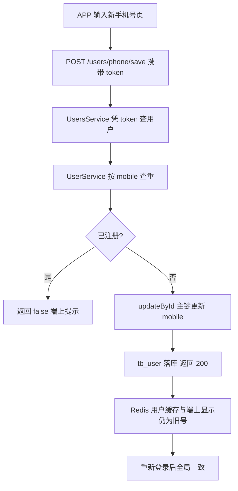

# 更换手机号第三步：查重之后落库新号码

> 🔒 安全提示：文中示例的口令/密钥均为课程教学环境演示口径，生产环境的安全要求见《安全与合规须知》。

发码证明了渠道，验码证明了本人，第三步终于把新号码写进 `tb_user`。这一步的代码量不大，一条 `updateById` 就能完成，但课程在更新前多插了一道查重：新号码要是已经被别的账号注册，直接拒绝绑定。少这道检查，两个账号共享一个手机号，登录时按手机号查用户就会查出一行还是多行都说不清，账号体系的根基被动摇。落库之后链路也还没有真正结束，缓存与端上显示的同步现象，是这节课的收尾看点。

## 先给结论

- 契约为 `POST /users/phone/save`，请求体是 `{"phone": "新手机号"}`，响应无数据体，Boolean 换 200 或 500。
- UsersService 凭 token 取当前用户，拿到用户 id 与新号下传，身份依旧只信任 token。
- UserService 更新前先按 `mobile` 查重，`selectOne` 查到记录直接返回 false，已注册的号码不允许再绑定。
- 查重通过后构建只带 `id` 与 `mobile` 的实体走 `updateById`，主键更新非 null 字段，影响行数换算 Boolean。
- day11 换号三步至此收口；改库后 Redis 的用户缓存与端上显示仍是旧号，重新登录才一致，工程上要同步处理缓存。

## 一、契约与穿线

保存接口的请求体只有一个新手机号。身份、旧号码、验证结论统统不进请求参数：身份在 token 里，旧号在用户表里，验码结论由两步接口的调用顺序保证。Controller 延续三连的统一姿势：

```java
/**
 * 保存新的手机号
 */
@PostMapping("phone/save")
public ResponseEntity<Void> saveNewMobile(@RequestBody Map<String, String> param,
                                          @RequestHeader("Authorization") String token) {
    try {
        String newPhone = param.get("phone");
        Boolean bool = this.usersService.updateNewMobile(token, newPhone);
        if (bool) {
            return ResponseEntity.ok(null);
        }
    } catch (Exception e) {
        e.printStackTrace();
    }
    return ResponseEntity.status(HttpStatus.INTERNAL_SERVER_ERROR).build();
}
```

UsersService 先取人再穿线，把 token 翻译成用户 id 交给下一层：

```java
public Boolean updateNewMobile(String token, String newPhone) {
    User user = this.userService.queryUserByToken(token);
    if (null == user) {
        return false;
    }
    return this.userService.updateNewMobile(user.getId(), newPhone);
}
```

到这里，三步接口的分工完全对齐：Controller 接参翻状态码，UsersService 做 token 到用户的转换，具体业务下沉到 UserService 或 SmsService。换号期间调用方拿到的永远是「操作者本人」这个锚点，号码怎么换，身份不动。

## 二、查重与主键更新

UserService 里的方法先查后改，两段逻辑一个都不能省：

```java
public Boolean updateNewMobile(Long id, String newPhone) {
    QueryWrapper<User> queryWrapper = new QueryWrapper<>();
    queryWrapper.eq("mobile", newPhone);
    User oldUser = this.userMapper.selectOne(queryWrapper);
    if (null != oldUser) {
        // 该手机号已注册，拒绝绑定
        return false;
    }
    User user = new User();
    user.setId(id);
    user.setMobile(newPhone);
    return this.userMapper.updateById(user) > 0;
}
```

**查重防的是登录歧义，不是多余的严谨。** 手机号在本项目里是登录凭证，登录接口按手机号查用户再比对密码，两个账号绑同一个号，查询结果要么报错要么取错人，密码校验的对象都变了。查重的另一个隐性收益是用户体验：返回 false，端上提示该号码已注册，比撞上数据库约束后抛 500 友好得多。课程资料的建表语句里 `mobile` 列上建了普通索引，查重这条 `selectOne` 走索引，代价可以忽略；但普通索引只加速不防重，两个请求在查重与落库之间并发插入，都能通过检查，唯一索引加捕获 `DuplicateKeyException` 才是并发下的最终防线，应用层查重负责给出友好提示，两层配合。

**更新用 `updateById` 而不是 `update(entity, wrapper)`，因为条件就是主键。** 构建的 User 实体只 set 了 id 与 mobile，MyBatis-Plus 的主键更新同样只拼非 null 字段，生成的 SQL 是 `UPDATE tb_user SET mobile = ? WHERE id = ?`，created 与 updated 都不会被误伤（自动填充策略会接管 updated）。方法名在课堂里提过可以叫 save 也可以叫 update，语义上「把账号绑到新号」更贴切，命名不必纠结，查重在前的顺序才是必须记住的。

把换号三步串成一张图，链路在这里收口：



关键路径在 E 与 I 两个节点：E 决定业务能否继续，I 揭示落库之后的一致性尾巴，两处都不是代码量问题，而是设计意识问题。

## 三、真机验收与 day11 收口

完整流程走一遍：登录 17602026868，进入修改手机号，获取验证码、输入 123456、下一步通过，输入新号 17602026869 点绑定，接口返回 200。数据库客户端刷新 `tb_user`，用户 id 为 1 的那行 `mobile` 已经变成 17602026869。退出后用新号 17602026869 登录，验证码 123456，进入的还是同一个用户，头像与资料原样保留，证明这次操作是原账号换绑而不是新建账号。为了验证流程对称性，课堂把号码又改回 17602026868 再测一遍，两次都成功。

有一个现象值得盯住：绑定成功后，页面上显示的手机号依旧是旧号。原因在缓存，登录时用户的 JSON 按 token 写进了 Redis，`queryUserByToken` 取缓存优先，落库改的只是 MySQL，Redis 里那份快照还躺在旧号上，端上又优先展示缓存数据，于是出现「库已更新、页面没动」的窗口。课程处理方式是退出重登，重新登录时缓存重写，全局恢复一致。工程上的正解是保存成功后同步删除或更新该 token 的用户缓存，让下一个请求回源拿到新号，不然换号之后立刻触发的「向当前手机号发码」类功能，取到的还是旧号。

到这里，day11 的换号链路三步收口：发码给当前绑定号、验码一次性消费、查重后主键落库。通用设置四个功能里，设置查询、陌生人问题、黑名单、通知开关、修改手机号全部闭环，学习目标里「独立完成更新通知的功能」「独立完成更新手机号的功能」两条验收点落地。贯穿三步的套路依然是那几件：token 定人、Service 分层穿线、Wrapper 表达条件、Redis 承担码的存取与生命周期，新功能不过是这些件的不同排列。

## 常见误区

- **只更新不查重。** 错例：拿到新号直接 `updateById`，别的账号注册过的号被绑进来，登录按手机号 `selectOne` 出现歧义，账号体系被击穿。正解：更新前按 `mobile` 查重，命中即返回 false，友好提示已注册。
- **指望普通索引防重复。** 错例：看到 `mobile` 列上有索引就认为不会重复，实际上普通索引只加速查询，并发查重与落库之间存在窗口，照样可能写重。正解：把列升级为唯一索引兜底，应用层查重保留用于友好报错，重复写入捕获 `DuplicateKeyException` 转成业务提示。
- **改库不处理用户缓存。** 错例：落库成功就认为流程结束，Redis 里按 token 缓存的用户快照还是旧号，端上显示与后续取号逻辑全部停留在旧值。正解：保存成功后同步删除或覆盖该 token 的用户缓存，把一致性窗口压到零。
- **更新实体顺手带无关字段。** 错例：构建 User 时把 created、password 一起赋值，`updateById` 的非 null 字段全部进 SET，创建时间被刷新，密码被重写成错误值。正解：更新场景实体只放主键与要改的列，其余一律不碰。

## 面试可能被问到的问题

1. 面试官追问：「手机号唯一性靠应用层查重还是数据库唯一索引？」
   答：两层都要。应用层查重给用户友好提示，还能区分「已注册」「格式错误」等业务语义；数据库唯一索引是并发下的最终防线，查重与落库之间的时间窗口靠它兜住，重复写入时捕获 `DuplicateKeyException` 转成业务异常。只有应用层查重的方案在并发下一定有洞，只有唯一索引的方案错误提示生硬，两者是分工不是二选一。
2. 面试官追问：「updateById 和 update(entity, wrapper) 各适合什么场景？」
   答：`updateById` 用于按主键改一条记录，实体只放主键与要更新的字段；`update(entity, wrapper)` 用于按业务条件批量或定向更新，条件由 Wrapper 表达。共同规则是实体里非 null 字段才进 SET，需要把某列更新为 null 只能用 `UpdateWrapper` 的 `set` 方法，或对字段设置更新策略。
3. 面试官追问：「换绑手机号之后，旧登录态要不要强制失效？」
   答：建议失效或至少降权。换绑是账号归属变更的高危事件，攻击者可能正握着旧会话，安全要求高的系统在换绑成功后吊销该用户全部 token 强制重新登录，一般系统也可以在下次敏感操作时触发二次验证。本课程实现保留了原 token，属于教学取舍，生产上要补上这一环。
4. 面试官追问：「为什么换手机号要拆成三步接口，一次提交校验加更新不行吗？」
   答：三步对应三类验证动作，拆开才能在中间插入用户确认环节，也避免一次性接口把校验与更新绑死、失败后状态难回滚。三步之间用短时效标记衔接，还能防跳步直调保存接口。接口粒度与安全流程对齐，比省请求次数重要得多。
5. 面试官追问：「账号核心字段（手机号、密码）更新时，如何保证多副本一致？」
   答：写路径单一入口，先更新库，再按影响范围清理缓存与派生数据：token 用户快照、推荐侧冗余字段、ES 索引文档等。顺序遵循先库后缓存，失败补偿靠消息或定时对账。核心字段更新频率低，用「更新加失效」就够了，不必引入复杂的分布式事务。

## 配套资料

- 数据库：`materials/code/07/day11 探花交友-我的中心/day11/代码/mytanhua.sql`，`tb_user` 的 `mobile` 列与普通索引 `KEY mobile` 出处，换号验收时观察该列从 17602026868 变为 17602026869 再改回。
- 学习目标：`materials/code/07/day11 探花交友-我的中心/day11/学习目标.md`，「独立完成更新手机号的功能」的保存环节，三步链路至此全部落地。
- 说明：day11 资料包不含工程源码，Controller、Service 与查重更新逻辑按课程画面与讲解整理补全，包名统一 `com.study.tanhua` 系，SSO 侧为 `com.study.tanhua.sso`；保存接口路径按 mock 文档语义整理；mock 文档站点域名以 example.com 占位。
