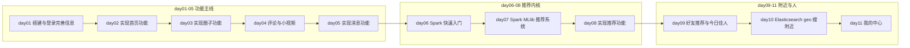

# 我的中心收官：day11 复盘与探花交友十一天全景

day11 最后一课没有新的功能代码，教师把这一天的模块盘了一遍，也顺势宣告整个探花交友项目基本完结：主要功能已经完成，剩下的是细节打磨。总结课最怕听完就散，值得把这一天串成一条线，再抬头看看十一天的全景，收尾的口径理顺了，项目在简历和面试里才立得住。

## 先给结论

- day11 的产出集中在我的中心：喜欢统计与列表、取消喜欢与喜欢粉丝两类交互、通用设置与陌生人问题、黑名单的建表到移除、更新通知、更新手机号三步，最后以 CDN 原理收尾。
- 概念先于代码：喜欢、粉丝、相互关注的方向语义辨析清楚，统计与列表的逻辑才不会错，这是本日反复强调的点。
- 黑名单的功能链路完整落地，但项目业务里还没有真正使用它，接入点留给学员自行扩展。
- CDN 属于认知课：CNAME、就近调度、边缘缓存、回源这条链路要能讲清，真实接入因备案门槛留到企业环境。
- 阶段七整体收束：功能主线完成，尚缺后台管理系统与首页部分功能，补齐打磨后即是可直接应用的项目。

## day11 这一天做了什么

我的喜欢是本日重头。我的模块先展示三个统计数字：互相关注、关注、粉丝，点进去是各自的列表页。列表之外是两类交互：取消喜欢，给粉丝回关。概念在这一课被单独拎出来讲：

- 喜欢：我喜欢他，`user_like` 集合里落一条我指向他的记录；
- 粉丝：他喜欢我，一条他指向我的记录；
- 相互关注：两个方向的记录都在，互关判定成立。

方向语义一旦搞反，统计数字和列表内容会跟着错位，所以概念辨析被排在了实现之前。dubbo 侧的 `UserLikeApi` 在 day10 已把 `saveUserLike`、`deleteUserLike`、`isMutualLike` 与统计、列表方法备齐，day11 用单元测试把调用串起来验证（包名按规范改为 `com.study.tanhua` 系）：

```java
package com.study.tanhua.dubbo.server.api;

import org.junit.Test;
import org.springframework.beans.factory.annotation.Autowired;
import org.springframework.boot.test.context.SpringBootTest;
import org.springframework.test.context.junit4.SpringJUnit4ClassRunner;

@RunWith(SpringJUnit4ClassRunner.class)
@SpringBootTest
public class TestUserLikeApi {
    @Autowired
    private UserLikeApi userLikeApi;

    @Test
    public void testSave(){
        this.userLikeApi.saveUserLike(1L,2L);
        this.userLikeApi.saveUserLike(1L,3L);
        this.userLikeApi.saveUserLike(2L,1L);
        this.userLikeApi.saveUserLike(1L,4L);
    }
}
```

四条记录覆盖了单方向与双向两种形态，后面的统计与互关判定全靠这批数据驱动。

通用设置走 MySQL：`tb_settings` 表存通知开关与陌生人问题，查询做回显，保存做更新。黑名单则是从建表到移除的完整纵切，表结构来自资料包的真实 SQL：

```sql
CREATE TABLE `tb_black_list` (
  `id` bigint(20) NOT NULL AUTO_INCREMENT,
  `user_id` bigint(20) DEFAULT NULL,
  `black_user_id` bigint(20) DEFAULT NULL,
  `created` datetime DEFAULT NULL,
  `updated` datetime DEFAULT NULL,
  PRIMARY KEY (`id`),
  KEY `user_id` (`user_id`)
) ENGINE=InnoDB DEFAULT CHARSET=utf8 COMMENT='黑名单';
```

`user_id` 与 `black_user_id` 两个字段把「谁拉黑了谁」钉死，列表按 `user_id` 查、移除按双条件删，越权问题在建表时就有了答案。

更新通知与更新手机号把通用设置补完：通知开关保存后即时生效；换手机号走发送验证码、校验验证码、保存新手机号三步，测试环境通过 Nginx 把短信请求代理到内部服务：

```nginx
location /users/phone {
    client_max_body_size 300m;
    proxy_connect_timeout 300s;
    proxy_send_timeout 300s;
    proxy_read_timeout 300s;
    proxy_pass http://127.0.0.1:18080;
}
```

CDN 是一天的收尾：内容分发网络把图片、视频、静态文件缓存到离用户最近的边缘节点，CNAME 别名加智能调度完成就近分配，未命中缓存时回源。项目里 OSS 上的图片、FastDFS 里的小视频都具备接入条件，备案门槛留待企业环境。

## 概念对，逻辑才对

把 day11 的代码横切一刀，能看到贯穿整个项目的主线。**身份与数据边界**：所有写操作的发起人一律从 token 解出、经 ThreadLocal 传递，客户端只传目标 id，黑名单的双条件删除正是这条防线的落地形态。**两层服务分工**：关系数据的读写收敛在 dubbo 服务（MongoDB 的 `user_like` 集合），接口层只做参数校验、编排与资料拼装（MySQL 的 `tb_user_info` 补齐头像昵称），列表页跨两个存储的两步查询是标准形态。**条件表达**：MyBatis-Plus 的 `QueryWrapper` 把业务条件逐条翻译成 SQL 片段，分页统一封装，翻页与筛选不再各写各的。

这些套路在 day11 全部复用了一遍，没有引入新组件。学完的检验标准不是「看过」，而是拿一个新功能（比如把黑名单接到消息屏蔽）能独立套用同一套骨架。

## 探花交友十一天的全景



三段各有主线。功能主线把社交 App 的骨架立起来，从登录、首页、圈子到消息，每一块都是前后端加存储的完整纵切；推荐内核引入 Spark 与 MLlib，把「看什么」交给模型；附近与人用 Elasticsearch geo 把地理维度补上，再以我的中心收束个人数据。 day01 到 day11 的学习目标文档里每一条「独立完成」，对应的都是这条线上的一个验收点。

## 项目还差什么，往哪里补

课程定位明确把重心放在 App 交互侧，所以有几块明显留白，总结课上点名了三处。**后台管理系统缺失**：没有管理端，课程、用户、举报都靠库里造数据，学员可以自行补一套管理端练手。**首页部分功能未完成**：测灵魂等入口还没有真正实现，可以基于现有功能的地基往上搭。**黑名单尚未接入业务**：设置和移除都做完了，但消息、评论等链路还没有消费黑名单，把它接进去是现成的扩展练习。把这些补齐打磨，这个项目就是可以直接拿出来应用的平台，动手敲一遍、逐条对学习目标验收，比再听一遍有用得多。

## 常见误区

- **把总结课当过场跳过。** 错例：赶进度直接翻下一个项目，day11 的概念辨析与留白清单全丢。正解：按三个统计数字、两张列表、一次概念辨析的口径自查，讲不清的地方回对应课程补。
- **方向语义背了但代码里写反。** 错例：统计粉丝时查了「我喜欢的人」。正解：写查询前先在纸上画方向，`user_id` 是动作发起方、`like_user_id` 是被指向方，两个方向凑齐才是互关。
- **黑名单只测接口不接业务。** 错例：验收完 CRUD 就结束，拉黑后对方消息照样进来。正解：在消息、评论读链路加黑名单过滤，功能才真正闭环。
- **简历里写「管理端齐全」。** 错例：项目描述照抄成品平台的介绍。正解：如实写 App 侧功能与推荐、搜附近亮点，管理端作为自行扩展项反而能体现主动性。

## 面试可能被问到的问题

1. 面试官追问：「用一分钟介绍你做的探花交友项目。」
   答：一个社交类 App 的完整后台，功能上覆盖登录、首页推荐、圈子动态、评论小视频、消息与我的中心；技术上是微服务分层，dubbo 服务管关系数据，MongoDB 存喜欢与访客关系，MySQL 存用户资料，Redis 做缓存；推荐侧用 Spark 加 MLlib 实现好友与内容推荐，地理位置维度用 Elasticsearch geo 实现搜附近。
2. 面试官追问：「喜欢、粉丝、相互关注在数据上怎么区分？」
   答：一个 `user_like` 集合，记录里有发起方与被指向方两个字段。我喜欢他存我指向他，粉丝是他的记录指向我；互关判定是查我发出的 id 集合，再看谁同时出现在指向我的集合里，两个方向都有记录即为相互关注。
3. 面试官追问：「为什么关系数据放 dubbo 服务加 MongoDB，而不是直接在接口层查？」
   答：关系数据读写频繁、结构是文档型，MongoDB 合适；dubbo 服务把存取逻辑收敛成统一 API，接口层与后续其他服务都能复用，也方便在服务内部做查重、互关判定这类原子逻辑，避免每个调用方各写一份。
4. 面试官追问：「黑名单这类删除接口怎么防越权？」
   答：身份取自 token 解析结果而不是请求参数，删除条件强制双条件：当前登录人的 `user_id` 加目标用户的 `black_user_id`。越权请求最多命中零行，删不动别人的关系；Mapper 返回影响行数，Service 翻译成业务结果。
5. 面试官追问：「CDN 的原理能一句话讲清吗？」
   答：把静态资源缓存到离用户最近的边缘节点，DNS 通过 CNAME 把解析交给 CDN 调度，调度按位置返回最近节点 IP，节点命中直接响应、未命中回源并缓存，源站压力和传输时延同时下降。
6. 面试官追问：「这个项目下一步你会怎么完善？」
   答：三件事：补一套后台管理系统管课程、用户与举报数据；把黑名单接入消息与评论链路实现真正的屏蔽；把首页未完成的测灵魂等入口做出来。都是复用既有骨架的增量开发，成本可控。

## 配套资料

- 学习目标：`materials/code/07/day11 探花交友-我的中心/day11/学习目标.md`，从「独立完成我的喜欢中查询统计数据」到「理解 cdn 的工作原理」，本日全部验收点清单。
- 数据库：`materials/code/07/day11 探花交友-我的中心/day11/代码/mytanhua.sql`，`tb_black_list`、`tb_settings`、`tb_question` 等表结构出处。
- 配置：`materials/code/07/day11 探花交友-我的中心/day11/代码/nginx.conf`，短信验证码代理与接口转发的真实配置。
- 说明：day11 资料包不含工程源码，单元测试类按课程画面整理补全，包名统一 `com.study.tanhua` 系；mock 文档站点域名以 example.com 占位。
