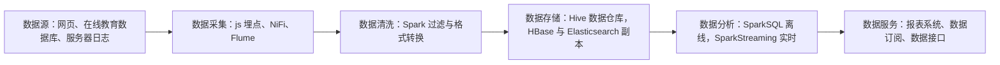

# 智慧学成开篇：给在线教育平台装上一套大数据统计系统

阶段八换了赛道。探花交友做的是业务系统本身，智慧学成站在业务系统背后看数据：分析对象是在线教育平台，产出是给运营决策用的统计报表。开章第一课只有几分钟，没有代码，却决定了后面每一章在干什么，四个问题必须先立起来：项目为什么做、业务流程是什么、功能怎么分、技术怎么选。

## 先给结论

- 智慧学成不是在线教育平台，而是对在线教育平台业务做大数据统计分析的系统，分析范围是课程、用户、教育机构三个业务领域。
- 立项动机：在线教育竞争的胜负手在服务质量与教育质量，大数据从海量用户行为数据里挖掘分析，为经营决策提供数据支撑。
- 研发方法是企业级的：ETL 规范化研发流程，加企业级数据仓库建模思想，围绕三个主题的不同维度做分析。
- 功能分六大模块：平台看板、课程统计、机构统计、用户统计、日志查询、系统管理。
- 技术架构分六层：数据源、采集、清洗、存储、分析、服务，NiFi 与 Flume 负责采集，Kafka 做中转，Spark 做清洗与分析，Hive 建数仓，HBase 与 Elasticsearch 支撑即时查询，Vue 加 ECharts 加 Spring Boot 做报表。

## 课程目标：四条验收点

讲义开篇给了四条课程目标，即本阶段的验收清单：

```text
1. 能够说出项目的背景和项目概述。
2. 理解项目的业务流程。
3. 能够说出项目的功能模块。
4. 能够说出项目的技术架构。
```

四条各管一段：背景回答为什么要做这个项目，概述回答项目的价值是什么；业务流程回答对哪些业务做统计分析；功能模块是业务的细分；技术架构回答对已知的需求用什么技术实现。每一条都对应后面一个章节，项目介绍这一章先把四张地图铺开。

## 项目背景：在线教育为什么需要大数据

受互联网 + 概念的催化，在线教育市场发展火热，越来越多的在线教育平台相继上线。所谓在线教育平台，指依托互联网在互联网上提供教学服务的平台，课程检索、报名购买、在线学习都在网页上完成。赛道拥挤之后，竞争的焦点变成了服务：注重用户服务、教育质量的平台最终会胜出，而如何提高用户服务水平、提高教育质量，是每个机构都面临的问题。

破题的思路是数据。用户在平台上的每一次浏览、学习、购买都会留下行为记录，大数据技术可以从海量用户行为数据中进行挖掘分析，根据分析结果优化平台的服务质量，最终满足用户需求。智慧学成的定位由此而来：将大数据技术应用于在线教育领域，从海量用户行为数据中挖掘分析，分析用户的学习行为、学习质量等指标，为企业经营提供数据支撑。

被统计的在线教育平台长什么样，课程用原型页面走了一遍。首页左侧是学科分类菜单，想学什么点对应分类筛选；课程入口支持输入关键字搜索；「我的学习」面向学生用户，学过、关注过、浏览过的课程都汇总在这里；「教学提供方」面向机构，任何机构都可以在这个平台上发布课程，课程的维护、学习人数与关注情况都在这个入口展示。学员产生行为、机构供给内容、平台运营看全局，三类角色的动作就是后续统计的原料。

## 项目概述：三个主题，一套企业级打法

智慧学成对在线教育平台业务进行大数据统计分析，分析对象落在课程、用户、教育机构三个业务领域。用数据仓库的术语说，这就是三个主题。做法上有两个关键词：**企业级 ETL 规范化研发流程**，数据怎么采、怎么洗、怎么入库、怎么产出都有章法；**企业级数据仓库建模思想**，围绕三个主题的不同维度组织数据，比如课程维度看访问与购买，用户维度看新增与活跃，机构维度看销量与学生数。挖掘数据的价值，最终为在线教育平台运营提供参考数据依据，这就是项目概述的全部。

## 功能模块：把业务细分到能开发

功能模块是业务细分的结果，讲义给出六大模块：

| 模块 | 功能说明 |
|---|---|
| 平台看板 | 系统首页，集成课程访问量、购买量、在线听课人数、新增人员等常用指标，方便管理员速览 |
| 课程统计 | 课程主题的指标：课程访问量、课程购买量、在线听课人数、热门课程、热门学科、机构销量 |
| 机构统计 | 机构主题的指标：机构销量、机构学生等 |
| 用户统计 | 用户主题的指标：新增用户、活跃用户、学习频次 |
| 日志查询 | 统计的细节数据查询：课程信息、在线学习日志、课程访问日志 |
| 系统管理 | 平台自身的管理：用户管理、权限管理、订阅管理 |

原型系统与这张表对得上：登录后首页是平台看板，左侧导航依次挂着课程访问量、课程购买量、在线学习 TOP5、实时看板、机构统计、用户统计等菜单。模块名与主题一一对应，课程统计对应课程主题，机构统计对应机构主题，用户统计对应用户主题，找功能时顺着主题找就不会迷路。

## 技术架构速览

整个系统按数据流向分六层，每一层解决一个问题：数据从哪来、怎么搬、怎么洗净、存在哪、怎么算、怎么用。



各层的落地技术讲义里给了清单：

```text
数据采集：NiFi 采集关系库数据落地 HDFS，Flume 采集日志文件落地 HDFS，
          Kafka 做数据中转，采集系统使用 Spring Boot 完成
ETL 清洗：编写 Spark 程序完成数据清洗，NiFi 做任务调度与数据流管理，
          shell 脚本提交 Spark 任务，小任务可用 Kettle 完成
数据存储：Hive 做数据仓库建模（资源库、主题库、业务库及中间库），
          即时查询的数据存 HBase 与 Elasticsearch
数据分析：SparkSQL 做离线分析，SparkStreaming 做实时分析
数据服务：Vue.js 加 ECharts 加 Spring Boot 开发报表系统，
          结果数据存 MySQL 与 Redis 供其他系统调用
```

这张清单不要求第一天就记住每个组件的用法，但分层的位置关系要留下印象：后面环境搭建、数据仓库、课程分析、实时分析、即时查询五章，就是沿着这条链路逐层展开的。

## 常见误区

- **把智慧学成当成在线教育平台本身。** 错例：以为要开发卖课、播视频的功能。正解：它不卖课也不播课，只对平台产生的数据做统计分析，被分析的平台是另一个业务系统。
- **把功能模块与技术组件混为一谈。** 错例：介绍功能时说「用 SparkSQL 做了一个模块」。正解：功能模块是业务细分（课程统计、用户统计），技术组件是实现手段（SparkSQL、NiFi），简历与面试里两套词要分开。
- **认为大数据系统要替代业务系统。** 错例：让统计系统直接接管课程购买流程。正解：业务库照常支撑线上交易，统计系统通过采集层拿走行为数据，两边以数据衔接而不是以功能替代。
- **跳过「企业级」三个字直接撸代码。** 错例：环境还没搭就去抄清洗脚本。正解：ETL 规范与数仓建模是这个阶段的主线，方法不立住，后面每一章都会卡壳。

## 面试可能被问到的问题

1. 面试官追问：「用一句话说清智慧学成的项目定位。」
   答：对在线教育平台业务进行大数据统计分析的系统，对课程、用户、教育机构三个业务领域做数据挖掘，采用企业级 ETL 流程与数仓建模思想，为平台运营提供参考数据。
2. 面试官追问：「在线教育平台为什么需要大数据分析？」
   答：平台竞争的核心在服务质量与教育质量，用户行为数据里藏着优化线索。从海量行为数据中挖掘学习行为、学习质量等指标，才能把「改善服务」从经验判断变成数据决策，为企业经营提供支撑。
3. 面试官追问：「三个主题为什么是课程、用户、机构？」
   答：它们正是平台的三大业务领域：机构供给课程，学员消费课程，平台在中间撮合。统计需求天然围绕这三方产生，按主题建模后每个主题下再展开维度与指标，数据组织与业务结构一致。
4. 面试官追问：「平台看板上会放哪些指标？」
   答：放管理员最常用的速览指标：课程访问量、购买量、在线听课人数、新增人员等。看板是首页聚合视图，细节下钻交给课程统计、机构统计、用户统计各模块，日志查询再往下兜底细节数据。
5. 面试官追问：「整体技术架构分几层，各层用什么？」
   答：六层。数据源是网页、数据库与服务器日志；采集用埋点、NiFi 与 Flume 落地 HDFS，Kafka 中转；清洗用 Spark 程序加 NiFi 调度；存储以 Hive 建数仓，即时查询数据复制到 HBase 与 Elasticsearch；分析分 SparkSQL 离线与 SparkStreaming 实时；服务层用 Vue 加 ECharts 加 Spring Boot 出报表，结果存 MySQL 与 Redis。

## 配套资料

- 讲义：`materials/docs/08/智慧学成-第1章-项目介绍v1.0.md`，项目背景、概述、业务流程、功能模块表与技术栈清单的全部出处。
- 讲义：`materials/docs/08/智慧学成-第1章-环境搭建v1.0.md`，CDH 开发环境组件与 Scala 工程依赖清单，紧随其后的环境搭建课配套。
- 资料：`materials/code/08/_散落资料/`，内有 day01 学习目标清单与项目原型、整体流程图源文件；目录内原始文件名带站点后缀，属元信息，正文一律不引用。
- 说明：被分析的在线教育平台无源码包，页面描述按课程画面整理；本阶段示例包名一律按 `com.study.xc` 系中性改写，示例站点以 example.com 占位。
