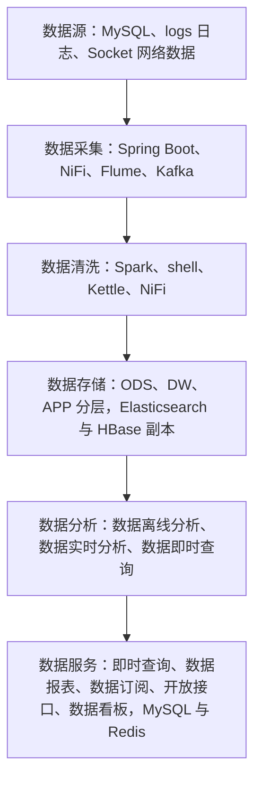
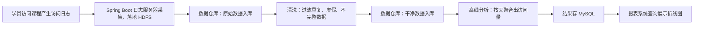

# 技术架构分层：数据从在线教育平台走到报表的六层旅程

功能模块回答「做什么」，技术架构回答「用什么做」。架构图一张、技术栈图一张，都要求自下向上看：数据源在最底层，一路向上经过采集、清洗、存储、分析，最终在数据服务层变成报表上那条折线。这一课的目标是能把每一层用了什么技术、为什么放在这一层说清楚，后面的环境搭建与各分析章节都会沿着这条链路展开。

## 先给结论

- 架构分六层：数据源、数据采集、数据清洗、数据存储、数据分析、数据服务，另有系统监管、作业管理、集群管理、状态监控等横向管理模块。
- 数据源有三类：MySQL 关系库里的结构化数据、日志文件里的半结构化数据、通过 Socket 传输的网络数据。
- 采集层的分工：Spring Boot 搭日志服务器采集行为日志，NiFi 采集关系库数据落地 HDFS，Flume 采集日志文件落地 HDFS，Kafka 做数据中转。
- 清洗层以 Spark 程序为主，shell 脚本提交任务，NiFi 负责任务调度与整体数据流管理，小任务可以直接用 Kettle。
- 存储以 HDFS 为基础，Hive 在其上做数仓建模（分层建模），即时查询的数据另存 HBase 与 Elasticsearch 一份。
- 分析分离线（SparkCore 加 SparkSQL）与实时（SparkStreaming）；服务层用 Vue 加 ECharts 出前端报表，Spring Boot 封装接口，结果存 MySQL 与 Redis。

## 六层架构：自下向上看

架构图从下往上读，每层只回答一个问题。数据源回答「数据从哪来」，采集回答「怎么搬」，清洗回答「怎么洗净」，存储回答「存在哪」，分析回答「怎么算」，服务回答「怎么用」。右侧还有一列管理能力：系统监管、作业管理、集群管理、状态监控、业务模型管理、采集管理，它们不参与数据流动，负责让这条流水线可管可查。



图里最值得留意的是存储层：讲义把它描述为「源数据、数据仓库、业务数据共三层」，落到工程上就是 ODS、DW、APP 的分层建模，在线学习明细这类日志数据除了存数仓，还会在 HBase 与 Elasticsearch 各存一份，目的是给即时查询提速。分层思想在数据仓库章节会单独展开，这里先记住位置关系。

## 以课程访问量为例，离线链路走一遍

以课程访问量为例把架构跑一遍。学员访问课程产生行为数据，以日志方式存储，这就是原始数据，也就是数据源。日志属于半结构化数据；对比之下，MySQL 关系库里二维表存的是结构化数据。原始数据通过采集获取，课程用一个 Spring Boot 搭建的采集服务器来收日志；采回来的数据不能直接用，先落进数据仓库，再由清洗环节把重复数据、垃圾数据、不完整数据过滤掉，清洗结果再次保存到数据仓库，这就是离线分析的基础数据。分析完成之后还是一次存储，这次存储是为数据服务供数：最终分析结果保存到 MySQL，业务报表展示时直接查 MySQL。



关键路径在中间三停：入库、清洗后再入库、分析后再入库。每一停都有明确目的，原始库留底、干净库供分析、结果库供报表，谁消费什么数据在层级上写死，链路就不会乱。

## 技术栈逐层落位

架构定层级，技术栈定人选。逐层看每个位置上站的是谁：

- **数据源：** 支持数据库、数据文件、网络数据等各类数据源，MySQL、日志文件、Socket 各占一类。
- **数据采集：** NiFi 对关系型数据库数据采集落地 HDFS；Flume 对 log 文件采集落地 HDFS；NiFi 同时对整个 ETL 过程做可视化数据流管理；Kafka 作为数据中转集成各采集层；采集系统使用 Spring Boot 完成。
- **ETL 清洗：** 编写 Spark 程序完成数据清洗任务；使用 NiFi 进行任务调度及整体数据流程管理；使用 shell 脚本提交 Spark 任务；一些小的 ETL 任务可以用 Kettle 客户端完成。
- **数据存储：** 主要使用 Hive 进行数据仓库建模，包括资源库数据、主题库数据、业务库数据，以及为支撑复杂业务创建的中间库；需要即时查询的数据存 HBase 与 Elasticsearch。
- **数据分析：** 离线分析用 SparkSQL 处理历史数据，实时分析用 SparkStreaming 处理实时数据，底层数字计算由 SparkCore 承担。
- **数据服务：** 采用 Vue 加 ECharts 加 Spring Boot 开发报表系统，服务数据存 MySQL 与 Redis 供其他系统调用。

选型理由里最值得展开的是 Elasticsearch 的位置：日志数据量非常大，清洗完存进 Hive 后用普通手段查询很慢，所以把索引存一份到 Elasticsearch，用它换查询速度，这是「分析走数仓、查询走索引」的典型分工。Kafka 的位置同理，它不生产数据也不消费数据，站在采集层中间做缓冲与解耦，哪一种组件采哪一类数据没有死规定，日志、数据库、Socket 数据其实都可以相互采集，选型只看哪种更适合当前业务场景。

## 真实工程里的证据：模块与依赖

技术栈不是 PPT 上的清单，工程目录里能对上号。课程真实工程的 Maven 坐标按中性包名改写后如下，五个 module 正好对应分析层的三个出口（离线、实时、即时查询）加两个公共包：

```xml
<groupId>com.study</groupId>
<artifactId>xc-analysis</artifactId>
<version>1.0-SNAPSHOT</version>
<modules>
    <module>xc-common-entity</module>   <!-- 公共实体 -->
    <module>xc-common-utils</module>    <!-- 公共工具 -->
    <module>xc-service-offline</module> <!-- 离线分析：SparkSQL -->
    <module>xc-service-rt</module>      <!-- 实时分析：SparkStreaming -->
    <module>xc-service-search</module>  <!-- 即时查询：HBase 与 Elasticsearch -->
</modules>
<packaging>pom</packaging>

<properties>
    <scala.version>2.11.8</scala.version>
    <spark.version>2.3.3</spark.version>
    <hadoop.version>2.6.0</hadoop.version>
    <hive.version>1.1.0</hive.version>
    <hbase.version>1.2.0</hbase.version>
    <elastic.version>6.4.0</elastic.version>
    <kafka.version>2.2.0</kafka.version>
</properties>
```

依赖清单与技术栈一一对应：`spark-core_2.11`、`spark-sql_2.11`、`spark-streaming_2.11` 对应分析层，`spark-streaming-kafka-0-10_2.11` 对应 Kafka 中转，`hive-exec`、`hive-jdbc` 对应数仓访问，`hbase-client`、`elasticsearch-spark-20_2.11` 对应即时查询存储，`mysql-connector-java` 对应结果落库。任务提交也按模块分包，实时分析任务的提交脚本（按课程资料脚本整理，包名已中性化）不需要日期参数，因为它是一个长驻进程：

```bash
/opt/spark/bin/spark-submit \
  --master spark://xc-online-spark:7077 \
  --conf spark.executor.cores=1 \
  --total-executor-cores 1 \
  --class com.study.xc.analysis.RealTimeVisit \
  /opt/run/jars/xc-service-rt-jar-with-dependencies.jar
```

即时查询侧同样是一条 spark-submit，把清洗统计后的数据写入 HBase 与 Elasticsearch（`com.study.xc.analysis.search.InstantQueryStep2ToHbaseAndES`，jar 包为 `xc-service-search-jar-with-dependencies.jar`）。离线、实时、即时查询三条链路在提交方式上的差异：离线任务按天传日期参数跑批，实时任务是长驻进程，即时查询任务跟着数仓产出节奏跑。

## 常见误区

- **把 Hive 当成存储引擎。** 错例：说数据存在 Hive 里。正解：数据落在 HDFS，Hive 在 HDFS 之上提供数仓建模与类 SQL 能力，存储与建模是两件事。
- **把即时查询与离线分析混成一条链路。** 错例：报表明细也去 Hive 里捞。正解：离线分析产出聚合指标走 Hive 到 MySQL；即时查询要的是快，明细另存 HBase 与 Elasticsearch，靠索引换速度。
- **认为 Kafka 只能采日志。** 错例：把 Kafka 归为日志采集工具。正解：Kafka 是数据中转，日志、数据库、Socket 数据都能经它中转，各类采集组件可以互相替代，按业务场景选。
- **以为清洗完就能出报表。** 错例：清洗结果直接给前端。正解：清洗之后还要离线分析按维度聚合成指标，指标再落 MySQL，报表消费的是指标而非明细。

## 面试可能被问到的问题

1. 面试官追问：「整体技术架构分几层，每层一句话说什么？」
   答：六层。数据源提供结构化与非、半结构化原始数据；采集用 Spring Boot、NiFi、Flume、Kafka 把数据搬进 HDFS；清洗用 Spark 过滤垃圾与重复并做格式转换；存储以 HDFS 为基础、Hive 建模并另存 HBase 与 Elasticsearch；分析分 SparkSQL 离线与 SparkStreaming 实时；服务层用 Vue、ECharts、Spring Boot 出报表，结果存 MySQL 与 Redis。
2. 面试官追问：「为什么即时查询数据要额外存一份到 HBase 和 Elasticsearch？」
   答：数仓面向批量分析，明细查询代价高。把在线学习明细等需要即时查询的数据在 HBase 与 Elasticsearch 各存一份，前者支撑 KV 级取数，后者用索引支撑全文与条件检索，用空间换查询速度。
3. 面试官追问：「NiFi 在这个架构里承担了哪几件事？」
   答：三件。采集关系型数据库数据落地 HDFS；对整个 ETL 过程做可视化数据流管理；承担任务调度。所以它同时出现在采集层与清洗层，是数据流的中枢工具。
4. 面试官追问：「离线任务和实时任务在提交方式上有什么不同？」
   答：离线任务按天跑批，日期做参数传给 spark-submit，跑完即退出；实时任务是无日期参数的长驻进程，常驻集群持续消费数据。对应工程里离线与实时拆成两个独立模块打包。
5. 面试官追问：「清洗为什么放在采集之后、分析之前，能不能省掉？」
   答：不能省。采集进来的原始数据有重复、虚假与不完整记录，直接分析会把错误计入指标。清洗保证进分析的数据干净且格式统一，这是指标准确的底线，也是数仓分层里 ODS 与 DW 的分界。

## 配套资料

- 讲义：`materials/docs/08/智慧学成-第1章-项目介绍v1.0.md`，2.1 技术架构六层说明与 2.2 技术栈清单的出处。
- 代码：`materials/code/08/_散落资料/`，真实工程的 Maven 坐标文件与离线、实时、即时查询三类 spark-submit 任务脚本存放处；目录内原始文件名带站点后缀，属元信息，正文一律不引用。
- 说明：工程坐标与任务脚本按课程资料整理，原包名已按 `com.study.xc` 系中性改写；`materials/code/08/` 下内层目录含项目原名，引用一律截至 `_散落资料` 层级。
