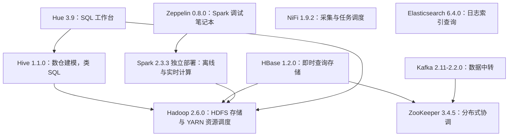

# CDH 开发环境认组件：一张版本清单撑起整个统计系统

> 🔒 安全提示：文中示例的口令/密钥均为课程教学环境演示口径，生产环境的安全要求见《安全与合规须知》。

项目介绍讲完，轮到把地基立起来。后面五章的清洗、统计、实时与即时查询，全都跑在这一套大数据环境上，环境搭不起来或者组件版本配错，后面每一步都会撞墙。环境搭建这一章的开头不急着敲命令，先把两件事定下来：学完要验收什么，以及这套环境里到底装了哪些组件、各是什么版本。

## 先给结论

- 环境搭建章有七条学习目标：说出 CDH 组件、搭建 CDH 环境、配置 IDEA（Maven、编码、Scala SDK）、搭建 Scala 工程、两种方式提交 Spark 任务、用 Zeppelin 调试 Spark、用 Hue 操作 Hive 与 HDFS。
- CDH 是把 Hadoop 生态核心组件按兼容版本打包发行的大数据平台，本课用的是 5.14.0 版。
- 本课组件清单：CDH 5.14.0 内含 ZooKeeper 3.4.5、Hadoop 2.6.0、Hive 1.1.0、Hue 3.9、HBase 1.2.0；Spark 2.3.3 与 Scala 2.11.8 独立部署，不在 CDH 组件包内。
- 外围组件：Zeppelin 0.8.0 调试 Spark，Kafka 2.11-2.2.0 做数据中转，NiFi 1.9.2 做采集与调度，Elasticsearch 6.4.0 做日志索引。
- 整套环境基于 Docker 编排：虚拟机 Ubuntu 18.04，容器系统 CentOS 6.9，JDK 1.8，每个组件一个容器，用 Docker Compose 统一编排。

## 学习目标：七条验收点

讲义给的学习目标就是这一章的验收清单，逐条过一遍：

1. 能说出 CDH 开发环境所使用的组件，Hadoop、Hive、HBase 这些名字要在这一步混个脸熟。
2. 能够参考文档搭建 CDH 开发环境，这是整个项目的基础环境，必须搭起来，否则后面开发无从谈起。
3. 能够配置 IDEA 开发环境，包括 Maven 配置、文件编码配置以及 Scala SDK 配置，配不到位后面会遇到各种奇怪问题。
4. 能够搭建 Scala 工程，它是 Spark 任务的基础工程，工程立不起来，Spark 任务就没地方写。
5. 能够测试提交 Spark 任务，提交方式有两种：在 IDEA 里直接提交，一般用于测试；把代码打包后用 spark-submit 提交，一般用于生产环境。
6. 能够使用 Zeppelin 调试 Spark 程序。Zeppelin 是基于网页的交互式数据分析开源框架，除 Spark 外还支持 Python、Hive、HBase 等，本课只要求掌握调试 Spark。
7. 能够使用 Hue 操作 Hive 及 HDFS。Hue 是基于网页的交互式数据处理框架，能操作 Hadoop、Hive、HBase 以及支持 JDBC 协议的数据库，本课只要求掌握用 Hue 操作 Hive 和 HDFS。

七条里有三条偏「说」，四条偏「做」。做的部分按依赖顺序排：环境在前，工程与提交在后，Zeppelin 与 Hue 是两个网页端辅助工具，分别管调试与查看。

## CDH 是什么，为什么用它

CDH 全称 Cloudera Distribution Hadoop，是 Cloudera 公司把 Apache Hadoop 生态的核心组件（HDFS、YARN、Hive、HBase、ZooKeeper、Hue 等）按经过验证的版本组合打包发行的大数据平台。Hadoop 生态组件众多、版本之间互相挑剔，手动组合很容易出现兼容性问题；CDH 的价值就在于发行版内部版本互相兼容、升级路径清晰，按主流做法补充一句：生产环境通常再配合 Cloudera Manager 做集群安装与组件管理，本课程为了降低资源门槛改用 Docker 容器化编排同样的组件组合，思路一致。

对本课而言还有一点要说清：组件清单里没有 Oozie 这类调度工具，任务调度与数据流管理由 NiFi 承担，这是本课技术栈自己的选型，不影响对 CDH 的理解。

## 版本清单：照单全收

环境搭建最忌讳「差不多就行」，版本必须照单全收。讲义 1.1 节的版本说明整理如下：

```text
基于 Docker：
虚拟机系统：Ubuntu 18.04
容器系统：CentOS 6.9
JDK：1.8
CDH 5.14.0：ZooKeeper 3.4.5、Hadoop 2.6.0、Hive 1.1.0、Hue 3.9、HBase 1.2.0
Spark：Spark 2.3.3、Scala 2.11.8
Zeppelin：0.8.0
Kafka：2.11-2.2.0
NiFi：1.9.2
Elasticsearch：6.4.0
```

这份清单有两处细节值得圈出来。一是 Spark 不在 CDH 组件包内，单独下载部署，配套的 Scala 版本是 2.11.8，Spark 2.3.3 与 Scala 2.11.8 是绑定关系，工程里的依赖坐标全部按这对版本走。二是 Kafka 的版本写法 `2.11-2.2.0` 里，前面的 2.11 是 Scala 版本号，后面的 2.2.0 才是 Kafka 自己的版本，看组件包名时别把两段数字混为一谈。

## 组件各司其职

十来个组件不是平行堆放，各自站在架构的不同层上，关系如下：



按架构层归位：Hadoop 是底座，提供 HDFS 存储与 YARN 资源调度；ZooKeeper 给 HBase、Kafka 提供协调服务；Hive 建在 HDFS 之上做数仓建模，对应存储层；HBase 与 Elasticsearch 服务即时查询；Spark 独立成计算引擎，对应分析层；Kafka 与 NiFi 对应采集层的中转与调度；Hue 与 Zeppelin 是两个网页入口，前者查看与操作 Hive、HDFS，后者调试 Spark 程序。上一课技术架构里的每一层，都能在这份清单里找到落地的组件。

## 编排方式：一个组件一个容器

整套环境全部容器化，每个组件就是一个 Docker 容器，配置完成后用 Docker Compose 编排。真实编排文件里 MySQL 与 Hadoop 的定义（按课程编排文件摘录）长这样：

```yaml
version: "2"
services:
  xc-online-mysql:                  # MySQL 容器
    image: mysql:5.7.9              # 指定镜像
    restart: always                 # 随 Docker 引擎启动而自动重启
    container_name: xc-online-mysql
    hostname: xc-online-mysql
    command: --default-authentication-plugin=mysql_native_password
    ports:
      - '3306:3306'                 # 端口映射，容器外:容器内
    environment:
      MYSQL_ROOT_PASSWORD: 123456   # root 密码，与课程环境一致

  xc-online-hadoop:                 # Hadoop 容器
    image: xc:base
    restart: always
    container_name: xc-online-hadoop
    hostname: xc-online-hadoop
    command: bash -c "service ntpd start && service sshd start && \
      /opt/hadoop-2.6.0-cdh5.14.0/sbin/start-all.sh && tail -f /dev/null"
    ports:
      - '50070:50070'               # HDFS Web 管理页
      - '9000:9000'                 # HDFS 协议端口
```

`restart: always` 是编排里的关键字段，意思是随 Docker 引擎启动而启动，虚拟机一开机容器就跟着起来，平时不需要逐个手动拉服务。容器之间还有依赖关系，比如 Hive 依赖 MySQL（存元数据）与 Hadoop（存数据），编排里用 depends_on 声明，单独启动 Hive 时依赖容器会自动拉起。日常操作就是几条 compose 命令（与编排文件同目录执行）：

```bash
docker-compose up -d                 # 后台启动编排的所有容器
docker-compose stop                  # 停止所有运行中的容器
docker-compose rm                    # 删除所有已停止的容器
docker-compose up -d xc-online-hive  # 单独启动某容器，依赖自动启动
```

组件清单加编排方式，就是这套开发环境的全部家底。下一课沿着两种安装路径，把这些容器真正跑起来。

## 常见误区

- **把 CDH 当成一个单独的软件。** 错例：说「安装 CDH 这个程序」。正解：CDH 是一套版本互相兼容的组件发行版，装的是 ZooKeeper、Hadoop、Hive 等一组组件，不是单个可执行文件。
- **版本凭感觉混搭。** 错例：Hadoop 用 2.7、Hive 用 2.x 凑着装。正解：CDH 5.14.0 的组件版本是经过兼容验证的组合，Spark 2.3.3 与 Scala 2.11.8 也是绑定关系，随意换版本会踩兼容坑。
- **以为 Spark 必须随 CDH 一起装。** 错例：在 CDH 组件列表里找 Spark。正解：本课 Spark 独立下载部署，版本可以脱离 CDH 发行版单独选，只要与 Hadoop 版本、Scala 版本匹配。
- **把 Hue 与 Zeppelin 混为一谈。** 错例：两者都说成「大数据网页工具」。正解：Zeppelin 是交互式数据分析笔记本，主要用来调试 Spark 程序；Hue 是数据仓库 SQL 工作台，主要用来操作 Hive 与 HDFS，定位不同。

## 面试可能被问到的问题

1. 面试官追问：「CDH 是什么，为什么不自己一套套组件手动装？」
   答：CDH 是 Cloudera 打包发行的 Hadoop 生态组件集合，发行版内组件版本经过兼容验证。手动装组件要自己处理版本匹配与配置衔接，容易踩兼容坑；用 CDH 拿到的是一套开箱即用、升级路径清晰的组合。
2. 面试官追问：「说说你这个项目的 CDH 环境用了哪些组件和版本。」
   答：CDH 5.14.0 内含 ZooKeeper 3.4.5、Hadoop 2.6.0、Hive 1.1.0、Hue 3.9、HBase 1.2.0；Spark 2.3.3 与 Scala 2.11.8 独立部署；外围还有 Zeppelin 0.8.0、Kafka 2.11-2.2.0、NiFi 1.9.2、Elasticsearch 6.4.0，整体基于 Docker Compose 编排。
3. 面试官追问：「任务调度为什么用 NiFi 而不是 Oozie？」
   答：这是项目自己的技术栈选型。NiFi 除了做关系库数据采集，还提供可视化数据流管理与任务调度能力，采集、调度、流程管理三件事用一套工具完成，避免了再引入 Oozie 的运维成本。
4. 面试官追问：「Kafka 版本 2.11-2.2.0 里的两段数字分别是什么？」
   答：2.11 是编译 Kafka 所用的 Scala 版本，2.2.0 才是 Kafka 本身的版本号。选客户端依赖时Scala 版本要与工程一致，本课工程统一用 2.11 系列。
5. 面试官追问：「开发环境为什么用 Docker 编排而不是直接在虚拟机里装组件？」
   答：每个组件一个容器，配置固化在镜像与编排文件里，环境一致且可复制；restart: always 让容器随虚拟机开机自启，配合 docker-compose up -d 一条命令拉起全家桶，搭建、重置、迁移都比裸装省力。

## 配套资料

- 讲义：`materials/docs/08/智慧学成-第1章-环境搭建v1.0.md`，学习目标七条与 1.1 版本说明的出处。
- 代码：`materials/code/08/_散落资料/`，docker-compose 编排文件与 docker 使用教程存放处，编排字段（restart、端口映射、依赖关系）均出自真实编排文件；目录内原始文件名带站点后缀，属元信息，正文一律不引用。
- 说明：CDH 与 Cloudera Manager 的关系为按主流做法补充的背景说明；编排示例按课程资料摘录整理，示例站点以 example.com 占位。
