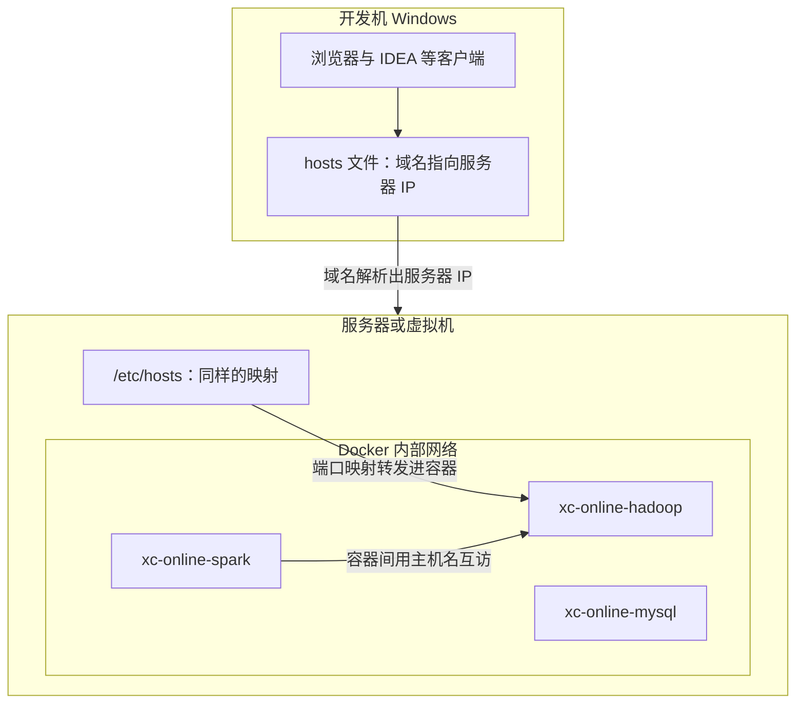

# 用域名访问大数据环境：hosts 映射的配置、原理与验证

> 🔒 安全提示：文中示例的口令/密钥均为课程教学环境演示口径，生产环境的安全要求见《安全与合规须知》。

大数据环境在服务器上装好之后，浏览器里输入 `xc-online:50070` 想看 HDFS 页面，得到的却是「无法访问」。组件本身没有任何问题，问题出在你手里这台开发机不认识 `xc-online` 这个名字。搭建环境的第一个动作就是补上这层映射：把课程环境用到的十来个域名写进 hosts 文件，全部指到真正跑服务的那台服务器，之后的访问、开发、容器互通才有一条稳定通路。

## 先给结论

- hosts 解决「域名到 IP」的映射问题，配置完成后访问项目一律使用 `xc-online:端口号` 的形式，不再直接写 IP。
- 课程环境的全部域名（`xc-online`、`xc-online-hadoop`、`xc-online-spark` 等）指向同一台服务器，映射十行写完。
- Windows 的 hosts 位于 `C:\Windows\System32\drivers\etc`，受系统权限保护不能原地保存，要复制出来改完再覆盖回去。
- 讲义里的 `192.168.1.101` 只是示例 IP，配置时必须以自己服务器（或虚拟机）的实际 IP 为准。
- 配置成功的标志：`ping` 域名通，浏览器用域名能打开 HDFS 的 50070 页面与 Spark 的 8080 页面。

## 为什么用域名而不是 IP

**第一，配置稳定，改一处生效全局。** 项目里会大量出现带域名的地址：Spark 任务提交写 `spark://xc-online-spark:7077`，HDFS 读写写 `hdfs://xc-online-hadoop:9000`，MySQL 连接串写 `xc-online-mysql:3306`。这些字符串散落在代码、配置文件和任务脚本里，如果直接写 IP，服务器迁移一次或虚拟机换一次网段，所有地方都要跟着改一遍。用域名则只需要在 hosts 里把域名指到新 IP，代码一行不动。

**第二，容器之间互通也靠域名。** 课程环境用 Docker 把 Hadoop、Spark、Hive、HBase、Kafka 等组件编排成一组容器，编排文件里给每个容器指定了 `hostname`，比如 `xc-online-hadoop`、`xc-online-spark`。容器之间互相访问用的就是这些主机名，Spark 容器里的任务去读 HDFS，写的同样是 `hdfs://xc-online-hadoop:9000`。于是「域名」在三个层面各自有解析途径，互不冲突：



开发机查 hosts 得到服务器 IP，服务器再把请求按端口转进容器，容器内部则由 Docker 网络自己完成主机名解析。三个层面各管一段，hosts 是最外层那一环。

## 两侧 hosts 各写什么

Windows 的 hosts 文件在 `C:\Windows\System32\drivers\etc` 目录下；Linux 与 Mac 在 `/etc/hosts`，用 root 权限编辑即可（课程环境 root 密码 123456）。两侧写的内容一致，每行一条映射，格式为「IP 空格 域名」。按课程口径，需要配置的清单如下：

```text
192.168.1.101 xc-online
192.168.1.101 xc-online-hadoop
192.168.1.101 xc-online-spark
192.168.1.101 xc-online-mysql
192.168.1.101 xc-online-yapi
192.168.1.101 xc-online-es
192.168.1.101 xc-online-zk
192.168.1.101 xc-online-kafka
192.168.1.101 xc-online-redis
192.168.1.101 xc-online-hbase
```

裸域名 `xc-online` 承担平台类 Web 服务的入口，比如 Hue 的 8888、Zeppelin 的 18080 都挂在它名下；带组件后缀的域名分别对应各组件容器，后续代码里按名字取用：HDFS 路径用 `xc-online-hadoop`，Spark 集群地址用 `xc-online-spark`，数据库连接用 `xc-online-mysql`。

## Windows 上改 hosts 的正确姿势

直接打开 `C:\Windows\System32\drivers\etc\hosts` 编辑，保存时会弹「访问被拒绝」，这是 System32 目录的权限保护，不是文件坏了。课程的迂回方案：把 hosts 复制到桌面（任何非系统目录都行），在副本上随意编辑，改完再复制回原目录，系统提示替换目标文件时点「继续」提供管理员权限，覆盖即完成。

动手前先把映射里的 IP 换成自己的。连上服务器或虚拟机的终端，查一下实际 IP：

```bash
# 查看本机网卡与 IP（课程演示环境网卡为 ens32，IP 为 192.168.43.145）
ip addr
# 老一点的环境也可以用
ifconfig
```

查出 IP 后，用编辑器的列选择模式（列编辑）竖着选中十行里的 IP 段，一次输入批量替换，比逐行改快得多。课程演示里就是这样把示例的 `192.168.1.101` 整体换成 `192.168.43.145` 的，替换完保存副本，覆盖回系统目录。

## 验证配置是否生效

先做最快的检查，`ping` 域名应返回你配置的那个 IP：

```bash
# ping 命令能看到域名解析出的 IP，说明 hosts 已生效
ping xc-online

# 来自 192.168.43.145 的回复：字节=32 时间<1ms TTL=64
```

再按课程口径过一遍真实服务。HDFS 的 Web 管理页在 50070 端口，浏览器打开 `xc-online:50070`，页面 Overview 一栏能看到 `xc-online-hadoop:9000 (active)` 的字样，进入 Utilities 里的文件浏览功能能列出 HDFS 上的目录，说明域名加端口映射彻底走通了。Spark 的 Master 管理页在 8080 端口，打开 `xc-online:8080` 能看到集群概览。组件端口记不住可以直接查课程资料里 Docker 使用文档的端口表，里面把每个容器的映射端口列全了。

## 常见误区

- **以为改了实际没改成。** 错例：直接在系统目录里编辑 hosts，看到内容变了就关掉，保存其实被拒绝。正解：走复制出来、改完覆盖回去的流程，覆盖时必须出现管理员授权提示，再重新打开文件确认内容。
- **照抄讲义里的示例 IP。** 错例：`192.168.1.101` 原样写进去，服务自然不通。正解：先在终端查自己服务器或虚拟机的 IP，十行映射统一用它。
- **只配一个域名就开测。** 错例：配了 `xc-online` 能打开页面，后面提交 Spark 任务却解析不了 `xc-online-spark`。正解：十行一次配齐，代码里会按组件名分别取用。
- **用 127.0.0.1 代替服务器 IP。** 错例：本机开发机上把域名指到 127.0.0.1。正解：服务跑在服务器容器里，127.0.0.1 指的是开发机自身，两者不是一台机器。

## 面试可能被问到的问题

1. 面试官追问：「hosts 文件是干什么的，域名解析先查它还是先查 DNS？」
   答：hosts 是本机的静态域名映射表。解析顺序上本机 hosts 优先于 DNS 服务器，先查 hosts 命中就直接用，查不到才发起 DNS 查询。所以改 hosts 可以在不动 DNS 的情况下让自定义域名立即生效。
2. 面试官追问：「项目里为什么都用域名而不直接写 IP？」
   答：IP 会随迁移、网段调整变化，写死在代码与配置里改起来是大面积返工；域名只在 hosts 层做一次映射，环境变了改一行即可。同时集群内部组件互通也依赖主机名，统一口径后开发与部署用的地址串一致。
3. 面试官追问：「容器之间是怎么用主机名互相访问的？」
   答：同一 Docker 网络里的容器由内置 DNS 提供解析，编排时给每个容器指定 hostname 或别名，其他容器直接拿这个名字访问。跨机器访问才需要在外部 hosts 或 DNS 里把域名指到宿主机 IP，再由端口映射转进容器。
4. 面试官追问：「Windows 上 hosts 改不了、保存被拒绝怎么办？」
   答：hosts 在 System32 目录下受系统权限保护，常规方式是复制到非系统目录编辑，再复制回去覆盖，覆盖时提供管理员权限；也可以用管理员身份打开编辑器直接改。改完用 ping 或浏览器验证。
5. 面试官追问：「hosts 映射和 DNS 服务各适合什么场景？」
   答：hosts 适合开发环境、小规模集群这类节点少、变动由自己掌控的场景，简单直接；DNS 面向大规模与动态变化的环境，集中管理、支持负载均衡与自动注册。集群上了规模后一般用内网 DNS 或服务发现替代手工维护 hosts。

## 配套资料

- 讲义：`materials/docs/08/智慧学成-第1章-环境搭建v1.0.md`，1.3 配置 hosts 一节，域名清单与操作说明的出处。
- 编排文件：`materials/code/08/_散落资料/`，课程环境的 docker-compose 编排原件所在目录，各容器的 `hostname` 即文中域名清单的来源；目录内文件原始名带站点后缀，属元信息，不进正文。
- 说明：hosts 清单以课程环境（xc-online 系域名）为例，IP 一律以自己服务器为准；示例站点以 example.com 占位；Linux 侧 hosts 编辑方式为通用系统操作，课程未提供额外源码。
