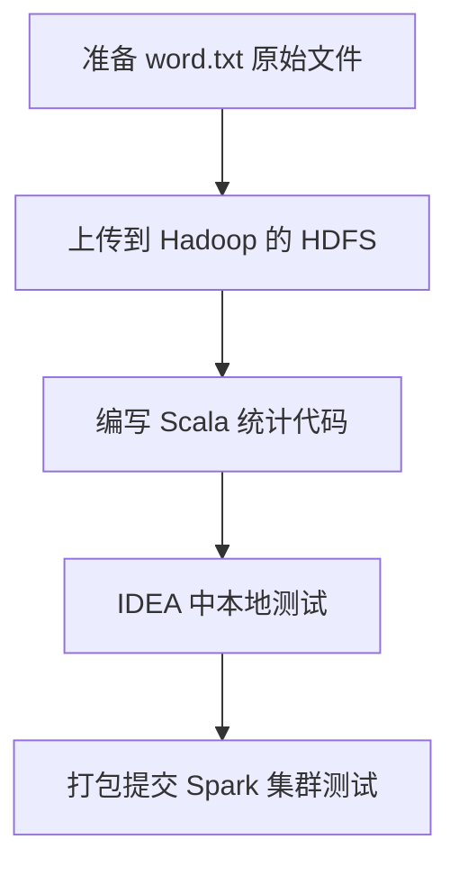
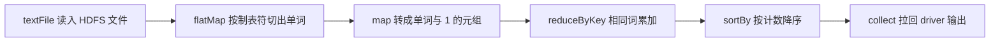

# WordCount：把第一个 Spark 统计程序在 IDEA 里跑通

环境装好、`xc-analysis` 工程导入成功之后，第一道真正的工序是在这个工程里写出并跑通 WordCount。程序本身只有十几行，麻烦都在周边：测试数据要传到 HDFS，SparkSession 要区分本地与集群两种模式，分隔符差一个字符，统计结果就会悄悄出错。这里把准备数据、上传、编码、本地测试四步走完整，集群提交展开在下一篇。

## 先给结论

- 测试共五步：准备 word.txt、上传 Hadoop、编写 Scala 统计代码、IDEA 中测试、提交 Spark 集群，前四步在下面走完，第五步集群提交放在下一课。
- 代码写在离线分析模块 xc-service-offline 的新包 `com.study.xc.first` 下，SparkSession 统一通过工具模块的 EtlEnvironment 获取，`application.properties` 不配置 `useingCluster` 时默认 local 模式。
- 统计链路：`textFile` 读 HDFS 文件，`flatMap` 按制表符切词，`map` 给每个词计 1，`reduceByKey` 相同词累加，`sortBy` 按计数降序，`collect` 触发执行并输出。
- word.txt 第一行 hi 与 java 之间是制表符而不是空格，切分必须用 `\t`，用空格切会把两个词粘成一个，结果悄悄少算。
- 跑通的标志：控制台输出降序统计结果，java 3 次、hi 2 次、scala 2 次，与文件内容人工核对一致。

## 测试路线：五步一张图

WordCount 虽小，五脏俱全，它把数据、代码、集群三个环节各过一遍，后面每一章的统计任务走的都是同一条路：



统计要读文件，而课程环境里所有分析任务的输入都统一放在 HDFS 上：本地测试时从 HDFS 读，集群提交后 executor 还是读同一个地址。数据入口一致，本地验证通过的代码提交到集群不用改一行。

## 数据准备与上传

word.txt 放在 HDFS 根目录，内容只有 11 行，大部分行是单个单词，只有第一行是 hi 和 java 两个词，中间隔着一个制表符：

```text
hi	java
hello
world
java
scala
hi
tom
java
spark
hadoop
scala
```

上传在 Hadoop 容器里完成，三条命令：

```bash
# 登录 Hadoop 容器
docker exec -it xc-online-hadoop bash
# 创建并编辑 word.txt，内容就是上面 11 行
vi word.txt
# 上传到 HDFS 根目录
hadoop fs -put word.txt /
```

上传完先确认数据到位再动代码：浏览器打开 `xc-online:50070` 的 HDFS 管理页，进文件浏览功能看到根目录下有 word.txt，数据这一环才算闭环。

## EtlEnvironment：一份代码适配两种模式

工具模块的 common 包里有一个 EtlEnvironment 对象，全工程的 SparkSession 都从它手里领。它读取 `application.properties` 里的 `useingCluster` 开关，取不到值时按 false 处理，也就是 local 模式；改成 true 则走集群分支（源码按讲义整理，包名已按中性口径改写）：

```scala
package com.study.xc.common

import java.util.Properties
import com.study.xc.utils.StrUtils
import org.apache.spark.SparkConf
import org.apache.spark.sql.SparkSession

/**
 * 根据 application.properties 构建 SparkSession
 */
object EtlEnvironment {

  def getSparkSession(appName: String): SparkSession = {
    if (isCluster) {
      // 集群模式：master 由 spark-submit 提交时指定，这里不写死
      val sparkConf: SparkConf = new SparkConf().setAppName(StrUtils.getClassName(appName))
      SparkSession.builder().config(sparkConf).enableHiveSupport().getOrCreate()
    } else {
      // 开发模式：local 本地运行
      val master = "local"
      val sparkConf = new SparkConf()
        .setMaster(master)
        .setAppName(StrUtils.getClassName(appName))
      SparkSession.builder().config(sparkConf).enableHiveSupport().getOrCreate()
    }
  }

  /**
   * 读取 useingCluster，false 或不配置默认 local 模式
   */
  def isCluster: Boolean = {
    val properties = new Properties()
    val inputStream = this.getClass.getClassLoader.getResourceAsStream("application.properties")
    properties.load(inputStream)
    properties.getProperty("useingCluster", "false").toBoolean
  }
}
```

配置文件里这个开关默认是注释掉的：

```properties
# 是否使用集群模式：true 为集群模式，false 或不配置默认 local 模式
#useingCluster=true
```

local 模式下 `setMaster("local")` 把 driver 与 executor 收进同一个 JVM，不依赖任何集群，这正是 IDEA 里能直接点 Run 的原因。集群分支刻意不调用 setMaster，master 留给 spark-submit 命令决定，同一份代码不用改就能在两种环境间切换。还有个小细节：传入的是 `this.getClass.getSimpleName`，Scala object 编译后的运行时类名带一个 `$` 后缀，StrUtils.getClassName 负责把它剥掉，任务在监控页上显示的才是干净的类名。

## WordCount 主程序

在 xc-service-offline 模块里新建包 `com.study.xc.first`，包下建 object 类 WordCount，`val spark` 定义在 object 级别供 main 方法使用：

```scala
package com.study.xc.first

import com.study.xc.common.EtlEnvironment
import org.apache.spark.sql.SparkSession

/**
 * 统计单词个数
 */
object WordCount {

  /**
   * 初始化 SparkSession
   */
  val spark: SparkSession = EtlEnvironment.getSparkSession(this.getClass.getSimpleName)

  /**
   * 主函数，程序入口
   */
  def main(args: Array[String]): Unit = {
    // 获取 SparkContext
    val sc = spark.sparkContext
    // 读取 HDFS 文件，必须写 HDFS 协议加域名和端口
    val input = sc.textFile("hdfs://xc-online-hadoop:9000/word.txt")

    // 统计单词个数
    val counts = input
      // 按行切分单词，文件以 \t 分隔
      .flatMap(line => line.split("\t"))
      // 每个单词计数为 1
      .map(word => (word, 1))
      // 相同单词的计数相加
      .reduceByKey(_ + _)
      // 按计数降序排序
      .sortBy(_._2, false)

    // 输出结果：转集合后遍历打印
    counts.collect().foreach(println(_))

    // 关闭资源
    sc.stop()
    spark.stop()
  }
}
```

统计链路里每个算子的角色可以这样拆开看：



**flatMap 而不是 map**，因为一行进来的可能是多个单词，切完要拍平成一串单词，map 只会把整行变成一个数组，后面还得再展开一次。**reduceByKey 做的是相同 key 的计数相加**，第一次遇到某词计 1，再遇到同一个词时两条记录合并成 2，相比 groupByKey 先攒齐再聚合，它少搬了一大半 Shuffle 数据。**sortBy(_._2, false)** 按二元组的第二位也就是计数排序，false 是降序，出现次数多的词排前面。前面四个都是转换算子，只描述计算并不执行，直到 collect 这个行动算子才真正触发任务，把结果拉回 driver 打印；结尾的 `sc.stop()` 与 `spark.stop()` 释放资源，读完就停。

## 在 IDEA 里跑起来看什么

在编辑器里直接 Run WordCount。首次运行要先把 xc-service-offline、xc-common-entity、xc-common-utils 几个模块完整构建一遍，Messages 窗口出现构建成功提示后才进入运行日志：SparkContext 启动、BlockManager 注册广播，`FileInputFormat: Total input paths to process : 1` 说明读到了那个文件。日志里还能看到 Spark UI 起在 4040 端口，程序结束时自动停止，这是本地模式自带的监控页。

输出结果第一次是乱序的，加不加排序取决于想不想一眼看出谁出现得最多。加上 sortBy 降序后再跑一遍，结果与人工数出来的对上：java 3 次，hi 2 次，scala 2 次，其余单词各 1 次。到这里写代码与本地验证两步完成，第五步把同一份代码送上集群，就是下一篇的内容。

## 常见误区

- **分隔符想当然用空格。** 错例：照着屏幕上「hi java」的样子写 `line.split(" ")`，制表符切不开，hi 和 java 粘成一个词，统计悄悄出错。正解：先确认原文件的真实分隔字符，这个文件以 `\t` 分隔，就写 `split("\t")`。
- **读取路径写成本地文件。** 错例：`sc.textFile("word.txt")` 或写成普通盘符路径。正解：写全 HDFS 协议 `hdfs://xc-online-hadoop:9000/word.txt`，域名来自 hosts 配置，9000 是 HDFS 文件系统端口。
- **首次运行卡住就重启 IDEA。** 错例：第一次 Run 等了几十秒以为程序死了。正解：首次编译要构建全部模块并建立索引，属正常现象，看 Messages 窗口的构建进度即可。
- **排序方向写反。** 错例：`sortBy(_._2, true)` 排出来次数最少的在最前。正解：按元组第二位排序时 true 是默认升序，想要次数多的在前用 false 降序。

## 面试可能被问到的问题

1. 面试官追问：「WordCount 里为什么用 flatMap 而不是 map？」
   答：一行文本切分后是多个单词，flatMap 对每个元素返回一个集合再把结果拍平，正好把一行变成多个词；map 是一对一映射，只会得到「单词数组」的集合，后续还要再展开一次，多一步转换。
2. 面试官追问：「reduceByKey 和 groupByKey 有什么区别，哪个更好？」
   答：两者都能按 key 聚合，但 groupByKey 会把所有相同 key 的原始记录 Shuffle 到一起再聚合，数据量大时单分区容易被撑爆；reduceByKey 在 map 端先做本地合并，Shuffle 传输的数据量小很多，能用 reduceByKey 就不用 groupByKey。
3. 面试官追问：「collect 触发了什么，为什么不能滥用？」
   答：Spark 的转换算子是惰性的，collect 属于行动算子，触发真正的作业执行并把全部结果拉回 driver。数据量大时 driver 内存会被打爆，生产上输出大结果集应该用 saveAsTextFile 这类直接落 HDFS 的方式，课程代码里也预留了这行注释。
4. 面试官追问：「同一份代码怎么在本地模式和集群模式之间切换？」
   答：把 master 的来源收敛到一处。课程工程用 EtlEnvironment 读配置文件的 useingCluster 开关，false 时 setMaster 为 local 本地调试，true 时不设置 master，由 spark-submit 的 master 参数在提交时决定，代码零改动。
5. 面试官追问：「程序结尾 sc.stop 和 spark.stop 都要调吗？」
   答：SparkContext 停止时会顺带清理底层关联的 SparkSession 资源，只调一个通常也能退出，但显式把两个都关掉能确保广播、连接池等资源干净释放，本地模式下不关还会残留进程占着端口。

## 配套资料

- 讲义：`materials/docs/08/智慧学成-第1章-环境搭建v1.0.md`，2.4 测试项目与 2.4.1 小节，word.txt 内容、EtlEnvironment 与 WordCount 代码的出处。
- Scala SDK：`materials/code/08/scala-2.11.8/`，Scala 2.11.8 发行包原件，工程编译所用的 SDK。
- 编排与脚本：`materials/code/08/_散落资料/`，docker-compose 编排文件与后续章节真实 spark-submit 调度脚本所在目录；目录内文件原始名带站点后缀，属元信息，不进正文。
- 说明：Scala 源码工程未随归档解压，代码按讲义与画面线整理，包名已按 `com.study.xc` 系改写；运行日志按课程画面摘录。
