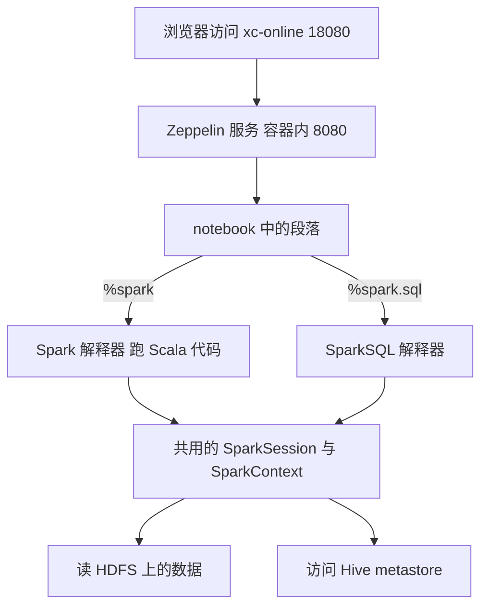

# Zeppelin：在网页笔记本里调试 Spark 程序

每改一行代码都要打包、上传、spark-submit 一整套，验证一个统计逻辑要来回等好几分钟，调试成本高得离谱。Zeppelin 把这件事搬进了浏览器：代码写在网页笔记本的段落里，点一下运行就出结果，改一行再跑一次只要几秒。这一课的目标有两个：把 Zeppelin 的 Spark 环境配起来，用它把 wordcount 原样跑一遍。

## 先给结论

- Zeppelin 是基于 Web 的交互式数据分析开源框架，笔记本形态，提供数据分析与数据可视化能力，支持的图表有表格、柱状图、饼状图、折线趋势图与散点图，查询结果默认以表格展示。
- 它靠解释器对接多种语言与组件：Scala（借助 Apache Spark）、Python、SparkSQL、Hive、HBase、Elasticsearch 以及 JDBC 协议兼容的数据库（Oracle、MySQL 等）；课程里只用 `%spark` 与 `%spark.sql` 两个解释器。
- 环境来自容器编排：xc-online-zeppelin 容器随系统自启，映射端口 18080，浏览器访问 `http://xc-online:18080/` 即可使用。
- 使用三步：Interpreter 菜单确认 Spark 配置（编排时已配好），创建一个默认解释器为 spark 的 notebook，段落里用 `%spark` 与 `%spark.sql` 写代码执行。
- wordcount 全程不用打 jar：`%spark` 里 sc 开箱即用，textFile 读 HDFS、五个算子统计、println 直接出结果；Zeppelin 编辑器不能输入中文，注释写不了。

## Zeppelin 是什么

一句话定位：给 Spark（以及其他引擎）配的一个网页笔记本。一个 notebook 由多个段落组成，每段是一个独立工作区，代码写一段、跑一段，结果和日志各自挂在段落下方，回看历史一目了然。相比命令行式的 spark-shell，它多了三样东西：代码与结果可保存、SQL 结果可一键切成柱状图饼图、notebook 可以分享给同事复用。它对接引擎的方式靠解释器，本课用到的两个分别是 `%spark`（执行 Spark Core 的 Scala 代码）与 `%spark.sql`（执行 Spark SQL），两者底层共用同一个 SparkSession：



这张图的关键在于两个解释器汇到同一个 SparkSession：SQL 里建的临时视图，Scala 段落里能接着用；Scala 里注册的数据，SQL 也能查。段落之间不是孤岛。

## 环境与 Spark 解释器配置

Zeppelin 容器在编排时设置了随 Docker 引擎自启，系统开机它就在跑，`docker ps` 里能看到 18080 端口映射。万一没有启动，到编排文件所在目录 `/opt/cdh5.14.0` 单独拉起：

```bash
# 在 docker-compose.yml 所在目录执行，路径为 /opt/cdh5.14.0
docker-compose up -d xc-online-zeppelin
```

访问 `http://xc-online:18080/` 进入首页。配置入口在右上角当前用户（匿名 anonymous）的菜单里，点 Interpreter 进入解释器列表，搜索框输入 spark 自动筛出 Spark 相关配置项。课程只关心 spark.master 一项：它决定解释器创建的 SparkSession 连向哪个集群，编排时已经指向 Spark 容器的集群地址，这里逐项确认一遍即可；Python、HBase 等其他解释器课程不启用。

## 创建 notebook，用 SparkSQL 验证链路

左侧 Notebook 菜单点 Create new note，弹窗里默认解释器已经选中 spark，名字起成 spark，点 Create 创建。notebook 的每一段都要显式声明交给哪个解释器，第一段验证 SparkSQL 通路：

```sql
%spark.sql
show databases
```

两个细节：前缀 `%spark.sql` 决定这段代码交给谁执行；语句结尾不要加分号，这里不是 hive 命令行，加了分号反而报错。点段落左侧的运行三角，状态从 READY 变成 RUNNING，几秒后查询结果以表格形式列在下方，当前只有一个默认库。

查到的库和 Hive 是不是同一份元数据？到 Hive 容器里对一遍：

```bash
# 登录 Hive 容器
docker exec -it xc-online-hive bash
# 进入 hive 命令行
hive
# 建一个测试库
create database tmp;
```

hive 命令行里 show databases 与刚才的结果一致；建出 tmp 库之后回到 Zeppelin 再跑一遍 `%spark.sql` 段落，tmp 立刻出现在列表里。原因在于两边共用同一个 Hive metastore，元数据存在 MySQL 里，任何一端建库另一端马上可见。这条链路通了，后面的统计分析才有可信的数据入口。

## 用 Spark Core 跑 wordcount

换一个段落跑 Spark Core，前缀换成 `%spark`，sc 变量开箱即用，不用自己创建 SparkContext，解释器启动时已经建好：

```scala
%spark
val input = sc.textFile("hdfs://xc-online-hadoop:9000/word.txt")
val counts = input.flatMap(line => line.split("\t")).map(word => (word, 1)).reduceByKey(_ + _).sortBy(_._2, false)
counts.collect().foreach(println(_))
```

三行代码与 IDEA 里的 WordCount 逐字对应：读 HDFS 的 word.txt，按制表符切词、计 1、相同词累加、降序排序，collect 后打印。运行后结果直接显示在段落下方，java 3 次、hi 2 次、scala 2 次。到这里调试闭环完成：改一个算子参数再点运行，几秒内看到新结果，这正是 notebook 相对打包提交的效率优势。

两个使用细节要记牢。其一，一个功能放一个段落，段落各自保存各自的代码与输出，回看历史时互不干扰。其二，这个编辑器没法输入中文，连注释都写不了，中文说明放在 notebook 之外的文档里维护。

## 常见误区

- **段落漏写解释器前缀。** 错例：直接写 show databases，Zeppelin 不知道交给谁执行，报解释器找不到。正解：每段第一行写清 `%spark` 或 `%spark.sql`。
- **按 hive 命令行的习惯加分号。** 错例：写成 `show databases;`，运行报错。正解：Zeppelin 段落里的语句不需要分号，写了反而出错。
- **试图在编辑器里写中文注释。** 错例：输入法切了半天打不出一个字。正解：编辑器不支持输入中文，注释写在段落外的文档里，代码里保持纯英文或不写。
- **把 Zeppelin 当成本地程序。** 错例：以为代码跑在自己的电脑上，改了本地文件却看不到变化。正解：解释器与 SparkSession 都运行在服务器容器里，读数据走容器网络访问 HDFS，浏览器只是操作台。

## 面试可能被问到的问题

1. 面试官追问：「Zeppelin 和 spark-shell 相比解决什么问题？」
   答：两者都是交互式执行 Spark 代码，spark-shell 是命令行 REPL，历史与结果不便保存分享；Zeppelin 是网页笔记本，段落式组织代码，输出可保存、可切图表、可分享给团队查看，适合做数据分析原型与结果展示。
2. 面试官追问：「解释器是什么概念，%spark 与 %spark.sql 的区别？」
   答：解释器是 Zeppelin 对接具体计算引擎的插件，段落第一行的前缀决定交给哪个解释器。%spark 执行 Spark Core 的 Scala 代码，%spark.sql 执行 Spark SQL，两者底层共用同一个 SparkSession，所以 SQL 的结果能继续用 Scala 处理。
3. 面试官追问：「为什么在 Zeppelin 里查到的库和 Hive 命令行里一致？」
   答：%spark.sql 背后的 SparkSession 开启了 Hive 支持，读写的是同一个 Hive metastore，元数据落在 MySQL。Zeppelin、Hive 命令行、Hue 都是 metastore 的不同客户端，元数据一处存储，多处可见。
4. 面试官追问：「哪些场景适合用 Zeppelin？」
   答：开发调试阶段快速验证统计逻辑，避免反复打包提交；数据分析阶段用 SQL 加图表产出日报周报；团队协作时 notebook 可分享复用。生产级的定时任务仍交给调度系统跑 spark-submit，Zeppelin 更多扮演交互查询与展示层。
5. 面试官追问：「Zeppelin 里的代码执行失败，日志去哪看？」
   答：每段的输出区分结果与日志两部分，报错信息直接显示在段落下方，展开能看到完整堆栈；与集群执行相关的细节还可以到 Spark 的监控页按应用查看。

## 配套资料

- 讲义：`materials/docs/08/智慧学成-第1章-环境搭建v1.0.md`，第 3 章 Zeppelin 调试 spark 程序，组件介绍、解释器配置与两段示例代码的出处。
- 编排文件：`materials/code/08/_散落资料/`，docker-compose 编排文件所在目录，Zeppelin 容器、0.8.0 版本与 18080 端口映射来自它；目录内文件原始名带站点后缀，属元信息，不进正文。
- 说明：Zeppelin 为容器内组件，课程未提供其源码包，界面操作与配置项按讲义与画面线整理；`%spark.sql` 与 Hive 命令行的对照实验步骤按课程演示补全。
