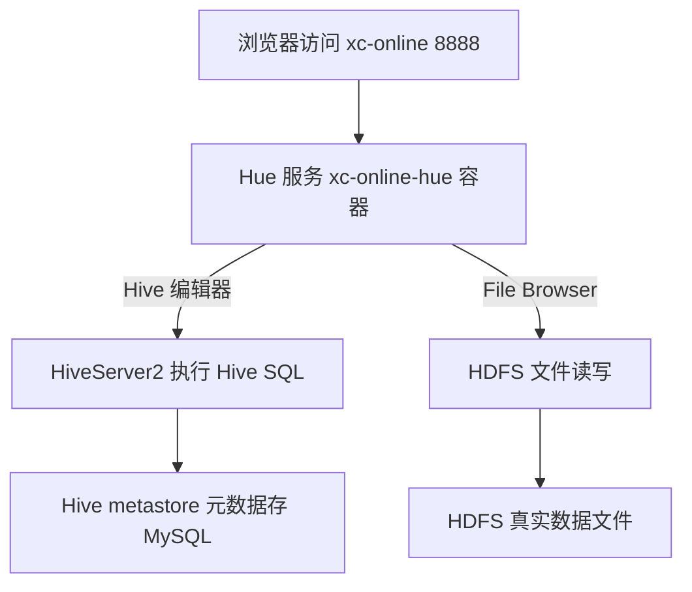

# Hue：把 Hive 与 HDFS 的日常操作搬进浏览器

到目前为止，建个库要登容器敲 hive 命令行，看个 HDFS 文件要打开 50070 页面翻目录，改个文本文件还得拼命令。Hue 把这些日常操作收进一个网页控制台：SQL 在编辑框里写，文件在页面里点。它与 Zeppelin 长得像，分工却不同：Zeppelin 侧重分析数据，Hue 侧重处理数据，一个管调试与可视化，一个管数据仓库与文件的日常运维。

## 先给结论

- Hue 是基于 Web 的交互式数据处理框架，定位是数据仓库的开源 SQL 工作台，支持 Hadoop（HDFS 文件）、Hive、HBase、MapReduce Job、Solr 以及 JDBC 协议兼容的数据库（MySQL、Oracle、PostgreSQL 等）。
- 与 Zeppelin 的分工：Zeppelin 的侧重点在分析数据（notebook 调试 Spark、结果可视化），Hue 的侧重点在处理数据（Hive SQL 工作台与 HDFS 文件管理），课程里两者配合使用。
- 环境来自容器编排：xc-online-hue 容器随系统自启，端口 8888，访问 `http://xc-online:8888/`；首次登录需要创建账号密码，虚拟机镜像里的 Hue 已初始化为用户名 hue、密码 hue。
- Hive 编辑器的自动补全相当智能，点语句前的小三角或按 `Ctrl+Enter` 执行；偶发 Database is Locked 报错不用管，再执行一次即可。
- File Browser 默认落在 `/user/hue` 目录，上传、新建、编辑、删除所见即所得；在页面里改完 word.txt，回 Zeppelin 重跑 wordcount，统计结果同步变化。

## Hue 的定位与架构

Hue 本身不做计算也不存数据，它是一个聚合操作台，把请求转给背后真正的组件。理解这一点，界面就好认了：左上角是浏览类型切换，可以按文档、文件、表等维度浏览，这里的文件就是 HDFS 上的文件，表就是 Hive metastore 里的表；工作区是 SQL 编辑区，下方是查询结果与查询历史。



容器编排时已经把 Hive 与 HDFS 的连接配好，登录即可使用；界面上列出的其他数据源没有编排配置，想用要先在 Hue 的配置文件里补上连接参数，配置好了才会出现在数据源列表里。

## 登录与首次初始化

容器随编排自启，`docker ps` 能看到 8888 端口映射；万一没有启动，到编排文件所在目录单独拉起：

```bash
# 在 docker-compose.yml 所在目录执行，路径为 /opt/cdh5.14.0
docker-compose up -d xc-online-hue
```

浏览器打开 `http://xc-online:8888/`。第一次登录会出现创建账号密码的界面，自己设一套并记牢；课程虚拟机镜像里的 Hue 已经初始化好，用户名 hue、密码 hue，直接登录进工作区。密码一旦遗忘只能重置容器重新初始化账号，之前在 Hue 里的操作记录会全部丢失，所以账号密码要记进自己的文档。

## 用 Hue 执行 Hive SQL

工作区输入 HiveQL，库表字段名敲前几个字母就有补全提示，执行有两种方式：点语句前的小三角，或按 `Ctrl+Enter`。演示两步，把之前的测试库删掉，再建一个 tmp 库：

```sql
CREATE DATABASE tmp;
```

执行后左侧库表树点一下刷新按钮，新库就出现了；点开一个空库，里面还没有任何表。右下角的 Query History 保存了每一条执行过的语句，回看与复用都方便。两个使用感受：一是补全确实智能，写 join 时字段都能对出来；二是偶发 Database is Locked 的报错，这是元数据并发操作产生的临时锁，不用管它，再执行一次就过。在这里建的库，Hive 命令行与 Zeppelin 的 `%spark.sql` 同样可见，三个客户端背后是同一个 metastore。

## 用 Hue 管理 HDFS 文件

顶部切到 Files 就是 HDFS 的文件管理器，默认打开 `/user/hue` 目录，点路径栏的斜杠切到根目录，点目录名或组件入口都能跳转，来回切换很自由。操作按钮集中在页面上方：Upload 上传文件，落点就是当前所在目录；New 用来新建文件或文件夹，两者图标一眼可辨；删除选中条目后点 delete，弹窗确认即可。

把之前做单词统计用的 word.txt 打开看文件详情。默认是文本浏览视图，也能切到二进制视图，只是基本用不上；页面上几个按钮各司其职：Edit file 进入编辑模式修改内容，View file 回到只读查看，Download 把文件下载到本地，还有按钮定位文件在目录树中的位置，页面右上角可以刷新。HDFS 是多人共用的，别人可能刚改过文件，看之前刷新一下再看。

## 闭环验证：Hue 改文件，Spark 结果跟着变

最有说服力的演示是把两个工具串起来。在 Hue 的编辑模式里打开 word.txt，当前内容统计出来是 java 3 次、hi 2 次、scala 2 次。在文件末尾追加一行 java、一行 hi、一行 scala，再补一个新单词 test，保存。切回 Zeppelin，重跑 wordcount 那一段，输出变成 java 4 次、hi 3 次、scala 3 次，并且多出了 test。追加的几行如下：

```text
java
hi
scala
test
```

这个闭环说明两件事：Hue 编辑的是 HDFS 上的真实文件，不是页面上的副本；Spark 读的与 Hue 写的是同一份数据。日常运维里用 Hue 改数据文件、补传文件、检查任务输出，比命令行直观得多，上手零门槛，所见即所得。

## 常见误区

- **密码忘了就反复猜。** 错例：Hue 账号密码试几次登不进就搁置不管。正解：Hue 没有找回流程，只能重置容器重新初始化账号，此前的操作记录全部丢失，密码务必记档。
- **页面里找不到未配置的数据源。** 错例：期望左上角能直接连 MySQL 操作。正解：编排只配置了 Hive 与 HDFS，其他数据源要在 Hue 配置文件里补齐后才会出现。
- **把 Database is Locked 当成严重故障。** 错例：一报锁就重启容器排查半天。正解：这是元数据并发操作的临时锁，重试执行即可。
- **上传文件不看当前目录。** 错例：在 /user/hue 下点 Upload，以为文件会传到根目录。正解：上传落点就是当前所在目录，先切目录再上传。

## 面试可能被问到的问题

1. 面试官追问：「Hue 和 Zeppelin 功能有重叠，实际项目里怎么选？」
   答：两者定位不同。Hue 是数据仓库操作台，强在 Hive SQL 工作台与 HDFS 文件管理，适合数仓开发与日常运维；Zeppelin 是分析笔记本，强在多解释器与图表可视化，适合 Spark 逻辑调试与数据探索。数仓维护选 Hue，交互分析选 Zeppelin，两者并存并不冲突。
2. 面试官追问：「Hue 是怎么连上 Hive 与 HDFS 的？」
   答：对 Hive，Hue 通过 Thrift/JDBC 协议连接 HiveServer2 提交 SQL，元数据仍走 Hive metastore；对 HDFS，走 HDFS 的 HTTP 访问接口（WebHDFS）读写文件。课程环境里这些连接参数在容器编排时已经配置完成。
3. 面试官追问：「Hue 的账号体系和 Hadoop 的用户是什么关系？」
   答：Hue 有自己的登录账号体系，首次登录创建的账号在 Hue 内使用；它对 HDFS 与 Hive 的实际操作以配置好的代理用户身份执行，文件属主与权限校验仍遵循 HDFS 规则，所以页面上看到的文件权限与命令行一致。
4. 面试官追问：「为什么在 Hue 里建的库，其他工具也看得到？」
   答：Hue 执行的 Hive SQL 由 HiveServer2 落到同一个 metastore，元数据存储在 MySQL，Hive 命令行、Zeppelin 的 SparkSQL、Hue 都是 metastore 的客户端，一处修改处处可见。
5. 面试官追问：「Hue 适合给哪些角色使用？」
   答：数仓开发用它建库建表、跑临时查询、核对结果表；运维用它管理 HDFS 文件、补传数据、检查任务输出；业务人员用它浏览数据并导出结果，不需要命令行基础。

## 配套资料

- 讲义：`materials/docs/08/智慧学成-第1章-环境搭建v1.0.md`，第 4 章 hue，组件介绍、登录说明与 hive/hdfs 操作步骤的出处。
- 编排文件：`materials/code/08/_散落资料/`，docker-compose 编排文件所在目录，Hue 容器、hue 3.9.0 版本与 8888 端口映射来自它；目录内文件原始名带站点后缀，属元信息，不进正文。
- 说明：Hue 为容器内组件，课程未提供其源码包，界面操作与账号说明按讲义与画面线整理；wordcount 交叉验证演示所用代码同上一篇 Zeppelin 段落。
