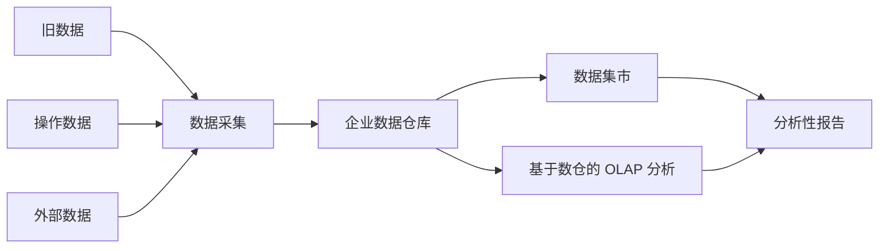

# 数据仓库是什么：定义、OLTP 与 OLAP 之分、统计为什么要单独建仓

课程访问日志每天几十万条地往业务库里灌，运营拿着统计原型提需求：要看每天的课程访问量、每月的课程购买量、本周的热门课程。直接在业务库上写 SQL 试一下就会发现不对劲：聚合查询把线上交易拖得卡顿，课程、订单、用户的数据分散在几个库里，口径还各不相同。这一课把「数据仓库」这个概念立起来，后面的采集、清洗、分析全部建立在它上面。

## 先给结论

- 数据仓库是面向主题的、集成的、相对稳定的、反映历史变化的数据集合，用途只有一个：支持管理决策。
- 数仓与业务库的分工，本质是 OLAP 与 OLTP 的分工：OLTP 管交易，要快；OLAP 管分析，要深。
- 统计分析要单独建数仓，三个理由：不拖垮线上交易、把跨系统的数据集成到统一口径、把业务库放不下的历史数据存住。
- 本阶段五个学习目标里，前四个是理解级，唯一「能够使用」级的是用 Hive 创建数据仓库，这是后续所有采集与分析任务的前提。

## 数据仓库的定义与定位

数据仓库概念的创始人 Inmon 在《建立数据仓库》一书里给出的定义是：数据仓库（Data Warehouse）是一个面向主题的（Subject Oriented）、集成的（Integrated）、相对稳定的（Non-Volatile）、反映历史变化（Time Variant）的数据集合，用于支持管理决策（Decision Making Support）。这四个修饰词不是修辞，每一个都对应一类具体的工程动作，下一课会结合在线教育平台的场景逐个拆开。

定义里那句「支持管理决策」点明了数仓的定位：它是决策支持系统的基础设施。决策支持系统基于数据仓库做联机分析处理（OLAP），常用技术有 HDFS、HBase、Hive、Spark，本项目落地用的正是 Hive 加 Spark 这一套。整条链路可以画成一张企业数据仓库架构图：



这张图在讲数据从哪里来、到哪里去：旧数据、操作数据、外部数据三类源头经过采集进入企业数据仓库，分析在仓上进行，结果一路生成分析性报告。关键路径是从「采集」到「数据仓库」这一段，源头数据一旦落仓，后面所有报表都从仓里取数，不再回头碰业务系统。图里还出现了数据集市：数仓往下可以细分出面向具体分析场景的数据子集，集市上的数据更聚焦，报表通常从集市取数。按课程的口径，重点放在数据仓库本身，集市知道这个概念即可。

## OLTP 与 OLAP：两种处理方式

OLTP（On-Line Transaction Processing）即联机事务处理，也称为面向交易的处理过程。它的基本特征是前台接收的用户数据立即传送到计算中心处理，并在很短的时间内给出结果，是对用户操作快速响应的方式之一。ERP 系统、CRM 系统、互联网电商系统都是典型的 OLTP 系统，特点是事务操作频繁、数据量小。

OLAP（On-Line Analytical Processing）即联机分析处理，有时也称为决策支持系统（DSS）。它支持复杂的分析操作，侧重决策支持，并提供直观易懂的查询结果。这类系统没有事务性操作，主要是查询操作，数据量大。

两种系统的差别可以用一个付款场景感受：在电商网站付款，钱付过去两小时才告诉你是否成功，人都要疯了，所以交易侧必须毫秒级响应；而「今年哪个月成交额最高」这类查询晚几秒出结果，没人会在意。两者的详细对比在讲义里是一张六行的表：

| 对比项目 | OLTP | OLAP |
|---|---|---|
| 功能 | 面向交易的事务处理 | 面向分析查询 |
| 设计 | 面向业务 | 面向主题 |
| 数据 | 最新数据，二维数据 | 历史数据，多维数据 |
| 存储 | M、G 量级 | T、P、E 量级 |
| 响应时间 | 快 | 慢 |
| 用户 | 业务操作人员 | 管理决策人员 |

这个对比在阶段四的 Hadoop 课程里铺过底子，现在换到在线教育平台统计的语境再对一遍：被分析的在线教育平台是一个标准的 OLTP 系统，学员下单、支付、选课都由业务库毫秒级响应，数据停留在 M、G 量级：

```sql
-- OLTP 侧：单笔订单状态更新，毫秒级返回（按本课写法补全的示例）
UPDATE course_orders SET status = '401002' WHERE order_number = '202611070001';
```

而统计系统要回答的是「过去一年每天的课程访问量是多少」，一次扫描一整年的历史明细，落点是 T 级以上的数据量：

```sql
-- OLAP 侧：按天聚合全年课程访问量，扫的是历史明细（course_visit_fact 为讲义真实事实表）
SELECT days, count(1) AS visit_num
FROM data_course.course_visit_fact
WHERE years = '2019'
GROUP BY days;
```

一条是针对一行记录的即时更新，一条是对整张历史明细表的聚合扫描，两类诉求塞进同一个库里互相拖累，这就是把它们分开的理由。

## 为什么统计分析要单独建数仓

**第一，业务库为交易而生，扛不住分析型查询。** 业务库的表结构按业务流程设计，索引为单笔操作优化。统计要的是全表扫描加多维聚合，一条大查询就能把线上下单拖成超时。把分析流量切到独立的数仓，业务库只服务交易。

**第二，统计要的数据是跨系统的，业务库给不了。** 课程访问量涉及访问日志，课程购买量涉及订单、课程、用户、机构四类数据，它们分散在在线教育平台的几个库甚至几个系统里，格式与编码互不一致。数仓通过采集把它们集成到统一口径下，分析才有干净的数据可用。

**第三，历史数据在业务库里放不住。** 趋势分析要的是按年沉淀的历史数据，业务库出于性能考虑会清理、归档旧数据。数仓相对稳定、反映历史变化，恰好接住这一部分。三点合起来：数仓不是业务库的替代品，而是专门为统计分析准备的数据集合。

## 五个学习目标与第一个动手动作

本章的学习目标有五个：理解数据仓库的概念，理解数据仓库的特点，理解星型建模并明白本项目为什么采用星型模型，理解数据分层的好处，以及能够使用 Hive 创建数据仓库。前四个是理解级，知道是什么、为什么即可；第五个是「能够使用」，必须动手，因为后面的采集、分析、落地到业务库的数据全部保存在数据仓库中，仓建不起来，后面的课程没法进行。

建仓的第一步是建库，数仓面向主题，库就按主题切分。课程讲义里给出的建库语句如下，五个库与功能模块的口径一一对应：

```sql
-- 数据库分层创建，主题与功能模块一一对应
create database data_agency;    -- 机构主题：机构统计模块
create database data_course;    -- 课程主题：课程统计模块
create database data_dimen;     -- 维度库：各主题共用的维度表
create database data_platform;  -- 平台库：平台看板相关
create database data_subject;   -- 学科库：热门学科排名等
```

这五条语句在 Hive 里执行完，数据仓库的骨架就有了，后续每张事实表、每张维度表都会落到其中某个库。

## 常见误区

- **把数仓当成「更大的数据库」。** 错例：以为数仓就是容量放大版的 MySQL，装进去就算完。正解：区别不在规模在用途，数据库面向事务捕获数据，数仓面向主题组织数据供分析，表结构设计思路完全不同。
- **认为 OLAP 响应慢是系统缺陷。** 错例：拿交易系统的响应标准去要求分析查询。正解：OLAP 面向决策支持，T、P、E 量级的数据上跑复杂分析，秒级甚至分钟级返回是正常水位，牺牲一点时效换分析深度是设计使然。
- **把数据集市等同于数据仓库。** 错例：建了几个面向部门的库就宣称建了数仓。正解：集市是面向具体分析场景的数据子集，分析性报告背后的主仓才是根基，集市服务于局部的取数效率。
- **在 OLTP 与 OLAP 里二选一。** 错例：为了「架构先进」把交易也搬进数仓。正解：两者是上下游关系，业务库捕获数据，定期采集进数仓做分析，并存且互补。

## 面试可能被问到的问题

1. 面试官追问：「什么是数据仓库？一句话说清它和数据库的区别。」
   答：数据仓库是面向主题的、集成的、相对稳定的、反映历史变化的数据集合，用于支持管理决策。数据库为捕获数据而设计，服务日常交易；数仓为分析数据而设计，服务管理决策，两者分工对应 OLTP 与 OLAP 的分工。
2. 面试官追问：「OLTP 和 OLAP 有什么区别？分别举几个典型系统。」
   答：OLTP 是联机事务处理，面向交易，响应快、事务频繁、数据量在 M 和 G 量级，典型如 ERP、CRM、电商交易系统；OLAP 是联机分析处理，面向分析，无事务操作、数据量大、存历史多维数据，典型如各类 BI 报表与数仓分析平台。
3. 面试官追问：「为什么统计分析不直接在业务库上做，非要建一个数仓？」
   答：三个原因：分析型的大查询会拖垮线上交易；统计所需的数据分散在多个系统且口径不一，需要集成；趋势分析依赖的历史数据业务库留不住。数仓把这三件事一次性解决。
4. 面试官追问：「数据集市和数据仓库是什么关系？」
   答：数仓是企业级的数据集合，集市是数仓细分开来的、面向具体分析场景的数据子集。报表常从集市取数以获得更好的响应，但集市的数据源头仍是数仓，两者是整体与局部的关系。
5. 面试官追问：「你们的数仓用什么技术落地？为什么不直接用 MySQL？」
   答：基于 Hadoop 生态，用 Hive 建仓，底层存储是 HDFS，分析用 Spark。MySQL 单机存储与计算能力撑不住 T 级历史明细的聚合扫描，Hive 的类 SQL 降低使用门槛，HDFS 与 Spark 负责大规模存储与分布式计算。

## 配套资料

- 讲义：`materials/docs/08/智慧学成-第2章-数据仓库.md`，1.1 数据仓库概念、1.2 OLTP 和 OLAP 区别对比表、4.3 按主题建库语句的出处。
- 代码：`materials/code/08/_散落资料/`，Hive 建库建表 SQL 汇总（`hive.sql`）存放处；目录内原始文件名带站点后缀，属元信息，正文一律不引用。
- 说明：OLTP 侧订单更新语句为按本课写法补全的示例；`course_visit_fact` 建表与五个主题库语句为讲义真实内容；示例站点以 example.com 占位。
