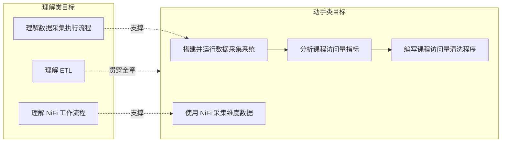

# ETL 学习目标：从这一课开始以动手为主

仓库建完了，但五库三十八张表全是空的。第二章 ETL 要干的事一句话说清：把在线教育平台的数据源源不断采进仓里，并加工成统计系统要用的样子。开章先把七个学习目标摆出来分个类，哪些要理解、哪些要动手跑，心里有谱，后面十几个小节才知道每一步在给哪个目标打工。

## 先给结论

- 七个目标分两档：理解类的三个，理解 ETL、理解数据采集执行流程、理解 NiFi 的工作流程；动手类的四个，搭建并运行数据采集系统、使用 NiFi 采集维度数据、分析课程访问量指标、编写课程访问量 Spark 清洗程序。
- 全章数据流向一句话：数据源 → ETL → 数据仓库，采集系统与 NiFi 负责前半段，Spark 清洗程序负责后半段。
- 数据采集系统是课程自研的教学系统，仅供学习使用，但贴合企业真实开发，麻雀虽小，五脏俱全。
- NiFi 是大数据的数据流向处理工具，本阶段先掌握基本组件的使用，再用它把维度数据采进 data_dimen。
- 课程访问量指标在数据仓库章节只做过粗分析，这一章要细到能直接支撑清洗程序编码。

## 七个目标分两档

**理解类目标三个。** 理解 ETL，明白 ETL 是什么、怎么贯穿到项目里；理解数据采集的执行流程，知道企业里数据采集是怎样一个流程；理解 NiFi 的工作流程。NiFi 是这一章的新概念，它是一个大数据的数据流向处理工具，需要掌握其基本组件的使用。

**动手类目标四个。** 搭建并运行数据采集系统，这套系统是课程自己研发的，仅供学习使用，但贴合企业真实开发；使用 NiFi 采集维度数据，维度数据被各主题使用且跨主题使用，必须先把它们采集进仓；分析课程访问量指标，数据仓库章节已有简单分析，这里要做深入分析，明白具体做哪些事；编写课程访问量的清洗程序，有了指标才有写程序的依据。

目标与目标之间的依赖用一张图看清：



图里的主线是采集在前、清洗在后：采集系统与 NiFi 把原始数据送进 ODS 与维度表，指标分析定出口径，清洗程序按口径把明细加工成事实表。G6 到 G7 的箭头最重要，先有口径再有代码，顺序反了必返工。

## 为什么动手比重陡增

数据仓库那一天的五个目标全是理解与建仓操作，属于铺垫；从这一章起，理解的东西明显变少，动手实践的东西明显变多。原因直白：仓建好了，表是空的，后续每一课的产出都是一段能跑起来的流程或程序，采集系统的搭建、NiFi 流程的编排、维度数据的入库、清洗任务的提交，全都要求真跑出结果。

这也给了一条硬要求：一定要动手把任务跑起来。概念课可以听完就懂，工程课不动手，到后面的分析环节手上没有数据，只能干看别人的结果。

## 两个新面孔

**数据采集系统。** 项目自研的教学系统，承担业务库数据与埋点数据的采集。它麻雀虽小，五脏俱全，采集流程与企业在生产中的做法一致，学的是流程与思路，后续小节会给出搭建与运行步骤。

**NiFi。** 大数据的数据流向处理工具，界面上拖拽处理器、连成数据流，就能完成采集与分发。课程用它做维度数据采集，资料包里已有编排好的流程定义，如课程分类维度、用户维度的采集流程。它的流程概念是理解类目标，采集实操是动手类目标，两者挨在一起讲。

## 目标的落点是这些表

动手目标最后都落到具体的库表上。维度采集的落点之一是课程分类维度表：

```sql
CREATE EXTERNAL TABLE
IF NOT EXISTS data_dimen.course_category_dim
(course_category_dim_id String,
name String,
label String,
parentid String,
isshow String,
orderby String,
isleaf String)
ROW FORMAT DELIMITED FIELDS TERMINATED BY '\t'
STORED AS TEXTFILE
location '/user/hive/external/data_dimen/course_category_dim';
```

清洗程序的落点是课程访问量事实表，ODS 原始数据经判重、补维度后写入它的按天分区：

```sql
CREATE EXTERNAL TABLE
IF NOT EXISTS data_course.course_visit_fact
(course_visit_fact_id String,
course_dim_id String,
time_dim_id String,
area_dim_id String,
company_dim_id String,
client_ip String,
client_sessionid String,
client_type String,
visit_time bigint)
PARTITIONED BY (years String,months String,days String)
ROW FORMAT DELIMITED FIELDS TERMINATED BY '\t'
STORED AS PARQUET
location '/user/hive/external/data_course/course_visit_fact';
```

任务跑起来的形态是带日期参数的 spark-submit 提交，下面以课程购买量任务为例（脚本按课程资料整理，类名已按 `com.study.xc` 系中性化）：

```bash
#!/usr/bin/env bash
# 单个清洗任务的提交形态：日期做参数，成功失败都给出提示
if [[ $1 != "" ]];then
    TD_DATE=$1
else
    echo "[===no params input,default date_info is yesterday===]"
    exit 1
fi
/opt/spark/bin/spark-submit \
  --master spark://xc-online-spark:7077 \
  --class com.study.xc.analysis.buy.CourseBuyHiveToFact \
  /opt/run/jars/xc-service-offline-jar-with-dependencies.jar ${TD_DATE}

if [[ $? == 0 ]];then
    echo "[===spark-submit process success===]"
else
    echo "[===spark-submit process failed===]"
    exit 0
fi
```

日期参数决定了任务处理哪一天的分区，调度系统按天串起多个这样的任务，就构成完整的数据加工链路。

## 常见误区

- **把学习目标当目录浏览。** 错例：七条目标扫一眼就翻下一课。正解：动手类目标占四条，每一课结束都应有能复跑的任务或数据，跑不出来等于没学。
- **认为采集系统是生产级产品。** 错例：拿企业级采集平台的功能清单去对照它。正解：它是仅供学习使用的自研系统，胜在贴合企业流程，学的是采集这件事怎么做。
- **跳过指标分析直接写清洗程序。** 错例：拿到需求就开写代码。正解：怎么算一次访问、怎么判重、怎么过滤爬虫，口径没定清，程序写得再快也是返工。
- **以为维度数据不用采。** 错例：只关心事实数据，维度表空着。正解：维度表没数据，事实表的维度外键关联不上，清洗与统计全部卡住。

## 面试可能被问到的问题

1. 面试官追问：「你们项目的数据采集是怎么做的？」
   答：分两路，业务库数据与埋点日志由自研采集系统按流程采入 ODS 层并按天落 HDFS 目录，维度数据用 NiFi 编排流程采集入库，执行流程先讲清楚再动手实现。
2. 面试官追问：「NiFi 是什么，为什么用它采集维度数据？」
   答：NiFi 是大数据的数据流向处理工具，通过可视化拖拽处理器连成数据流完成采集与分发。维度数据来自业务库的字典与基础表，表多、来源杂，用 NiFi 编排一次流程即可反复执行。
3. 面试官追问：「课程访问量指标分析要产出什么？」
   答：统计口径与数据模型。指标是课程访问量，维度是时间且分周月年三级；判重靠 session_id 加 client_ip，user_agent 过滤爬虫；采集字段与 HDFS 按天存储格式都在这一步定清。
4. 面试官追问：「清洗程序为什么用 Spark 写？」
   答：ODS 明细数据量大，Spark 内存计算适合批量清洗与维度关联，输出按分区写 Parquet，与 Hive 数仓表无缝对接，任务用 spark-submit 按天调度。
5. 面试官追问：「学习目标里理解与动手的比例变化说明了什么？」
   答：前期打地基靠理解，概念、建模、分层；仓库建成后价值要靠数据与程序体现，所以目标转向动手实践，要求每个环节都能跑起来。

## 配套资料

- 讲义：`materials/docs/08/智慧学成-第2章-数据仓库.md`，本章讲义，分层与建表口径的出处；ETL 学习目标条目按视频画面线整理。
- 代码：`materials/code/08/_散落资料/`，维度采集与整体流程的 NiFi 编排 xml、spark-submit 任务脚本所在目录；建表语句取自同目录建表 SQL 汇总；文件原始名带站点后缀，属元信息，不进正文。
- 说明：数据采集系统为课程自研教学系统，无独立源码包，功能描述按画面线整理；spark-submit 脚本以课程购买量任务为例，类名已按 `com.study.xc` 系中性改写。
