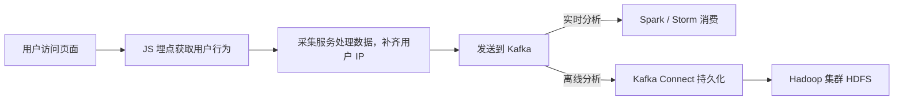

# 课程访问量的数据从哪来：采集系统的流程与搭建

维度表和数据仓库分层设计好了，仓库本身还是空的。在线教育平台的用户每天在访问课程页面，这些行为数据不会自己长进 Hadoop，中间必须有一条专门的管道：页面把行为报出来，服务接住，消息中转，最后落进分布式存储。这条管道就是采集系统。这一课把采集系统的执行流程讲清楚，再把环境搭起来，为后面测试采集课程访问量做准备。

## 先给结论

- 采集系统由三个部分组成：web 前端的 JS 埋点、采集服务、Kafka Connector（kafka-to-hdfs 插件），三者相互依赖，缺了哪一环数据都过不去。
- 采集系统采集的是用户行为数据，课程访问量只是用户行为中的一种，测试环节测它，但系统的能力不止于此。
- 浏览器里的埋点拿不到用户 IP，补 IP 这一步由采集服务完成，补齐后才发往 Kafka。
- Kafka 自己不能把消息写到 Hadoop，离线分析这条线中间要加一层 Kafka Connect 做持久化转换。
- 搭建共三步：配置 Kafka-Connector、部署采集系统、部署 web 前端，配套文档各有一份。

## 采集系统在数据管道里的位置

对数据的抽取，通常会搭建专业的数据采集系统来完成各种源数据的采集。本项目自研了一套采集系统，职责是接收用户的行为数据。测试环节采集的是课程访问量，这只是一个用来验证链路的指标：用户访问、浏览、点选都属于行为数据，系统按行为数据的通用结构设计，课程访问量是其中被统计得最早的一类。

整条链路的执行流程如下，这张图在讲数据从页面到 Hadoop 的完整路径：



从左到右看关键路径：用户产生行为的前提是访问页面，页面里的 JS 埋点把行为取到并发送给采集服务；Kafka 是分叉点，实时分析直接消费消息，走 Spark、Storm 这类流式引擎，离线分析这条线则多一个 Kafka Connect，由它把 Kafka 里的消息持久化到 Hadoop，后面的统计分析直接从 Hadoop 取数。本项目以离线分析为主，课程访问量就落在这一条线上。

**埋点与采集服务是分工关系。** 埋点脚本跑在浏览器里，受浏览器沙箱限制，拿不到用户的真实 IP；采集服务是一个独立部署的接收端，收到埋点上报后，根据这次访问把用户 IP 补进数据里，再统一发往 Kafka。经过这一步，Kafka 里流转的每条行为数据字段才是完整的，下游分析不用再操心 IP 缺失的问题。

**Kafka Connect 是离线这条线的最后一跳。** Kafka 的定位是消息中转，本身不具备把消息写到 HDFS 的能力。课程使用 Kafka Connect 框架，配一个自研的 kafka-to-hdfs 插件：插件以 Sink Connector 的形式订阅指定 topic，攒够一批消息后按天建目录写入 HDFS，攒批大小由 `flush.size` 控制。

## 搭建采集系统的三个步骤

搭建步骤一共三步：第一步配置 Kafka-Connector（kafka-to-hdfs）；第二步部署采集系统；第三步部署 web 前端。三者的关系是：前端负责产生数据，采集服务负责接收，Connector 负责落盘，共同组成完整的采集系统。课程资料里有两份独立文档：采集系统部署使用说明、Kafka-Connector 使用文档，代码怎么写不是重点，重点是把配置走通。

**第一步，把 kafka-to-hdfs 插件装进 Kafka 容器。** 资料里提供了打包好的插件依赖，上传服务器解包后，复制进 Kafka 安装目录的 `plugins` 目录：

```bash
# 在服务器上创建目录并解包插件
mkdir -p /opt/jars/kafka-to-hdfs
unzip kafka-to-hdfs.zip -d /opt/jars/kafka-to-hdfs
# 复制进 Kafka 容器的 plugins 目录
docker cp /opt/jars/kafka-to-hdfs xc-online-kafka:/opt/kafka_2.11-2.2.0/plugins/
```

插件放好之后还要在 Connect 的配置文件里登记。进入容器，编辑 `config/connect-distributed.properties`，改三处配置：

```properties
# 转换器保持字符串格式
key.converter=org.apache.kafka.connect.storage.StringConverter
value.converter=org.apache.kafka.connect.storage.StringConverter
# 消息不带 schema，关闭 schema 转换
key.converter.schemas.enable=false
value.converter.schemas.enable=false
# 新增配置，指定自定义 Connector 插件目录，使用绝对路径
plugin.path=/opt/kafka_2.11-2.2.0/plugins/kafka-to-hdfs
```

配置写错一个目录名，Connect 就加载不到插件，后面提交 Connector 时会直接报找不到类，这里宁可复制粘贴也不要手敲。确认配置后启动 Connect，测试期建议用前台方式启动，日志里没有报错、正常完成加载之后再转后台：

```bash
cd /opt/kafka_2.11-2.2.0
bin/connect-distributed.sh config/connect-distributed.properties
```

**Connect 起来后，用 REST 接口提交 Connector 实例。** 向 Kafka Connect 的 8083 端口发一个 POST 请求，把插件订阅的 topic、HDFS 地址、落盘路径一次性告诉它（包名已按 `com.study.xc` 系中性化）：

```json
POST http://xc-online-kafka:8083/connectors
{
  "name": "visit_topic",
  "config": {
    "connector.class": "com.study.xc.bigdata.common.kafka_to_hdfs.hdfs.HdfsSinkConnector",
    "tasks.max": "1",
    "topics": "visit_topic",
    "hdfs.url": "hdfs://xc-online-hadoop:9000/",
    "flush.size": "100",
    "expression": "yyyy-MM-dd",
    "hdfs.path": "/user/hive/external/data_course/course_visit_source/",
    "name": "visit_topic"
  }
}
```

返回原信息且无报错即提交成功，也可以到 Connect 日志里确认加载的 connector class。几个参数值得留意：`topics` 对应埋点数据所在的 topic；`expression` 指定按天格式化目录；`hdfs.path` 是 HDFS 上的落盘根目录，与数仓 ODS 层的外部表位置对齐；`flush.size` 是攒批条数，攒够才写一次文件。

**第二步，部署采集系统。** 采集服务的可运行包随课程资料提供，上传到服务器后直接启动。它依赖的 HDFS、ZooKeeper、Kafka、Kafka Connect 都已经以容器方式运行，所以只要把服务拉起来即可。部署支持单机与负载两种方式，单机方式便于快速测试，负载方式借助 Nginx 分流，测试阶段用单机就够了：

```bash
# 单机方式启动采集服务（本课无配套源码包，命令为按本课写法补全）
java -jar xc-collect-service.jar
```

启动日志里看到内置 Web 容器完成初始化、没有报错，采集服务就绪。

**第三步，部署 web 前端。** 在线教育平台的页面是静态前端，同样上传后直接启动。页面里已经埋好了埋点脚本，前端一起，三个组件全部就位，环境搭建就完成了。

## 常见误区

- **把采集服务当成整条管道的全部。** 错例：以为启动了采集服务就能在 HDFS 看到数据。正解：采集服务只负责接数据、补 IP、发 Kafka，落盘靠 Kafka Connect 插件，前端埋点负责产生数据，三步哪步没做链路都不通。
- **插件目录名手敲出错。** 错例：`plugin.path` 指向的目录名拼写与实际不符。正解：目录名直接复制，插件放错位置或路径写错，Connect 启动时加载不到插件，提交 Connector 会报找不到实现类。
- **用 localhost 提交 Connector。** 错例：照文档把请求发到 `http://localhost:8083/connectors`。正解：文档地址是站在服务本机视角写的，Connect 跑在服务器容器里，要从宿主机访问就换成配置的域名 `xc-online-kafka:8083`。
- **前台日志还没确认就转后台。** 错例：启动命令一敲就挂到后台跑。正解：测试期用前台启动，日志里确认无报错、插件加载完成，再切换为后台方式，出问题时也更容易定位。

## 面试可能被问到的问题

1. 面试官追问：「你们的行为数据是怎么从页面落到数据仓库的？」
   答：页面里的 JS 埋点采集用户行为，上报给采集服务；采集服务补齐埋点拿不到的用户 IP 后发到 Kafka；离线这条线用 Kafka Connect 加自研的 kafka-to-hdfs 插件把消息按天落盘到 HDFS，数仓 ODS 层的外部表直接指向这个目录，后续清洗统计从 HDFS 取数。
2. 面试官追问：「为什么埋点不直接带上用户 IP，要采集服务来补？」
   答：埋点脚本运行在浏览器里，拿不到用户的真实公网 IP；采集服务接收的是一次真实的 HTTP 请求，从请求里取 IP 最可靠，补齐后再发 Kafka，保证下游拿到的数据字段完整。
3. 面试官追问：「Kafka 的数据怎么进 Hadoop 的？为什么中间还要一层 Connect？」
   答：Kafka 只做消息中转，不具备写 HDFS 的能力。Kafka Connect 是 Kafka 自带的数据集成框架，以 Sink Connector 的形式订阅 topic，按 flush.size 攒批、按天建目录写入 HDFS，实现持久化与解耦，实时分析和离线分析共用同一个 topic 互不影响。
4. 面试官追问：「实时分析和离线分析在哪里分开？」
   答：在 Kafka 处分开。实时分析直接消费 Kafka 消息，用 Spark Streaming 这类流式引擎；离线分析经过 Kafka Connect 先落 HDFS，再进 Hive 做统计分析。课程访问量属于离线分析场景。
5. 面试官追问：「采集系统搭建有哪些步骤，出问题怎么排查？」
   答：三步，配置 Kafka-Connector 插件、部署采集服务、部署 web 前端。排查顺序按数据流向倒着查：HDFS 目录有没有文件，Connect 日志里 Connector 是否在运行，Kafka topic 里有没有消息，采集服务日志有没有收到上报，前端请求有没有发出，哪一环断了问题就在哪一环。

## 配套资料

- 讲义：`materials/docs/04/智慧学成-第2章-ETL.md`，第 3 节采集系统（采集系统介绍、采集系统搭建、测试采集课程访问量）为本课内容出处。
- 讲义：`materials/docs/08/智慧学成-第1章-环境搭建v1.0.md`，容器环境与组件版本出处。
- 代码：`materials/code/08/_散落资料/`，docker-compose 编排文件定义了采集链路依赖的 kafka、hadoop、zookeeper、hue 等容器（Kafka 镜像内为 kafka_2.11-2.2.0，Connect 端口 8083）。
- 说明：采集系统与 Kafka-Connector 插件的可运行包随课程资料分发，不在代码目录内；`connect-distributed.properties` 修改项与提交 Connector 的 JSON 按讲义整理，原工程包名已按 `com.study.xc` 系中性改写；采集服务启动命令为本课无源码部分按本课写法补全的示例。
