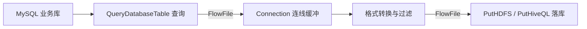
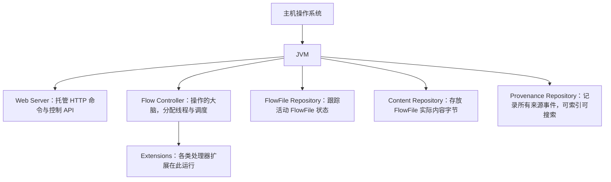

# NiFi 是什么：把数据管道画出来的可视化数据流平台

行为数据经采集系统进了 HDFS，数据清洗还差一块原料：维度数据。维度表存在业务系统的 MySQL 里，清洗程序关联维度时要用到它，得有人把 MySQL 的业务数据也搬进数仓。搬数、转换、调度，这些活如果全靠写代码和命令行，链路一多就管不过来。NiFi 解决的正是这个问题：用拖拽组件的方式把数据流画在界面上，平台负责调度执行。

## 先给结论

- NiFi 是 Apache 基金会顶级项目，一个易于使用、功能强大且可靠的系统，用于处理和分发数据，支持从多种数据源动态拉取数据。
- 它把数据处理拆成「获取、处理、再保存」三步，每一步对应一个可拖拽的处理器，处理器之间用连线接起来就是一条数据流。
- 核心概念五个：FlowFile、FlowFile Processor、Connection、Flow Controller、Process Group。
- 本项目用 NiFi 做三类事：采集维度数据、生成测试数据、实时采集 MySQL 变更，同时用它做任务调度与整体数据流的可视化管理。
- 相比 Sqoop、Flume 这类单一场景工具，NiFi 的优势在于可视化编排与处理器生态，复杂的多源采集靠它统一管理。

## NiFi 是做什么的

NiFi 原是 NSA 的一个内部项目，开源后成为 Apache 基金会顶级项目之一。它基于 Java，用 Maven 管理构建，以 Web 方式工作：用户在浏览器里把数据处理定义成一个流程，后台的数据处理引擎负责任务调度与执行。

「处理和分发数据」这个词可以用一个例子拆开。以 MySQL 为例：NiFi 从 MySQL 里读到数据，这是获取；接着可以对数据做筛选、过滤、聚合，这是处理；处理完的结果要保存到文件、保存到 HDFS，还是流向下一个处理器继续加工，这是分发。获取到处理再到再保存，就是 NiFi 描述一条数据流的完整方式，保存目的地完全按业务需求定，可能流向下一个处理器，也可能通过端口发往别处，也可能直接落库落文件。

数据在处理器之间流转时长什么样，是理解 NiFi 的关键。这张图在讲 FlowFile 从 MySQL 流向 Hive 的路径：



每条被处理的数据都是一个 FlowFile 对象，它在连线里排队、在处理器里被加工，直到落到终点。这条路径上的每个节点都是界面上拖出来的组件，不需要写一行调度代码。

## 五个核心概念

官方把 NiFi 的世界拆成五个概念，每个都不难，合起来就是一整套数据流模型：

| 概念 | 一句话解释 | 在项目里的角色 |
|---|---|---|
| FlowFile | 通过系统移动的每个对象，包含数据流的内容与基本属性 | 从 MySQL 读到的一条批次数据在 NiFi 里的暂存形态 |
| FlowFile Processor（处理器） | 负责实际对数据流执行工作 | 查询、过滤、转换、落库都由具体处理器完成 |
| Connection（连线） | 处理器之间的连接，是数据的有界缓冲区 | 下游处理不过来时，数据在连线里排队缓冲 |
| Flow Controller（流量控制器） | 管理进程使用的线程及其分配 | 单机控制线程与进程数量，集群时控制多少节点执行任务 |
| Process Group（过程组） | 一组特定的进程及其连接，可组合出新的组件 | 一段完整的业务逻辑装进一个组，组与组独立、便于区分 |

**FlowFile 是数据的载体。** 每种业务、每种情况下的数据流都是独特的，读 MySQL 得到的数据会暂存成一个 FlowFile，处理器的产出也是 FlowFile，它在整个流程里被传递、被加工、被记录。

**处理器是对 FlowFile 的加工者。** 从 MySQL 拿到的数据往往不能直接用，需要聚合、过滤、清洗，处理器根据业务对 FlowFile 做对应处理，处理完要么把 FlowFile 分发给下一个处理器，要么在当前处理器结束流程。

**连线不只是画连线，还是缓冲区。** 多个处理器协作时，上游产出快、下游消化慢是常态，连线作为有界缓冲区把暂时处理不过来的数据攒在队列里，起到削峰的作用，这是 NiFi 流转稳定的一个设计前提。

**过程组解决的是复用与分类。** 每一段处理逻辑都是独特的：读 MySQL 清洗后存 Hive 是一组，反向从 HDFS 读出过滤后存 MySQL 又是一组。把一组处理器装进同一个组，这个组就有了特定的业务功能，组与组相互独立，功能一目了然。

## 架构与集群形态

NiFi 在主机操作系统的 JVM 内执行，主要组件都在这个 JVM 里，这张图在讲它的内部分工：



三个存储库各管一摊：FlowFile 存储库记录流程中活跃 FlowFile 的状态，内容存储库存放数据本身，源头存储库记录每一条数据的来龙去脉，出了问题可以回溯到具体事件。

NiFi 原生支持集群部署，这也是推荐方式。集群里每个节点对数据执行相同的任务，但操作不同的数据集；协调交给 Apache ZooKeeper，由它选出集群协调器处理节点的断开与接入，再选举一个主节点。管理数据流时通过任意节点的用户界面操作即可，更改自动同步到全部节点，多个入口都能管理同一条流。

## 界面速览

课程环境里 NiFi 部署在容器中，映射端口 58080，浏览器访问后登录即可进入画布。界面分几块：上方组件区提供处理器、输入端口、输出端口、过程组、远程过程组、聚合（Funnel，把多条连线的数据合并到一条）、模板、标签等组件，按住图标拖进工作区就完成添加；中间大块是工作区，所有编排都在这里进行；下方状态栏统计组件运行状态，多少处理器在运行、多少停止、多少配置有问题（以感叹号标识）、多少被禁用；操作区在选中组件后出现，提供配置、启动、停止、禁用、复制、变色、删除等操作；右上角菜单里管理模板与控制器设置；Navigate 缩略图负责视野导航，画布大了找不到组件时，点缩略图或居中按钮快速定位。

处理器由官方内置了大量种类，覆盖常见场景，常用的有：ExecuteScript（执行脚本）、QueryDatabaseTable（数据库查询）、ConvertAvroToJSON（格式转换）、SplitJson（JSON 拆分）、EvaluateJsonPath（路径取值）、ReplaceText（文本替换）、PutHDFS（写入 HDFS）、PutHiveQL（执行 Hive DDL/DML）、PublishKafka_2_0（发送 Kafka 消息）、GetHDFS 与 PutFile（文件读写）、CaptureChangeMySQL（监听 MySQL CDC 变更）等。官方处理器不够用时可以自己开发，用官方脚手架生成工程：

```bash
# 生成自定义处理器工程骨架，需要 maven 3.1.0 以上
mvn archetype:generate \
  -DarchetypeGroupId=org.apache.nifi \
  -DarchetypeArtifactId=nifi-processor-bundle-archetype \
  -DarchetypeVersion=1.9.2 \
  -DnifiVersion=1.9.2
```

打包得到的 nar 包拷进 NiFi 的 `lib` 目录，重启后新处理器就会出现在组件列表里。本项目就带着三个自定义处理器：Json-To-Hive 把 JSON 数据一步存进 Hive，MySQL-BinLog-To-Hive 监听 binlog 变更直接落 Hive，Wait-For-Next-Group 保证处理器组之间按顺序执行。

## 和其他采集工具怎么比

大数据生态里能做数据搬运的工具不少，选型差异在场景：Sqoop 面向关系型数据库与 HDFS 之间的批量搬运，靠命令行作业，流程多了难以维护；Flume 面向日志文件采集，管道一旦定义好改动不灵活；Kafka Connect 面向 Kafka 与外部系统之间的集成，本项目采集系统里落 HDFS 用的就是它，功能专一。NiFi 的定位不同，它把所有采集、转换、分发动作都搬到了可视化界面：流程长什么样一目了然，改配置点开属性面板就行，处理器生态覆盖文件、数据库、消息队列、Hive、HDFS，还能自定义扩展。多源异构、链路复杂、需要频繁调整的场景，用 NiFi 统一编排最划算，这也是项目把它用在维度采集、测试数据生产与整体数据流管理上的原因。

## 常见误区

- **把 NiFi 当成又一个 Sqoop。** 错例：只会用命令行跑批的思维去理解它。正解：NiFi 的核心是可视化数据流管理，流程在界面上定义、调度与监控，长链条的采集编排靠命令行工具拼脚本维护成本远高于它。
- **认为连线只是图上的装饰。** 错例：随意连线不管数据走向。正解：连线是有界缓冲区，承载 FlowFile 队列与上下游关系，连线上还能按关系（成功、失败）分流，是流程设计的一部分。
- **概念只背中文翻译不理解角色。** 错例：FlowFile、处理器、过程组背得出定义，设计流程时却不知道往画布上放什么。正解：按「数据载体、加工者、缓冲、线程管理、逻辑分组」五个角色对照实际需求，一段业务逻辑对应一个过程组，一个动作对应一个处理器。
- **忽略 NiFi 也能做任务调度。** 错例：以为它只负责搬运数据，调度还要另搭一套。正解：后台有数据处理引擎与任务调度组件，项目里 NiFi 同时承担任务调度与整体数据流程管理。

## 面试可能被问到的问题

1. 面试官追问：「NiFi 是什么，解决什么问题？」
   答：Apache 顶级项目，用于处理和分发数据的可视化数据流平台，支持从多种数据源动态拉取数据。它把获取、处理、再保存三步拆成拖拽式处理器，流程在 Web 界面上定义，后台引擎负责调度执行，适合多源异构采集的统一编排。
2. 面试官追问：「说说 NiFi 的核心概念。」
   答：FlowFile 是数据在系统中流动的载体，带内容与属性；FlowFile Processor 对数据流执行实际工作；Connection 连接处理器，是有界缓冲区；Flow Controller 管理线程与调度，集群时控制节点分工；Process Group 把一组进程及连接组成特定业务功能，便于分类与复用。
3. 面试官追问：「Connection 的缓冲作用体现在哪？」
   答：下游处理器处理不过来时，数据在连线队列里排队，不会压垮下游；队列有容量与大小上限，超过即背压，上游自动降速。这让快慢不一的处理器之间保持稳定协作。
4. 面试官追问：「NiFi 和 Sqoop、Flume 比有什么区别？」
   答：Sqoop 专注关系库与 HDFS 间批量搬运，Flume 专注日志采集，两者场景单一、靠配置或命令行；NiFi 可视化编排全流程，处理器生态覆盖数据库、文件、消息、Hive、HDFS，支持自定义处理器，还能承担任务调度，复杂多源链路用 NiFi 管理更清晰。
5. 面试官追问：「你们项目里 NiFi 用在哪些地方？」
   答：三类场景：把 MySQL 业务库的维度数据采集进 Hive 供清洗关联；用脚本处理器批量生成模拟行为数据写入 HDFS 补测试量级；监听 MySQL binlog 实时采集变更数据。此外整个 ETL 的任务调度与数据流程管理也由 NiFi 承担。
6. 面试官追问：「官方处理器不够用怎么办？」
   答：用官方 Maven 脚手架 nifi-processor-bundle-archetype 生成工程，实现处理器的 onTrigger 等方法，打成 nar 包放进 NiFi 的 lib 目录重启即可使用；项目里的 Json-To-Hive、MySQL-BinLog-To-Hive、Wait-For-Next-Group 三个处理器就是自定义实现的。

## 配套资料

- 讲义：`materials/docs/04/Nifi使用文档.md`，Apache NiFi 概念（简介、核心概念、构架）、常用处理器清单、自定义处理器开发为本课内容出处。
- 讲义：`materials/docs/08/智慧学成-第1章-项目介绍v1.0.md`，技术栈中 NiFi 的定位（维度采集、ETL 可视化管理、任务调度）出处。
- 代码：`materials/code/08/_散落资料/`，项目实际使用的 NiFi 流程模板 XML（维度采集、数据生产、实时采集等）存放处。
- 说明：课程环境 NiFi 版本为 1.9.2，部署在 docker 容器中；处理器清单与脚手架命令为讲义真实内容；示例站点以 example.com 占位。
