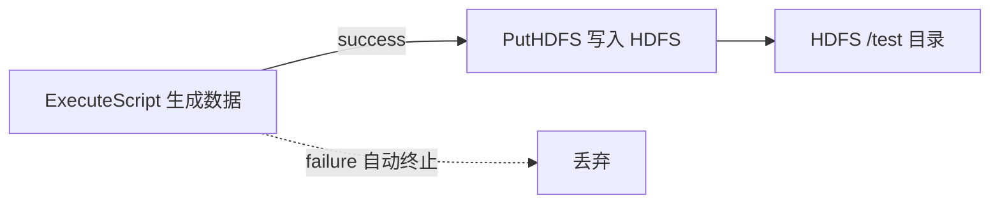

# NiFi 快速入门：装起来，跑通第一条脚本落 HDFS 的数据流

概念背得再熟，不如亲手跑通一条流。NiFi 的入门案例很短：用脚本处理器生产一批数据，再让 HDFS 处理器把它写到分布式文件系统上。两个处理器、一条连线，装完、连上、启动，就能看到数据在界面里流动，HDFS 里多出文件。跑通这一条，NiFi 的操作套路就全在手里了，后面每接触一个新处理器都是同样的流程。

## 先给结论

- 安装即解压：下载 `nifi-1.9.2-bin.tar.gz` 解压就能用，前提是 JDK8 以上；改 `conf/nifi.properties` 的 Web 端口为 58080。
- 启动后要等 1 到 5 分钟，看 `logs/nifi-app.log` 确认端口起来，浏览器访问 `ip:58080/nifi`。
- 入门流程：建 demo 组，拖 ExecuteScript（Script Engine 选 python，脚本写在 Script Body），拖 PutHDFS，连线选 success 关系。
- PutHDFS 必配三项：Hadoop 配置文件路径、HDFS 目标目录、文件已存在时的冲突策略。
- 测试前确认 HDFS 已启动；脚本产数速度极快，验证完立刻停止处理器，不然几 GB 数据很快就写满。

## 安装与启动

NiFi 可运行在 Windows 与 Linux 平台，环境要求 JDK8 以上、Maven 3.1.0 以上（Maven 只有自定义处理器开发时才用到）。从 Apache NiFi 官网下载二进制包，课程使用的版本是 1.9.2，以 Linux 为例，下载到 `/opt` 目录解压：

```bash
cd /opt
tar zxvf nifi-1.9.2-bin.tar.gz   # 得到目录 nifi-1.9.2
cd nifi-1.9.2/conf
# 编辑 nifi.properties，web properties 段的第 137 行改端口
# nifi.web.http.port=58080
cd ../bin && ls                  # 可见 nifi.sh 等脚本
```

同一台机器跑多个服务时端口容易冲突，默认端口建议改掉，编辑 `conf/nifi.properties`，找到 `# web properties #` 段，把 Web 端口改为 58080。启动、停止、重启、查状态都用 `bin/nifi.sh`：

```bash
./nifi.sh start      # 启动
./nifi.sh status     # 状态
./nifi.sh stop       # 关闭
./nifi.sh restart    # 重启
cd ../logs && tail -f nifi-app.log   # 观察日志，出现端口信息即启动成功
```

执行启动命令后别急着刷浏览器，NiFi 启动需要一到五分钟，日志里看到配置的 58080 端口说明成功，这时访问 `ip:58080/nifi` 就能看到画布。课程环境把这套安装搬进了容器：docker-compose 里定义了 `xc-online-nifi` 容器，`NIFI_HOME=/opt/nifi-1.9.2`，并把宿主机的 Hadoop 配置目录映射到容器的 `/opt/hadoop`，这个映射马上会在 PutHDFS 配置里用到。

进入界面后先建一个组，起名 demo，双击进入组内操作。组的作用是把这段练习用的逻辑圈起来，不影响画布上其他流程。

## 第一条流：脚本生产数据写入 HDFS

目标链路是 `ExecuteScript → Connection → PutHDFS`。这张图在讲两个处理器之间的数据关系，以及失败分支的去向：



**拖入 ExecuteScript 并写脚本。** 从组件区把处理器拖进 demo 组，搜索 `exec` 找到 ExecuteScript。它的属性里 Script Engine 支持多种脚本语言，这里选 python；Script File 与 Script Body 二选一：前者指定外部脚本的路径，后者直接把代码写进属性，这里没有外部脚本，填 Script Body。产数脚本如下（按课程文档真实脚本整理，作用是生成 rid、IP、时间戳三个值，一次一万条）：

```python
import datetime
import random
from org.apache.nifi.processor.io import StreamCallback

def datestamp():
    now_info = datetime.datetime.now()
    delta = datetime.timedelta(random.randint(1, 60))
    time_info = now_info - delta
    return time_info.strftime('%Y-%m-%d %H:%M:%S')

class PyStreamCallback(StreamCallback):
    def __init__(self):
        pass
    def process(self, inputStream, outputStream):
        for i in xrange(1, 10000):
            ip_str = '.'.join(str(random.randint(1, 255)) for i in xrange(4))
            rid = random.randint(10000, 99999)
            line = str(rid) + '\t' + ip_str + '\t' + datestamp() + '\n'
            outputStream.write(bytearray(line.encode('utf-8')))

flowFile = session.create()
flowFile = session.write(flowFile, PyStreamCallback())
session.transfer(flowFile, REL_SUCCESS)
```

脚本本身不是重点，只要知道执行它就会生成一批模拟数据。填完点 Apply，处理器上方的感叹号消失，说明配置完整了。

**拖入 PutHDFS 并建立连线。** 搜索 `put` 找到 PutHDFS 拖进组。把鼠标悬停在 ExecuteScript 上，出现斜箭头图标后按住拖向 PutHDFS，弹出连线窗口让选关系：success 表示上游处理成功时数据流向下游，failure 表示处理失败时的走向。这里只把 success 连到 PutHDFS；failure 关系选 Automatically Terminate（自动终止），让失败数据直接结束，否则感叹号不消，处理器仍然无效。规则是：处理器定义的每个关系，必须连到下游组件或者被自动终止，二者占一个。

**配置 PutHDFS 的三个必填属性。** 属性面板里逐项填：

| 属性 | 配置值 | 说明 |
|---|---|---|
| Hadoop Configuration Resources | `/opt/hadoop/core-site.xml,/opt/hadoop/hdfs-site.xml` | Hadoop 客户端配置，不配找不到 HDFS；多个文件用英文逗号分隔 |
| Directory | `/test` | HDFS 上的保存目录，目录不存在会自动创建 |
| Conflict Resolution Strategy | `append` | 文件已存在时的处理策略，这里选追加 |

Hadoop 配置文件的路径来自容器里的映射位置，配好后 Apply。这一步最容易出错：路径写错时界面会明确报出「Hadoop 配置文件不存在或不是一个文件」，看到这个提示就回头核对路径；逗号也要用英文逗号，中文逗号会让两个文件都被解析错。目录一项还能写 NiFi 表达式，项目里的真实模板就是按天建目录的写法：

```text
/user/hive/external/data_course/learning_course_online_source/${now():toNumber():minus(86400000):format('yyyy-MM-dd')}
```

表达式含义是取当前时间减一天再格式化成日期，也就是昨天的目录，离线任务按天处理前一天的数据正好对上。冲突策略的四个选项各有所指：`fail` 是默认值，文件已存在则报错；`replace` 覆盖旧文件；`ignore` 忽略不动；`append` 把数据追加到已有文件末尾，模拟持续写入时选它。

## 启动与验证

三项配置齐全后 Apply，校验通过就可以启动。两种启动方式：右键单个处理器选 Start，只启动它；在组的工作区空白处右键选 Start，启动组内全部处理器。启动成功后处理器出现绿色三角，正在运行；连线的队列里能看到数据在排队，说明流已经转起来了。

脚本产数的速度非常快，不停的话几分钟就能写出几个 GB 的文件，验证目的达到后立刻在空白处右键 Stop 全部暂停。然后到 HDFS 上确认结果：刷新 Hue 的文件浏览器或 HDFS 网页界面，`/test` 目录已经出现，目录里是刚才生成的一批文件。到这里，从创建处理器、配置属性、建立连接到启动验证的完整流程就走了一遍，后面使用其他处理器，重复的都是这套动作。

## 常见误区

- **启动后立刻访问页面。** 错例：`nifi.sh start` 一执行就开浏览器。正解：启动需要一到五分钟，先 `tail -f nifi-app.log` 等端口就绪，访问早了只会看到拒绝连接。
- **关系不处理就不管。** 错例：success 连了下游，failure 悬着不配。正解：每个关系必须连下游或自动终止，否则处理器上有感叹号，start 是灰的点不动。
- **Hadoop 配置路径写错或用中文逗号。** 错例：把 `core-site.xml` 的路径拼错，或文件之间用中文逗号分隔。正解：路径与容器内映射位置一致（课程环境为 `/opt/hadoop`），分隔符用英文逗号；报「配置文件不存在或不是文件」时优先查这两处。
- **验证完不停处理器。** 错例：看到 HDFS 出文件就去干别的。正解：脚本处理器按调度周期持续产数，几 GB 很快写满磁盘，验证完立刻 Stop。
- **忘记确认 HDFS 在运行。** 错例：PutHDFS 一直报失败。正解：写入目标得先在线，测试前确认 HDFS 已启动，容器环境确认 hadoop 容器已起。

## 面试可能被问到的问题

1. 面试官追问：「NiFi 怎么安装部署，要注意什么？」
   答：下载二进制包解压即用，前提 JDK8 以上；改 `conf/nifi.properties` 里的 Web 端口避免冲突；`nifi.sh start` 启动后等一至五分钟，看 `logs/nifi-app.log` 出现端口再访问界面。生产推荐集群部署，用 ZooKeeper 做协调。
2. 面试官追问：「处理器上出现感叹号是什么意思，怎么消掉？」
   答：感叹号表示存在必配项未配置或关系未处理。逐条看提示补齐属性，比如 ExecuteScript 必须给 Script Body 或 Script File 二者之一；每个关系要么连到下游组件，要么设置 Automatically Terminate，处理后感叹号消失才能启动。
3. 面试官追问：「PutHDFS 要配哪些关键属性？」
   答：Hadoop Configuration Resources 指向 core-site.xml 与 hdfs-site.xml，让处理器能定位 HDFS；Directory 指定目标目录，不存在自动创建，支持 NiFi 表达式按天建目录；Conflict Resolution Strategy 决定文件已存在时 fail、replace、ignore 还是 append。
4. 面试官追问：「连线上能同时传成功和失败的数据吗？」
   答：不能混在一条。连线建立时按关系选择数据走向，success 与 failure 是不同的关系，分别各连一条线，失败分支要么接专门的错误处理，要么自动终止，这样数据按处理结果天然分流。
5. 面试官追问：「为什么验证完要立刻停掉脚本处理器？」
   答：ExecuteScript 按调度周期反复执行，产数脚本一次生成上万条且速度极快，持续运行几分钟就能写满数 GB，测试数据只是用来验证链路的，不停会占满磁盘还污染目录，验证完立即 Stop。
6. 面试官追问：「目录里想每天存前一天的数据，怎么实现？」
   答：Directory 用 NiFi 表达式语言写日期运算，例如取当前时间减一天的毫秒数再格式化为日期，得到昨天的目录名，离线任务每天从对应目录取数，和数仓按天分区的加载方式对齐。

## 配套资料

- 讲义：`materials/docs/04/Nifi使用文档.md`，NIFI 环境搭建（下载、端口修改、启动命令）、应用场景之执行脚本产生的数据保存到 HDFS（demo 组案例与产数脚本）为本课内容出处。
- 代码：`materials/code/08/_散落资料/`，项目真实使用的 NiFi 流程模板 XML（ExecuteScript 产数加 PutHDFS 落盘的完整配置，含按天目录表达式）与 docker-compose 编排文件（xc-online-nifi 容器定义、Hadoop 配置目录映射）。
- 说明：课程环境 NiFi 版本 1.9.2、Web 端口 58080；产数脚本与 PutHDFS 属性配置以课程资料真实模板为准；`/test` 目录取名与界面操作步骤为按本课写法整理的示例。
