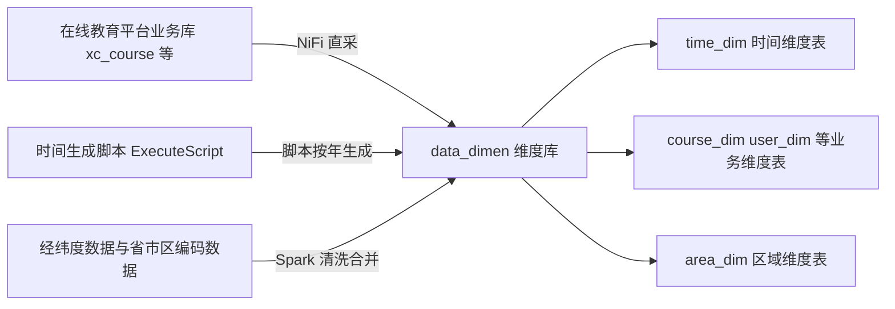
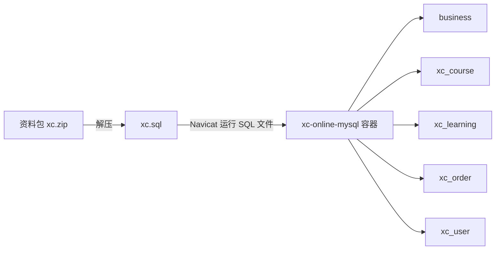
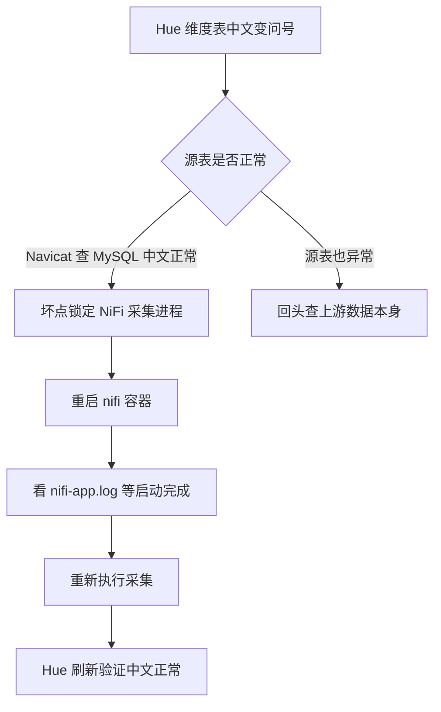
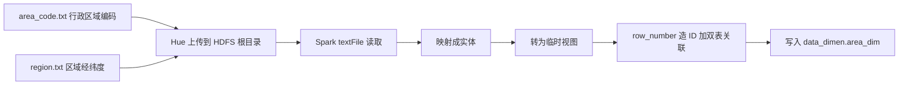
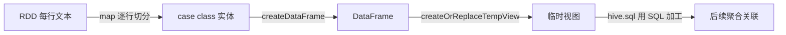
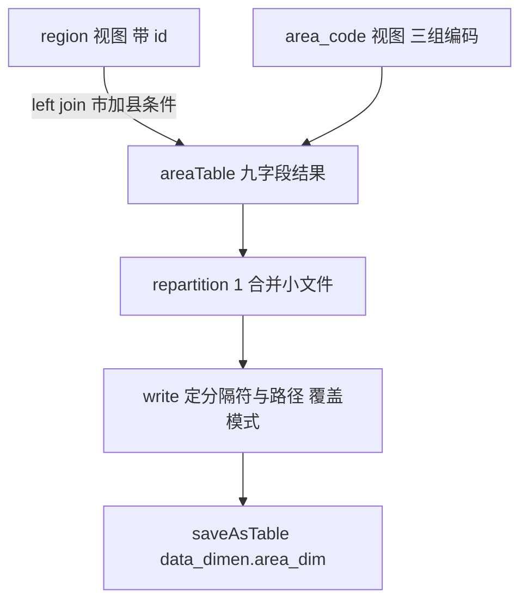
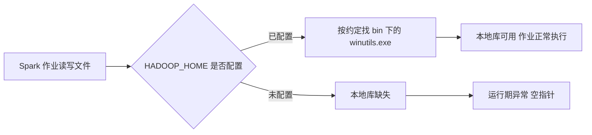

# ETL 维度数据采集全流程：九个维度盘点、NiFi 采集与区域维度 Spark 清洗

> 🔒 安全提示：文中示例的口令/密钥均为课程教学环境演示口径，生产环境的安全要求见《安全与合规须知》。

## 先给结论

- 维度采集是智慧学成所有清洗任务的前置工序：清洗程序要把原始记录转成事实表记录，靠的就是时间、课程、区域这一串维度 id 外键，维度表里没数据，清洗就断粮。
- 九个维度分两类来源：时间、公司、课程视频、用户选课、课程信息、用户、课程学习频率、课程分类、区域，其中七个来自在线教育平台业务库，一个维度对应一张业务表。
- 时间维度业务库里没有，用脚本按年生成；区域维度同样没有现成表，由区域编码与经纬度两个文件用 Spark 清洗合并入库。
- 业务数据不需要搭起整套在线教育平台，把 xc.sql 导入本地 MySQL 即可，导入后 business 加课程、学习、订单、用户五个库，维度采集用的是后四个业务库。
- NiFi 主线走模板：上传时间与课程维度两个 XML 模板，链路固定为 QueryDatabaseTable 读 MySQL、ConvertAvroToJSON 转 JSON、JsonToHiveProcessor 写 Hive，参数缺口通常只有连接池密码，采集结果落在数仓 data_dimen 库。
- NiFi 采集出中文全变问号是经典环境坑：Docker 自启瞬间多个容器抢资源，NiFi 编码信息没加载全，登进容器 restart 并等 nifi-app.log 就绪后重新采集即可。
- 区域维度主线走代码：两个原文件经 Hue 上传 HDFS 根目录，Spark 直接 textFile 读取，区域编码切两刀、经纬度切一刀，映射成实体注册临时视图。
- 入库收尾三件事：row_number 按省排序造稳定主键，left join 按市县组合关联编码表拼出九字段，repartition 加 overwrite 四件套写进 data_dimen.area_dim。
- Windows 开发机跑 Spark 报无征兆空指针，根因是缺 winutils 本地二进制，按是否装过 Hadoop 两种情况配平 HADOOP_HOME 并完全重启 IDEA，维度采集整条链路随之收官。

## 第1部分：ETL-维度数据采集-维度介绍

数据清洗不是拿着裸数据就能算的。清洗程序要把一条条原始记录转成事实表记录，里面要填时间维度 id、课程维度 id、区域维度 id 这一串外键，维度表里没有数据，清洗就断粮。NiFi 入门篇跑通了脚本产数写 HDFS 的最小流程，接下来把真正要采的货备齐：九个维度的数据。其中七个来自在线教育平台的业务库，用 NiFi 采集；两个业务库里没有，得用特殊方式造出来。

### 维度为什么必须先采

维度是看数据的角度。同样是课程访问量，按天看是时间维度，按课程看是课程维度，按地区看是区域维度。维度表就是把这些角度各自整理成一张干净的目录表：时间维度表把一年拆成年、月、日、小时、周；课程维度表把每门课程带上分类名、等级名、公司名。

清洗环节对维度的依赖是硬性的。课程访问量事实表的字段里有 course_dim_id、time_dim_id、area_dim_id、company_dim_id，清洗程序运行时要现场查维度表做关联转换，比如根据用户 IP 去区域维度表里换出区域 id。维度表是空的，这些 id 全都填不出来，所以维度数据采集排在所有清洗任务之前。

### 九个维度分三类

这张图在讲九个维度的三条来路，殊途同归，最终都落到数仓的 data_dimen 库：



七张业务维度表走 NiFi 直采，时间维度走脚本生成，区域维度走 Spark 清洗，三条路最终都汇到 data_dimen。

**第一类，业务库现成的七个。** 公司、课程视频、用户选课、课程信息、用户、课程学习频率、课程分类，这些数据在线教育平台每天都在产生，用 NiFi 从业务库读出来写进 Hive 即可，方式与入门案例同一套路，只是处理器链路换成了读库写 Hive 的组合。

**第二类，时间维度，脚本生成。** 业务库里有各种业务时间，但没有一张按维度建模要求组织的完整时间表，年、月、日、小时、一年中第几周都要有，业务数据给不齐。时间的规律性极强，用脚本按年推算生成最省事：一年 365 天或 366 天，每天 24 小时，逐条展开写入。课程环境生成的是 2018 年，想换年份改脚本里的年份变量即可。

**第三类，区域维度，Spark 清洗合并。** 手上只有两份不规则数据：一份区域经纬度，记录省市县对应的经纬度；一份省市区区域编码。要把两份数据按省市县匹配起来，合成一张带编码和经纬度的区域维度表，中间要做各种拆分、清洗和关联计算。用 NiFi 调度编排这类复杂计算相对麻烦，直接用 Spark 代码清洗入库更顺，课程提供了对应的清洗程序，两份源数据上传 HDFS 后由程序合并写出区域维度表。

### 七个业务维度的对应关系

维度与业务库的对应关系整理成表，采集时按图索骥：

| 维度名 | 业务库对应表（库名.表名） | 数仓维度表 |
|---|---|---|
| 公司 | xc_user.xc_company | data_dimen.company_dim |
| 课程视频 | xc_course.teachplan | data_dimen.course_video_dim |
| 用户选课 | xc_learning.xc_learning_course | data_dimen.learning_course_dim |
| 课程信息 | xc_course.course_base | data_dimen.course_dim |
| 用户 | xc_user.xc_user | data_dimen.user_dim |
| 课程学习频率 | xc_course.course_study_freq | data_dimen.course_study_freq_dim |
| 课程分类 | xc_course.category | data_dimen.course_category_dim |

三个业务库的分工：xc_user 是用户库，装用户和公司；xc_course 是课程库，装课程、课程计划、分类、学习频率；xc_learning 是学习库，装选课记录。课程视频维度对应的是课程计划表 teachplan，它是课程的章节目录树，别望文生义去找视频文件表。

### 维度表长什么样

数仓建库阶段九张维度表都已建好，以时间维度表为例，建表语句如下，外表指向 HDFS 目录，字段以制表符分隔：

```sql
CREATE EXTERNAL TABLE IF NOT EXISTS data_dimen.time_dim
(time_dim_id String,      -- 主键，形如 2018-01-01-08
 year String,             -- 年
 month String,            -- 月
 day String,              -- 日
 hour String,             -- 小时
 week String,             -- 一年中第几周
 week_name String)        -- 周名称
ROW FORMAT DELIMITED FIELDS TERMINATED BY '\t'
STORED AS TEXTFILE
LOCATION '/user/hive/external/data_dimen/time_dim';
```

课程维度表的字段更能说明采集侧做冗余的思路：

```sql
-- data_dimen.course_dim 的字段清单（建表方式与 time_dim 相同，外表 location 略）
-- course_dim_id               课程 id，同时是课程维度 id
-- name                        课程名
-- mt / mt_name                课程大分类 id 与名称
-- st / st_name                课程小分类 id 与名称
-- grade / grade_name          课程等级 id 与名称
-- company_id / company_name   所属公司 id 与名称
-- users                       适用人数
-- status / status_name        课程状态 id 与名称
-- description                 课程介绍
```

课程维度表里，id 字段之外还带了一整套名称冗余字段，这些名称是采集时从业务库的字典表关联出来的。好处是后续清洗和分析直接查维度表就够了，不必再回业务库做 join，离线任务跑起来轻得多。

### 采集的顺序与节奏

- 先把在线教育平台业务数据导入智慧学成的 MySQL，采集源就位。
- 导入 NiFi 采集模板，补上密码等参数，执行采集。
- 时间维度和课程信息维度优先采，后续课程访问量分析马上要用；其余维度同一套路，需要哪个采哪个。
- 课程信息在这个阶段不再变化，采一次就够，配合覆盖式写入，重复采集也不会堆积重复数据。

## 第2部分：ETL-维度数据采集-导入学成在线业务数据

智慧学成是一个统计分析系统，它不生产数据，只分析数据，分析对象是在线教育平台的运行数据。要做维度采集，先得让被分析的数据在自己手里：不需要把在线教育平台整套系统搭起来，只要把它的业务库数据拿过来，导入智慧学成的 MySQL，采集源就位了。

### 为什么只导数据不搭系统

统计系统关心的是库表结构和数据本身，不关心在线教育平台的功能跑不跑得起来。整套系统搭起来要起一大片服务，对统计分析毫无必要。把业务库导出成 SQL 文件，导入到智慧学成自己的 MySQL 容器里，表结构、数据和原平台一致，采集程序按同样的库名表名去读就行，还能随便折腾而不影响任何真实系统。

这一步在 ETL 流程里属于数据源的准备动作：数据还没进数仓，先在本地 MySQL 里形成一个稳定的、可重复读取的数据源，后面 NiFi 采集的全部输入都来自这里。

### 解压与建连接

**解压数据包。** 课程资料第 2 章 数据仓库与 ETL 目录内有 sql 文件夹，里面的 xc.zip 就是业务数据包，右键解压提取到当前位置，得到 xc.sql。Navicat 运行的是 SQL 文件，zip 包要先解开。

**新建 MySQL 连接。** 这是第一次连接智慧学成的数据库：点连接，选择 MySQL，连接名起 xc-online-mysql，主机填同名地址，课程环境已经配好主机名映射，容器名可以直接当主机名用；端口 3306 是默认值不用动，用户名 root，密码 123456，点测试连接，提示连接成功后确定保存。

连接参数与课程环境的 docker-compose 编排一一对应，MySQL 服务的定义如下：

```yaml
xc-online-mysql:                 # 服务名与容器名同名
  image: mysql:5.7.9
  restart: always                # 随 docker 引擎自动启动
  ports:
    - '3306:3306'                # 端口映射：宿主机 3306 到容器 3306
  environment:
    MYSQL_ROOT_PASSWORD: 123456  # root 密码
  volumes:
    - /opt/docker/mysql:/var/lib/mysql
```

密码 123456 就是编排文件里 MYSQL_ROOT_PASSWORD 的值，课程环境约定如此。

### 执行导入

打开新建的连接，右键连接名，选择运行 SQL 文件，浏览选中解压出来的 xc.sql，点开始。导入过程就是把 SQL 文件里的建库、建表、插入语句逐条执行，数据量不小，全程约 40 多秒，等它跑完再操作，不要中途取消。完成后右键连接选刷新，五个新库出现在列表里。

这张图在讲数据从资料包到落进 MySQL 的完整链路：



### 导入后的五个库

刷新后五个库各司其职：

- business：智慧学成数据清洗完成后落地保存的业务库，后面章节的清洗程序直接往里写，这次随包一起导入先用起来，它不是采集源。
- xc_course：课程相关，课程信息、课程计划、课程分类、课程学习频率都在这里。
- xc_learning：学习相关，用户选课记录在这里。
- xc_order：订单相关，订单数据在这里。
- xc_user：用户相关，用户和公司数据在这里。

维度采集的对象就是后四个业务库：公司维度、用户维度从 xc_user 采，课程信息、课程视频、课程分类、课程学习频率从 xc_course 采，用户选课从 xc_learning 采，订单数据留给后面购买量分析用。

### 导入验证

导入是否完整，用几条简单 SQL 抽查（示例为按本课写法补全，行数以实际导入为准）：

```sql
SHOW DATABASES;                                  -- 应看到 business 与四个 xc_ 开头的库
USE xc_course;
SELECT COUNT(*) FROM course_base;                -- 课程表应有数据
SELECT name, price FROM course_base LIMIT 5;     -- 随手抽几行看内容是否正常
```

库在、表在、行数不为零、抽样内容正常，导入就算完成。后续 NiFi 采集如果报找不到表，先回到这一步确认。

## 第3部分：ETL-维度数据采集-导入NiFi源码&执行采集

业务库数据已经导入本地 MySQL，接下来把 NiFi 采集流程搭起来。课程资料里提供了配置好的 NiFi 调度模板，处理器链路和连接池参数都已写好，要做的事不多：导入模板、补齐参数、启动采集。采完到 Hue 里看表，时间维度和课程维度就躺在 data_dimen 库里了。

### 模板链路与已带参数

模板把课程环境该配的都配好了，以课程维度模板里的真实配置为例：

```properties
# MySQL 连接池 DBCPConnectionPool（课程维度用）
Database Connection URL = jdbc:mysql://xc-online-mysql:3306/xc_course?characterEncoding=UTF-8&useSSL=false&allowPublicKeyRetrieval=true
Database Driver Class Name = com.mysql.cj.jdbc.Driver
database-driver-locations = /opt/mysql-connector-java-8.0.16.jar
Database User = root
Password = （导入后必须重填，模板里已丢失）

# Hive 连接池 HiveConnectionPool
hive-db-connect-url = jdbc:hive2://xc-online-hive:10000

# 自定义处理器 JsonToHiveProcessor（课程维度）
table_name = data_dimen.course_dim        # 目标维度表
temp_file_path = /opt/tmp/course_dim      # 临时文件目录
hdfs_url = hdfs://xc-online-hadoop:9000   # HDFS 地址
is_it_full = true                         # 全量覆盖写入
```

QueryDatabaseTable 里配的是业务表与字段别名，课程维度直接用一段带关联的查询，把字典名称一起带出来：

```sql
SELECT
  b.id course_dim_id, b.name name,
  b.mt mt, b.grade grade, b.st st,
  b.company_id company_id, b.users users,
  b.status status, b.description description,
  d1.name grade_name, c1.name mt_name, c2.name st_name,
  d2.name status_name, co.name company_name
FROM course_base b
LEFT JOIN dict d1 ON b.grade = d1.id
LEFT JOIN dict d2 ON b.status = d2.id
LEFT JOIN category c1 ON b.mt = c1.id
LEFT JOIN category c2 ON b.st = c2.id
LEFT JOIN xc_user.xc_company co ON b.company_id = co.id
```

这条查询正是维度介绍时说的名称冗余字段的来源：等级名、分类名、状态名、公司名在采集时就 join 出来，落进 course_dim 的对应字段。JsonToHiveProcessor 里的 fields_correspond 属性再把查询结果字段一一映射到维度表列上，别名对得上，数据就能对号入座。

这张图在讲从模板上传到数据入仓的完整路径：


### 导入模板与建组

导入入口在画布上：右键工作区空白处，选 Upload Template，弹出窗口里 Browse 选中模板 XML，点 Upload。一次只能上传一个文件，上传成功后在菜单的 Templates 窗口能看到已导入的模板。

然后建一个处理器组把采集装进去：拖出处理组，组名就叫维度，双击进组，从组件区拖 Template 组件，依次选择课程维度、时间维度模板放入。拖错了用 Move to 上一级组移出去重来。进到组里能看到两条处理器链路，黄色感叹号标记的就是待配置项。

### 补参数：密码是唯一的缺口

**时间维度只需启用 Hive 连接。** 时间维度不读 MySQL，模板里 Hive 连接池的 URL 已配好，进入 Hive 连接池服务，点启用（闪电图标），感叹号消失即可。

**课程维度要多补一个 MySQL 密码。** 课程维度读业务库，连接池五项参数里 URL、驱动类名、驱动位置、用户名都已在模板中配好，唯独密码是空的。这不是漏配：NiFi 保存模板时会剔除所有敏感属性，凡是和密码有关的属性，存模板都丢。点开密码属性填入 123456，确定后界面上只显示已设置而不回显具体值。密码补完，把 MySQL 和 Hive 两个连接池都启用，所有感叹号消失，配置就算完成。

### 时间维度生成脚本

时间维度的源头不是数据库，而是一段脚本。ExecuteScript 处理器里内嵌的 Python 脚本按年生成时间维度数据（脚本与课程资料一致，年份可改）：

```python
import arrow
import json
import datetime
from org.apache.nifi.processor.io import StreamCallback
from org.apache.nifi.processors.script import ExecuteScript

def isLeapYear(years):
    if ((years % 4 == 0 and years % 100 != 0) or (years % 400 == 0)):
        return 366
    return 365

class PyStreamCallback(StreamCallback):
    def __init__(self):
        pass
    def process(self, inputStream, outputStream):
        years = int('2018')              # 想换年份改这里
        data = []
        start_date = '%s-1-1' % years
        a = 0
        days_sum = isLeapYear(years)     # 闰年 366 天，平年 365 天
        while a < days_sum:
            for num in range(0, 24):     # 每天 24 小时
                time_dim_id = arrow.get(start_date).shift(days=a).format(
                    "YYYY-MM-DD-") + str(num)
                obj = {'time_dim_id': time_dim_id}
                temp = time_dim_id.split('-')
                obj['year'] = temp[0]
                obj['month'] = temp[1]
                obj['day'] = temp[2]
                obj['hour'] = temp[3]
                tmp_week = datetime.date(int(temp[0]), int(temp[1]),
                                         int(temp[2])).isocalendar()
                obj['week'] = tmp_week[1]
                obj['week_name'] = tmp_week[1]
                data.append(obj)
            a += 1
        outputStream.write(bytearray(json.dumps(data), encoding='utf-8'))

flowFile = session.create()
if flowFile != None:
    flowFile = session.write(flowFile, PyStreamCallback())
    session.transfer(flowFile, ExecuteScript.REL_SUCCESS)
```

脚本把 2018 年全年展开成 time_dim_id 加年月日时分周的记录，经 JsonToHiveProcessor 按字段映射写进 data_dimen.time_dim。课程环境还有一条硬约束：NiFi 执行的 Python 脚本里不能出现任何中文，注释也不行，否则脚本无法正常执行，课程所有脚本都遵守这条规范。

### 执行采集与验证

进入时间维度组，右键工作区空白处点 Start。脚本执行要一点时间，运行完成的标志是数据走完全程：第一个处理器有流出，末端的队列进来又被消费清空。采完立刻在空白处 Stop。

到 Hue 里验证：找到 data_dimen 库的 time_dim 表，浏览数据并切到样例视图，从第一天到最后一天的小时记录都在，界面默认只显示 100 条。课程维度同样操作：启动、等队列清空、停止，到 Hue 查 course_dim，课程名、分类名、公司名等字段都有值。此时中文很可能显示成一串问号，这是采集进程的编码问题，解决办法单独成篇。

调度周期多说一句：处理器调度设的是 9000 秒，它不会执行完一次就自动停，而是到点还会再跑。设这么长的周期是给人工留操作时间，采集完成立刻手动 Stop，防止二次执行重复写入。课程信息在这个阶段不变，采一次即可。

## 第4部分：ETL-维度数据采集-注意事项-NiFi采集乱码处理

课程维度采进来了，条数对、字段对，就是不对劲：Hue 里 course_dim 的课程名、分类名、公司名，所有中文都是一串问号。切到 Navicat 看业务库源表 course_base，中文好好的。源没问题，落地错了，问题出在采集链路上，而且是 NiFi 进程自己的运行状态问题。

### 乱码现场与定位

数据链路分三段：源头 MySQL，中间采集进程 NiFi，落地 Hive。乱码排查就是把三段挨个看过去，找出正常与异常的分界点。

这张图在讲乱码的定位路径，关键分叉是源表是否正常：



现象落在第一支：Navicat 里 course_base 表的中文完整无误，Hive 里全是问号，说明数据是在 NiFi 手里被写坏的。这个判断很值钱：源表正常，就不用去重建 Hive 表、改表字符集，方向直接指向采集进程。

### 为什么同时启动会坏编码

NiFi 本质是一个 JVM 进程，字符集编码这类运行环境信息在进程启动阶段加载确定，之后整个生命周期沿用。课程环境里所有服务都跑在 Docker 容器上，docker-compose 给 NiFi 配了 `restart: always`，Docker 引擎一启动，NiFi 就跟着系统一起启动；同一时刻 MySQL、Hadoop、Hive、Spark、ZooKeeper 一堆容器都在抢 CPU 和内存，NiFi 的启动被挤在资源竞争最激烈的窗口里，自身的编码信息没有加载全。编码信息缺位，写出数据时中文按错误的方式转字节，落进 Hive 就成了问号。

重启为什么能治：等这一批容器都进入稳定状态后，登录 NiFi 容器手动重启，此时资源竞争小得多，NiFi 能把编码信息完整加载，再次采集时中文按 UTF-8 正确编码写入，乱码消失。这段机制解释按 JVM 进程编码加载的通用原理补充，课程现象以重启后恢复为准。

**加固思路。** 生产环境可以更进一步，在 NiFi 的 `conf/bootstrap.conf` 里显式指定 JVM 编码参数（例如 `java.arg.NN=-Dfile.encoding=UTF-8`，按主流写法补充），让编码不依赖启动时机，从根上消除这类偶发问题。

### 修复步骤

命令就两条，先登录容器再重启：

```bash
# 登录 nifi 容器
docker exec -it xc-online-nifi bash
# 重启 nifi
$NIFI_HOME/bin/nifi.sh restart
# nifi 重启成功后，再次采集即可
```

几个细节值得交代。`-it` 会分配一个交互式终端，进去才能敲命令；`$NIFI_HOME` 是容器里配置的环境变量，指向 `/opt/nifi-1.9.2`，用 Tab 补全时会被直接解析成具体目录，两种写法效果一样。`restart` 的动作是先停再启：先看到关闭过程的输出，随后进入启动流程。

启动不代表就绪。NiFi 依赖的组件多，启动偏慢，重启命令返回后要盯日志：

```bash
tail -f $NIFI_HOME/logs/nifi-app.log
# 日志里出现 Web 端口 58080 的监听信息，说明启动完成
```

启动完成前访问 NiFi 页面会提示无法连接，属正常现象；日志确认就绪后刷新页面即可。还有一点容易误判：`docker ps` 能看到容器在运行，不代表容器里的 NiFi 进程已就绪，判断以日志为准。

### 重新采集与验证

回到 NiFi 界面，重新启动课程维度采集，等数据走完全程后停止。刷新 Hue 查看 course_dim：新一批数据中文完整，课程名、分类名、公司名都正常显示，乱码解决。

一个自然的疑问是：表里原来已经有一批问号数据，重新采集，旧数据去哪了？模板里 JsonToHiveProcessor 配的是覆盖写入，`is_it_full = true`，再次采集会把原来的数据整表覆盖。这么配置的道理在于课程信息在这个阶段不再增加，重复采集产生的只会是同样的数据，覆盖后每次进表的都是最新一份：既不用担心旧问号数据残留，也不会堆积重复记录。

## 第5部分：ETL-维度数据采集-区域维度原文件上传HDFS&spark读取文件

时间、课程、用户这些维度，业务库里都有现成的表，交给调度工具就能采集进仓。区域维度是个例外：在线教育平台的业务数据里根本没有这张表，区域信息只存在于两个原始文本文件里，一个存行政区域编码，一个存经纬度。文件格式不规则，调度工具吃不下，只能走代码清洗的路线。清洗的第一步很朴素：把文件传上 HDFS，用 Spark 读出来。

### 区域维度为什么要单独清洗

智慧学成这个统计分析系统要回答「哪个省哪个市的用户在学什么」，区域维度就是这类问题的钥匙：课程访问量事实表里的用户 IP，最终要靠区域维度表换算成区域 ID，再聚合出分地区的统计结果。

维度清单里，时间维度靠脚本生成，其余维度大多能从业务库直接采集，唯独区域维度在业务库里没有对应表。它的原始数据是两个文本文件：

- `area_code.txt`：行政区域编码，一行三段，段间是英文逗号，每段是「名称 空格 编码」；
- `region.txt`：区域经纬度，一行五列「省，市，县，经度，纬度」，全靠英文逗号分隔。

而最终入库的维度表需要名称、编码、经纬度共九个字段，等于要把两个文件按省市县关联合并。整条链路如下：



这张图把区域维度从文件到入库的完整路径串了起来。本课覆盖前两步：上传与读取；映射、关联、入库在接下来的两课完成。

### 用 Hue 把文件传到 HDFS 根目录

上传用 Hue 的文件浏览器完成：进入根目录，点上传按钮，选择 `area_code.txt`，再传 `region.txt`，两步就完。选根目录不是随手为之：清洗代码里读取路径写的是 `/area_code.txt`，文件放在根目录，路径最短，代码里也不用拼目录名。文件放在别处也能跑，只要代码路径与实际上传位置一致，课程约定统一放根目录，省去一层对照。

传完先查看内容，后面的映射逻辑完全取决于这两份文件长什么样。`area_code.txt` 的一行由三段组成，段与段之间用英文逗号分隔，每段内部是「名称 空格 编码」：

```text
河北省 130000,石家庄市 130100,长安区 130102
北京市 110000,北京市 110100,东城区 110101
```

示意行按文件结构还原，实际文件覆盖全国省市区。直辖市的形态比较特殊：省和市同名，往下才是市辖区，而且区这一层的命名不太规范，这一点会在后面的关联环节留下伏笔。`region.txt` 则简单得多，五个字段全用英文逗号分隔，最后两列是经度和纬度：

```text
河北省,石家庄市,长安区,114.51,38.04
北京市,北京市,东城区,116.40,39.90
```

### 建类与获取 Spark 环境

工程里新建一个存放维度清洗代码的包 `com.study.xc.dimen`，再新建 Scala Object `AreaDimInsert`，区域维度的全部清洗逻辑都写在这一个文件里。

SparkSession 不在业务代码里现搭，工程有个通用工具类 `EtlEnvironment`，内部就是一段标准的 builder 链式配置：

```scala
// EtlEnvironment 内部要点（按画面线整理，去重后）
val spark: SparkSession = SparkSession.builder()
  .appName(appName)                                              // 由调用方传入
  .config("spark.sql.warehouse.dir", "hdfs://node1:8020/user/hive/warehouse")
  .config("spark.serializer", "org.apache.spark.serializer.KryoSerializer")
  .config("spark.sql.adaptive.enabled", "true")                 // 自适应执行
  .config("spark.sql.adaptive.coalescePartitions.enabled", "true")
  .getOrCreate()
```

仓库目录指向 Hive 的 warehouse 路径，序列化换成 Kryo，再开自适应执行让 Spark 自动合并小分区。业务代码里一行取用，AppName 直接用当前类名，报错时一眼能定位到是哪个清洗任务：

```scala
package com.study.xc.dimen

import com.study.xc.common.EtlEnvironment

/**
 * 区域维度数据处理
 */
object AreaDimInsert {

  // 经纬度实体
  case class regionMap(sheng: String, shi: String, xian: String, lng: Float, lat: Float)

  // 区域编码实体
  case class areaCodeMap(sheng: String, shengCode: String, shi: String, shiCode: String, xian: String, xianCode: String)

  // 获取 spark session，appName 就是当前类名
  val spark = EtlEnvironment.getSparkSession(this.getClass.getSimpleName)

  def main(args: Array[String]): Unit = {
    // 获取 spark context
    val sc = spark.sparkContext
    // 读取 HDFS 根目录的两个原文件
    val area_code = sc.textFile("/area_code.txt")
    val region = sc.textFile("/region.txt")
  }
}
```

case class 定义在 object 顶层即可，字段名与数据类型完全对着文件的列来：经纬度实体五个字段，省、市、县是 String，经度纬度带小数，声明成 Float；区域编码实体六个字段，三组名称加三组编码，全是 String。

### 读文件为什么不写协议前缀

`sc.textFile` 的参数看起来只是个普通路径，既没有 `hdfs://` 也没有主机名，Spark 怎么知道去 HDFS 上找？答案在工程的 resources 目录：项目里已经放了 `core-site.xml` 等 Hadoop 配置文件，其中的 `fs.defaultFS` 指向 `hdfs://node1:8020`。Spark 客户端加载这些配置后，默认文件系统就是 HDFS，路径以 `/` 开头即表示 HDFS 根目录，协议前缀全省。

这也解释了上传位置为什么重要：代码里的相对路径以根目录为基准，文件传到别的地方，按 `/area_code.txt` 就找不到。想放别的目录，就要把代码里的路径改成实际位置，两边必须对齐。

## 第6部分：ETL-维度数据采集-区域维度原文件数据与实体映射

前一课用 `sc.textFile` 把两个原文件读成了 RDD，但 RDD 里每一行还是一整个字符串，没法按列取值，更没法用 SQL 加工。这一课的活儿是把行打散、按位置装进 case class，再转成带 schema 的临时视图。区域编码文件要切两刀，经纬度文件切一刀，两种切法放在一起讲，正好把 Spark 清洗里最常用的 split 组合拳练熟。

### 为什么先映射成实体

文本行到 SQL 之间隔着两层：一层是 schema，一层是表。map 算子把 `RDD[String]` 变成实体 RDD，case class 的声明就是 schema；`createDataFrame` 拿着这个 schema 生成 DataFrame；`createOrReplaceTempView` 再把 DataFrame 注册成会话内可见的临时表。三步做完，区域数据就能用 SQL 语法操作，后面两个文件的聚合关联全在 SQL 里完成。



从字符串到可查的表，链条上每一步都不可省。实体是这条链的枢纽：字段名、顺序、类型全由它锁定，切分代码只是往这个模子里装数据。

### 区域编码文件的两层切分

对着 `area_code.txt` 的结构写映射：一行是「省 省编码，市 市编码，县 县编码」，第一刀按英文逗号分成三组，第二刀在每组内部按空格分开名称与编码：

```scala
// 区域编码转实体
val area = area_code.map(line => {
  val strings = line.split(",")
  val sheng = strings(0).trim().split(" ")
  val shi = strings(1).trim().split(" ")
  val xian = strings(2).trim().split(" ")
  areaCodeMap(sheng(0), sheng(1), shi(0), shi(1), xian(0), xian(1))
})
```

几个细节值得停一下。map 的匿名函数加了花括号，函数体里就能写多行代码，不加大括号只能写一行表达式。split 的分隔符必须是英文逗号，输入法一切换，中文逗号混进去，切出来的不是三组而是一组，后面全是索引越界。每段先 `trim` 再切，作用是去掉两边的空白字符：一来行尾可能挂着看不见的空格，二来保证下一次按空格切分不被首尾空白干扰，不会混出空字符串。trim 之后的值按空格 split，索引 0 是名称、索引 1 是编码，六个值按 areaCodeMap 声明的顺序装进去，一行文本就变成了一个实体对象。

### 经纬度文件的一层切分

`region.txt` 结构简单，五个字段全靠逗号分隔，一层切分就够：

```scala
// 经纬度转实体
val region_temp = region.map(line => {
  val strings = line.split(",")
  regionMap(strings(0), strings(1), strings(2), strings(3).toFloat, strings(4).toFloat)
})
```

前三个索引直接交给 String 字段，第四第五个必须调 `toFloat`，因为 regionMap 里经纬度声明的是 Float，而从文件里读出来的一切都是 String。类型不匹配编译期就过不去，这也是 case class 的好处：字段类型在定义处锁死，映射代码写错立刻暴露；反过来，文件里某列混进了非数字字符，`toFloat` 在运行期抛异常，等于又做了一次数据校验。

### 注册成临时视图

映射完成，接下来把两个实体 RDD 推上 SQL 舞台：

```scala
// 获取 sql context
val hive = spark.sqlContext

// 区域转换为临时表
hive.createDataFrame(area).createOrReplaceTempView("area_code")

// 经纬度转换为临时表
hive.createDataFrame(region_temp).createOrReplaceTempView("region_temp")
```

`spark.sqlContext` 从 SparkSession 里取出 SQL 上下文，变量名起作 hive，后面所有 SQL 都通过它执行。`createDataFrame` 把实体 RDD 转成 DataFrame，紧跟着 `createOrReplaceTempView` 注册临时视图，视图名分别沿用 `area_code` 与 `region_temp`，和源文件名对得上，读代码的人不用来回对照。

方法名里的 OrReplace 是关键词：同名视图已存在就整体替换，不存在就新建。清洗任务经常反复调试重跑，用 replace 语义的注册方式，第二次运行不会因为视图已存在而中断。

到这里，两份不规则的文本各自变成了一张临时表：`area_code` 有省市区三组名称与编码，`region_temp` 有省市县名称加经纬度。下一课把两张表按区域关联，补上主键 ID，落进维度表。

## 第7部分：ETL-维度数据采集-区域维度字段关联及区域维度数据入库

两份原文件已经各自变成临时视图：`region_temp` 有省市县名称加经纬度，`area_code` 有省市县名称加编码。维度表要的是九个字段一表打尽，还差一个主键 ID 和一次跨表关联。这一课把这些缝起来：先用 row_number 给经纬度表编上号，再以它为基表左连编码表，最后把结果写入 Hive 的 `data_dimen.area_dim`，区域维度入库收官。

### 目标表长什么样

`data_dimen` 库里的 area_dim 表在数据库脚本里已经定义好，九个字段一眼就能看出两份源文件的影子：

```sql
CREATE EXTERNAL TABLE IF NOT EXISTS data_dimen.area_dim (
  area_dim_id   String,  -- 区域 id
  province      String,  -- 省编码
  city          String,  -- 市编码
  county        String,  -- 县编码
  longitude     float,   -- 经度
  latitude      float,   -- 纬度
  province_name String,  -- 省名称
  city_name     String,  -- 市名称
  county_name   String   -- 县名称
) ROW FORMAT DELIMITED FIELDS TERMINATED BY '\t'
STORED AS TEXTFILE
location '/user/hive/external/data_dimen/area_dim';
```

外部表，字段以制表符分隔，存储位置在 `/user/hive/external/data_dimen/area_dim`。编码三列与名称三列来自 area_code，经纬度两列来自 region，ID 一列需要现造。建表语句里的 `\t` 分隔符先记下，写入时必须与它对齐，这是后面 delimiter 配置的由来。

### 给经纬度表造 ID

两张临时视图都没有 ID 列，维度表的主键只能自己造。选经纬度表做基准，让它带上编号：

```scala
// 给 region_temp 这个表加 id
val result = hive.sql("select row_number() over(order by sheng) as id, * from region_temp")
// 转为临时表
result.createOrReplaceTempView("region")
```

row_number 是窗口函数，over 里指定按省排序后，从 1 开始给每行生成连续序号。排序列选省有个现实考虑：省名是稳定字段，排序结果确定，同一份数据无论跑多少次，ID 都一致，重跑不换号。row_number 出来的列默认没有一个像样的列名，必须 `as id` 显式命名，后面所有 `a.id` 的引用都靠这个名字。实战里漏掉这个别名，程序跑到关联那一步直接报列解析错误，检查半天才发现是 ID 列没名字，这是本课真实踩过的坑。带 ID 的结果转成新视图 region，基准表就绪。

### 双表关联拼出九字段

接下来的 SQL 是整个区域维度的合体动作，字段多、逻辑密，展开看：

```scala
val areaTable = hive.sql(
  """
    |select
    | a.id area_dim_id, b.shengCode province, b.shiCode city, b.xianCode county,
    | a.lng longitude, a.lat latitude,
    | a.sheng province_name, a.shi city_name, a.xian county_name
    |from region a
    |left join area_code b
    |on a.xian = b.xian and a.shi = b.shi
    |order by a.id
    |""".stripMargin)
```

以 region 为基表（别名 a），left join 编码表（别名 b）。关联条件值得咀嚼：两表都有省、市、县名称，理论上拿全名等值连接最保险，但文件里直辖市的省市县命名不统一，条件越多漏配的行越多。县名存在重复的可能，单用县又不够，折中方案是市加县两个字段做条件，重复概率被压到极低。

select 里的九个输出列按目标表字段顺序排列，每个都起了与维度表列名一致的别名：ID 取 a.id 对应 area_dim_id，三个编码全从 b 表取，经纬度取 a 表的 lng 与 lat，三个名称取 a 表的省市区。别名在这里不只是好看：落盘文件按 DataFrame 的列顺序排列，Hive 侧按位置读取，顺序与建表 DDL 对齐，列才不会串。order by a.id 把关联后的乱序结果按 ID 排回正序。

整体链路一张图收拢：



基表带 ID，编码表补编码，九字段结果经一次写入动作落库，图上每一步都对应代码里的一段。

### 写入 Hive 并收尾

写入前先 `areaTable.show()` 打印二十行，确认字段对齐、数量正常，再执行写入：

```scala
// 输出结果
areaTable.show()

areaTable
  // 分区修改为 1，减少小文件
  .repartition(1)
  // 字段分割方式
  .write.option("delimiter", "\\t")
  // 保存路径
  .option("path", "/user/hive/external/data_dimen/area_dim")
  // 写入模式：覆盖
  .mode("overwrite")
  // 数据仓库的库名.表名
  .saveAsTable("data_dimen.area_dim")

// 关闭资源
sc.stop()
spark.close()
```

`repartition(1)` 把结果强制并成一个分区，落盘就是一个文件，维度数据量不大，单文件省得一堆小文件给 Hive 查询添堵。`option("delimiter", "\\t")` 传的是制表符，与建表语句的 `FIELDS TERMINATED BY '\t'` 对齐，分隔符错位，Hive 读出来的列就整体错乱。`option("path", ...)` 指向外部表的 location，路径可以到 HDFS 文件浏览器的 data_dimen 目录下核对。mode 用覆盖，等价的写法是 `SaveMode.Overwrite`，重跑时旧数据被整体替换，维度表始终保持一份最新结果。`saveAsTable` 的参数必须带上库名：`data_dimen.area_dim`，只写表名会落进 default 库，跟维度库就对不上了。

资源关闭按对象各自的方式：sc 用 stop，spark 用 close；sqlContext 没有对应的关闭方法，随 spark 一起回收。

任务跑完，到 Hue 的表浏览器里查看 `data_dimen.area_dim`：大部分行的编码、经纬度、名称齐全，个别行的编码列是 NULL。这不是 bug：两个源文件对同一区域的写法不完全一致，直辖市尤其明显，left join 保住了基表所有行，匹配不上的编码自然留空，属于可接受的脏数据代价。到这里，清洗所需的维度数据全部入库，数据仓库的维度层准备完毕。

## 第8部分：ETL-维度数据采集-区域维度-注意事项_winutils配置

同一份区域维度清洗代码，在别的环境跑得好好的，到了 Windows 开发机上却在毫无征兆的 NullPointerException 上断了：出问题的行没有可疑对象，调试器里每个变量都有值。这种错只会在 Windows 环境出现，Linux 或者 Mac 上根本不存在。原因不在代码，在操作系统缺了一块 Hadoop 的本地二进制：winutils。这也是维度采集这条线的收官一节，环境配平，整条链路才算真正跑通。

### 报错现场：变量都有值的空指针

为了看清这个错，可以把环境变量 HADOOP_HOME 从系统里删掉，重启 IDEA 后运行区域维度清洗程序。程序启动、初始化 Spark、连上 Hive 元数据，一路正常，进入计算阶段后抛出 NullPointerException，报错指向一行再普通不过的代码。断点进去看：hive 上下文有值，映射出来的区域实体 RDD 也有值，两个变量都不为空，这段逻辑在配好环境的机器上刚验证过。

变量都有值还报空指针，问题必然不在这段业务代码里，而在运行环境。课程讲义把这条注意事项单独列成小节，原因就是它足够隐蔽：异常出现在业务代码附近，根子却在环境变量缺失，排查时容易朝错误方向耗时间。

### 为什么 Windows 需要 winutils

Hadoop 最初为 Linux 设计，文件权限、本地库调用这类操作在 Windows 上没有对应的系统实现。winutils 是社区维护的 Windows 版二进制工具集，核心是 winutils.exe，配套的 hadoop.dll 提供本地库支持。Spark 在 Windows 上跑作业，凡涉及 Hadoop 文件系统的访问，底层都会按 HADOOP_HOME 的目录约定找这套工具；找不到时，就表现成各种不易定位的异常，空指针是最常见的一种。



这张图在讲异常的因果链：作业挂掉的位置离环境问题很远，缺的只是一个 exe 文件和指向它的变量。

### 两种情况的配置步骤

winutils 在课程资料的第 2 章资料目录里以 winutils.zip 提供，按机器上有没有装 Hadoop 分两种配法。

**情况一，本机没有安装 Hadoop。** 把 winutils.zip 解压到一个非中文目录，比如 D:\devtools，解压出来的结构是：

```text
D:\devtools\winutils\bin\winutils.exe
```

新建系统环境变量 HADOOP_HOME，值指向 bin 的上一层，也就是 winutils 根目录：

```bash
# 系统变量新增
# 变量名 HADOOP_HOME
# 变量值 D:\devtools\winutils
```

winutils 目录本身就被当作 Hadoop 主目录使用：Spark 按 Hadoop 的约定拼路径，先找 HADOOP_HOME，再找它下面的 bin，最后在 bin 里找 winutils.exe。

**情况二，本机已安装 Hadoop。** HADOOP_HOME 已指向 Hadoop 安装目录，此时只差工具文件：把 winutils.zip 解压到任意目录，找到 winutils.exe，复制到 `%HADOOP_HOME%\bin` 下即可，不用改任何环境变量。

阶段四配置 Windows 下的 Hadoop 客户端时铺过同一套底子：HADOOP_HOME 指向目录本身、Path 追加 `%HADOOP_HOME%\bin`、hadoop.dll 部署到位、改完重启。本次的差别只在工具来源：有 Hadoop 就补进自带的 bin，没 Hadoop 就让 winutils 目录顶替 Hadoop 主目录。

### 重启 IDEA 并验证

环境变量的修改对已运行的进程无效，配置完必须把 IDEA 完全关掉再打开，这一步漏了，配了也白配。重启后重新运行清洗程序：初始化照旧，计算阶段不再报错，说明环境已通。

有个小插曲：show() 打印的结果混在海量运行日志里一闪而过，肉眼翻不到。在控制台按输出内容里的关键字搜索，就能把它从日志堆里捞出来，确认结果正常。至此环境、代码、数据三层都对上了，区域维度这条清洗链路在 Windows 开发机上完整跑通。如果确认 winutils 已配好且工具可用，程序仍报相关错误，把异常栈完整截下来对照排查，通常是版本不匹配或路径层级配错这类原因。

## 常见误区

- **以为九个维度全部来自业务库。** 错例：在业务库里翻时间维度表，翻不到就以为少导了数据。正解：时间维度脚本生成、区域维度 Spark 清洗，只有七个来自业务库。
- **把点分表名读反。** 错例：把 xc_user.xc_company 理解成 company 库下的 xc_user 表。正解：库名.表名，点前是库，点后是表。
- **以为维度表字段和业务表一一对应。** 错例：看到维度表多出 name、mt_name 之类字段以为是脏数据。正解：名称冗余字段是采集时关联字典表带出来的，专为离线分析省 join。
- **把课程视频维度对应表想成视频资源表。** 正解：它对应课程计划表 teachplan，即课程的章节结构，采集的是结构数据而非视频文件。
- **把 business 当成在线教育平台的库。** 错例：找维度表找到 business 里去了。正解：business 是智慧学成自己清洗落地的业务库，维度采集的来源是 xc_course、xc_learning、xc_order、xc_user 四个业务库。
- **zip 包直接喂给 Navicat。** 错例：运行 SQL 文件时选了 xc.zip。正解：先解压出 xc.sql，Navicat 只认 SQL 文件。
- **没等导入完就重跑。** 错例：看着没反应，反复点开始。正解：导入约 40 多秒，等完成提示；重复执行会撞主键冲突，还得清库重来。
- **密码随手乱填。** 正解：课程环境 MySQL 的 root 密码就是 123456，docker-compose 里写得明明白白，按环境如实配置。
- **密码不填直接启动。** 错例：导入模板后只点启用连接池，密码空着。正解：模板保存必丢密码，启动前逐项检查连接池属性，密码补 123456。
- **以为 9000 秒后会自动停。** 正解：那是调度触发的间隔，到点会再次执行；防重复靠采集完手动 Stop。
- **一次上传两个模板。** 正解：Upload Template 一次只收一个 XML，分两次传。
- **改了脚本年份却放任调度重复跑。** 正解：换年份前先停处理器，改完再启动；同一年份重复执行等于重复写全表。
- **Python 脚本里写中文注释。** 正解：NiFi 执行 Python 脚本不允许出现任何中文，注释也不行，会直接导致脚本执行失败。
- **以为是 Hive 表字符集问题，动手重建表。** 错例：看到问号就改表编码、重建维度表。正解：源表正常而落地异常，坏点在采集进程，重启 NiFi 即可，表不用动。
- **restart 一返回就开采。** 错例：命令跑完立刻回页面点 Start。正解：先停再启的启动过程要时间，看 `nifi-app.log` 确认端口监听后再操作。
- **以为重复采集会堆重复数据。** 正解：覆盖写入模式下重新采集就是整表刷新，课程信息不变的前提下覆盖是安全的。
- **只重启不重新采集。** 错例：重启完直接去看表，问号还在，以为没修好。正解：重启只保证进程编码正确，表里的旧数据要靠重新采集覆盖掉。
- **文件上传位置与代码路径对不上。** 错例：文件传到 `/data` 目录下，代码仍写 `/area_code.txt`，运行时抛文件不存在。正解：上传位置与代码路径一一对应，课程约定统一放 HDFS 根目录。
- **以为必须写全协议路径。** 错例：工程没有放 Hadoop 配置文件时写相对路径，默认落到本地文件系统。正解：resources 里有 `core-site.xml` 时可省前缀；没有配置文件时必须写 `hdfs://node1:8020/...` 全路径，否则读的是本地盘。
- **经纬度字段声明成 String。** 错例：图省事把经纬度定义成字符串，后面按区域计算距离没法做。正解：经纬度带小数，case class 里声明 Float，映射时做 `toFloat` 转换。
- **case class 定义在 main 方法内部。** 错例：实体类写在方法里，作用域受限，别的代码引用不到。正解：定义在 object 顶层，整个清洗流程共用同一份实体。
- **分隔符用了中文逗号或全角空格。** 错例：`line.split("，")` 切不动真实数据，切完只有一段，取索引 1 直接越界。正解：切分符照抄文件里实际的英文符号，写完先用一行真实数据验证。
- **跳过 trim 直接切分。** 错例：行尾带空格时，最后一段切出空字符串，编码字段存进脏值。正解：每段先 `trim` 再 `split`，把边界空白清干净。
- **索引写错位。** 错例：经纬度文件把 `strings(2)` 当经度用，名称和数值整体错位。正解：写映射前把一行数据打印出来逐列核对，五个字段对应索引 0 到 4。
- **忘了 toFloat 转换。** 错例：把 String 直接传给 Float 字段，编译报类型不匹配。正解：数值列显式调用 `toFloat`，转换异常同时能暴露非数字脏值。
- **row_number 不起别名。** 错例：`select row_number() over(order by sheng), * from region_temp`，后面引用 `a.id` 时报 cannot resolve。正解：窗口函数列必须 `as id` 显式命名，再往下关联。
- **关联条件只配一个县字段。** 错例：`on a.xian = b.xian`，重名县的数据互相串行，编码张冠李戴。正解：市加县双条件，必要时再评估加省，在漏配与错配之间权衡。
- **saveAsTable 不带库名。** 错例：`saveAsTable("area_dim")`，表落进 default 库，Hue 里切到 data_dimen 找不到数据。正解：库名.表名写全。
- **分隔符与建表不一致。** 错例：写盘用逗号分隔，表定义是制表符，查询时整行列错。正解：`option("delimiter", ...)` 与 DDL 的 `FIELDS TERMINATED BY` 保持一致。
- **改完环境变量不重启 IDEA。** 错例：变量配好直接运行，照样报错，误以为配置无效。正解：环境变量在进程启动时读取，IDEA 必须完全重启才生效。
- **HADOOP_HOME 指到 bin 里面。** 错例：变量值写成 `D:\devtools\winutils\bin`，Spark 按约定拼出的路径变成 bin 下再找 bin。正解：HADOOP_HOME 指向 bin 的上一层，无 Hadoop 时是 winutils 根目录，有 Hadoop 时是安装根目录。
- **解压到含中文的路径。** 错例：放在桌面或含中文的目录下，本地库加载失败。正解：winutils 与 Hadoop 相关目录统一放非中文、无空格路径。
- **winutils 版本与 Hadoop 版本差太远。** 错例：本机 Hadoop 3.x 配了 2.x 的 winutils，本地库版本对不上。正解：winutils 版本尽量与依赖的 Hadoop 版本对齐，课程环境直接用资料里配套的包。

## 面试可能被问到的问题

1. 面试官追问：「维度表和事实表的区别是什么？」
   答：维度表是分析角度的目录，比如时间、课程、区域，字段以描述性属性为主；事实表是业务过程的度量，比如课程访问量，以外键加指标为主，通过维度 id 关联维度表。清洗时把原始记录关联维度转成事实表记录。
2. 面试官追问：「时间维度数据业务库里没有，你是怎么来的？」
   答：用脚本按年生成。判断闰年确定全年 365 或 366 天，每天展开 24 小时，逐条算出年、月、日、小时和一年中第几周，组成时间维度记录写入数仓。时间规律性强，脚本生成比从业务数据反推更完整可控。
3. 面试官追问：「区域维度为什么不用 NiFi 采集？」
   答：区域维度不是一张现成表，要拿区域经纬度和省市区编码两份数据按省市县匹配合并，中间有拆分、清洗、关联等多种计算。NiFi 擅长流程编排不擅长复杂计算，所以直接写 Spark 清洗程序读两份数据，合并后写入维度表。
4. 面试官追问：「维度表里为什么要冗余分类名称这些字段？」
   答：采集时就把业务库字典表的名称关联进维度表，形成宽表。后续清洗和分析只查维度表就能同时拿到 id 和名称，不用反复回业务库 join，减少对业务库的依赖，也提升离线任务效率。
5. 面试官追问：「维度数据用全量加载还是增量加载？」
   答：维度数据用全量加载，即覆盖式加载，每次采集覆盖旧数据。维度数据量小且在这个阶段基本不变，全量保证数据干净不重复；业务操作数据量大且持续产生，才用增量加载。
6. 面试官追问：「统计分析项目为什么不直接连被分析系统的生产库？」
   答：一是隔离，统计分析的批量读取和清洗不能影响线上业务库的性能；二是可控，导一份到自己的环境，表结构稳定、数据可重复读，测试随便折腾。生产上通常用主从同步、Canal、CDC 之类的方式做数据同步，课程环境用导入 SQL 文件的方式达到同样目的。
7. 面试官追问：「business 库是干什么的？」
   答：它是智慧学成自己的库，存放清洗完成后落地的业务统计数据，供后续业务使用。它不是被分析平台的库，也不是维度采集的来源，随资料包导入是为了后面章节直接使用。
8. 面试官追问：「这一步导入在 ETL 里算哪个环节？」
   答：属于数据源准备。ETL 是抽取、转换、加载，这步把原始业务数据在本地 MySQL 备好，是抽取的输入前置；真正的抽取由 NiFi 采集完成，转换由清洗程序完成，加载落到数据仓库。
9. 面试官追问：「Navicat 运行 SQL 文件导入大文件要注意什么？」
   答：确认文件是解压后的 SQL；导入耗时要有预期，不要中途取消；导入完刷新并抽查行数验证完整性；如果导入中断要清理残留再重跑，避免半截数据和主键冲突。
10. 面试官追问：「QueryDatabaseTable 和 ExecuteSQL 有什么区别？」
   答：ExecuteSQL 每次执行都跑指定 SQL 全量取数；QueryDatabaseTable 基于表的数字或时间戳列维护状态，能记住上次取到哪里，实现增量拉取。维度采集这种小表全量场景用哪个都行，大业务表增量场景 QueryDatabaseTable 更合适。
11. 面试官追问：「NiFi 模板导出为什么密码会丢？」
   答：模板是流程结构的序列化文件，导出时敏感属性被剔除，防止密码随 XML 泄露。导入后所有敏感属性都要重新填写，界面上显示已设置但不回显值。
12. 面试官追问：「JsonToHiveProcessor 是怎么把数据写进 Hive 的？」
   答：它是课程提供的自定义处理器：先把 JSON 数据写到 HDFS 临时目录，再按目标表字段映射把文件装载进 Hive 表。属性里 table_name 定目标表，temp_file_path 定临时目录，hdfs_url 定文件系统，is_it_full 控制是否全量覆盖。相比逐条执行 PutHiveQL，文件装载效率高得多。
13. 面试官追问：「采集完成的标志你怎么判断？」
   答：看数据流走完全程：上游处理器的流出队列有量，末端处理器的进入队列被消费清空。最终以 Hive 表里查到数据为准，到 Hue 浏览目标表确认。
14. 面试官追问：「为什么采集处理器调度周期设 9000 秒？」
   答：给人工留操作窗口。维度采集只需要跑一次，周期设长，从启动到下一次触发之间有足够时间观察队列、确认写表并手动停止，避免周期太短导致任务反复执行重复写数据。
15. 面试官追问：「数据落地后中文变问号，怎么定位是哪个环节的问题？」
   答：按数据链路分段排查：先看源数据是否正常，再看中间处理进程的编码配置与运行状态，最后看落地存储端的字符集。三段里正常与异常的分界处就是坏点。本课案例是源表正常、落地问号，坏点锁定在 NiFi 进程。
16. 面试官追问：「为什么容器一起启动会导致 NiFi 编码异常？」
   答：NiFi 的编码信息在进程启动阶段加载。容器环境里 NiFi 随 Docker 引擎自启，与大量容器同时启动形成资源竞争，启动被拖慢甚至部分初始化没完成，编码信息没加载全，写中文时就变成问号。等其余容器稳定后单独重启 NiFi 即可恢复。
17. 面试官追问：「JVM 的默认字符集由什么决定，生产上怎么固定？」
   答：默认字符集取决于操作系统的 locale 与启动参数等环境因素，不同机器、不同启动时机可能不一致。生产上在启动参数里显式指定 file.encoding 为 UTF-8，并统一数据源、传输、存储各环节的字符集，不依赖默认值。
18. 面试官追问：「重新采集不会产生重复数据吗？」
   答：写入配置为覆盖模式，再次采集把目标表旧数据整体覆盖，等效于全量加载。维度数据在阶段内不变，覆盖既刷新了数据又天然去重；如果是增量写入，就要考虑去重与幂等。
19. 面试官追问：「docker exec -it 里的两个参数是什么意思？」
   答：-i 保持标准输入打开，-t 分配一个伪终端，合起来就是在运行中的容器里得到一个可交互的 shell，进去后可以执行容器内的命令，比如重启 NiFi。
20. 面试官追问：「业务库没有的区域维度数据从哪来？」
   答：来自独立的原始文本文件，行政区域编码文件和经纬度文件各一份。这类公共数据不随业务库走，通常由数据团队维护，清洗时上传 HDFS，用 Spark 读取后与业务维度一起入库。
21. 面试官追问：「sc.textFile 写相对路径，Spark 怎么定位 HDFS？」
   答：客户端 classpath 里有 core-site.xml 等配置，fs.defaultFS 指定了默认文件系统，以 / 开头的路径都解析到该文件系统上。没有这份配置时相对路径会落到本地文件系统，这是初学者最容易踩的读错位置问题。
22. 面试官追问：「为什么区域维度不用调度工具采集？」
   答：调度工具擅长结构规整的数据源，比如数据库表或规则日志。区域编码文件一行里混合了名称与编码、逗号与空格两种分隔，属于不规则文本，需要逐行解析、两次切分再关联，这类逻辑用代码清洗更可控。
23. 面试官追问：「读取文本后为什么先定义 case class？」
   答：case class 给数据定了 schema，RDD 映射成实体后才能通过 createDataFrame 转成带列名的 DataFrame，进而注册临时视图用 SQL 处理。没有 schema 的字符串行无法直接参与 SQL 关联。
24. 面试官追问：「文件上传到 HDFS 哪个位置有讲究吗？」
   答：本质是代码与数据位置的契约。放根目录路径最短，代码可读性好；多人协作时统一目录约定能避免代码路径与实际数据对不上。生产上更推荐按项目划目录，代码里用配置项管理全路径。
25. 面试官追问：「RDD、DataFrame、临时视图三者的关系是什么？」
   答：RDD 是分布式数据集，不带列信息；DataFrame 在 RDD 之上加了 schema，每列有名字和类型；临时视图是给 DataFrame 注册一个 SQL 可见的表名，本质是会话级的引用。清洗代码通常按 RDD 到 DataFrame 再到视图的顺序逐层加工。
26. 面试官追问：「createOrReplaceTempView 和 createTempView 有什么区别？」
   答：后者遇到同名视图直接抛异常，前者用新视图替换旧视图。批处理任务反复重跑，replace 语义能保证第二次执行不被已存在错误挡住，工程代码里一般首选 OrReplace 版本。
27. 面试官追问：「一行数据要用两种分隔符切开，怎么处理？」
   答：分层切分。先按外层分隔符 split 得到分组，对每组单独 trim 后再按内层分隔符 split，最后按索引取值组装实体。关键是每一层都先清理空白，避免下一层切分被干扰。
28. 面试官追问：「从文件读出来的数值为什么还要转类型？」
   答：textFile 读到的每一行都是 String，切分出来的仍是字符串。case class 声明了 Float 之类的数值类型，映射时必须显式 toFloat，一方面满足 schema 要求，另一方面转换动作本身就是对脏数据的一次校验。
29. 面试官追问：「为什么用 map 而不是 flatMap 做映射？」
   答：map 是一行进一行出，行与实体一一对应，行数不变；flatMap 允许一行展开成多条，适合拆词、拆嵌套结构。区域清洗的每一行恰好对应一个实体，用 map 语义最贴切。
30. 面试官追问：「为什么用 row_number 而不是自增 ID 或 UUID？」
   答：维度表的 ID 需要稳定且可复现，同一份数据重跑结果要一致。row_number 配合固定排序能保证这一点；UUID 每次都不同，自增依赖写入顺序，都不满足离线数仓对可复现的要求。
31. 面试官追问：「left join 和 inner join 在这里怎么选？」
   答：以经纬度表为基准，left join 保证基表行不丢，编码缺失的行以 NULL 落库，维度数据尽量完整；inner join 会把没匹配上的区域整行丢掉，后续按 IP 反查区域时可能查不到。
32. 面试官追问：「repartition(1) 和 coalesce(1) 有什么区别，这里能换吗？」
   答：repartition 会触发 shuffle，分区可增可减；coalesce 默认只减不增，不做全量 shuffle。这里只是把结果合成一个文件，coalesce(1) 开销更小也能胜任，两者在单分区场景结果等价。
33. 面试官追问：「overwrite 模式写外部表有什么风险？」
   答：覆盖会清掉目标路径旧数据再写新数据，上游算错时旧的好数据也没了。维度表可以从源头重算，风险可控；生产上一般配合重跑机制与备份目录使用，避免直接覆盖唯一副本。
34. 面试官追问：「option path 加 saveAsTable 是什么组合效果？」
   答：path 指定数据落盘位置，saveAsTable 负责在元数据里登记表。两者一起用，表的实际存储位置与外部表 DDL 的 location 对齐，Hive 侧建好的外部表直接指向这批文件，代码写入与表定义解耦。
35. 面试官追问：「winutils 是什么，为什么 Windows 上跑 Spark 需要它？」
   答：winutils 是社区提供的 Hadoop Windows 本地二进制工具集，核心是 winutils.exe 与 hadoop.dll。Hadoop 的本地操作在 Windows 上缺少系统实现，Spark 作业访问 Hadoop 文件系统时会加载这套工具，缺了它轻则警告重则运行期异常。
36. 面试官追问：「为什么本地程序报了变量都有值的空指针？」
   答：异常出现的位置和异常的根源往往不在一起。环境缺失类问题的堆栈落在业务代码附近，根因却在运行环境。排查思路是先确认代码在别的环境能否跑通，再核对 HADOOP_HOME、winutils 这类环境要素。
37. 面试官追问：「没有安装 Hadoop 的 Windows 机器，HADOOP_HOME 怎么配？」
   答：解压 winutils 包到非中文目录，HADOOP_HOME 指向 winutils 根目录，保证其下有 bin\winutils.exe。Spark 按 Hadoop 的目录约定查找工具，winutils 的目录结构与之一致，可以顶替 Hadoop 主目录。
38. 面试官追问：「本机已经装了 Hadoop 还需要 winutils 吗？」
   答：需要。官方发行包不带 Windows 二进制，要把 winutils.exe 补进 %HADOOP_HOME%\bin，hadoop.dll 一并部署。环境变量不用动，缺的只是这几个文件。
39. 面试官追问：「环境变量配了却不生效，一般是什么原因？」
   答：最常见的是进程没有重启，IDEA 与 JVM 都在启动时读取环境变量；其次是变量值指错层级，比如多指了一层 bin；还有用户变量与系统变量配混、Path 里少了 bin 这一项等，逐项核对即可。

## 配套资料

- 讲义：`materials/docs/04/智慧学成-第2章-ETL.md`，3.2.1 维度介绍（九个维度清单与业务表对应关系）为本课内容出处。
- 讲义：`materials/docs/08/智慧学成-第2章-数据仓库.md`，4.3.2 创建维度表（time_dim、course_dim 等九张维度表的建表语句与字段说明）。
- 代码：`materials/code/08/_散落资料/`，hive 建库脚本（data_agency、data_course、data_dimen、data_platform、data_subject 五个主题库）与项目真实 NiFi 维度采集模板 XML（用户维度采集、课程分类维度采集、课程视频维度采集等）。
- 说明：区域维度 Spark 清洗程序与两份源数据在后续区域维度小节使用；维度表字段注释按讲义内容整理。
- 讲义：`materials/docs/04/智慧学成-第2章-ETL.md`，3.2.3 导入 MySQL（xc.zip 解压导入 xc-online-mysql 的步骤）为本课内容出处。
- 代码：`materials/code/08/_散落资料/`，docker-compose 编排文件（xc-online-mysql 服务定义：mysql:5.7.9 镜像、3306 端口映射、root 密码环境变量）。
- 说明：业务数据包 xc.zip 为课程资料文件，连接与导入的操作步骤按本课操作整理；导入验证 SQL 为按本课写法补全的示例。
- 讲义：`materials/docs/04/智慧学成-第2章-ETL.md`，3.2.4 NiFi 调度源码（导入模板与配置步骤）、3.2.5 时间维度数据生成脚本、3.2.6 执行采集为本课内容出处。
- 代码：`materials/code/08/_散落资料/`，项目真实 NiFi 流程模板 XML（时间维度与课程维度采集的连接池参数、JsonToHiveProcessor 属性、9000 秒调度配置、课程维度关联查询），另有用户维度采集、课程分类维度采集、课程视频维度采集等单维度模板。
- 讲义：`materials/docs/08/智慧学成-第2章-数据仓库.md`，4.3.2 创建维度表（data_dimen.time_dim 与 course_dim 建表语句）。
- 说明：连接池与处理器属性均取自课程真实模板配置；界面操作步骤按本课操作整理。
- 讲义：`materials/docs/04/智慧学成-第2章-ETL.md`，3.2.6.1 注意事项（采集数据乱码的解决命令：登录 nifi 容器重启）为本课内容出处。
- 代码：`materials/code/08/_散落资料/`，docker-compose 编排文件（xc-online-nifi 容器的 restart: always 配置与 NIFI_HOME 环境变量，即乱码成因与重启命令的出处）。
- 说明：JVM 编码加载机制与 bootstrap.conf 显式指定编码的加固写法为按主流写法补充说明，课程操作以重启容器后重新采集为准。
- 讲义：`materials/docs/04/智慧学成-第2章-ETL.md`，3.2.7 区域维度代码（两个原文件的位置、AreaDimInsert 完整清洗代码）为本课与后续两课的代码出处。
- 建表：`materials/code/08/_散落资料/` 下的 hive.sql，`data_dimen.area_dim` 维度表的九字段结构与外部表位置。
- 说明：Scala 工程源码未随仓库解包，工具类内部配置按课程画面线整理并去掉重复行；文中两份文件的内容为按真实结构还原的示意行。
- 讲义：`materials/docs/04/智慧学成-第2章-ETL.md`，3.2.7 区域维度代码中的区域转实体、经纬度转实体与临时视图注册代码，与本课逐行对应。
- 说明：Scala 工程源码未随仓库解包，代码以讲义为准，包名与工具类按课程工程 `com.study.xc` 系改写。
- 讲义：`materials/docs/04/智慧学成-第2章-ETL.md`，3.2.7 区域维度代码（加 ID、关联 SQL、写入与关闭资源）为本课代码出处。
- 建表：`materials/code/08/_散落资料/` 下的 hive.sql，`data_dimen.area_dim` 建表语句（九字段、制表符分隔、外部表位置）。
- 说明：Scala 工程源码未随仓库解包，代码以讲义为准，包名按 `com.study.xc` 系改写。
- 讲义：`materials/docs/04/智慧学成-第2章-ETL.md`，3.2.7.1 注意事项（Windows 配置 winutils，两种情况的环境变量与目录结构）为本课内容出处。
- 资料：winutils.zip 随课程授课资料第 2 章提供，仓库内登记于 `materials/code/04/winutils/`（仅保留来源记录，未解包）。
- 说明：报错现场与控制台搜索定位输出的描述按课程实操整理；环境变量示例值以课程环境为准。
